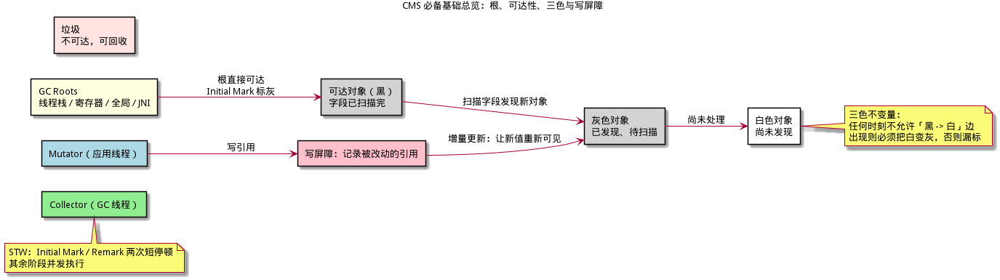
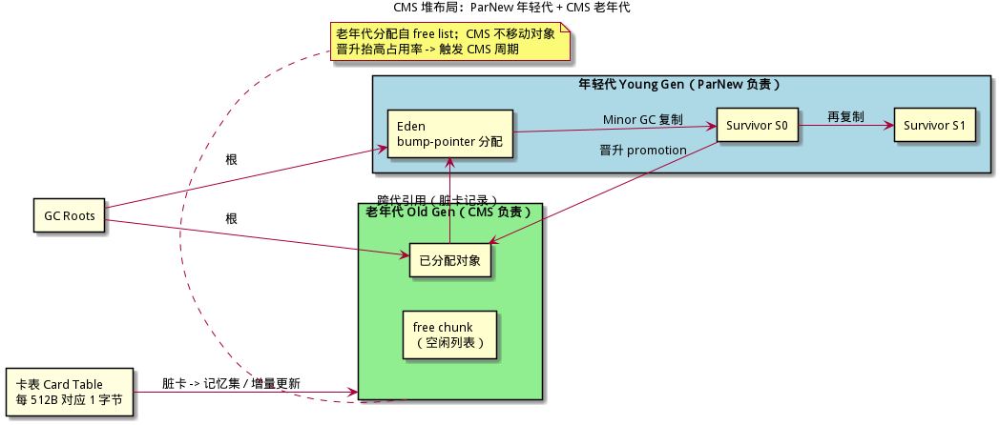
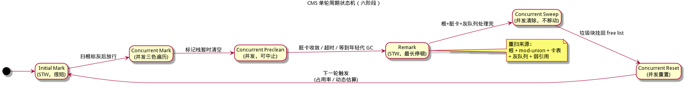
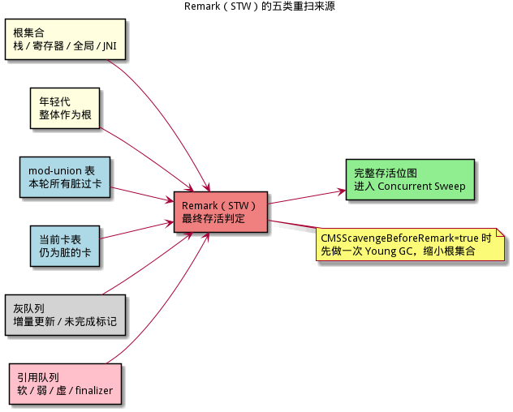
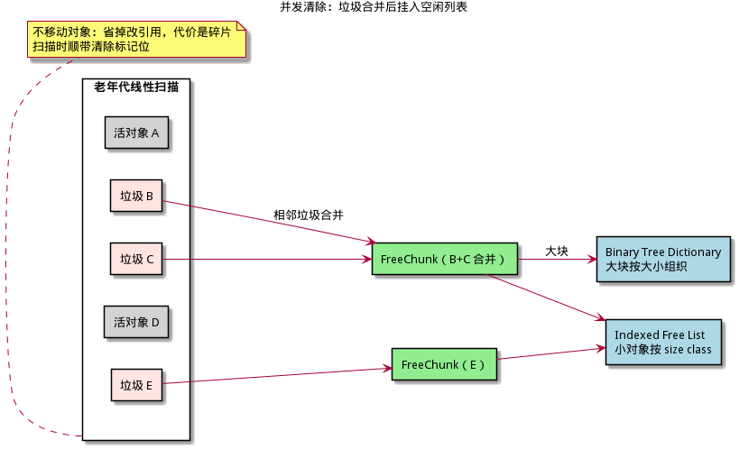
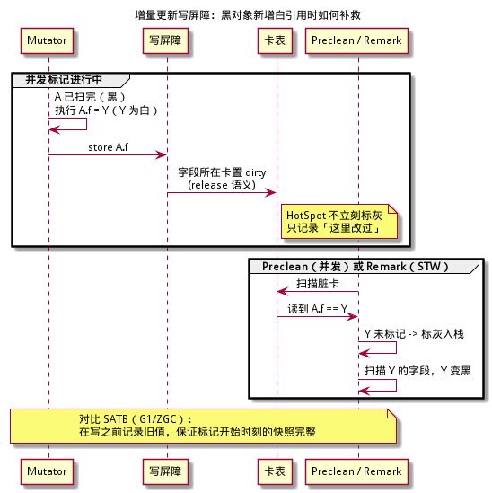
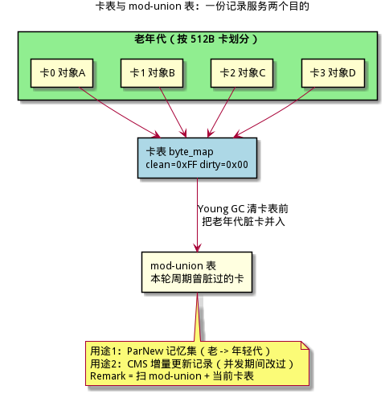
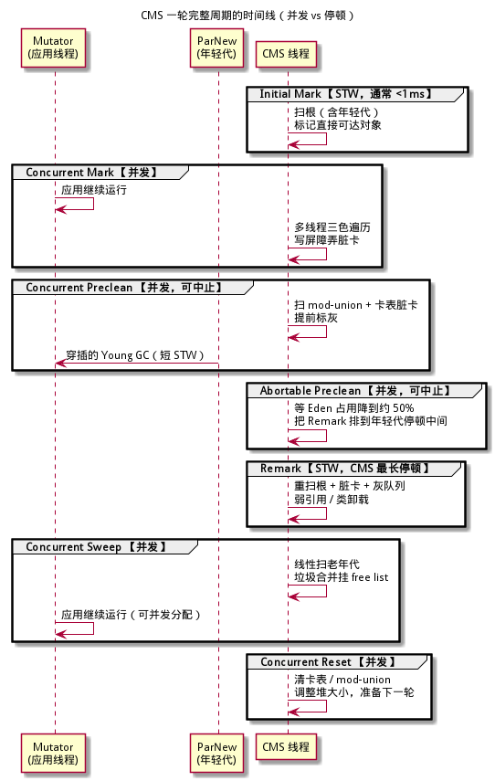
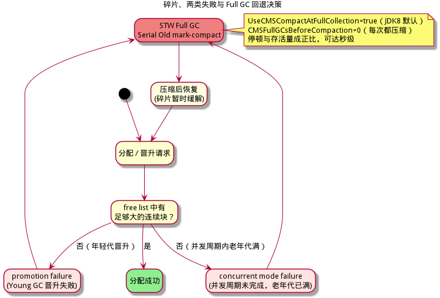

# CMS 算法详解 —— 首个主流并发收集器

> **面向读者**：完全没有 GC（垃圾回收）背景的开发者。本文从"内存为什么要回收"讲起，一路拆到 OpenJDK 经典收集器 CMS（Concurrent Mark Sweep，并发标记清除）的每一个阶段、每一处写屏障、每一条失败回退路径。
> **目标**：读完并配合文末伪代码，你能独立实现一个"ParNew 年轻代 + CMS 老年代"的收集器；本文所有示意图均由 PlantUML 生成，源文件在同目录 `figures/` 下（`.puml`）可复编译。
>
> **本系列（建议按序阅读）**：[Serial / Parallel 分代](../serial-parallel-算法详解/serial-parallel-算法详解.md) · [CMS](cms-算法详解.md) · [G1](../g1-算法详解/g1-算法详解.md) · [Shenandoah](../shenandoah-算法详解/shenandoah-算法详解.md) · [Go GC](../go-gc-算法详解/go-gc-算法详解.md) · [ZGC](../zgc-算法详解/zgc-算法详解.md)
>
> **基础从哪来**：本文 §1 是自足速览；想深入三色抽象、读屏障、并发标记正确性，请看
> [ZGC 算法详解 §1–3](../zgc-算法详解/zgc-算法详解.md)；分代假说、Eden/Survivor、卡表与记忆集的完整推导，请看
> [Serial / Parallel 算法详解](../serial-parallel-算法详解/serial-parallel-算法详解.md)。
>
> **与 xgc 仓库的关系**：本文是"算法原理/教学"文档；xgc 自身的工程实现细则见
> [implementation-guide/05-算法实现详解.md](../implementation-guide/05-算法实现详解.md) 等系列文档。

---

## 目录

1. [必备基础：15 分钟速览](#1-必备基础15-分钟速览)
2. [CMS 是什么：定位、历史与目标](#2-cms-是什么定位历史与目标)
3. [堆布局：ParNew 年轻代 + CMS 老年代](#3-堆布局parnew-年轻代--cms-老年代)
4. [总体设计：六阶段与三大基石](#4-总体设计六阶段与三大基石)
5. [六阶段逐阶段详解](#5-六阶段逐阶段详解)
6. [增量更新写屏障、卡表与 mod-union 表](#6-增量更新写屏障卡表与-mod-union-表)
7. [并发正确性：为什么 remark 一定能收敛](#7-并发正确性为什么-remark-一定能收敛)
8. [单轮完整流程与真实日志追踪](#8-单轮完整流程与真实日志追踪)
9. [碎片、promotion failure 与 concurrent mode failure](#9-碎片promotion-failure-与-concurrent-mode-failure)
10. [参数、默认值与调优](#10-参数默认值与调优)
11. [从零实现一个 CMS：最小可行路线](#11-从零实现一个-cms最小可行路线)
12. [关键数据结构与伪代码](#12-关键数据结构与伪代码)
13. [与同类算法对比](#13-与同类算法对比)
14. [术语速查表](#14-术语速查表)
15. [延伸阅读与参考](#15-延伸阅读与参考)

---

## 1. 必备基础（15 分钟速览）

> 本节完全自足：即使你从没接触过 GC，读完也能继续。已经懂的读者可跳到 §2。

### 1.1 对象、堆与根

程序运行时不断创建对象（`new` 一个结构体或类实例），它们放在一片叫**堆（Heap）**的内存里。一个对象什么时候可以销毁？答案是：**当程序再也访问不到它时**。

怎么判断"访问不到"？从一组确定的入口出发，顺着对象里的引用一路走：

- 走得到的对象，是**可达的（reachable）**，必须保留；
- 走不到的，是**不可达的（unreachable）**，即垃圾，可以回收。

这组入口叫 **GC 根（GC Roots）**，典型包括：

- 线程栈上的局部变量、参数、返回地址处的引用；
- CPU 寄存器里的引用；
- 全局 / 静态变量引用的对象；
- JNI / 宿主 VM 持有的引用。

| 角色 | 英文 | 职责 |
|------|------|------|
| 应用程序 | **Mutator**（改变者） | 跑用户代码，不断创建、改写、读取对象 |
| 垃圾回收器 | **Collector**（收集器） | 找出并回收不可达对象，管理空闲内存 |



### 1.2 STW 与三大指标

最朴素的做法：GC 先**停下所有 Mutator**（**STW = Stop-The-World，停止世界**），扫完、回收完再放行。好处是正确性容易保证，坏处是**停顿（Pause）**。衡量 GC 的三大指标：

| 指标 | 英文 | 含义 |
|------|------|------|
| 吞吐 | Throughput | 有用工作时间占总时间的比例 |
| 延迟 / 停顿 | Latency / Pause | 单次 STW 有多长，最坏有多长 |
| 占用 | Footprint | GC 自身额外消耗多少内存与 CPU |

传统 Serial / Parallel 追求吞吐，容忍长 STW；CMS 的目标是**把长时间工作搬到并发阶段，只留下两个短 STW**。

### 1.3 三色抽象与漏标

并发标记的正确性用**三色抽象（Tri-color Abstraction）**描述：

| 颜色 | 含义 |
|------|------|
| **白（White）** | 本轮标记还没发现它（可能活、可能死） |
| **灰（Grey）** | 已发现，但字段还没扫描完（在待办队列里） |
| **黑（Black）** | 字段已全部扫描完，确定存活 |

遍历就是：白 → 灰（入队）→ 黑（扫完出队）。没有灰色对象时，剩下的白色就是垃圾。

**并发正确性判据**：任何时刻都不允许出现「黑对象直接指向白对象」的边，否则那个白对象可能永远不被发现，被误回收，造成**漏标（对象被错误回收）**。

出现黑→白边只有一种途径：Mutator 往一个已扫完的黑色对象里写入了一个白色引用。解决它有两派：

- **增量更新（Incremental Update，Dijkstra 风格）**：写入时把**新值**重新变灰/记录，让白对象重新可见。CMS 采用这一派。
- **快照（SATB，Yuasa 风格）**：写入时记录**旧值**，保证"标记开始那一刻的存活图"被完整保留。G1、Shenandoah、ZGC 采用这一派。

两派的对比见 §6.4。

### 1.4 屏障、卡表与记忆集

Mutator 每次写引用，编译器/解释器都可以插入一小段代码，叫**写屏障（Write Barrier / Store Barrier）**。它是 GC 唯一能"偷看" Mutator 改动的窗口。

- **卡表（Card Table）**：把堆按固定大小切块（HotSpot 里一块 **512 字节**，即 `card_shift=9`），每块对应卡表里 1 个字节；写屏障把被改写的区域对应的卡标记为"脏（dirty）"。
- **记忆集（Remembered Set，RSet）**：记录"老年代哪些位置可能有指向年轻代的引用"。分代 GC 把 RSet 当作根的一部分，避免每次年轻代 GC 都扫整个老年代。
- **mod-union 表**：CMS 在并发周期里额外维护的"脏卡并集"（详见 §6.3）。

CMS 的高明之处，正是**复用同一张卡表同时服务两个目的**：年轻代跨代引用 + 并发标记的增量更新记录。

> **一句话总结**：根决定"谁是活的"，三色描述"标记到哪了"，写屏障 + 卡表让 GC 在 Mutator 不停的情况下仍能知道"哪里被改过"。

---

## 2. CMS 是什么：定位、历史与目标

### 2.1 一句话

> **CMS（Concurrent Mark Sweep，并发标记清除）**是 HotSpot 的**老年代并发标记-清除**收集器：它把"标记可达对象"和"清除垃圾"的主体工作放到 Mutator 运行期间并发执行，只保留两次短暂的 STW——**Initial Mark（初始标记）**与 **Remark（重新标记）**。

### 2.2 历史与版本

| 时间 | 事件 |
|------|------|
| J2SE 1.4.1 | CMS 首次出现在 HotSpot，可用 `-XX:+UseConcMarkSweepGC` 选择（当时还有 `-XX:+UseParNewGC` 并行年轻代） |
| J2SE 5.0（JDK 5） | 随分代 / ergonomics 一起成为主流可用选项；`-XX:+UseConcMarkSweepGC` 同时启用 ParNew |
| JDK 6 | 并发标记并行化；`-XX:+ExplicitGCInvokesConcurrent` 让 `System.gc()` 走并发周期；默认年轻代更大 |
| JDK 7 | `CMSClassUnloadingEnabled`、`CMSParallelInitialMarkEnabled` 默认关闭 |
| JDK 8 | 两者默认开启；`UseCMSCompactAtFullCollection` 默认 true；CMS 的黄金年代 |
| JDK 9 | **JEP 291**：废弃 CMS，命令行使用 `-XX:+UseConcMarkSweepGC` 会告警；G1 成为默认收集器 |
| JDK 14 | **JEP 363**：彻底移除 CMS；该选项变成"忽略并告警"，VM 用默认收集器继续运行 |

CMS 的里程碑意义：**它是第一个把标记与清除主体放到并发阶段的工业级主流收集器**。G1 的卡表/记忆集、SATB 屏障、并发周期，ZGC/Shenandoah 的并发思想，都能在 CMS 身上找到源头；而 CMS 遗留的**碎片**与**失败回退**问题，也正是后两代收集器要解决的核心。

### 2.3 组合拳：ParNew + CMS

CMS 只负责老年代。年轻代交给 **ParNew**——Serial 收集器的多线程版本，STW 复制收集：

| 代 | 收集器 | 算法 | 是否 STW |
|----|--------|------|----------|
| 年轻代 | **ParNew** | 并行复制（Eden/S0/S1） | 是（但很短） |
| 老年代 | **CMS** | 并发标记-清除（不移动对象） | 大部分并发，两次短 STW |

在 JDK 8 中，`-XX:+UseConcMarkSweepGC` 会自动启用 ParNew（源码注释："If we are using CMS, we prefer to UseParNewGC, unless explicitly forbidden"）。因此常说的"CMS 收集器"其实是"**ParNew + CMS 组合**"。

### 2.4 适用场景

- 老年代大、对象长寿、希望**停顿短且可接受**的在线服务（Web、缓存、消息中间件）；
- 多核机器（并发阶段会与业务抢 CPU）；
- 堆大小中等偏大（几 GB 到几十 GB），且分配速率别太疯狂。

> **常见误区**：CMS 不是"零停顿收集器"。它有两处 STW（Initial Mark、Remark），外加 ParNew 每次年轻代 GC 的 STW。它的卖点是"把长停顿拆成短停顿 + 并发"，不是"没有停顿"。

> **一句话总结**：CMS = ParNew 管年轻代 + 并发标记清除管老年代，用两次短 STW 换掉了一次长 Full GC。

---

## 3. 堆布局：ParNew 年轻代 + CMS 老年代



### 3.1 年轻代（ParNew 负责）

- 分为 **Eden** 与两个 **Survivor（S0 / S1）**，默认比例由 `-XX:SurvivorRatio` 控制；
- 对象先在 Eden 分配（TLAB + bump-the-pointer，极快）；
- **Minor GC / Young GC**：ParNew 多线程 STW，把 Eden + 一个 Survivor 里的活对象复制到另一个 Survivor（年龄 +1），清空原空间；
- 年龄超过阈值（CMS 下默认 `MaxTenuringThreshold=6`，见源码 `tenuring_default = 6`）或 Survivor 放不下的对象**晋升（promotion）**到老年代。

### 3.2 老年代（CMS 负责）

- 一整块连续空间，用**空闲列表（free list）**分配，不移动对象；
- CMS 并发周期只处理老年代；清除后空闲块挂回 free list；
- 由于不移动，**必然产生碎片**（§9）。

### 3.3 两代如何互相触发

两代是**互相的根**：老年代对象可以引用年轻代对象，年轻代对象也可以引用老年代对象。

- **年轻代 → 老年代**：年轻代 GC 不回收老年代，但会把年轻代里指向老年代的引用当作根扫描，让 CMS 标记不漏；
- **老年代 → 年轻代**：靠卡表记忆集，年轻代 GC 只扫"脏卡"里的老年代对象，不扫整个老年代；
- **promotion 触发 CMS**：年轻代晋升把对象塞进老年代，抬高老年代占用率；当占用超过触发阈值，CMS 线程启动并发周期；
- **Minor GC 穿插在 CMS 周期中间**：并发标记 / 清除期间可以随时插入若干次 ParNew STW（每次都很短），这正是"两次短停顿"而不是"两次长停顿"的原因。

### 3.4 两个 STW 的排布

- **Initial Mark**：通常很短，紧随其后进入并发标记；
- **Remark**：比 Initial Mark 长，且会重扫根与脏卡。CMS 会尽量把 Remark **排在两次年轻代停顿的正中间**（避免"Remark 停完紧接着又来一次 Young GC"被应用感知为一次超长停顿）；
- 可选 `-XX:+CMSScavengeBeforeRemark`：在 Remark 前先做一次 Young GC，把 Eden 清空、幸存对象归拢，显著缩小 Remark 要重扫的年轻代根集合。

> **一句话总结**：年轻代用 ParNew 复制、老年代用 CMS 并发清除；晋升把压力从年轻代传导到老年代，从而触发 CMS 周期。

---

## 4. 总体设计：六阶段与三大基石

### 4.1 核心思想

> **把"标记"和"清除"拆成并发阶段跑，只在两端用两个短 STW 卡住正确性：Initial Mark 建立初始灰色集合，Remark 用写屏障记录把并发期间漏掉的引用补齐。**

### 4.2 三大基石

| 基石 | 解决什么 | 章节 |
|------|----------|------|
| **增量更新写屏障 + 卡表** | 并发标记期间 Mutator 改引用不漏标 | §6 |
| **Preclean + mod-union 表** | 把 Remark 的工作提前并发做掉，缩短 STW | §5.3、§6.3 |
| **空闲列表 + Full GC 回退** | 不移动对象带来的碎片用回退 mark-compact 兜底 | §9 |

### 4.3 六阶段一览

| # | 阶段 | 停不停 | 一句话 |
|---|------|--------|--------|
| 1 | Initial Mark（初始标记） | **STW** | 从 GC Roots（含年轻代）标记直接可达对象，很快 |
| 2 | Concurrent Mark（并发标记） | 并发 | 多线程三色遍历整个老年代可达图 |
| 3 | Concurrent Preclean（并发预清理，可中止） | 并发 | 提前扫脏卡、消化增量更新记录，缩短 Remark |
| 4 | Remark（重新标记） | **STW** | 停世界，清空灰色队列、重扫根与脏卡、处理弱引用 |
| 5 | Concurrent Sweep（并发清除） | 并发 | 线性扫老年代，把不可达块合并挂回 free list |
| 6 | Concurrent Reset（并发重置） | 并发 | 清卡表 / mod-union，重置状态，准备下一轮 |



> **一句话总结**：CMS 一轮 = 两次 STW 夹住三段并发标记/预清理，再跟两段并发清除/重置。

---

## 5. 六阶段逐阶段详解

### 5.1 Initial Mark（初始标记，STW）

| 项目 | 内容 |
|------|------|
| 目的 | 建立本轮标记的**初始灰色集合**：所有从根直接可达的对象 |
| 是否 STW | 是，但**很短**（只扫根，不递归遍历） |
| 输入 | GC Roots：线程栈、寄存器、全局/静态、JNI、**年轻代整体**（年轻代对象可能直接引用老年代） |
| 输出 | 标记位图（mark bitmap）中被置位的对象 + 压入标记栈的灰色对象 |
| 失败会怎样 | 基本不会失败；若此时正好有 Full GC 请求，会被抢占，走 STW Full GC |

要点：

- Initial Mark 只处理"根的直接邻居"，不往下走，所以工作量与堆大小无关，日志里通常是零点几毫秒；
- JDK 8 默认 `CMSParallelInitialMarkEnabled=true`，初始标记本身也是并行多线程的（JDK 7 默认串行）；
- 年轻代在 Initial Mark 中被当作根整体扫描：年轻代对象在老年代里的引用必须让 CMS 看到；
- 标记信息写在**独立的 mark bitmap** 里（不是对象头），这与 ZGC 的染色指针完全不同——CMS 不需要额外指针位，代价是要维护一张位图。

### 5.2 Concurrent Mark（并发标记）

| 项目 | 内容 |
|------|------|
| 目的 | 从初始灰色集合出发，并发遍历老年代可达图，标记所有存活对象 |
| 是否 STW | 否，由 `ConcGCThreads` 个并发 GC 线程执行（默认 `(ParallelGCThreads+3)/4`） |
| 输入 | 标记栈里的灰对象 + 写屏障持续记录的脏卡 |
| 输出 | 完整的存活位图（理想情况下）；中途改引用产生的额外灰对象 |
| 失败会怎样 | 标记栈溢出则用"溢出链表"继续；若老年代在此期间被填满，触发 concurrent mode failure → Full GC（§9） |

工作循环（每个并发线程）：

1. 从标记栈/工作队列弹出一个灰对象；
2. 扫描它的每个引用字段：若指向老年代且未标记，则**标灰并压栈**；
3. 对象字段扫完，变黑；
4. Mutator 的写屏障在背后不断把"新写入的引用"所在卡置脏（§6），这些卡会在 preclean/remark 被消费。

两个关键实现细节：

- **新分配对象视为存活**：并发标记开始后，Mutator 在老年代新分配的对象，标记器可能已经"扫过它所在的地址"。因此 CMS 在分配时直接把它**标记为存活（灰）**，并额外用 P-bits 标出"未初始化/对象结尾"，让并发扫描能安全跳过尚未构造完的对象（源码 `direct_allocated()`）。
- **晋升对象也视为存活**：年轻代 GC 晋升到老年代的对象，在 STW 中直接标活，并把对应 mod-union 位弄脏（源码 `promoted()`）。

### 5.3 Concurrent Preclean（并发预清理，可中止）

| 项目 | 内容 |
|------|------|
| 目的 | **把 Remark 要做的脏卡扫描提前并发做掉**，让 Remark 尽量短 |
| 是否 STW | 否；`CMSPrecleaningEnabled=true`（默认） |
| 输入 | mod-union 表 + 卡表里的脏卡、标记栈残留的灰对象、引用列表 |
| 输出 | 被提前标灰/标黑的对象；脏卡被消费（清零） |
| 失败会怎样 | 可中止（abort）：没做完就交给 Remark 补；`CMSMaxAbortablePrecleanTime=5000ms` 兜底 |

**为什么需要 preclean？** Remark 必须停世界。停世界后要重扫的东西越多，停顿越长。并发标记期间 Mutator 疯狂改引用，会留下海量脏卡。如果在并发阶段就一遍遍扫脏卡、把新引用指向的对象标灰，等 Remark 开始时剩下的脏卡就很少了，Remark 自然短。

Preclean 分两段：

1. **Concurrent Preclean（常规）**：对 mod-union 表和卡表做若干轮"扫脏卡 → 标灰 → 再扫"的迭代，带收敛判据：
   - `CMSPrecleanIter=3`：最多迭代 3 轮；
   - `CMSPrecleanThreshold=1000`：脏卡少于 1000 张就别迭代了，直接进 Remark；
   - `CMSPrecleanNumerator=2 / CMSPrecleanDenominator=3`：如果脏卡数量没有按 2/3 比例下降，说明"清得没有脏得快"，立即放弃。
2. **Abortable Preclean（可中止预清理）**：等一次年轻代 GC 发生，让 Eden 占用降到 **`CMSScheduleRemarkEdenPenetration=50%`**，再把 Remark 排在年轻代停顿正中间：
   - `CMSScheduleRemarkEdenSizeThreshold=2MB`：Eden 用量低于 2MB 就不等了，直接 Remark；
   - `CMSMaxAbortablePrecleanTime=5000ms`：最多等 5 秒；
   - `CMSAbortablePrecleanWaitMillis=100ms`：每轮之间睡 100ms。

> **一句话总结**：Preclean 就是"把 Remark 的作业提前并发做完"，是 CMS 把第二次 STW 压短的关键。

### 5.4 Remark（重新标记，STW）

| 项目 | 内容 |
|------|------|
| 目的 | 在 Mutator 停止的前提下，补齐并发期间所有漏标，得到**完整存活集** |
| 是否 STW | 是；CMS 周期里最长的一次停顿 |
| 输入 | 根集合、当前卡表脏卡、mod-union 表、标记栈残留灰对象、引用队列 |
| 输出 | 最终存活位图；弱引用/软引用清理结果；类卸载结果（可选） |
| 失败会怎样 | 停顿时若发现需要扩容等，正常完成；若此时老年代已满，同样转入 Full GC |



Remark 具体做五件事：

1. **清空标记栈**：处理增量更新写屏障留下的灰对象，以及 preclean 没来得及处理的灰对象；
2. **重扫根**：线程栈/寄存器/全局/JNI + **年轻代**（年轻代是天然的根）；可选 `CMSScavengeBeforeRemark` 先做一次 Young GC 缩小这部分；
3. **重扫脏卡**：把 mod-union 表和卡表里仍为脏的卡全部扫一遍，卡内引用指向的未标记对象标灰；
4. **处理引用**：软引用、弱引用、虚引用、finalizer 的存活判定（引用对象只有在被强引用时才算活）；
5. **类卸载**（`CMSClassUnloadingEnabled=true` 时）：卸载不可达的类元数据。

JDK 8 默认 `CMSParallelRemarkEnabled=true`，重扫工作在多线程间按卡区间（`CMSRescanMultiple=32` 张卡一个任务）切分并行执行。

### 5.5 Concurrent Sweep（并发清除）

| 项目 | 内容 |
|------|------|
| 目的 | 回收不可达对象，把空间挂回空闲列表供后续分配 |
| 是否 STW | 否；单个（或增量）GC 线程执行，可与 Mutator 分配并发 |
| 输入 | 最终存活位图 |
| 输出 | 空闲块（free chunk）挂入 free list；位图逐步清零 |
| 失败会怎样 | 清除期间分配失败（碎片/无块）→ Full GC；清除本身不做移动，不会破坏引用 |



要点：

- 线性扫描整个老年代（按地址顺序），对每块内存判断"是对象且被标记"还是"垃圾"；
- **不移动对象**：这是 CMS 不产生更新引用开销的原因，也是碎片的根源；
- 连续的垃圾块会被**合并（coalesce）**成一个大的 FreeChunk；
- 合并后的块按大小挂到**空闲列表**：
  - 小对象用**按 size class 索引的 free list**（`IndexedFreeListArray`，每个大小档一条链表）；
  - 大块用**平衡树字典（binary tree dictionary）**按大小组织，方便找"最合适的大块"；
  - 相邻空闲块在插入时继续尝试合并（`CompactibleFreeListSpace` 的合并逻辑）。
- 扫描过程中顺带把存活对象的标记位清掉（省掉单独的"清位图"阶段）；
- Sweep 与 Mutator 分配通过 free list 锁互斥；若分配太急，Sweep 会让步，甚至被 Full GC 打断。

### 5.6 Concurrent Reset（并发重置）

| 项目 | 内容 |
|------|------|
| 目的 | 为下一轮周期准备干净的数据结构 |
| 是否 STW | 否 |
| 输入 | 刚结束的周期状态 |
| 输出 | 清空的 mod-union 表与卡表、重置的标记位图、按 `MinHeapFreeRatio/MaxHeapFreeRatio` 调整后的堆大小 |
| 失败会怎样 | 无失败路径；若堆需要收缩/扩张，按比例调整 |

Reset 之后 CMS 线程进入 `Idling`，等待下一次触发。

> **一句话总结**：Initial Mark 建灰集，Concurrent Mark 走可达图，Preclean 提前扫脏卡，Remark 补齐并收敛，Sweep 并发回收，Reset 打扫战场准备下一轮。

---

## 6. 增量更新写屏障、卡表与 mod-union 表

### 6.1 增量更新的语义

三色不变量要求：**不能存在"黑 → 白"的边**。Dijkstra 的**插入屏障（Insertion Barrier）**做法是：

```
*field = new_value;          // Mutator 写入
if (new_value is white)      // 屏障检查
    mark_grey(new_value);    // 让新值重新可见
```

这样即使黑色对象新增了一条指向白对象的边，白对象也会立刻变灰，重新进入标记队列，不会漏标。

### 6.2 HotSpot CMS 的实际实现：卡表脏标记

如果每次写引用都同步判断颜色、标灰、入队，写屏障成本会很高。CMS 选择了更便宜的方案：

> **写引用时，只把该字段所在的卡标记为脏（card dirty）；并发 preclean / STW Remark 扫到脏卡时，再把卡内引用指向的、未标记的老年代对象标灰入队。**

这就是"粗粒度记录 + 延迟精确处理"。语义上等价于插入屏障（新值最终会被重新发现），成本却只有一次字节写。



HotSpot 的实现细节（源码级）：

- 卡表每卡 **512 字节**（`CardTableModRefBS::card_shift=9`）；
- 屏障写卡时对脏值使用 **release 语义**（`OrderAccess::release_store`），保证别的线程看到"脏"时也一定能看到新引用；
- 屏障是**不精确（imprecise）**的：普通对象改字段时弄脏的是**对象头所在的卡**，不一定是字段所在卡；只有对象数组是精确到元素的（源码注释明确说明）。扫描脏卡时必须容忍这一点，从对象头开始解析。

### 6.3 卡表的两个用途与 mod-union 表

同一张卡表在 CMS 组合里承担两件事：

| 用途 | 谁消费 | 记录什么 |
|------|--------|----------|
| 年轻代跨代引用（记忆集） | ParNew | 老年代里指向年轻代的引用，让 Young GC 只扫脏卡 |
| 并发标记增量更新 | CMS preclean / Remark | 并发期间 Mutator 改过的老年代区域 |



问题来了：**并发周期中间会穿插多次 Young GC，而 Young GC 会清空/复用卡表**。如果不清就丢记录，清了又可能丢并发标记的记录。CMS 的答案是 **mod-union 表（ModUnionTable）**：

- 它是一个与卡表同粒度的位图，记录"**本轮 CMS 周期内曾经脏过的老年代卡**"；
- 在**每次年轻代 GC 清卡表之前**，CMS 先把老年代当前脏卡信息**并（union）进 mod-union 表**，再让 Young GC 清卡；
- Initial Mark 时也会做一次 mod-union 更新，把周期开始前的脏卡纳入；
- 这样无论中间清了多少次卡表，本轮周期里脏过的卡都能在 mod-union 表里找到；
- **Remark 同时扫 mod-union 表和当前卡表**，不会漏掉任何一次改动；
- 新晋升对象也会把自己的卡在 mod-union 表里弄脏（源码 `promoted()`），确保 Remark 会扫描它。

> **一句话总结**：卡表是"当前谁脏"，mod-union 表是"本轮曾经谁脏"；Young GC 可以随意清卡表，但 mod-union 保证 Remark 拿得到完整账本。

### 6.4 增量更新 vs SATB

| 维度 | 增量更新（CMS） | SATB 快照（G1 / Shenandoah / ZGC） |
|------|------------------|-------------------------------------|
| 屏障位置 | **写后**（post-write） | **写前**（pre-write） |
| 记录什么 | 新值（新引用指向的对象） | 旧值（被覆盖掉的引用） |
| 实现载体 | 卡表脏标记 + 延迟扫卡 | 每字段捕获旧值入队（常配卡表/队列） |
| 漏标防护 | 黑→白边出现时把白变灰 | 保证"标记开始时的快照"完整，旧值不入队则新值入队 |
| 浮动垃圾 | 标记中途变垃圾的**已标记**对象本轮留着 | 快照时刻之后变垃圾的对象本轮留着；**快照时刻前刚死的对象也会留一轮** |
| 收敛方式 | Remark 重扫脏卡 + 灰队列 | Final Mark 清空 SATB 队列 + 重扫根 |
| 对 CMS 的收益 | 复用既有卡表，几乎零新增结构；preclean 可提前消化 | 更适合 region 化回收与并发整理 |

CMS 选择增量更新的根本原因：HotSpot 已经有为分代收集服务的卡表写屏障，**直接复用最便宜**；而 SATB 需要在每个引用字段上做写前记录，代价更高。

> **常见误区**："增量更新 = 写的时候立刻把新值标灰。" 在 HotSpot CMS 里不是——写屏障只弄脏卡，真正标灰发生在 preclean/Remark 扫卡时。理解成"延迟标灰"才不会推导错。

---

## 7. 并发正确性：为什么 remark 一定能收敛

### 7.1 不漏标论证

设并发标记开始时（Initial Mark 结束）所有根可达对象都被标灰/标黑。之后 Mutator 可能制造"黑 → 白"边，只有这一种途径会造成漏标。逐条堵死：

1. **Mutator 把白对象写进黑对象**：写屏障弄脏对应卡；preclean 或 Remark 扫描该卡时发现这个白对象，标灰入队；即使 preclean 没扫到，Remark 也会扫（卡仍在 mod-union 或卡表里）。
2. **Mutator 把引用从 A 移到 B**：新边所在卡变脏，同上处理。
3. **并发期间新分配的老年代对象**：分配时直接标灰（allocate-live），且它内部引用的写入会弄脏卡，从而在 preclean/Remark 被扫描。
4. **并发期间晋升的对象**：晋升发生在 STW 的 Young GC 中，直接标灰，并弄脏 mod-union。
5. **年轻代对象引用老年代**：年轻代整体在 Initial Mark 和 Remark 都作为根扫描；中间新生/改动的跨代引用由 Young GC 的卡表机制与 mod-union 覆盖。

因此 Remark 结束时（Mutator 已停），**不存在任何未处理的"黑→白"边**。

### 7.2 Remark 为什么收敛

Remark 是一个有界工作量的固定点计算：

- Mutator 停了，不再产生新的脏卡/新边；
- 输入是有限集合：根 + mod-union 脏卡 + 卡表脏卡 + 灰队列；
- 处理灰对象只增不减，每个对象最多被标灰一次（CAS 保证）；
- 弱引用处理依赖强引用标记结果，而强引用标记已经完成；
- 所以工作队列必然清空，算法终止。

### 7.3 浮动垃圾（Floating Garbage）

并发标记期间被标记为存活、但在周期结束前又变成垃圾的对象，本轮**回收不到**，留到下一轮，称为**浮动垃圾**。

- 产生原因：标记与 Mutator 并发，标记的"快照"不是瞬时的；
- 为什么无害：它们仍是**可达性正确的**（不会误回收任何活对象），只是延迟回收；
- 代价：老年代需要预留额外空间。Oracle 调优指南建议：为浮动垃圾**把老年代容量放大 20% 左右**；
- 与触发阈值的关系：`CMSInitiatingOccupancyFraction` 不能太接近 100%，否则周期还没跑完堆就满了 → concurrent mode failure。

### 7.4 常见误区

> 误区一："Remark 只需要扫灰色对象。" 正解：还要重扫根与所有脏卡，因为写屏障只记录了"哪里改过"。
>
> 误区二："CMS 不会误回收活对象，所以随便怎么调都安全。" 正解：正确性成立的前提是**精确根 + 精确对象布局 + 屏障不被绕过**。任何 JIT/解释器漏插屏障、元数据描述错字段，都会破坏论证。

> **一句话总结**：写屏障负责"记账"，preclean/Remark 负责"清账"，Mutator 停下后账目有限，所以一定能收敛。

---

## 8. 单轮完整流程与真实日志追踪

### 8.1 时间线



典型 JDK 8 日志（Oracle 官方示例，节选）：

```
[GC (CMS Initial Mark) [1 CMS-initial-mark: 13991K(20288K)] 14103K(22400K), 0.0023781 secs]
[CMS-concurrent-mark-start]
[GC (Allocation Failure) [ParNew: 2112K->64K(2112K), 0.0837052 secs] 16103K->15476K(22400K)]
...
[CMS-concurrent-mark: 0.267/0.374 secs]
[CMS-concurrent-preclean-start]
[CMS-concurrent-preclean: 0.044/0.064 secs]
[CMS-concurrent-abortable-preclean-start]
[CMS-concurrent-abortable-preclean: ...]
[GC (CMS Final Remark) [YG occupancy: ...][Rescan (parallel) , ...][weak refs processing, ...][class unloading, ...] 0.0210460 secs]
[CMS-concurrent-sweep-start]
[CMS-concurrent-sweep: 0.291/0.662 secs]
[CMS-concurrent-reset-start]
[CMS-concurrent-reset: 0.016/0.016 secs]
```

注意：`CMS-concurrent-mark: 0.267/0.374` 的两个数字分别是**并发墙钟时间 / 含停顿的总时间**；ParNew 的 `DefNew/ParNew` 日志会穿插在 CMS 并发阶段之间。

### 8.2 追踪例一：并发标记期间 Mutator 改引用

场景：黑色对象 `A`（已扫完）原本指向对象 `X`；并发标记期间 Mutator 执行 `A.f = Y`，`Y` 是老年代白对象。

```
时刻 T0  Concurrent Mark 正在跑；A 已被扫描，颜色=黑；Y 未被发现，颜色=白
时刻 T1  Mutator: A.f = Y
         写屏障：把 A 对象头所在卡（或 f 所在卡）标记为 dirty（release 语义）
时刻 T2  Preclean 扫到这张脏卡：
         读出 A.f == Y；Y 未标记 → 标灰、压入标记栈
时刻 T3  并发标记线程弹出 Y，扫描 Y 的字段，Y 变黑
时刻 T4  Remark（STW）：
         - 清空剩余灰队列（无遗漏）
         - 重扫根 + mod-union + 当前卡表（此卡已在 preclean 被清零，不重复）
         - 弱引用/类卸载处理
         最终位图完整，Y 存活
```

变体：若 Mutator 后来又把 `A.f` 改回指向 `X`，`Y` 变成浮动垃圾——本轮已标记所以不回收，下一轮周期回收。

### 8.3 追踪例二：一次 concurrent mode failure 回退

场景：老年代 1GB，`CMSInitiatingOccupancyFraction=92`，业务分配速率突然翻倍。

```
t0  老年代占用 92%，CMS 线程启动周期：Initial Mark（STW 0.5ms）
t1  Concurrent Mark 进行中，老年代占用继续上涨
t2  Mutator 分配老年代对象，free list 中找不到足够大的连续块
t3  老年代占用触及 100%，CMS 无法在并发期间完成回收
    → 报 "concurrent mode failure"
t4  VMThread 抢占，执行 STW Full GC（Serial Old / MarkSweepCompact）：
    - 标记-整理整个堆（含老年代压缩）
    - 清除全部垃圾、消除碎片
    - 停顿可达数百 ms 到数秒（与存活对象量成正比）
t5  恢复运行；CMS 重置周期状态；由于本次 Full GC 已压缩，
    碎片暂时缓解，但下一轮仍可能重演
```

日志形态：`[Full GC (Allocation Failure) ... [CMS: ...] ...` 或带 `(concurrent mode failure)` 字样。根因通常是三选一：**触发太晚**（占用率设太高）、**分配太快**（并发线程追不上）、**碎片太多**（大对象没有连续块）。

> **一句话总结**：正常一轮是"两停三并发"；改引用靠屏障记账、preclean 清账；追不上分配速率就退回 STW Full GC。

---

## 9. 碎片、promotion failure 与 concurrent mode failure



### 9.1 碎片从哪来

CMS 并发清除**不移动对象**，只在原地把垃圾块合并挂回 free list。运行久了会出现：

- 空闲内存总量够，但都是小洞，**分配不出连续的大块**；
- 大对象（大数组、大缓存条目）尤其容易失败；
- free list 的 size class 与合并只能缓解，不能根治——因为洞与洞之间隔着活对象。

### 9.2 promotion failure（晋升失败）

年轻代 GC 想把存活对象晋升到老年代时，**老年代没有足够大的连续空闲块**容纳这个对象。此时：

- Young GC 失败，置 `incremental_collection_failed`；
- 触发 STW **Full GC**（MarkSweepCompact），压缩老年代、腾出连续空间；
- 特点：可能发生在老年代总空闲量其实不少、但碎片严重的时候。

### 9.3 concurrent mode failure（并发模式失败，CMF）

CMS 并发周期还没跑完（通常卡在并发标记/清除），老年代就被填满，分配无法满足：

- CMS 线程被抢占，VMThread 执行 STW **Full GC**；
- 这次 Full GC 往往同时完成标记-整理，把 CMS 这一轮的工作作废重做；
- 特点：停顿最长、最伤延迟，是 CMS 调优最需要避免的事件。

### 9.4 回退收集器与压缩策略

回退的 Full GC 用的是 **Serial Old（MarkSweepCompact）**——单线程标记-整理，压缩整个堆。

| 参数 | 默认值（JDK 8） | 作用 |
|------|------------------|------|
| `-XX:+UseCMSCompactAtFullCollection` | **true** | Full GC 时是否做压缩 |
| `-XX:CMSFullGCsBeforeCompaction` | **0** | 每多少次 Full GC 压缩一次；0 = 每次都压缩 |

两个参数在 JDK 9（JEP 291）被标记废弃，JDK 14 随 CMS 一起移除。

### 9.5 如何减少失败

- 把 `CMSInitiatingOccupancyFraction` 调低（如 70），并加 `-XX:+UseCMSInitiatingOccupancyOnly` 锁定；
- 增大老年代（`-Xmx` / `NewRatio`）；
- `-XX:+CMSScavengeBeforeRemark` 缩短 Remark，也间接减少 CMF 概率；
- 增大 `-XX:ConcGCThreads`（默认约 `ParallelGCThreads/4`），让并发周期更快跑完；
- 减少大对象的产生 / 避免频繁分配大数组；
- 监控 GC 日志里的 `promotion failed`、`concurrent mode failure`、Full GC 频率。

> **一句话总结**：不移动对象是 CMS 低延迟的来源，也是碎片与两类失败回退的来源；回退用 Serial Old mark-compact 兜底，代价是一次长 STW。

---

## 10. 参数、默认值与调优

> 默认值均来自 OpenJDK 8u `hotspot/src/share/vm/runtime/globals.hpp` 与 `gc_implementation/concurrentMarkSweep/`；个别项在 JDK 7 不同，已单独标注。

### 10.1 开关与线程

| 参数 | 默认值 | 说明 |
|------|--------|------|
| `-XX:+UseConcMarkSweepGC` | 关 | 启用 CMS；同时自动启用 ParNew（除非显式禁用） |
| `-XX:+UseParNewGC` | 由 CMS 自动打开 | 并行年轻代；JDK 9 起随 CMS 一起废弃 |
| `-XX:ConcGCThreads=<N>` | **0**（自动） | 并发 GC 线程数；为 0 时按 `(ParallelGCThreads+3)/4` 计算（源码 `FLAG_SET_DEFAULT(ConcGCThreads, (ParallelGCThreads + 3)/4)`） |
| `-XX:ParallelCMSThreads=<N>` | **0** | `ConcGCThreads` 的旧别名，设置它会直接写入 `ConcGCThreads` |
| `-XX:+CMSConcurrentMTEnabled` | true | 是否允许多线程并发阶段 |
| `-XX:+CMSParallelInitialMarkEnabled` | true（JDK 8；JDK 7 为 false） | Initial Mark 并行化 |
| `-XX:+CMSParallelRemarkEnabled` | true | Remark 并行化 |

### 10.2 触发阈值（重点，易错）

| 参数 | 默认值 | 说明 |
|------|--------|------|
| `-XX:CMSInitiatingOccupancyFraction=<N>` | **-1**（表示未设置） | 老年代占用达到百分之多少启动 CMS 周期。**默认不是 92 这个字面值**，而是 -1；为负时用下面的公式计算 |
| `-XX:CMSTriggerRatio=<N>` | **80** | 公式里的比例项 |
| `-XX:CMSBootstrapOccupancy=<N>` | **50** | 统计尚未建立时的"引导"触发占用率（首次周期用 50%） |
| `-XX:+UseCMSInitiatingOccupancyOnly` | false | true = 只用占用率触发，禁用动态估算/碎片等其它触发条件 |
| `-XX:CMSTriggerInterval=<ms>` | -1（禁用） | 每隔多少毫秒至少启动一次周期；0 = 永远启动 |

**`CMSInitiatingOccupancyFraction` 的默认计算（源码 `init_initiating_occupancy`）**：

```
若 io >= 0：  initiating_occupancy = io / 100
否则：        initiating_occupancy = (100 - MinHeapFreeRatio
                                     + CMSTriggerRatio * MinHeapFreeRatio / 100) / 100
```

JDK 8 默认 `MinHeapFreeRatio=40`、`CMSTriggerRatio=80`，代入：

```
100 - 40 + 80 * 40 / 100 = 60 + 32 = 92   →  92%
```

这与 Oracle JDK 8 调优指南的表述一致："默认启动占用阈值约为 92%，且随版本可能变化。"

触发判定（源码 `CMSCollector::shouldConcurrentCollect` + `ConcurrentMarkSweepGeneration::should_concurrent_collect`）：

1. 显式 GC 请求 / 元数据需要回收 / 增量收集将要失败 → 启动；
2. 若**未**设置 `UseCMSInitiatingOccupancyOnly`：
   - 统计有效时：`time_until_cms_start() == 0`（动态估算"周期时长 vs 剩余填满时间"）→ 启动；
   - 统计无效（首次）时：占用 ≥ `CMSBootstrapOccupancy`（50%）→ 启动；
3. 占用 > `initiating_occupancy`（默认 92%）→ 启动；
4. 若设置了 `UseCMSInitiatingOccupancyOnly`，到此为止；
5. 否则：空间因分配而扩张、free list 判断碎片过多、`CMSTriggerInterval` 到点等 → 启动。

### 10.3 停顿优化

| 参数 | 默认值 | 说明 |
|------|--------|------|
| `-XX:+CMSScavengeBeforeRemark` | false | Remark 前先做一次 Young GC，减少 Remark 要重扫的年轻代根 |
| `-XX:CMSWaitDuration=<ms>` | **2000** | CMS 线程在启动周期前等待一次年轻代 GC 的最长时间（毫秒） |
| `-XX:+CMSPrecleaningEnabled` | true | 启用并发预清理 |
| `-XX:CMSPrecleanIter=<N>` | 3 | 预清理最多迭代轮数 |
| `-XX:CMSPrecleanThreshold=<N>` | 1000 | 脏卡少于该值不再迭代 |
| `-XX:CMSScheduleRemarkEdenSizeThreshold=<bytes>` | 2M | Eden 用量低于此值不再等待，直接 Remark |
| `-XX:CMSScheduleRemarkEdenPenetration=<N>` | 50 | 尝试把 Remark 排在 Eden 占用约 50% 时 |
| `-XX:CMSScheduleRemarkSamplingRatio=<N>` | 5 | Eden 采样时机比例 |
| `-XX:CMSMaxAbortablePrecleanTime=<ms>` | 5000 | Abortable Preclean 最长时长 |
| `-XX:CMSMaxAbortablePrecleanLoops=<N>` | 0 | 最多循环次数，0 = 不限制 |

### 10.4 类卸载与 Full GC

| 参数 | 默认值 | 说明 |
|------|--------|------|
| `-XX:+CMSClassUnloadingEnabled` | true（JDK 8；**JDK 7 为 false**） | 并发周期中卸载不可达类 |
| `-XX:+UseCMSCompactAtFullCollection` | true | Full GC 是否压缩（JDK 9 废弃） |
| `-XX:CMSFullGCsBeforeCompaction=<N>` | 0 | 多少次 Full GC 后压缩；0 = 每次都压缩（JDK 9 废弃） |
| `-XX:+ExplicitGCInvokesConcurrent` | false | `System.gc()` 也走并发周期而非 Full GC |

### 10.5 一组可直接抄的保守配置（JDK 8）

```
-Xms8g -Xmx8g -Xmn3g
-XX:+UseConcMarkSweepGC
-XX:CMSInitiatingOccupancyFraction=70
-XX:+UseCMSInitiatingOccupancyOnly
-XX:+CMSScavengeBeforeRemark
-XX:ConcGCThreads=4
-XX:+CMSClassUnloadingEnabled
-XX:+PrintGCDetails -XX:+PrintGCDateStamps -Xloggc:gc.log
```

### 10.6 为什么 CMS 被 G1 取代

1. **碎片与无并发整理**：CMS 不移动对象，free list 碎片会随时间恶化；G1 以 region 为单位，可把高垃圾 region 并发/并行回收并压缩，天然控制碎片。
2. **CMF / promotion failure 引发长 Full GC**：CMS 一旦追不上分配速率，回退 Serial Old mark-compact，单次停顿可达秒级；G1 用并发标记 + Mixed GC + 停顿预测模型，把最坏情况显著压小。
3. **Remark 停顿不可控**：CMS 的 Remark 工作量取决于脏卡数量与 Mutator 改引用频率，最坏情况可能很长；G1 的 Remark 只处理 SATB 队列与根，且可用 `MaxGCPauseMillis` 做目标化调节。
4. **没有停顿目标、调参脆弱**：CMS 需要人工猜占用率、线程数、碎片对策；G1 自 JDK 9 成为默认，提供统一的目标停顿与更少的"调参雷区"。

> **一句话总结**：CMS 的默认阈值是"公式算出的 92%"（标志本身默认 -1），调优的核心是"更早启动、更快并发、更少碎片"；它被 G1 取代，本质是败给了碎片与最坏停顿。

---

## 11. 从零实现一个 CMS：最小可行路线

> 目标：不要一上来就写并发。每一步都能跑、能测、能交付，再逐步替换。所有阶段都必须用 ASan + TSan 打底。

### 第 0 步：精确根 + 精确对象布局（前提）

- 能枚举线程栈/寄存器/全局/JNI 的根；
- 对象元数据能回答"哪些字段是引用"；
- 有安全点（Safepoint）机制可随时停世界。
- **验收**：写一个测试，在任意时刻枚举根 + 遍历对象图，结果与影子模型一致。
- 失败怎么办：没有精确根就别做并发 GC，先退回保守式 STW。

### 第 1 步：STW mark-sweep（位图 + free list）

- 从根遍历、位图标记、线性扫堆把垃圾合并进 free list；
- 分配从 free list 取块。
- **验收**：创建→断引用→回收→地址复用跑通；ASan 无错。
- 失败怎么办：free list 合并写错会 UAF/双重分配；用影子标记器做差分测试。

### 第 2 步：分代 + 卡表 + 写屏障 + ParNew 式 STW 复制

- 年轻代 Eden/S0/S1 复制收集；晋升到老年代；
- 实现 512B 卡表、写屏障脏卡；Young GC 把脏卡当根。
- **验收**：老年代→年轻代引用被正确当根；跨代引用不被误回收。
- 失败怎么办：屏障漏插（JIT/解释器两条路径都要覆盖）；用随机图差分测试。

### 第 3 步：并发标记 + 增量更新屏障

- 标记位图 + 标记栈 + CAS 标灰；`ConcGCThreads` 个并发线程；
- 写屏障只弄脏卡；新分配对象 allocate-live；晋升对象标灰 + 弄脏 mod-union。
- **验收**：并发压测下用差分测试对比"影子 STW 标记"，零漏标；TSan 无数据竞争。
- 失败怎么办：出现漏标先查屏障路径与卡表清空时机，再查 allocate-live 的状态可见性（用 release/acquire）。

### 第 4 步：Remark 收敛（STW）

- 停世界：重扫根（含年轻代）、重扫 mod-union + 卡表脏卡、清空灰队列、处理弱引用；
- `CMSScavengeBeforeRemark` 可选。
- **验收**：在并发标记期间注入大量随机改引用，Remark 后存活集与影子模型完全一致。
- 失败怎么办：漏扫来源通常有三个——忘了 mod-union、忘了年轻代根、灰队列没排空。

### 第 5 步：并发清除 + Reset

- 线性扫描 + 相邻垃圾合并 + size class free list + 大块字典；
- 扫描时清标记位；Reset 清卡表/mod-union、调整堆大小。
- **验收**：长时间并发分配 + 清除，堆无泄漏、free list 无重叠块；ASan/TSan 干净。
- 失败怎么办：free list 并发插入用锁或 CAS；合并时注意"边界块"竞态。

### 第 6 步：碎片与 Full GC 回退

- 实现 STW mark-compact（LISP2 或 forwarding 表）；
- promotion failure / CMF 检测 → 触发回退；压缩策略参数化。
- **验收**：构造碎片场景（交替分配大小对象、断开小对象），能正确回退并恢复。
- 失败怎么办：压缩期间所有引用都要更新（根 + 对象字段）；漏改一根即崩溃，用强校验扫描。

### 第 7 步：并发周期触发策略

- 占用率阈值（含 -1 自动公式）、bootstrap、动态估算、`CMSWaitDuration` 等待年轻代；
- `UseCMSInitiatingOccupancyOnly` 语义。
- **验收**：不同分配速率下无 CMF、无频繁空转周期；日志与真实 CMS 形态一致。
- 失败怎么办：阈值太低 → 周期过频抢 CPU；太高 → CMF。用压测扫参数。

### 测试与验证策略（必须做）

- **差分测试**：与影子 STW 标记器比对存活集，任何不一致即 bug；
- **随机图 + 随机并发改写**：长跑，配合并发分配；
- **Sanitizer**：ASan / TSan / UBSan，参见
  [implementation-guide/16-并发正确性与内存模型.md](../implementation-guide/16-并发正确性与内存模型.md) 与
  [implementation-guide/17-正确性验证与压力测试.md](../implementation-guide/17-正确性验证与压力测试.md)。

---

## 12. 关键数据结构与伪代码

> 下面代码是"可直接照抄"的示意实现，内存序与 CAS 处均有注释；与 HotSpot 的真实实现做了必要简化（例如把卡表屏障改成精确到字段所在卡）。

### 12.1 卡表与 mod-union 表

```c
#define CARD_SHIFT 9
#define CARD_SIZE  (1u << CARD_SHIFT)      // 512 B，与 HotSpot 一致
#define CARD_CLEAN 0xFF
#define CARD_DIRTY 0x00

typedef struct {
    jbyte*  map;          // 每卡 1 字节
    size_t  len;          // 卡数
    uintptr_t base;       // 堆起始地址（用于地址→卡索引）
} CardTable;

static inline jbyte* card_byte(CardTable* ct, void* p) {
    return &ct->map[((uintptr_t)p - ct->base) >> CARD_SHIFT];
}

// mod-union：与卡表同粒度，记录「本轮周期内曾经脏过」的卡
typedef struct { jbyte* map; size_t len; } ModUnion;

static inline void mu_set(ModUnion* mu, void* p) {
    mu->map[((uintptr_t)p) >> CARD_SHIFT] = 1;   // 只置位，从不清除
}
static inline int mu_test(ModUnion* mu, void* p) {
    return mu->map[((uintptr_t)p) >> CARD_SHIFT] != 0;
}
```

### 12.2 增量更新写屏障（store barrier）

```c
// Dijkstra 插入屏障的 CMS 版：只弄脏卡，不立刻标灰。
// release 语义：确保「看到脏卡」的 GC 线程一定能看到新引用本身。
static inline void store_ref(oop* field, oop new_val) {
    *field = new_val;                                  // 1) 发布新引用
    __atomic_store_n(card_byte(ct, field), CARD_DIRTY, // 2) 弄脏字段所在卡
                     __ATOMIC_RELEASE);
}

// 数组批量写：对每个元素弄脏其卡（HotSpot 对数组是精确屏障）
static inline void store_ref_array(oop* arr, size_t n, oop new_val) {
    for (size_t i = 0; i < n; i++) store_ref(&arr[i], new_val);
}
```

### 12.3 标记：CAS 标灰 + 标记栈

```c
typedef struct { obj** data; size_t top, cap; } MarkStack;

// 返回 1 表示本次由我把对象从白变灰（保证每个对象只入栈一次）
static int try_mark_grey(obj* o) {
    uintptr_t expected = 0;
    // acq_rel：获取别人的标记结果，发布自己的标记
    return atomic_compare_exchange_strong_explicit(
        &mark_bit(o), &expected, 1,
        memory_order_acq_rel, memory_order_acquire);
}

static void push_grey(MarkStack* st, obj* o) {
    if (try_mark_grey(o)) stack_push(st, o);   // 已标记则跳过，避免重复
}

static void drain_mark_stack(MarkStack* st) {  // 并发标记主循环
    while (!stack_empty(st)) {
        obj* o = stack_pop(st);
        for (oop* f = first_field(o); f < end_field(o); f++) {
            obj* v = load_acquire(f);          // 并发读引用
            if (v && in_old_gen(v)) push_grey(st, v);
        }
        blacken(o);                            // 字段扫完 = 黑
    }
}
```

### 12.4 Initial Mark（STW 根扫描）

```c
void initial_mark_stw(void) {
    stw_begin();
    collector_state = MARKING;          // 对 Mutator 全局可见（STW 保证）
    update_mod_union_from_card_table(); // 把当前脏卡并入 mod-union
    scan_all_roots(mark_root_closure);  // 线程栈/寄存器/全局/JNI
    scan_young_gen_as_roots(mark_root_closure); // 年轻代整体当根
    drain_mark_stack(&mark_stack);      // 只处理根的直接邻居，很快
    stw_end();
}
```

### 12.5 并发标记期间的分配（allocate-live）

```c
void* old_gen_alloc(size_t sz) {
    lock(free_list_lock);
    void* p = free_list_alloc(sz);              // 可能因碎片失败
    if (p && collector_state >= MARKING) {
        bitmap_mark_live(p);                    // 新对象视为存活（灰）
        bitmap_mark_pbits(p, sz);               // 标出「未初始化 / 对象结尾」
    }
    unlock(free_list_lock);
    return p;                                   // 返回 NULL 则上层走回退
}
```

### 12.6 Preclean：扫脏卡、提前标灰

```c
size_t preclean_dirty_cards(void) {
    size_t scanned = 0;
    // 1) 先扫 mod-union（本轮周期内所有脏过的卡）
    scanned += scan_dirty_range(mod_union_range(&mu));
    // 2) 再扫当前卡表（可能还有残留脏卡）
    scanned += scan_dirty_range(card_table_dirty_range(&ct));
    // 3) 迭代收敛判据（对应 CMSPrecleanIter / Threshold / 2:3）
    //    若脏卡数不再显著下降，交给 Remark
    return scanned;
}
```

### 12.7 Remark：最终收敛（STW）

```c
void remark_stw(void) {
    stw_begin();
    if (CMSScavengeBeforeRemark) young_gc_stw();   // 可选：先清年轻代

    scan_all_roots(mark_root_closure);             // 根（含年轻代）
    scan_mod_union_dirty_cards(mark_closure);      // mod-union 全扫
    scan_card_table_dirty_cards(mark_closure);     // 当前脏卡全扫
    drain_mark_stack(&mark_stack);                 // 灰队列清空 → 收敛

    process_references();                          // 软/弱/虚 + finalizer
    if (CMSClassUnloadingEnabled) unload_classes();

    collector_state = SWEEPING;                    // 进入并发清除
    stw_end();
}
```

### 12.8 并发清除：合并垃圾块、挂 free list

```c
void concurrent_sweep(void) {
    HeapWord* p = old_gen.bottom();
    FreeChunk* pending = NULL;
    size_t pending_sz = 0;

    while (p < old_gen.top()) {
        size_t sz = block_size(p);
        if (is_marked(p)) {
            clear_mark(p);                     // 顺带清位图，省一轮全堆扫描
            if (pending) { free_list_insert(pending, pending_sz); pending = NULL; }
        } else {
            if (pending && (char*)pending + pending_sz == (char*)p) {
                pending_sz += sz;              // 相邻垃圾合并
            } else {
                if (pending) free_list_insert(pending, pending_sz);
                pending = (FreeChunk*)p; pending_sz = sz;
            }
        }
        p += sz;
    }
    if (pending) free_list_insert(pending, pending_sz);
}

void free_list_insert(FreeChunk* c, size_t sz) {
    lock(free_list_lock);
    coalesce_with_adjacent(c);                 // 与前后空闲块继续合并
    if (sz <= MAX_INDEXED_SIZE) indexed_free_list[sz_class(sz)].push(c);
    else                        tree_dictionary.insert(c);  // 大块进平衡树
    unlock(free_list_lock);
}
```

### 12.9 周期触发与 Full GC 回退

```c
int should_start_cycle(void) {
    if (full_gc_requested) return 1;

    if (!UseCMSInitiatingOccupancyOnly) {
        if (stats_valid()) {
            if (time_until_cms_start() == 0.0) return 1;   // 动态估算
        } else if (occupancy() >= CMSBootstrapOccupancy / 100.0) {
            return 1;                                      // 首次：50%
        }
    }
    if (occupancy() > initiating_occupancy()) return 1;    // 默认 92%
    if (UseCMSInitiatingOccupancyOnly) return 0;
    if (space_should_concurrent_collect()) return 1;       // 碎片/线性分配将失败
    if (incremental_collection_will_fail()) return 1;
    if (CMSTriggerInterval >= 0 && since_last_begin() >= interval) return 1;
    return 0;
}

void handle_allocation_failure(int cause /* PROMOTION | CMF */) {
    // 回退：STW Full GC，用 Serial Old（MarkSweepCompact）
    int compact =
        UseCMSCompactAtFullCollection &&
        (full_gcs_since_conc_gc >= CMSFullGCsBeforeCompaction ||
         cause == USER_REQUESTED ||
         incremental_collection_will_fail());
    full_gc_mark_compact_stw(compact);   // JDK 8 默认每次都压缩
}
```

### 12.10 mod-union 更新（每次 Young GC 清卡表之前）

```c
void update_mod_union_from_card_table(void) {
    // 与 CMS 线程互斥；遍历老年代区域的脏卡
    for (size_t i = old_gen_card_start; i < old_gen_card_end; i++) {
        if (ct.map[i] == CARD_DIRTY) mu.map[i] = 1;  // 并入 mod-union
    }
    clear_card_range(&ct, old_gen_card_start, old_gen_card_end);
}
```

---

## 13. 与同类算法对比

| 维度 | Serial / Parallel | **CMS（ParNew+CMS）** | G1 | ZGC |
|------|-------------------|------------------------|----|-----|
| 堆布局 | 连续分代 | 连续分代（Eden/S0/S1 + Old） | Region + 逻辑分代 | Region（动态大小） |
| 年轻代 | 复制（Serial 单线程 / Parallel 并行） | ParNew 并行复制（STW） | Young GC 疏散（STW） | 分代/统一并发 |
| 老年代标记 | STW 标记 | **并发标记 + 增量更新** | 并发标记 + SATB | 并发标记 + 读屏障 |
| 老年代回收 | STW 整理 | **并发清除（不移动）** | Mixed GC 疏散（STW，region 级） | 并发重定位 |
| 并发整理 | 无 | **无（碎片）** | 有（选中的 region） | 有 |
| STW 次数/轮 | 1（Full） | 2（Initial Mark / Remark）+ 若干 Young GC | Initial Mark / Remark / Cleanup + Young/Mixed | 3 个亚毫秒 |
| 停顿特征 | 与存活量成正比 | 两个短停顿 + 若干短 Young GC | 目标化（MaxGCPauseMillis） | 亚毫秒且与堆大小无关 |
| 失败回退 | — | **Serial Old mark-compact Full GC** | Full GC（JDK 10+ 并行） | 一般无（分配失败极罕见） |
| 主要取舍 | 吞吐最好、延迟最差 | 延迟好，碎片与最坏停顿是软肋 | 平衡，调参友好 | 延迟极致，吞吐/CPU 开销更高 |

---

## 14. 术语速查表

| 术语 | 含义 |
|------|------|
| Mutator | 应用程序线程（不断改变堆的人） |
| Collector | 垃圾回收线程 |
| STW（Stop-The-World） | 停止所有 Mutator 的停顿 |
| 根（GC Roots） | 栈/寄存器/全局/JNI 等可达性入口 |
| 三色（Tri-color） | 白/灰/黑，描述标记进度 |
| 增量更新（Incremental Update） | Dijkstra 风格写后屏障：记录/重标新值 |
| SATB | Yuasa 风格写前屏障：记录旧值，保留标记开始时的快照 |
| 卡表（Card Table） | 每 512B 一卡的脏位表，用于跨代引用与增量更新 |
| 记忆集（RSet） | 记录跨代引用的集合，分代 GC 的根的一部分 |
| mod-union 表 | 本轮 CMS 周期内"曾经脏过"的卡并集 |
| Preclean | 并发预清理，提前扫脏卡以缩短 Remark |
| Abortable Preclean | 可中止的预清理，等待年轻代 GC 以安排 Remark 时机 |
| Remark | 重新标记，CMS 最长的 STW |
| allocate-live | 并发标记期间新分配对象直接视为存活 |
| P-bits | 标记位图中标记"未初始化/对象结尾"的辅助位 |
| 浮动垃圾（Floating Garbage） | 并发期间变垃圾但本轮已标记、回收不到的对象 |
| free list | 空闲块链表/索引表，CMS 分配来源 |
| size class | 空闲块按大小分档的索引 |
| coalesce | 相邻空闲块合并 |
| promotion failure | 年轻代晋升时老年代无连续块 |
| CMF（Concurrent Mode Failure） | 并发周期未完成老年代已满，回退 Full GC |
| Serial Old / MarkSweepCompact | CMS 的 Full GC 回退收集器（标记-整理） |

---

## 15. 延伸阅读与参考

- **仓库内（xgc）**：
  - [zgc-算法详解/zgc-算法详解.md](../zgc-算法详解/zgc-算法详解.md)：三色抽象、读屏障与并发正确性基础；
  - [implementation-guide/05-算法实现详解.md](../implementation-guide/05-算法实现详解.md)：算法伪代码与陷阱；
  - [implementation-guide/10-内存分配器与堆布局.md](../implementation-guide/10-内存分配器与堆布局.md)：free list 与堆布局；
  - [implementation-guide/16-并发正确性与内存模型.md](../implementation-guide/16-并发正确性与内存模型.md)：CAS、内存序与屏障；
  - [implementation-guide/17-正确性验证与压力测试.md](../implementation-guide/17-正确性验证与压力测试.md)：差分测试与 sanitizer；
  - [implementation-guide/22-术语表与FAQ.md](../implementation-guide/22-术语表与FAQ.md)。
- **JEP**：[JEP 291（JDK 9 废弃 CMS）](https://openjdk.org/jeps/291)、[JEP 363（JDK 14 移除 CMS）](https://openjdk.org/jeps/363)。
- **Oracle 文档**：Java SE 8 HotSpot GC Tuning Guide, "Concurrent Mark Sweep (CMS) Collector"（默认阈值约 92%、浮动垃圾建议扩容 20%）；"Concurrent Mark Sweep Collector Enhancements"（JDK 6 并行标记）。
- **源码（OpenJDK 8u）**：`hotspot/src/share/vm/runtime/globals.hpp`（默认值）、`runtime/arguments.cpp`（ParNew 自动启用、阈值校验）、`gc_implementation/concurrentMarkSweep/concurrentMarkSweepGeneration.cpp`（六阶段、触发、mod-union、allocate-live）、`memory/cardTableModRefBS.hpp`（512B 卡、不精确屏障注释）。
- **论文**：E. W. Dijkstra et al., *On-the-fly Garbage Collection: An Exercise in Cooperation*（1978，增量更新）；T. Yuasa, *Real-time Garbage Collection on General-purpose Machines*（1990，SATB）。

> 附图源文件均在 `figures/` 下，修改 `.puml` 后可用 `plantuml -charset UTF-8 -tpng x.puml` 重新生成。中文渲染字体使用 WenQuanYi Micro Hei。
