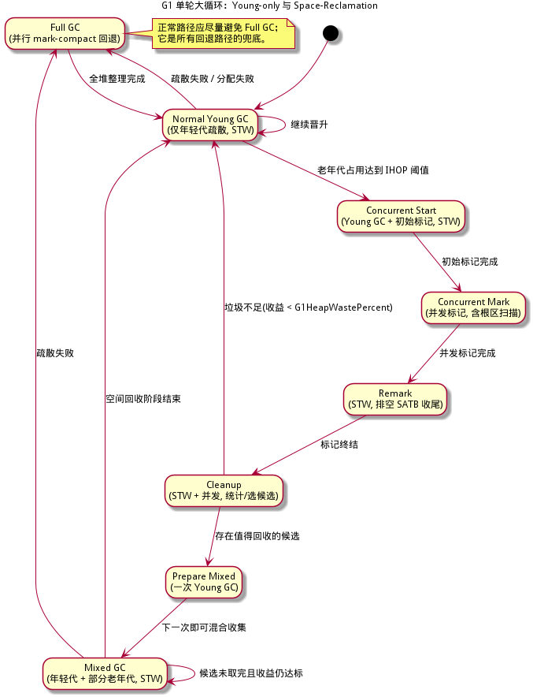
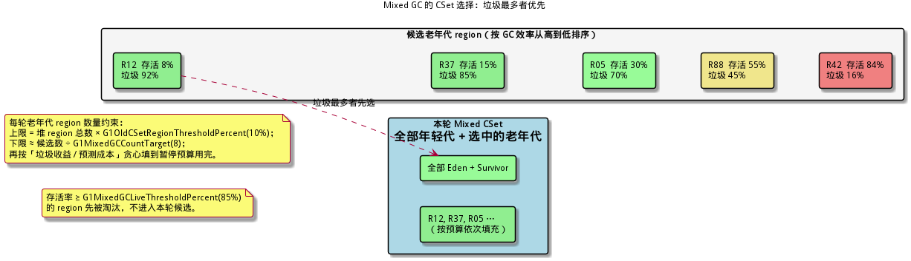
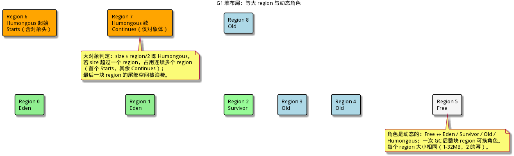
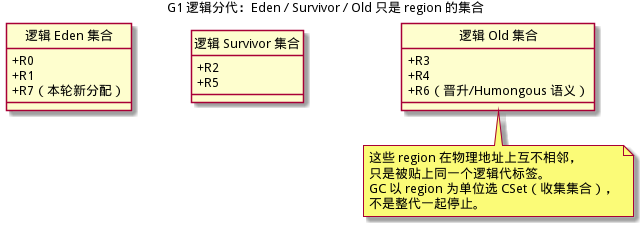
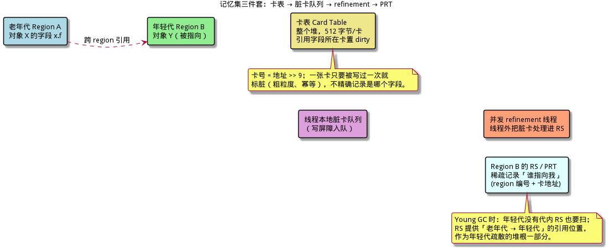
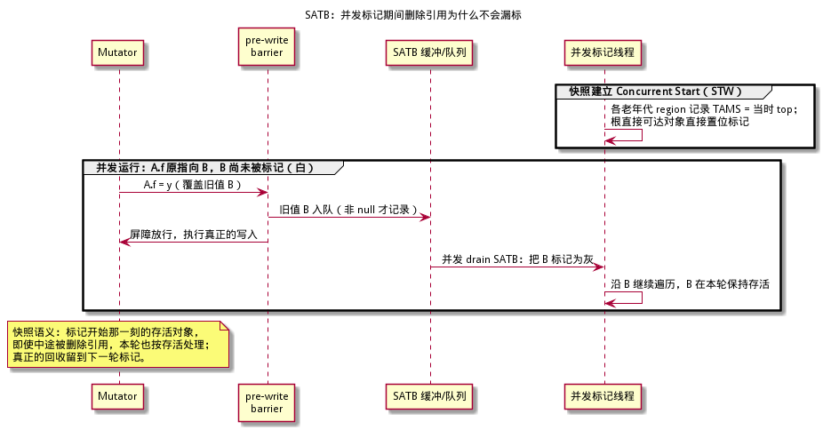
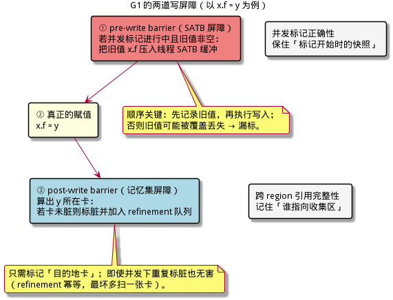
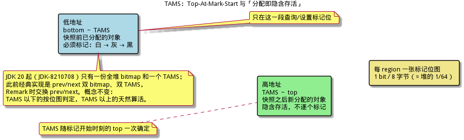
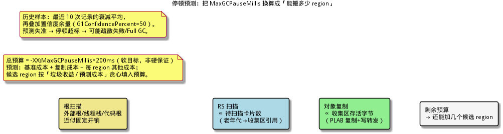
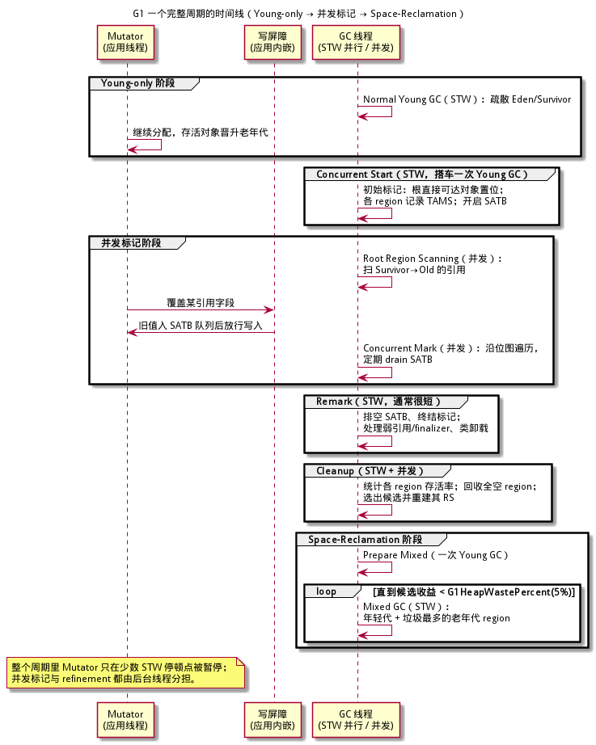

# G1 算法详解 —— 从零基础到能照着实现

> **面向读者**：完全没有 GC（垃圾回收）背景的开发者。本文从"内存为什么要回收"讲起，一路拆到 OpenJDK Garbage-First（G1）的完整机制：region 化堆、逻辑分代、卡表与记忆集、SATB 并发标记、TAMS、疏散与停顿预测模型，最后给出可以照着写的实现路线与伪代码。
> **目标**：读完并配合伪代码，你能独立实现一个"可预测短停顿"的 G1 风格收集器；文中的参数默认值、JEP 编号均按 OpenJDK 官方资料查证，版本差异逐处标注。
>
> **本系列（建议按序阅读）**：[Serial / Parallel 分代](../serial-parallel-算法详解/serial-parallel-算法详解.md) · [CMS](../cms-算法详解/cms-算法详解.md) · [G1](g1-算法详解.md) · [Shenandoah](../shenandoah-算法详解/shenandoah-算法详解.md) · [Go GC](../go-gc-算法详解/go-gc-算法详解.md) · [ZGC](../zgc-算法详解/zgc-算法详解.md)
>
> **阅读顺序建议**：三大指标、STW、三色抽象、屏障/卡表/记忆集这套基础，[ZGC 文档 §1–§3](../zgc-算法详解/zgc-算法详解.md) 讲得最细，可对照阅读；分代假设与卡表另见 [Serial / Parallel 文档](../serial-parallel-算法详解/serial-parallel-算法详解.md)（若已就绪）；想做"并发标记 + 不搬对象"的对照，看 [CMS 文档](../cms-算法详解/cms-算法详解.md)（若已就绪）。本文 §1 已做到自足，不看其他篇也能继续。
>
> **与 xgc 仓库的关系**：本文是"算法原理/教学"文档。xgc 自身的工程实现细则见
> [implementation-guide/05-算法实现详解.md](../implementation-guide/05-算法实现详解.md)、
> [implementation-guide/16-并发正确性与内存模型.md](../implementation-guide/16-并发正确性与内存模型.md)、
> [implementation-guide/17-正确性验证与压力测试.md](../implementation-guide/17-正确性验证与压力测试.md)。

---

## 目录

1. [必备基础（15 分钟速览）](#1-必备基础15-分钟速览)
2. [G1 是什么：定位、历史与目标](#2-g1-是什么定位历史与目标)
3. [总体设计：一句话与五大基石](#3-总体设计一句话与五大基石)
4. [Region 化堆布局与对象分配](#4-region-化堆布局与对象分配)
5. [写屏障、卡表与记忆集三件套](#5-写屏障卡表与记忆集三件套)
6. [SATB：并发标记的快照语义](#6-satb并发标记的快照语义)
7. [并发标记周期五阶段](#7-并发标记周期五阶段)
8. [Young GC 疏散详解](#8-young-gc-疏散详解)
9. [Collection Set 与 Mixed GC](#9-collection-set-与-mixed-gc)
10. [停顿预测模型](#10-停顿预测模型)
11. [疏散失败与 Full GC 回退](#11-疏散失败与-full-gc-回退)
12. [单轮流程状态机与时间线](#12-单轮流程状态机与时间线)
13. [并发正确性论证](#13-并发正确性论证)
14. [从零实现最小路线（第 0～8 步 + 验收）](#14-从零实现最小路线第-08-步--验收)
15. [关键数据结构与伪代码](#15-关键数据结构与伪代码)
16. [性能特征、工业参数与调优表](#16-性能特征工业参数与调优表)
17. [与同类算法对比](#17-与同类算法对比)
18. [术语速查表](#18-术语速查表)
19. [延伸阅读与参考](#19-延伸阅读与参考)

---

## 1. 必备基础（15 分钟速览）

本节的目标：**完全不懂 GC 的人，只读这十几分钟也能看懂后文**。已经熟悉的读者可跳到 §2。

### 1.1 对象、堆、根与可达性

程序运行时不断创建对象，对象放在一片叫**堆（Heap）**的内存里。一个对象什么时候可以销毁？答案是：**当它再也无法被程序访问到时**。

怎么判断"无法被访问"？从一组确定的入口出发，顺着对象里的引用一路走：

- 走得到的对象叫**可达（reachable）**，视为存活；
- 走不到的叫**不可达（unreachable）**，视为垃圾。

这组入口叫 **GC 根（GC Roots）**，典型有：

| 根类型 | 例子 |
|--------|------|
| 线程栈与寄存器 | 局部变量、参数、返回值里引用的对象 |
| 全局/静态变量 | 类静态字段引用的对象 |
| 代码与元数据 | 编译代码、类装载器、JNI 句柄持有的引用 |
| 运行时内部结构 | 字符串表、异常对象、同步监视器等 |

### 1.2 两个角色与 STW

| 角色 | 英文 | 干什么 |
|------|------|--------|
| 应用程序 | **Mutator**（改变者） | 运行你的代码，不断分配、读取、改写对象引用 |
| 垃圾回收器 | **Collector**（收集器） | 找出并回收不可达对象，整理可用内存 |

最直接的做法：GC 先**暂停所有 Mutator**（**STW = Stop-The-World，停止世界**），在此期间扫描、搬运、回收——因为没人改对象，正确性最容易保证；GC 结束后恢复运行。代价是**停顿（Pause）**。

### 1.3 三大指标

| 指标 | 英文 | 含义 | 冲突 |
|------|------|------|------|
| 吞吐 | Throughput | 有用工作时间占比 | 想省 CPU 就少并发，停顿变长 |
| 延迟 | Latency / Pause | 单次停顿，尤其最大停顿 | 想停顿短就多并发、多搬运 |
| 占用 | Footprint | GC 自身的额外内存与 CPU | 想省内存就少冗余结构 |

**核心矛盾**：三者不可兼得，所有收集器都是在这个三角形里做取舍。G1 的选择是：**停顿可预测（有目标值）、吞吐尚可、用较重的辅助数据结构换这一点**。

### 1.4 三色抽象与漏标

判断"并发标记是否做对"的标准工具是**三色抽象（Tri-color Abstraction）**。把对象分三类：

| 颜色 | 含义 |
|------|------|
| **白（White）** | 还没被发现（可能活也可能死） |
| **灰（Grey）** | 已发现，但字段还没扫描完（在"待办队列"里） |
| **黑（Black）** | 自身与字段都扫描完，确定存活 |

遍历就是：白 → 灰（发现并进队列）→ 黑（扫完）。当没有灰色对象时，仍是白色的就是垃圾。

并发标记的正确性判据（**三色不变量**）：

> **任何时刻都不允许出现「黑色对象直接引用白色对象」而无人处理。** 因为黑对象已经扫完，它指向的白对象如果是活的，就再也没人去发现它，会被误当垃圾回收——这叫**漏标（漏掉存活对象）**，后果是程序崩溃或数据损坏。

要防止漏标，有两条路：

1. **增量更新（Incremental Update）**：当黑对象新指向白对象时，把这条边记下来，事后把白对象重新变灰。CMS 主要用这条路。
2. **快照（SATB，Snapshot-At-The-Beginning）**：把"标记开始那一刻的存活状态"当成一张快照；当一条旧引用被覆盖（删除）时，把**旧值**记录下来。只要标记开始时的活对象都能被标记到，本轮就正确。**G1 用这条路**，详见 §6。

### 1.5 屏障、卡表与记忆集

**写屏障（Write Barrier）**：在程序写引用（`x.f = y`）前后自动插入的一小段代码。JIT 会把屏障内联进赋值点。它有两种常见用途：

- **pre-write barrier（写前屏障）**：赋值**之前**执行。G1 用它把被覆盖的旧引用记进 SATB 队列。
- **post-write barrier（写后屏障）**：赋值**之后**执行。G1 用它把"跨 region 引用"所在的卡标脏，更新记忆集。

**卡表（Card Table）**：把堆按固定粒度切成**卡（Card，G1 默认为 512 字节）**，每张卡对应卡表里的一个字节。字段被写过就把它所在的卡标记为 **dirty（脏）**。它是**粗粒度**的：只知道"这 512 字节里有人写过引用"，不知道具体哪个字段。

**记忆集（Remembered Set, RS）**：每个 region 配一份，记录"**谁指向我**"（外部指向本 region 的引用大致位置）。因为它是稀疏的，G1 用卡号集合来实现；论文里把这套 per-region 的表叫 **PRT（Per-Region Table）**。有了 RS，Young GC 就不必扫描整个老年代来找"老 → 新"的引用，只扫与收集区相关的 RS 即可。

### 1.6 总览：G1 一轮大循环

先把后文的一切压成一张图，混个眼熟即可：



> **一句话总结**：GC 的本质是"从根出发找活对象、回收其余"；并发标记的正确性靠三色不变量保证，G1 用 SATB 写屏障守住"标记开始时的快照"；跨代/跨 region 引用靠卡表与记忆集精确记账。基础概念不牢的读者，建议先过一遍 [ZGC 文档 §1–§3](../zgc-算法详解/zgc-算法详解.md)。

---

## 2. G1 是什么：定位、历史与目标

### 2.1 一句话定位

> **G1（Garbage-First）** 是一款 **region 化、分代、增量、并行、大部分并发、STW 疏散**的垃圾收集器：它把堆切成许多等大 region，用"垃圾最多优先"的策略选择收集集合，在**用户给定的停顿目标（默认 200ms）**内尽量多回收内存。

论文原文的目标是"meet a soft real-time goal with high probability, while achieving high throughput"——**以高概率满足软实时停顿目标，同时保持高吞吐**。注意"高概率""软实时"两个限定词：**停顿目标是努力方向，不是硬保证**。

### 2.2 历史与版本时间线

| 版本 | 事件 | 出处 |
|------|------|------|
| 2004 | 论文《Garbage-First Garbage Collection》发表于 ISMM'04（Detlefs、Flood、Heller、Printezis） | DOI 10.1145/1029873.1029879 |
| JDK 6u14 | G1 作为实验特性首次随 HotSpot 发布 | 需 `-XX:+UnlockExperimentalVMOptions -XX:+UseG1GC` |
| JDK 7u4 | G1 正式支持（fully supported） | Oracle JDK 7 文档 |
| JDK 8u40 | 并发类卸载（JEP 156）补齐，G1 功能完整 | JEP 248 背景说明 |
| JDK 9 | **成为服务器配置的默认 GC** | JEP 248 |
| JDK 9 | 自适应 IHOP（Adaptive IHOP）默认开启 | JDK-8136678 / JDK-8136680 |
| JDK 10 | Full GC 并行化（此前单线程 mark-sweep-compact） | JEP 307 |
| JDK 12 | 可周期性归还空闲堆内存给操作系统 | JEP 346 |
| JDK 18 | 记忆集数据结构瘦身、内存占用大降；`G1HeapRegionSize` 可手设至 512MB | tschatzl 博客 / JDK-8275056 |
| JDK 20 | 标记位图从 prev/next 双份改为**单份**（内存从堆的 3% 降到 1.5%） | JDK-8210708 |
| JDK 27 | **所有环境默认 G1**（此前受限环境默认 Serial） | JEP 523 |

> **常见误区**："G1 从 JDK 9 才出现。" 不对。G1 早在 JDK 6u14 就能用、JDK 7u4 起受支持；JDK 9 只是把它**变成默认**，JDK 27 进一步在所有环境默认。

### 2.3 目标拆解：为什么它能"可预测"

| 传统 Parallel 的做法 | G1 的做法 | 收益 |
|---------------------|-----------|------|
| 整代一起收集，停顿 ∝ 全代大小 | 以 region 为单位，分多次增量收集 | 单次停顿与堆大小解耦 |
| 老年代只有 Full GC 能整理 | 并发标记 + Mixed GC 增量回收老年代 | 避免长 Full GC、无碎片 |
| 停顿不可控 | 用历史成本模型预测并限制每轮搬运量 | 停顿可预测（目标值） |
| 单线程整理老年代 | 标记并发、疏散并行 | 吞吐可接受 |

代价：卡表、记忆集、SATB 队列、位图等辅助结构带来**额外内存与 CPU 开销**；写屏障让每次引用写多几条指令。JEP 248 的原话："When resource usage overhead needs to be minimized a collector other than G1 should be used"——**极省资源场景不该选 G1**。

> **一句话总结**：G1 用"region 化 + 垃圾优先 + 停顿预测"把大堆上的长停顿切成许多可预测的短停顿，代价是辅助结构与屏障开销；它是 JDK 9 起的默认、JDK 27 起全环境默认。

---

## 3. 总体设计：一句话与五大基石

> **核心思想一句话**：把堆切成等大 region，照顾分代假设把回收集中在年轻代；当老年代占用达到阈值时，用 **SATB 并发标记**测出每个 region 的存活量，然后在后续的 **STW 疏散**中按"垃圾收益/预测成本"贪心挑选 region，把活对象复制走、整块 region 回收，从而在停顿预算内稳步释放老年代空间。

支撑它的五大基石：

| 基石 | 解决什么 | 对应章节 |
|------|----------|----------|
| **Region 化堆 + 逻辑分代** | 细粒度回收、任意选集合、天然无碎片 | §4 |
| **卡表 + RS/PRT + refinement** | 不扫全堆也能找到跨 region 引用 | §5 |
| **SATB pre-write barrier** | 并发标记不漏标（快照语义） | §6 |
| **TAMS + 标记位图 + 标记栈** | "分配即存活"，让并发遍历简单可终止 | §7 |
| **CSet 策略 + 停顿预测模型** | 把 MaxGCPauseMillis 变成"每轮搬多少"的决策 | §9、§10 |

两个 STW 疏散动作把上面的一切变现：

- **Young GC**：收集集合 = 全部 Eden + Survivor region，停顿短、频率高；
- **Mixed GC**：收集集合 = 全部年轻代 + 挑选出的老年代 region，是"垃圾优先"的正面战场。

下图是后者选集合的直觉示意，先混眼熟：



> **一句话总结**：G1 = region 化分代堆 + SATB 并发标记（TAMS/位图）+ 卡表记忆集 + 垃圾优先的 CSet 选择 + 停顿预测；年轻代高频疏散，老年代靠并发标记后分批 Mixed GC 回收。

## 4. Region 化堆布局与对象分配

### 4.1 Region：等大的"集装箱"

G1 把整个 Java 堆划分成许多**等大**的 **region（区域）**，region 是最小的回收与分配单位。

| 属性 | 规则 |
|------|------|
| 大小 | 1MB ～ 32MB（人体工学默认），必须是 **2 的幂** |
| 目标数量 | 约 **2048 个**（整个堆） |
| 默认值 | `-XX:G1HeapRegionSize=0`，0 表示由 JVM 自动推导 |
| 推导公式（现代实现） | `region = clamp(round_up_pow2(max_heap / 2048), 1MB, 32MB)` |
| 手动设置范围 | 旧版本 1～32MB；较新 JDK（JDK 18 起，JDK-8275056）64 位平台允许 1～512MB |
| 人体工学上限 | 无论堆多大，自动选择不会超过 32MB |

> **版本差异**：早期 G1 用"初始堆与最大堆的平均值/2048"来算（JDK-8019902），后来发现平均堆偏小会一律选 1MB；现代实现（JDK-8241670 起）改用**最大堆**计算。手动设置不是 2 的幂时，现代实现会**向上取整到 2 的幂**（如设 3MB 得 4MB），旧实现向下取。

几个算例（按现代实现）：

| `-Xmx` | `max_heap/2048` | 取 2 的幂并裁剪 | region 数 |
|--------|-----------------|-----------------|-----------|
| 128MB | 64KB | 1MB（下界） | 128 |
| 1GB | 512KB | 1MB（下界） | 1024 |
| 8GB | 4MB | 4MB | 2048 |
| 32GB | 16MB | 16MB | 2048 |
| 128GB | 64MB | 32MB（上界） | 4096 |

region 数量的意义：太多则元数据（卡表、RS、位图）开销大；太少则选集合粒度粗、容易大停顿。~2048 是经验平衡点。

### 4.2 Region 的角色

每个 region 在任意时刻有一个角色，GC 过程中动态转换：

| 角色 | 说明 |
|------|------|
| **Free（空闲）** | 未使用，可被分配器拿走 |
| **Eden** | 新对象优先分配在这里（实际经 TLAB） |
| **Survivor** | 经历过至少一次 GC 的年轻对象 |
| **Old** | 晋升的老对象 |
| **Humongous（Starts / Continues）** | 超大对象；`Starts` 是首块（含对象头），`Continues` 是后续块 |



补充：JDK 9+ 里还可能看到 `Archive` region（CDS 归档类元数据），它被排除在普通分配/回收之外，初学时可忽略。

### 4.3 逻辑分代：物理不连续，逻辑成代

G1 仍然是**分代收集器（Generational）**，但 Eden / Survivor / Old 只是 **region 的逻辑集合**，物理地址互不相邻：

- 年轻代（Young Generation）= 所有 Eden region + 所有 Survivor region；
- 老年代（Old Generation）= 所有 Old region（Humongous 语义上归老年代）。



这样设计的好处：

1. **收放自如**：年轻代大小可以随停顿目标和晋升速度动态伸缩（在 `G1NewSizePercent=5%` 与 `G1MaxNewSizePercent=60%` 之间），不需要预留连续的年轻代地址空间；
2. **回收粒度细**：一次 Young GC 只处理年轻代 region 集合，停顿不随堆大小增长；
3. **老年代也可增量回收**：不像 Parallel 只能靠 Full GC 整理老年代，G1 可以挑一部分老年代 region 做 Mixed GC。

### 4.4 Humongous 对象

**判定**：对象大小 **≥ region 大小的 1/2** 即为 **Humongous（超大）对象**。为什么取一半？因为一个 region 至少要能装下两个普通对象，否则"分配即占掉半块"就不值得走普通路径。

规则：

- 大小在 `[region/2, region)` 之间的 Humongous 占**一整块** region，尾部空间浪费；
- 大于一个 region 的，占用**连续的多个 region**；第一个是 `Starts`（含对象头与元数据），后续是 `Continues`（只有对象体）；
- 分配路径**绕过 TLAB**，直接在老年代语义的区域里找连续空闲 region；
- **不参与 Young/Mixed 疏散**（复制成本太高），但会在**任意一次 Young GC 时被"顺手"回收**（eager reclaim，条件是不可达）；不可达的 Humongous 也可以在 Cleanup/Full GC 阶段回收；
- 分配 Humongous 前会检查标记阈值，必要时**提前启动并发标记周期**；若找不到连续空闲 region，可能触发 Full GC。

> **常见误区**："Humongous 对象一定在 Full GC 才回收。" 不对。从 JDK 8 起（JDK-8027959）G1 就支持在 Young GC 中**主动回收已死的 Humongous**，默认开启（`G1EagerReclaimHumongousObjects`，后来该开关被移除、行为恒为开启）。Full GC 只是兜底路径。

Humongous 的典型问题是**外部碎片**：一个 `region+8` 字节的数组占两块 region，尾部几乎全浪费。若日志里频繁出现因 Humongous 分配触发的并发周期，可适当调大 `-XX:G1HeapRegionSize` 让它退化为普通对象。

### 4.5 分配路径：TLAB 与 bump 分配

G1 的分配快在**指针递增（bump-the-pointer）**：region 内维护 `top`，分配就是 `top += size`（再对齐）。为了让多线程不抢同一把锁，每个线程有一块私有领地：

**TLAB（Thread Local Allocation Buffer，线程本地分配缓冲）**：

| 参数 | 默认值 | 作用 |
|------|--------|------|
| `-XX:+UseTLAB` | true | 开启线程本地分配缓冲 |
| `-XX:TLABSize` | 0 | 0 = 人体工学自动设定初始大小 |
| `-XX:ResizeTLAB` | true | 动态调整 TLAB 大小 |
| `-XX:MinTLABSize` | 2048（字节） | TLAB 下限 |
| `-XX:TLABWasteTargetPercent` | 1 | 允许 Eden 中因 TLAB 半满而被浪费的比例 |

分配的快慢路径：

```c
// 分配一个 size 字节（已对齐）的对象
void* allocate(size_t size) {
  if (size >= region_size / 2) return allocate_humongous(size); // 慢路径 2

  char* p = tlab.top;
  if (p + size <= tlab.end) {        // 快路径：纯指针递增，无锁、无屏障
    tlab.top = p + size;             // 单线程私有，无需原子
    return p;                        // 返回后由调用者清零/填对象头
  }
  return allocate_slow(size);        // 慢路径 1：换 TLAB / 直接在 Eden 分配 / 触发 GC
}
```

- **慢路径 1**：当前 TLAB 装不下。退休（retire）旧 TLAB，向 Eden 申请新 TLAB；Eden 也满就触发 Young GC；分配失败再走 Full GC。
- **慢路径 2**：Humongous，直接找连续空闲 region。
- **写屏障只挂在"写引用"上**：分配本身不触发屏障；但当把新对象写进某个字段（如数组元素、对象字段）时，post-write barrier 会执行（见 §5）。
- **GC 期间的复制**也使用线程本地缓冲：疏散时用 **PLAB（Promotion-Local Allocation Buffer）**，其浪费目标由 `-XX:TargetPLABWastePct=10` 控制。

> **一句话总结**：G1 把堆切成 1–32MB 的等大 region，按需贴上 Eden/Survivor/Old/Humongous/Free 角色；小对象走 TLAB 指针递增无锁分配，大对象（≥ region/2）按连续 region 直接分配且不参与疏散；逻辑分代物理不连续，这是"细粒度 + 可预测"的地基。

---

## 5. 写屏障、卡表与记忆集三件套

### 5.1 为什么需要记忆集

考虑一次 Young GC：收集集合（CSet）里只有年轻代 region。但一个老对象可能引用一个年轻对象——如果只看 CSet 内部，会以为"这个年轻对象没人引用"，把它错当垃圾回收。

传统分代 GC 的解法是"**老 → 新**"引用集合（RS），因为年轻代回收频繁，只记录单向即可。但 G1 要支持**任意 region 集合**（老年代也可以被 Mixed GC 收集），所以 RS 必须记录**所有跨 region 的引用**：任何 region 的 RS 记录"**谁指向我**"。

如果每次 GC 都扫描整个老年代来找这些引用，停顿就会随堆增长——这正是 G1 必须避免的。**卡表 + RS** 就是把这件工作摊到每次引用写入时刻的答案。

### 5.2 卡表：粗粒度的脏标记

把堆按 512 字节切成**卡（Card）**，每个卡在**卡表（Card Table）**里占一个字节：

```
card_index = address >> 9          // 512B/卡 ⇒ 位移 9 位
card_table[card_index] = dirty     // 写过引用就标脏
```

要点：

- **512 字节**是 Oracle 文档给出的默认卡粒度（由 `card_shift` 决定，G1 中为 9）；
- 卡是**粗粒度、近似**的：只说明"这 512 字节里有人写过引用"，不是精确定位字段；
- **幂等**：重复标脏无害，所以并发下不需要昂贵的 CAS（最坏情况是细化时多重扫一张卡）。

### 5.3 post-write barrier：脏卡并交给 refinement

每当程序写一个引用字段（`x.f = y`），JIT 在赋值后插入 **post-write barrier**：

```c
// 写后屏障（伪代码；实际由 JIT 内联）
void g1_write_barrier_post(void** field, void* new_value) {
  card_t* card = &card_table[((uintptr_t)field) >> 9];   // 512B/卡 ⇒ 位移 9
  if (*card != DIRTY) {                 // 快路径：已是脏卡就什么也不做
    *card = DIRTY;                      // 标脏
    // 把这张卡加入本线程的 refinement 队列（覆盖去重）
    // 这里用 release 语义发布，保证 refinement 线程看到脏卡内容
    dirty_card_queue_enqueue(card);
  }
}
// obj->f = new_value;   // ← 真正的赋值发生在屏障调用之前
```

几点实现说明：

- **只需标记"目的地卡"**（字段所在地址），不需要知道源 region；
- **入队 + 去重**通常由线程本地缓冲承担，满了才批量入全局队列；
- 如果写屏障只在 GC 期间生效，程序大部分时间的引用写入根本不进入这条路径——但 G1 的 post-write barrier **始终开启**，因为 RS 必须持续保持近似最新。

### 5.4 refinement：把脏卡合并进 RS

脏卡队列里的卡不会自动变成 RS，需要 **refinement（细化）** 把它们处理掉：

1. **并发 refinement 线程**从全局队列取卡，扫描卡内对象，把"指向某 region 的引用位置"合并进该 region 的 RS；
2. 处理热的卡（hot card）时会放进 **hot card cache**，避免同一张卡反复入队、反复扫描；
3. STW 停顿中，G1 还会在 **Update RS** 阶段用 `-XX:G1RSetUpdatingPauseTimePercent=10` 的暂停预算处理剩余积压，保证进入 **Scan RS** 前 RS 足够新；
4. `-XX:G1ConcRefinementThreads=0` 表示并发细化线程数由 CPU 数人体工学推导；`-XX:G1AdaptiveConcRefinement=true` 让并发线程数随队列长度自适应。



> **版本差异**：JDK 25（JDK-8342382）把"每线程 update buffer"改成静态分配的卡表结构，因此 `-XX:G1UpdateBufferSize`（默认 256）在 JDK 25 被废弃、JDK 26 移除（JDK-8352139）。这属于实现演化，概念不变。

### 5.5 PRT：稀疏的"谁指向我"

一个 region 的 RS 若用位图记录所有 512B 卡，10GB 堆就是 2000 万张卡——太占内存。G1 论文把这套 per-region 的表叫 **PRT（Per-Region Table）**，核心是**稀疏存储**：

| 层级 | 记录方式 | 何时使用 |
|------|----------|----------|
| **粗粒度** | 只记"某个 region 整体指向我" | 刚开始有跨区引用时 |
| **细粒度** | 记具体卡号（压缩后的 card index） | 需要精确扫描时细化 |

OpenJDK 现代实现用 `G1CardSet` 容器族：空 → 单个卡 → 位图/数组 → 哈希表，随密度自适应升级。无论哪种，语义都是"**这张卡所在区域可能有指向我的引用**"；GC 扫 RS 时，会走进这些卡**遍历卡内对象**，确认真正的引用。

### 5.6 追踪例子：Young GC 如何用 RS 找到"老 → 新"引用

场景：老年代 region R3 里对象 A 的字段 `A.f`，被 Mutator 写成指向年轻代 region R9 里新分配的对象 B。

```
时刻 T1  Mutator 执行 A.f = B
         └─ post-write barrier：A.f 地址所在的 512B 卡标脏并入队
时刻 T2  并发 refinement 线程处理该卡：
         扫描卡内对象，发现 A.f -> B（B 在 R9）
         把「R3 的这张卡」合并进 R9 的 RS（PRT）
时刻 T3  Young GC 开始，CSet 含 R9
         Update RS：处理积压脏卡，保证 R9 的 RS 最新
         Scan RS：遍历 R9 的 RS 条目，进入 R3 的卡，找到 A.f -> B
         └─ 把 B 加入疏散根；B 是活的，复制到 Survivor/Old
         然后才扫描 CSet 内部对象、递归处理新复制的对象
时刻 T4  GC 结束：B 搬走，R9（可能已空）释放；A.f 指向新地址或由转发/更新流程修正
```

如果把 RS 漏了，B 会被错误回收，A.f 变成悬垂引用——这就是记忆集存在的意义。

> **常见误区**："卡表就是 RS。" 不是。卡表是**全堆一张**的粗粒度脏标记（谁被写过）；RS 是**每个 region 一份**的"谁指向我"清单（PRT），由 refinement 从脏卡中提炼出来。卡表是原料，RS 是成品。

> **一句话总结**：post-write barrier 在每次引用写入后把目的卡标脏入队，并发 refinement 把脏卡提炼成每 region 的稀疏 RS/PRT；Young GC 靠扫 RS 定位"老 → 新"引用，避免扫描整个老年代。

---

## 6. SATB：并发标记的快照语义

### 6.1 为什么是"快照"

并发标记期间 Mutator 还在跑，引用图一直在变：新对象不停分配、旧引用不停被覆盖。如果要求"此刻的每一步都精确对应某一瞬间的引用图"，实现和证明都会极其复杂。

G1 选择 **SATB（Snapshot-At-The-Beginning，标记开始时快照）** 的**弱化语义**：

> 只保证"**标记开始那一刻已经存活的对象**"在本轮都被标记为存活；标记开始之后才变成垃圾的对象，本轮可以继续留着，等下一轮再回收。

这个弱化换来了两个巨大好处：

1. **数据量固定**：快照之后再分配的对象不需要遍历（TAMS 之上"分配即存活"），标记一定能终止；
2. **引用删除不丢**：只要把被覆盖的旧引用记录下来，快照中的对象就不会被漏掉。

代价是"浮动垃圾（floating garbage）"：本轮标记期间死掉的对象要留到下一轮，这是软实时收集器接受的取舍。

### 6.2 pre-write barrier：记录被覆盖的旧值

SATB 的核心是一句话：**在覆盖引用之前，先把旧值记下来**。

```c
// 写前屏障（伪代码；JIT 内联在赋值之前）
void g1_write_barrier_pre(void** field, void* new_value) {
  if (marking_active()) {                 // 只有并发标记进行中才有意义
    void* old = *field;
    if (old != NULL) {
      // 关键顺序：先记录旧值，再允许真正写入。
      // 若反过来，旧值可能已被新值覆盖，快照对象就成了"没人指向的白对象"。
      satb_enqueue(old);                  // 进入本线程 SATB 缓冲
    }
  }
}
// obj->f = new_value;   // ← 屏障返回后执行真正的赋值
```

内存序要求：`satb_enqueue` 必须对并发标记线程**可见地先于**真正的字段写入（stores 之间的 release/顺序保证）。实现上，G1 的 pre-write barrier 在入队完成后才返回，随后才是赋值，JIT 的指令顺序不会越过副作用边界。

### 6.3 伪代码之后的流程

```
Mutator 写 x.f = y
   │
   ├─ pre-write barrier：old = B，B 非空 ⇒ B 入线程 SATB 缓冲
   │
   ├─ 执行赋值 x.f = y
   │
   └─ post-write barrier：把 y 所在卡标脏（保证 RS，见 §5）
```

线程本地 SATB 缓冲满了以后：

| 参数 | 默认值 | 作用 |
|------|--------|------|
| `-XX:G1SATBBufferSize` | 1024（项） | 每个 SATB 日志缓冲的条目数 |
| `-XX:G1SATBBufferEnqueueingThresholdPercent` | 60 | 入队前本地过滤的保留比例阈值；0 表示 mutator 不做过滤 |
| `G1SATBProcessCompletedThreshold`（develop） | 20 | 完成的缓冲达到多少后触发处理 |

入队/处理步骤：

1. 缓冲写满，Mutator 线程先做一次**本地过滤**（去掉明显无效的项）；
2. 过滤后按阈值决定是否把缓冲挂到全局 `SATBMarkQueueSet`；
3. **并发标记线程**在遍历间隙 drain 这些队列：把里面的对象当作**额外的根**去标记；
4. **Remark（STW）**阶段把剩余缓冲全部排空，确保"一个不漏"。





### 6.4 为什么它能防漏标

用三色不变量来论证。设某条引用 `x.f = B` 在快照时刻存在，B 在快照中是活的。分两种情况：

- **x 还没被扫（灰）**：标记线程迟早会扫 x。如果在此之前 Mutator 把 `x.f` 覆盖成 y，pre-write barrier 会把 B 入队 → B 被标记为灰，不会漏。如果没被覆盖，扫描时自然会标记 B，也不会漏。
- **x 已经被扫（黑）**：x 扫描时 `x.f = B` 还在，B 当时就被发现并标记了，不会漏。

所以"**在快照时刻可达的对象，一个都不会漏**"。注意边界：如果 y 是标记开始后才通过新边变得可达的、且在快照时不可达，SATB **允许**回收它——这正是快照语义的定义。以及新分配的对象在 TAMS 之上，天然按存活处理（§7）。

> **常见误区**："SATB 记录新值。" 不对，SATB 记录的是**被覆盖的旧值**；记录新值是"增量更新（Incremental Update）"的思路。

> **一句话总结**：SATB 用 pre-write barrier 在赋值前把旧引用入队，使"标记开始的快照对象"一个不漏；新分配对象靠 TAMS 之上"分配即存活"兜底，代价是接受浮动垃圾。

---

## 7. 并发标记周期五阶段

G1 的并发标记周期（Concurrent Mark Cycle）可以概括为五个阶段：**Initial Mark（Concurrent Start）→ Root Region Scanning → Concurrent Mark → Remark → Cleanup**。前两个在现代日志里表现为一次"Concurrent Start"停顿加一段并发根区扫描；后三者是收尾。

### 7.1 Initial Mark / Concurrent Start（STW，搭车 Young GC）

G1 不会为了初始标记单独安排一次停得久的停顿，而是**搭在一次 Young GC 上**（日志：`Pause Young (Concurrent Start)`）。这次停顿除了照常疏散年轻代，还做：

1. **拍快照**：给所有**老年代 region** 设置 `nextTAMS = 当前 top`；年轻代与特殊 region 的 TAMS 设为 `bottom`（意味着它们不在本轮遍历范围内，因为会被 Young GC 整体处理）；
2. **标根**：扫描所有 GC 根（线程栈、全局、JNI、代码根等），把根直接可达的对象**直接置位**（不经过标记栈，避免大停顿）；
3. **记录 root region**：本次 GC 把对象复制到 Survivor/Old 的区间记为 **Root Region**，留给并发阶段补扫；
4. 重置标记线程的局部 finger 与局部标记栈，全局 finger 指向堆起点。

> 经典 G1 的术语是 **Initial Mark**；现代调优指南与日志多称 **Concurrent Start**，因为这次停顿同时是年轻代 GC 的起点。两者指同一次停顿。

### 7.2 Root Region Scanning（并发）

Initial Mark 出于停顿考虑**没有跟随** Survivor/晋升对象的引用（那可能很多）。于是紧接着用**并发线程**补课：

- 扫描所有 root region 里的对象；
- 把这些对象指向**快照区（TAMS 以下）**的引用标记出来；
- **必须在第一次 Mixed GC 之前完成**（实际上 G1 保证在**下一次 GC 之前**完成，必要时宁可推迟下一次 GC）；否则被这些根引用着的对象可能没被标记，Mixed GC 就会把它们当垃圾搬掉，违背 SATB。

现代日志相位名为 `Concurrent Scan Root Regions`。

### 7.3 Concurrent Mark（并发）

这是真正"遍历快照"的阶段。

**数据结构**：

| 结构 | 说明 |
|------|------|
| 标记位图（Mark Bitmap） | 每 region 一张/或全堆一张；1 bit 对应最低对象对齐粒度的起始地址（默认为 8 字节对齐，所以位图 ≈ 堆的 1/64 = 1.5%） |
| TAMS（Top-At-Mark-Start） | 每 region 一个指针；TAMS 以下按位图判定，TAMS 以上"分配即存活" |
| 全局 finger（Global Finger） | 标记线程共享的进度指针，按 region 粒度原子推进 |
| 本地 finger（Local Finger） | 每个标记线程私有，配合全局 finger 减少竞争 |
| 局部/全局标记栈 | 存"已标记但字段未扫"（灰）的对象 |

**TAMS 机制（本节最重要）**：

```
Region 地址空间（低 → 高）：
  bottom ......... TAMS ......... top
  |  快照前分配   |  标记期间分配  |
  |  需要标记     |  隐含存活      |
```

- 标记只处理 **TAMS 以下**的对象；每次标记开始把 TAMS 设成当时的 `top`；
- TAMS 与 top 之间是标记开始后 Mutator 新分配的对象——**一律当活**，既不标记也不回收；
- 因此快照是"固定大小"的，并发遍历一定有界、可终止。



**遍历算法**（伪代码见 §15）：

1. 标记线程原子推进全局 finger，**按 region 认领**扫描区间（粒度粗，减少竞争；代价是个别对象被重复扫描，无害）；
2. 在区间内从本地 finger 扫到位图里的标记，对被标记对象的每个引用：
   - `null` 跳过；指向 TAMS 之上的引用跳过（快照外）；
   - 若对象未标记则**原子置位**（CAS，唯一赢家）；
   - 新标记的对象若在全局 finger 左边，压入本地标记栈（右边会被 finger 自然扫到，不必压栈，节省一半栈空间）；
3. 线程周期性地把本地栈压缩/转全局栈，并 drain SATB 队列（SATB 里的对象是额外的根）；
4. **终止条件**：局部/全局标记栈都空，且所有 finger 扫到末尾。若全局标记栈溢出，则**重置 finger 重新扫**（已访问对象隐含变灰），保证终止。

另外可能有 **Concurrent Preclean** 子阶段：预先处理已发现的 `java.lang.ref.Reference` 实例（如 referent 已死或本来存活的，可以提前从待处理列表移除），减轻 Remark 的工作量。它不是每个版本都在日志里出现，属可选优化。

### 7.4 Remark（STW）

停一次，短而关键：

1. **排空所有剩余 SATB 缓冲**，把里面的对象标灰并继续遍历到终止；
2. 再走一遍线程栈（快照之后栈可能变了），补上最后的根；
3. 若此时标记栈又溢出，允许**重启并发标记**（罕见）；
4. 处理**弱引用/软引用/虚引用/finalizer**（决定哪些引用对象本身要被保留）；
5. **类卸载（class unloading）**、字符串去重等；
6. 回收已确定全空的 region，并**选出 Mixed GC 的候选 region**（存活率低于 `G1MixedGCLiveThresholdPercent` 的进入候选）；
7. 记录候选 region 的 **TARS（Top-At-Rebuild-Start）**，为随后并发重建 RS 做准备。

### 7.5 Cleanup（STW + 并发）

- **STW 部分**（`Pause Cleanup`）：做存活统计（每 region 的活字节数）、回收全空 region、对候选清单做"效率修剪"（把回收收益太低的 region 踢出候选），并决定进入 Space-Reclamation（空间回收）阶段；
- **并发部分**（`Concurrent Rebuild Remembered Sets and Scrub Regions`）：为候选 region **重建记忆集**（因为标记期间老年代仍在变），并把类卸载后不可解析的"空洞"用 filler 对象填平（scrub），使堆重新可遍历；
- 随后并发执行 `Concurrent Cleanup for Next Mark`：清理标记位图、重置 TAMS，准备下一轮。

> **版本差异（必读）**：**经典 G1（论文与 JDK 20 之前）使用 prev/next 双标记位图、每 region 双 TAMS**：`nextTAMS` 记录本轮标记起点，`prevTAMS` 记录上一轮；Remark 时交换 prev/next，从而不必每次清零整张位图（代价是双倍位图内存，堆的 ~3%）。**JDK 20 起（JDK-8210708）改为单一位图 + 单一 TAMS**，用"并发 scrub + 重置 TAMS"完成轮转，位图内存降到 ~1.5%。你实现时两种都能用：**双位图更易懂，单位图更省内存**。

> **一句话总结**：初始标记搭车 Young GC 拍快照并标根，根区扫描并发补齐 Survivor 引用，并发标记靠"TAMS 以下查位图、以上算活"完成有界遍历，Remark 排空 SATB 终结标记，Cleanup 统计存活、回收空 region 并选出 Mixed GC 候选。

## 8. Young GC 疏散详解

### 8.1 收集集合（CSet）的组成

**Young GC** 的收集集合（**CSet，Collection Set**）就是**全部 Eden region + 全部 Survivor region**。老年代 region 一个都不动（Humongous 也不动）。整个 Young GC 是 **STW** 的（并行，但停下来）。

为什么 Survivor 每次都要收？因为 Survivor 本来就是"上次疏散的产物"，寿命判断还没结束；一次收干净才能安心复用/晋升。

### 8.2 一次 Young GC 的阶段

按 G1 日志（`-Xlog:gc+phases=debug`）大致分为：

| 阶段 | 做什么 | 是否并行 |
|------|--------|----------|
| Prepare TLABs | 退休所有线程当前 TLAB，统计 Eden 顶部 | 采集 |
| **Ext Root Scanning** | 扫线程栈、全局、JNI 等外部根 | 并行 |
| **Update RS** | 处理积压的脏卡队列/日志缓冲，补进 RS | 并行 |
| **Scan RS** | 扫 CSet region 的 RS，找出"外部 → 收集区"引用 | 并行 |
| **Code Root Scanning** | 扫编译代码（nmethod）中的引用 | 并行 |
| **Object Copy** | 复制/晋升存活对象（回收主体） | 并行 |
| Termination | 终止检测（工作队列空、无新任务） | 并行 |
| Other | 引用处理、字符串去重、统计等 | 混合 |

**根枚举的顺序值得注意**：先扫"外部根"（桟、全局、JNI、代码根），再扫"堆内根"（**Scan RS** 提供的跨 region 引用）。RS 里的引用只有在 **Update RS** 把脏卡积压消化完之后才是可信的——这就是 §5.4 里"停顿内留 10% 预算给 Update RS"的原因。

### 8.3 复制与晋升

对每个存活对象，G1 决定它搬到哪里：

| 对象状态 | 去向 | 说明 |
|----------|------|------|
| 年龄 < 晋升阈值 | Survivor region | 年龄 +1（存在对象头 mark word 的 age 位） |
| 年龄 ≥ 晋升阈值，或 Survivor 空间不足 | Old region | **晋升（promotion）** |
| 分配 to-space 失败 | 留在原地 + self-forward | 疏散失败，见 §11 |

复制目标通过在 GC 内部分配的 **PLAB（Promotion-Local Allocation Buffer）** 完成：每个 GC 工作线程有自己的 PLAB，复制时 bump 分配，减少对目标 region 的竞争。若 PLAB 装不下的对象，直接向 region 申请。

### 8.4 转发指针：CAS 保证唯一赢家

对象搬走后，旧地址必须能解析到新地址。G1 把**转发指针（forwarding pointer）写在对象头的 mark word 里**：

```c
// 并行疏散：把一个对象从 from-space 复制到 to-space
// 返回对象的新地址（若对象已被别人搬走，返回已有的新地址）
void* evacuate(oop obj) {
  for (;;) {
    mark_word_t m = obj->load_mark_acquire();       // 读 mark word
    if (mark_word_is_forwarded(m)) {
      return mark_word_forwardee(m);                // 已有人搬走：跟随转发指针
    }
    void* dest = plab_alloc(obj->size());           // 线程本地 PLAB bump 分配
    if (dest == NULL) {
      return evacuate_slow(obj);                    // PLAB 失败：直接申请/触发失败路径
    }
    memcpy(dest, obj, obj->size());                 // 复制对象内容
    mark_word_t fwd = mark_word_encode_forward(dest);
    // 关键：CAS 安装转发指针，只有一个线程能成功
    if (obj->cas_mark_acq_rel(m, fwd)) {
      obj->set_forwarded_hash_if_needed(dest);      // 保留 hash code 等元数据
      return dest;                                  // 我是赢家
    }
    plab_undo(dest);                                // 我是输家：回滚这次分配
    // 循环回去重新读 mark word，必然能读到赢家写的转发指针
  }
}
```

要点：

- **CAS 是唯一仲裁**：多个 GC 线程同时发现同一个活对象时，只有第一个 CAS 成功；输家跟随赢家的新地址，不会出现"两份副本各写各的"；
- **PLAB 分配要能回滚**：输家复制的那份作废（`plab_undo`），否则目标空间会被白占；
- **mark word 被复用**：转发指针覆盖了原来的 hash code/年龄/锁信息，所以复制成功时要把必要元数据带到新对象；疏散失败时要**另存原 mark word**（见 §11）；
- **G1 的疏散全程 STW**：转发指针只在本轮 GC 的 GC 线程之间使用，Mutator 恢复前所有引用都会更新完毕。这与 ZGC/Shenandoah 的"并发搬移、Mutator 读旧地址"完全不同。

### 8.5 更新引用、修 RS、释放 region

对象搬完后，G1 还要做三件事：

1. **更新引用**：扫描过程中遇到指向 CSet 的引用，一律解析转发指针改成新地址；根、被扫描字段、脏卡中的引用都走这条路；
2. **修 RS**：CSet region 被清空后，指向它的旧 RS 条目失效，需要丢弃；GC 期间新产生的脏卡（deferred cards）在 GC 尾部的 Update RS 里处理；若发生疏散失败，还要**为留在原地的 region 重建 RS 条目**；
3. **释放 region**：CSet 中所有活对象都搬走的 region 归还 Free 列表，下一次分配即可复用——**整块回收，无碎片**。

### 8.6 追踪例子：一次 Young GC 的全过程

假设堆里：

- Eden region R0/R1，Survivor R2，Old R3/R4，Free R5；
- 线程栈上局部变量 `p -> A`（A 在 R0）；
- A.g -> B（B 在 R1）；B.h -> C（C 在 R2）；
- Old R3 里的对象 D.f -> B（跨代引用，RS 已记录）。

```
1) 选定 CSet = {R0, R1, R2}（全部年轻代）
2) Ext Root Scanning：从栈找到 p -> A，A 进疏散队列
3) Update RS：把 R3 的脏卡合并进 R2 的 RS（若还没合并）
4) Scan RS：扫 R2 的 RS，找到 D.f -> B，B 进疏散队列
5) Object Copy（to-space 只能来自 Free 列表或目标代 region，不能是 CSet 自身）：
   从 Free 列表取 R5 分给两个 GC 线程做 PLAB
   A 年龄 0→1，复制到 R5（Survivor）
   B 年龄 1→2，复制到 R5
   C 年龄 2→3，达到晋升阈值 → 复制到 Old R6（从 Free 列表取）
   复制 A 时扫到 A.g，指向 B 的引用更新为 B 的新地址
   复制 B 时扫到 B.h，更新为 C 的新地址
   同时 D.f 也更新为 B 的新地址（RS 扫描时跟踪转发）
6) 释放：R0、R1、R2 全空 → 归还 Free 列表；R5 贴 Survivor 标签、R6 贴 Old 标签
7) 结果：A、B 在新 Survivor R5；C 晋升 Old R6；R3 的 D 仍指向 B 的新地址
```

注意第 4 步——如果没有 RS，就必须扫描 R3、R4 甚至整个老年代才能找到 `D.f -> B`，这正是记忆集省下来的工作。

> **一句话总结**：Young GC 在 STW 中把全部年轻代 region 的活对象复制/晋升，用 mark word 里的转发指针 + CAS 保证并行复制的唯一性，然后更新引用、修正 RS、整块释放 region；RS 扫描让"老 → 新"引用无需扫全堆即可找到。

---

## 9. Collection Set 与 Mixed GC

### 9.1 从并发标记到混合回收的阶段序列

```
Normal Young GC ...（老年代占用上升）
   │ 达到 IHOP 阈值（默认 45，可自适应）
   ▼
Concurrent Start（Young GC + 初始标记，STW）
   ▼
Concurrent Scan Root Regions（并发）
   ▼
Concurrent Mark（并发，含 preclean）
   ▼
Remark（STW）：排空 SATB、终结标记、处理引用、选候选
   ▼
Concurrent Rebuild RS + Scrub（并发，为候选重建 RS）
   ▼
Cleanup（STW）：统计、回收全空 region、最终确定候选
   ▼
Prepare Mixed（一次普通 Young GC，给 Mutator 一个 MMU 缓冲）
   ▼
Mixed GC #1 ... #N（STW，年轻代 + 一批老年代候选）
   │ 直到候选区剩余可回收空间 < G1HeapWastePercent
   ▼
回到 Young-only 阶段
```

日志对照：`Pause Young (Normal)` → `Pause Young (Concurrent Start)` → `Pause Remark` → `Pause Cleanup` → `Pause Young (Prepare Mixed)` → `Pause Young (Mixed)`。

### 9.2 候选 region 的筛选

Cleanup 之后，G1 手里有一份**候选老年代 region**清单，筛选规则：

| 条件 | 参数 | 默认值 | 含义 |
|------|------|--------|------|
| 存活率上限 | `G1MixedGCLiveThresholdPercent` | 85 | 存活字节占比 **高于** 85% 的 region 不收集（搬它不划算） |
| 收益下限 | `G1HeapWastePercent` | 5 | 候选区剩余可回收空间低于堆的 5% 时，**结束**空间回收阶段 |
| 每轮数量上限 | `G1OldCSetRegionThresholdPercent` | 10 | 每轮 Mixed GC 最多收堆 region 总数的 10% 老年代 region（至少 1 个） |
| 阶段长度 | `G1MixedGCCountTarget` | 8 | 期望用 8 次 Mixed GC 把候选收完（决定每轮**下限**的一部分） |

### 9.3 选取算法：垃圾优先 + 预算贪心

对候选 region，G1 计算一个**GC 效率（gc efficiency）**，近似为：

```
效率 ≈ 可回收垃圾字节数 / 预测收集成本
预测收集成本 ≈ 存活字节数 × 每字节复制成本 + 每 region 固定成本（RS 扫描等）
```

然后：

1. **按效率从高到低排序**（垃圾最多、最便宜的先选）；
2. 先放**年轻代全部 region**（它们本来就要收）；
3. 老年代部分：受两个边界约束——
   - **上限**：`max(1, 堆 region 总数 × 10%)` 个 region；
   - **下限**：`ceil(候选总数 / G1MixedGCCountTarget)`，即"分摊到 8 次左右收完"，保证阶段会结束；
4. 在此范围内，按排序**贪心填充剩余暂停预算**：每加一个 region，用预测模型减去它的预测成本，直到预算用尽；
5. 若候选区剩余可回收空间 < `G1HeapWastePercent`，Space-Reclamation 阶段结束，回到 Young-only。


### 9.4 计算示例

设：`-Xmx8g`，region = 4MB → 2048 个 region；一次并发标记后得到 **200 个候选老年代 region**；本轮 `MaxGCPauseMillis=200ms`，年轻代预计占 60ms，RS/根等基准成本 50ms，则老年代可用预算约 **90ms**。

```
候选 200 个，G1MixedGCCountTarget=8 → 每轮下限 = ceil(200/8) = 25 个
堆 2048 region，10% 上限 = 204 个（不构成约束）
按效率排序，预测每个老年代 region 成本约 3ms（含存活复制 + RS 扫描）
90ms / 3ms = 30 个 → 在 [25, 204] 内，本轮选 30 个
```

于是本轮 CSet = 全部年轻代 + 效率最高的 30 个老年代 region。下一次 Mixed GC 再取剩下的候选，直到候选区剩余可回收空间低于 5% 堆大小。

### 9.5 IHOP：什么时候启动并发标记

`-XX:InitiatingHeapOccupancyPercent=45`（简称 IHOP）是**启动 Concurrent Start 的老年代占用阈值**的初始值：

- **JDK 9 起默认开启自适应 IHOP**（`-XX:+G1UseAdaptiveIHOP`，JDK-8136678/8136680）：G1 观察"标记耗时"和"标记期间老年代分配速率"，动态调整最晚启动时机，目标是"既不 Full GC、又尽量晚启动以省 CPU"。此时 IHOP 只作为**前几个周期的初始值**（前 `G1AdaptiveIHOPNumInitialSamples=3` 个样本，experimental）。
- 关闭自适应后，`InitiatingHeapOccupancyPercent=45` 恒定生效。
- 触发时机不只有 IHOP：**Humongous 分配**失败、分配速率突增等也可能提前启动并发周期。

> **口径差异（易错）**：JDK 8 文档把 IHOP 描述为"**整个 Java 堆**的占用百分比"，JDK 9+ 文档描述为"**老年代大小**的百分比（自适应前的初始值）"。数值都是 45，但基数口径随版本/文档变化，跨版本调参时务必以对应版本的 Oracle 调优指南为准。

> **一句话总结**：并发标记结束后，G1 在候选老年代 region 中按"垃圾收益/预测成本"排序，先满足每轮数量上下限、再按暂停预算贪心选择；Mixed GC 分批收完，剩余收益低于 5% 就结束阶段；IHOP（初始 45，可自适应）决定何时启动整个并发周期。

---

## 10. 停顿预测模型

### 10.1 目标参数

| 参数 | 默认值 | 含义 |
|------|--------|------|
| `-XX:MaxGCPauseMillis` | 200 | 单次 STW 停顿的**目标**（软目标） |
| `-XX:GCPauseIntervalMillis` | 0（未设置） | 两次停顿间隔目标；设了才启用 MMU 跟踪 |
| `-XX:G1NewSizePercent` | 5 | 年轻代占当前堆的百分比下限 |
| `-XX:G1MaxNewSizePercent` | 60 | 年轻代占当前堆的百分比上限 |
| `-XX:G1ConfidencePercent` | 50 | 预测的置信度（越低留越多安全余量） |

### 10.2 预测的三部分成本

G1 把一次 Young/Mixed GC 的暂停时间拆成可预测的三块：

```
预测停顿 = 基准成本（base）
         + 收集集合的复制成本
         + 每 region 附加成本 × region 数
```

| 成本项 | 与什么成正比 | 说明 |
|--------|--------------|------|
| **根扫描 + RS 扫描（基准）** | 待扫描卡片数、根数量 | Update RS / Scan RS / Code Root / 固定开销 |
| **对象复制** | 收集集合中的存活字节数 | 每字节复制成本 × 预测存活字节 |
| **其他（per-region）** | 收集的 region 数 | 记账、释放、终止检测等 |



存活字节从哪来？**并发标记的位图统计**已经给出每个候选 region 的存活量；年轻代 region 的存活量则用历史晋升率估计。

### 10.3 历史统计与衰减平均

预测不是拍脑袋，而是维护若干**历史样本序列**：

- 每个序列保留最近 **10** 个样本（`G1Analytics` 的 `TruncatedSeqLength=10`）；
- 预测值取样本的**衰减平均（decayed average）**：越新的样本权重越高；
- 再叠加一个与**方差**相关的置信余量（`G1ConfidencePercent=50` 控制余量大小；较新 JDK 修正了该参数的内部解释，见 JDK-8337269）；
- 复制空间还要留安全系数：`(100 / G1ConfidencePercent) × (100 + TargetPLABWastePct) / 100`，其中 `TargetPLABWastePct=10` 是 PLAB 预期浪费。

样本来源：每次 GC 的 `Ext Root Scanning`、`Update RS`、`Scan RS`、`Code Root Scanning`、`Object Copy` 等阶段耗时，以及"每字节复制成本""每卡扫描成本"等派生量。

### 10.4 用预测决定年轻代大小

Young GC 前，G1 会问：

> "在当前基准成本下，年轻代最多能有多大，使得**预测停顿 ≤ MaxGCPauseMillis**，且复制后的**空闲空间也够**？"

于是：

1. 从 `G1NewSizePercent=5%` 到 `G1MaxNewSizePercent=60%` 的范围内，二分/迭代找满足预测的最大年轻代长度；
2. 至少保留 **1 个 Eden region**（保证分配有进展）；
3. 还要检查"复制目标空闲空间 ≥ 预测复制字节 × 安全系数"，否则收缩（三个终止条件：空间不足、超时、复制空间不足）。

年轻代大小**在每次 GC 结束时**为下一个 Mutator 阶段定好；Mixed 阶段里年轻代通常压到最小（腾出预算给老年代）。

### 10.5 用预测决定 Mixed 的 CSet

候选老年代 region 的贪心填充（§9.3）用的就是"基准成本 + 每个候选的预测成本"：

```c
// 示意：在暂停预算内贪心选老年代 region
double budget = target_pause_ms - predicted_young_part_ms;
sort(candidates, by gc_efficiency DESC);
uint max_old = MAX2(1, heap_regions * G1OldCSetRegionThresholdPercent / 100);
uint min_old = MAX2(1, candidates.count / G1MixedGCCountTarget);
uint selected = 0;
for (r in candidates) {
  double cost = predict_region_cost(r);     // 复制 + RS 扫描 + 固定开销
  if (selected >= min_old && cost > budget) break;  // 至少凑够下限
  if (selected >= max_old) break;
  add_to_cset(r);
  budget -= cost;
  selected++;
}
```

### 10.6 预测失准会怎样

| 失准表现 | 后果 | G1 的应对 |
|----------|------|-----------|
| 单次超预算 | 用户观察到长停顿 | 下一轮自动收缩年轻代/候选数 |
| 预测复制量偏小 | **疏散失败**（to-space 不够） | self-forward + 可能 Full GC（§11） |
| 长期达不到目标 | 吞吐下降（GC 太频繁） | 会到 `G1NewSizePercent` 下限，只能调大目标或堆 |
| Humongous/分配激增 | 并发周期跟不上 | 触发 Full GC 兜底 |

> **常见误区**："设置了 `MaxGCPauseMillis=200`，停顿一定 ≤ 200ms。" 不对。它是**软目标**：G1 用历史模型"多数情况下"满足，遇到标记骤增、Humongous 分配、系统抖动仍可能超标。官方文档的措辞是 monitors pause-time goals、meets with high probability。

> **一句话总结**：G1 用最近 10 次样本的衰减平均预测"根扫描 + RS 扫描 + 复制"三块成本，据此动态定年轻代上限并在暂停预算内贪心选 Mixed CSet；`MaxGCPauseMillis` 是软目标，预测失准的兜底是疏散失败与 Full GC。

---

## 11. 疏散失败与 Full GC 回退

### 11.1 什么是疏散失败（Evacuation Failure）

疏散前，G1 会预留一部分空间（`-XX:G1ReservePercent=10`，默认保留堆的 10%），并在预测模型里加安全系数。但如果发生极端情况——存活对象远超预测、Humongous 挤占、堆几乎满——目标空间 **to-space** 会用尽。

此时 G1 采取"**半途保命**"策略（**疏散失败，evacuation failure / to-space exhausted**）：

- **已经搬走的对象**保持在新地址；
- **还没搬的对象不再尝试复制**，留在原地；
- 只在"已搬走对象"之间调整引用，不搬的对象引用暂不调整；
- GC 结束后应用继续运行，G1 假设失败发生在临近尾声、大部分对象已经搬完，因此可以继续；
- 但堆状态已经不完美——**下一次 GC 往往需要 Full GC 来整理**。

### 11.2 Self-forwarding 与 Preserved Marks

留在原地的对象，旧地址必须仍然可用（因为可能有引用指向它）。G1 的解法是安装 **self-forwarding pointer（自转发指针）**：转发指针指向**对象自己**。

```c
// 疏散失败的兜底：对象留在原地，但 mark word 被自转发指针占用
void* evacuate_failure(oop obj, size_t size) {
  mark_word_t original = obj->load_mark_acquire();
  // 1) 原 mark word（hash code、年龄、锁状态）另存入 PreservedMarks
  preserved_marks_push(obj, original);
  // 2) 安装指向自己的转发指针
  obj->cas_mark(original, mark_word_encode_self_forward());
  return obj;                        // 对象原地不动
}
```

GC 收尾时：

- 扫描"自转发"对象，从 **PreservedMarks** 恢复原始 mark word；
- 把这些对象显式标记为存活（下一轮标记的位图/TAMS 处理）；
- **为它们重建 RS 条目**（因为 GC 中跳过了 CSet 卡的扫描，可能缺条目）;
- 把死对象区间填成 filler，保持堆可遍历。

对于正常复制成功的对象，原 mark word 的必要信息（如 identity hash code）会带到新对象上；**只有疏散失败/Full GC 搬移的对象才必须依赖 PreservedMarks 恢复**。

### 11.3 Full GC 的触发条件

| 触发 | 说明 |
|------|------|
| 疏散失败 | to-space exhausted，最常见 |
| Humongous 分配失败 | 找不到连续空闲 region 放超大对象 |
| 并发标记来不及完成 | 老年代/元空间在标记期间被耗尽，回收跟不上分配 |
| 显式 `System.gc()` | 默认走 Full GC（除非开启 `-XX:+ExplicitGCInvokesConcurrent`） |
| 周期性 GC | JDK 12+ `-XX:G1PeriodicGCInterval` 默认 0（关闭）；开启后按需并发或 Full |
| 分配失败兜底 | 年轻代/老年代都无处可分配 |

### 11.4 Full GC 的算法：并行 mark-compact

| 版本 | 行为 |
|------|------|
| JDK 9 及以前 | **单线程** mark-sweep-compact，停顿长 |
| JDK 10 起（JEP 307） | **并行** mark-sweep-compact，线程数与 Young/Mixed GC 一致（受 `-XX:ParallelGCThreads` 控制） |

Full GC 是"就地整理（in-place compaction）"：

1. 并行标记全堆存活对象；
2. 把存活对象**向 region 头部滑动压缩**，消除碎片；对象移动同样用 mark word 存转发指针，因此需要 PreservedMarks 恢复；
3. Humongous 对象也被压缩（可能移动到新的连续 region）；
4. 释放尾部 region。

JEP 307 也提醒：region 化会让并行 Full GC 之后存在比单线程更多的空间浪费，这是设计取舍。

日志形如：`Pause Full (G1 Compaction Pause)`，堆占用通常明显下降，但耗时可能是 Young GC 的几十倍。

### 11.5 如何减少 Full GC

1. **不要关自适应 IHOP**（保持默认 `+G1UseAdaptiveIHOP`），让标记启动时机自动贴合应用；
2. 老年代增长快时，适当**降低** `-XX:InitiatingHeapOccupancyPercent`，给并发周期留提前量；
3. **不要设置过小的 `MaxGCPauseMillis`**：目标越苛刻，G1 越小步走，疏散失败风险反而上升；
4. 检查 Humongous：频繁因超大对象触发周期时调大 `G1HeapRegionSize`；
5. 保留足够的 `G1ReservePercent`（默认 10），不要为了"省内存"调到 0；
6. 用 `-Xlog:gc*` 观察 `to-space exhausted`、`Pause Full` 出现的根因，而不是盲目调参。

> **一句话总结**：to-space 用尽即疏散失败，G1 用"已搬保留 + 未搬自转发 + PreservedMarks 恢复"半途保命，下一次往往 Full GC 整理；Full GC 自 JDK 10 起为并行 mark-compact，是兜底而非正常路径。

## 12. 单轮流程状态机与时间线

### 12.1 状态机

把前几节串起来，G1 的宏观状态机只有两个大阶段：**Young-only（只管年轻代）** 与 **Space-Reclamation（空间回收）**，中间由并发标记周期连接。


### 12.2 时间线



### 12.3 各阶段停不停、忙什么

| 阶段 | 是否 STW | 主要工作 | 停顿量级 |
|------|----------|----------|----------|
| Normal Young GC | STW / 并行 | 疏散全部年轻代 | 目标内（默认 200ms） |
| Concurrent Start（Initial Mark） | STW / 并行 | Young GC + 拍 TAMS 快照 + 标根 | 与 Young GC 同级 |
| Concurrent Scan Root Regions | 并发 | 扫 Survivor/晋升区指向快照区的引用 | 不暂停 |
| Concurrent Mark | 并发 | 位图遍历 + drain SATB | 不暂停 |
| Concurrent Preclean（可选） | 并发 | 预处理 Reference | 不暂停 |
| Remark | STW / 并行 | 排空 SATB、终结标记、弱引用、类卸载、选候选 | 通常很短 |
| Concurrent Rebuild RS + Scrub | 并发 | 为候选重建 RS、填平空洞 | 不暂停 |
| Cleanup | STW（+并发收尾） | 存活统计、回收空 region、修剪候选 | 通常很短 |
| Prepare Mixed | STW / 并行 | 一次普通 Young GC | 目标内 |
| Mixed GC | STW / 并行 | 年轻代 + 一批老年代候选 | 目标内 |
| Full GC（回退） | STW / 并行 | 全堆 mark-compact | 可能很长 |

> **一句话总结**：宏观上 G1 在 Young-only 与 Space-Reclamation 之间循环，靠 Concurrent Start/并发标记/Remark/Cleanup 的"三短停 + 长并发"结构，把老年代回收摊进多次可预测的 Mixed GC。

---

## 13. 并发正确性论证

本节回答四个"凭什么是对的"问题。想照着实现的读者，请把这一节当作验收标准的理论依据。

### 13.1 SATB 为什么不会漏标（正式版）

**不变量**：在并发标记期间，任何"在快照时刻可达"的对象，迟早会被置位标记；标记终止时，快照可达对象全部被标记。

**证明（对快照可达对象 B 分类）**：

1. 若 B 在某条从根出发的快照路径上，路径中最后一个已被标记的前驱为 P（初始时 P 是根直接可达对象，已被标记）。考虑 P 的字段 `P.f = B`（快照时刻成立）：
   - 若该字段在标记线程扫描 P 之前被 Mutator 改成别的值：pre-write barrier 在写入前把旧值 B 入队 → B 会被 drain 成灰，不漏；
   - 若未被改：标记线程扫 P 时读到 B，B 被标记，不漏。
2. 归纳到整条路径，最终 B 被标记。终止性由"快照对象有限 + 每个对象最多被标记一次"保证。

**注意边界**：SATB 只承诺"快照可达不漏"。快照时才变成垃圾的对象（浮动垃圾）本轮允许不回收；快照后新分配的对象由 TAMS 机制处理（下一节）。

### 13.2 TAMS 为什么"分配即存活"是安全的

- 标记只看 `address < TAMS` 的对象；`TAMS ≤ address < top` 的区间不遍历、不标记，但在存活统计里按**整段存活**记账，因此不会被 Mixed GC 选中回收；
- Mutator 新分配的对象一定落在 TAMS 之上，天然安全；
- 新对象里的字段可能指向旧对象：若那个旧对象在快照时不可达，Mutator 也无法合法获得它的引用（可达性语义决定），所以不构成"活对象引用未标记对象"的危险；
- 若旧对象在快照时可达，它已经在快照路径上，按 13.1 会被标记。

### 13.3 RS 为什么保证跨 region 引用不漏

**不变量**：任何从非收集区指向收集区的引用，要么已存在于收集区 region 的 RS 中，要么在 GC 开始前出现在"待处理脏卡/日志缓冲"里，GC 的 Update RS 会把它们全部并入 RS。

- 每次引用写入都执行 post-write barrier，把目的卡标脏——**没有旁路**（JIT 编译代码、解释器、JNI 关键区都走屏障；若某路径真绕过，必须用 `GCLocker` 之类机制在 GC 前补齐，这是实现者必须自己保证的收口点）；
- 脏卡积压（refinement 落后）不会导致漏：GC 一开始先把**所有**线程本地缓冲 + 全局队列 + hot card cache 的卡处理进 RS（Update RS），再 Scan RS；
- RS 条目过多/过时只会导致**多扫**，不会导致**漏扫**，所以并发更新允许近似、允许重复。

**反例警示**：如果为了快，在"新生代 region 内的写"或"TLAB 内的对象初始化"上把 post-write barrier 省略，并且该写指向了老年代/其他 region，那么 RS 就会漏条目，Young GC 可能误回收仍被引用的对象。**省屏障必须有严格的安全论证，不能拍脑袋。**

### 13.4 疏散期间"Mutator 读旧地址"怎么办——一个必须澄清的前提

任务式问法常写："疏散期间 Mutator 读到旧地址，如何经转发指针解析？"——**在 G1 里这个场景不存在**，因为：

- G1 的 Young GC / Mixed GC 疏散是 **STW**：所有 Mutator 线程都停在安全点（safepoint），没有任何应用线程并发读对象；
- 转发指针只在**本轮暂停内**被 GC 工作线程使用：谁先找到活对象谁复制并 CAS 安装转发指针，慢到的线程跟随转发指针；引用更新在暂停结束前全部完成；
- Mutator 恢复运行后，堆里不应再有指向"已搬走旧地址"的引用（疏散失败的自转发对象除外，它本来就没搬）；
- 真正"Mutator 与搬移并发、读旧地址经转发/读屏障解析"的是 **Shenandoah/ZGC**，见系列其他篇。

> **常见误区**："G1 也是并发搬对象，所以需要读屏障处理旧地址。" 不是。G1 的并发在**标记**（以及 RS refinement），**搬对象始终 STW**；因此它用写屏障 + 卡表，而不是读屏障。

### 13.5 为什么 CAS 能保证"一个对象只有一份副本"

多个 GC 线程并发疏散同一对象时，流程是"先复制到各自 PLAB，再 CAS 抢装转发指针"：

- CAS 是原子的，并且以"当前 mark word"为期望值；只有一个线程能从"未转发"状态成功切换到"已转发"；
- 输家的复制品被回滚（PLAB undo），它的后续引用解析统一走赢家写入的转发指针；
- 因此堆中该对象只有一个权威新地址，不会出现两个副本、两套引用。

### 13.6 标记栈溢出与重启为什么安全

并发标记的全局标记栈容量有限。若溢出，G1 会把所有标记线程同步、把全局 finger 重置到堆起点重新扫一遍：已标记的对象此时"隐含为灰"（位图上有标记），重新扫描只是把它们的引用再过一遍，幂等且不会漏；代价是多花一点时间。这种"宁可重扫，不许漏标"的保守设计，是并发正确性的常见兜底模式。

### 13.7 并发更新的"单调性"检查清单

实现时建议逐条自查：

| 检查点 | 要求 |
|--------|------|
| SATB 入队 vs 字段写入 | 入队必须 happens-before 真正写入（release 顺序） |
| 位图置位 | CAS/acq_rel；赢家负责继续遍历 |
| 转发指针安装 | CAS/acq_rel；输家必须重新读 mark word |
| 转发指针读取 | acquire；读到后对象内容必须已完整可见 |
| 脏卡发布 | 标脏与入队用 release，refinement 读用 acquire |
| RS 扫描 | 必须发生在 Update RS 之后（同一 STW 内的阶段顺序） |
| self-forward 恢复 | 恢复 mark word 与重建 RS 必须在 Mutator 恢复前完成 |

> **一句话总结**：SATB 保证快照可达不漏，TAMS 保证新分配对象安全，写屏障 + Update RS 保证跨 region 引用不漏，CAS 保证疏散唯一副本；而 G1 的疏散是 STW，"Mutator 读旧地址"是 ZGC/Shenandoah 的问题，不是 G1 的。

---

## 14. 从零实现最小路线（第 0～8 步 + 验收）

> 目标：每一步都有可运行产物、可验收、可回滚。**不要一上来就写并发标记**；先做对一个 STW 的疏散器，再逐层加并发。所有步骤的验收都必须通过 **ASan**；涉及并发/多线程后必须同时通过 **TSan**。

### 第 0 步：Region 分配器 + 基本对象分配

**做什么**

1. 把堆切成等大 region（先用固定 1MB，后面再做 ergonomic），维护 `Free/Young/Old` 列表；
2. 实现 `region_alloc(role)` / `region_free(idx)`；
3. 实现对象头（mark word + klass 指针）与 TLAB 指针递增分配；
4. `size >= region/2` 走单独的 Humongous 路径（先做成"占一整块，简单粗暴"）。

**验收**

- 分配 N 个对象地址连续、跨 region 时正确切换；释放后 region 可复用；
- Humongous 判定、连续多块 Starts/Continues 标记正确；
- ASan 无越界/泄漏。

**失败怎么办**：地址对不齐先修对象对齐（8 字节）；region 边界写坏用 ASan 定位。

### 第 1 步：全 region 标记位图 + TAMS

**做什么**

1. 实现位图 `bitmap_get/bitmap_par_set/bitmap_clear`；
2. 每个 region 维护 `tams`；提供 `in_snapshot(r, p) = p < r->tams`；
3. 写一组单元测试：置位/清位/CAS 并发置位（多线程抢同一 bit，只有一个赢）。

**验收**

- 位图寻址公式 `bit = (p - bottom) >> 3` 正确；边界（region 首/尾对象）不越界；
- 多线程并发 `par_set` 无丢失、无数据竞争（TSan）。

**失败怎么办**：位图大小按 `region_size/8/8` 计算，注意向上取整。

### 第 2 步：STW Young GC 疏散

**做什么**

1. 选 CSet = 全部 Eden + Survivor；
2. 根枚举：线程栈/全局（此时可以先用一个简单的影子栈模拟）；
3. 复制存活对象到 to-region（TLAB/PLAB），mark word 写转发指针；
4. 更新根与已扫字段中的引用；释放空的 CSet region；
5. 年龄计数与晋升（先阈值 = 1 也行）。

**验收**

- 建"对象图 → 触发 GC → 断引用 → 再 GC"用例，存活对象地址改变但内容一致；
- 无碎片：回收后空闲 region 可整块复用；
- ASan 通过（重点：复制越界、悬垂引用）。

**失败怎么办**：若出现"对象丢失"，先检查根枚举是否漏了局部变量槽位；若出现"重复复制"，检查转发指针读取是否 acquire、CAS 是否用同一期望值。

### 第 3 步：卡表 + post-write barrier + RS（PRT）

**做什么**

1. 全堆卡表（512B/卡），每次引用写标脏；
2. 线程本地脏卡缓冲 + 全局队列 + 一个后台 refinement 线程；
3. 每 region 的稀疏 PRT（先做"粗粒度 region 集合 + 细化卡号"两级）；
4. Young GC 的根集合加入 **Scan RS**。

**验收**

- 构造"老对象 → 年轻对象"，只触发 Young GC，年轻对象存活；
- refinement 并发跑时 TSan 零竞争；关闭 barrier 的实验分支必须能复现"对象被误回收"（证明屏障有效）；
- 卡表标脏幂等：重复写只标一次。

**失败怎么办**：RS 漏条目先查是否所有写路径都过屏障（解释器/JIT/JNI）；误回收先查 Update RS 与 Scan RS 的顺序。

### 第 4 步：SATB 并发标记（含 TAMS）

**做什么**

1. 增加 `marking_active` 状态与 pre-write barrier：旧值非空入 SATB 缓冲；
2. 标记线程：按 region 推进 finger，位图 CAS 置位，局部/全局标记栈；
3. Concurrent Start：Set TAMS = top（old region），标根，记录 root region；
4. Root Region Scanning：并发扫 Survivor/晋升区；
5. SATB drain：把缓冲里的旧值当根标灰。

**验收**

- 差分测试：构造随机对象图，与"STW 全量标记"比对存活集合，必须一致；
- 让 Mutator 在标记期间疯狂删除/改写引用，配合 TSan，反复触发，不能出现"标记漏对象→后续被回收"；
- 标记必须能终止（finger + 栈空判定）。

**失败怎么办**：漏标九成是 pre-write barrier 顺序反了（先写后记）或某个写路径没挂屏障；重复标记不致命，漏标记致命。

### 第 5 步：Remark 终止检测

**做什么**

1. Remark（STW）：排空所有 SATB 缓冲、再扫一遍线程栈、终结标记；
2. 实现"标记栈溢出 → 重置 finger 重启"的兜底；
3. 处理弱引用/finalizer（先做最简单的"清空弱引用"语义）。

**验收**

- 人为制造标记栈溢出（把栈调小），重启后存活集合仍与全量标记一致；
- 统计每 region 存活字节数，与精确遍历比对误差为 0。

**失败怎么办**：终止条件要精确到"所有 finger 到尾 + 局部/全局栈空 + SATB 队列空"，三者缺一都会提前终止。

### 第 6 步：CSet 选择 + Mixed GC

**做什么**

1. 候选筛选：`live_ratio < G1MixedGCLiveThresholdPercent`（先固定 85%）；
2. 计算效率 = 垃圾字节 / 预测成本，降序排序；
3. 施加每轮上限（堆 region 的 10%，至少 1）与下限（候选数 / 8，至少 1）；
4. Mixed GC = 年轻代 CSet + 选中的老年代 region，复用第 2 步的疏散器；
5. 阶段终止：候选剩余可回收空间 < `G1HeapWastePercent`（先固定 5%）。

**验收**

- 构造"老年代 20% region 是垃圾"的堆，观察 N 次 Mixed GC 后老年代下降并停止（不会无限收）；
- 每轮老年代 region 数在 [下限, 上限] 内；
- ASan/TSan。

**失败怎么办**：候选收敛不了，先查终止条件是否用了"堆总垃圾"而不是"候选剩余可回收"。

### 第 7 步：停顿预测

**做什么**

1. 记录每次 GC 各阶段耗时与复制字节数，维护最近 10 次样本；
2. 实现衰减平均 + 置信余量；
3. 用预测决定年轻代大小（至少 1 个 Eden region）；
4. 用预测给 Mixed CSet 做预算贪心。

**验收**

- 长期运行下 **95 分位停顿**接近 `MaxGCPauseMillis`（允许偶发超标）；
- 把预算调小/调大，GC 频率与年轻代大小按预期变化；
- 预测值与实际值的误差随样本积累收敛。

**失败怎么办**：样本序列初期方差不稳，前几次用保守估计；不要把预测成本写成常量。

### 第 8 步：疏散失败与 Full GC 回退

**做什么**

1. to-space 分配失败：已搬保留 + 未搬 self-forward + PreservedMarks；
2. GC 收尾：恢复自转发对象的 mark word、重建其 RS、填 filler；
3. 实现完整版 Full GC（并行 mark-compact，先做单线程正确版再并行化）；
4. 触发条件：疏散失败、Humongous 分配失败、显式请求。

**验收**

- 用"把 to-space 故意调到几乎为零"的注入测试，验证疏散失败后堆仍自洽、应用可继续；
- 下次 Full GC 后所有引用正确、堆紧凑；ASan/TSan；
- 注入分配失败，验证不会死循环/不丢对象。

**失败怎么办**：疏散失败路径是最容易藏 UAF 的地方——self-forward 对象的 mark word 恢复与 RS 重建必须**在 Mutator 恢复前**完成（用断言验证）。

### 测试与验证策略（必须做）

| 手段 | 目的 | 提示 |
|------|------|------|
| 差分测试 | 与"保守/全量标记"比对存活集合 | 任何不一致即 bug |
| 随机图压力 | 随机建/断引用 + 多线程 + 反复 GC | 复现并发窗口 |
| ASan | 捕获越界/UAF | 每步必跑 |
| TSan | 捕获数据竞争 | 并发步骤必跑 |
| 注入测试 | 强制疏散失败/栈溢出/分配失败 | 验证回退路径 |
| 断言 | TAMS、转发指针、RS 一致性 | Debug 构建常开 |

参考仓库文档：[implementation-guide/17-正确性验证与压力测试.md](../implementation-guide/17-正确性验证与压力测试.md)、[implementation-guide/16-并发正确性与内存模型.md](../implementation-guide/16-并发正确性与内存模型.md)。

> **一句话总结**：实现顺序必须是"region 分配 → 位图/TAMS → STW 疏散 → 卡表 RS → SATB 并发标记 → Remark → CSet/Mixed → 预测 → 失败回退"；每步都要有可自动化的验收，并发步骤以 ASan+TSan 为底线。

---

## 15. 关键数据结构与伪代码

本节是"可照抄"清单。示例为 C 风格伪代码，省略错误处理，突出**并发语义与边界条件**。

### 15.1 Region 与堆

```c
typedef enum {
  R_FREE, R_EDEN, R_SURVIVOR, R_OLD,
  R_HUMONGOUS_STARTS, R_HUMONGOUS_CONTINUES
} region_role_t;

typedef struct region {
  char*    bottom;          // region 起始地址
  char*    top;             // 已分配到的位置（分配指针）
  char*    tams;            // Top-At-Mark-Start；快照分界
  region_role_t role;
  uint64_t* mark_bitmap;    // 标记位图：1 bit / 8 字节（可按 region 或全堆一张）
  struct prt* rs;           // 本 region 的记忆集（PRT，稀疏）
  size_t   live_bytes;      // Cleanup 统计出的存活字节数
  uint32_t age_group;       // Survivor 年龄组（可选）
  struct region* next;      // 空闲链表等
} region_t;

typedef struct heap {
  region_t* regions;
  size_t    n_regions;
  region_t* free_list;      // 空闲 region
  _Atomic bool marking_active;   // SATB 屏障开关
} heap_t;

static inline bool in_snapshot(region_t* r, const void* p) {
  return (const char*)p < r->tams;     // 只有 TAMS 以下需要标记
}
```

### 15.2 标记位图与并发置位

```c
// 一个 bit 对应 8 字节（最小对象对齐粒度）
static inline size_t bit_index(region_t* r, const void* p) {
  return (size_t)((const char*)p - r->bottom) >> 3;
}

static inline bool bitmap_get(region_t* r, const void* p) {
  size_t i = bit_index(r, p);
  // acquire：确保"看到标记"时对象内容与标记前的发布顺序一致（保守做法）
  return (r->mark_bitmap[i >> 6] >> (i & 63)) & 1u;
}

// 并发置位：返回 true 表示"由我首次标记"
static inline bool bitmap_par_set(region_t* r, const void* p) {
  size_t i = bit_index(r, p);
  uint64_t mask = 1ull << (i & 63);
  uint64_t* word = &r->mark_bitmap[i >> 6];
  uint64_t old = atomic_load_explicit(word, memory_order_relaxed);
  for (;;) {
    if (old & mask) return false;                     // 已标记：无需重复
    // acq_rel：保证"看到标记"与"继续遍历其字段"之间的可见性
    if (atomic_compare_exchange_weak_explicit(
            word, &old, old | mask,
            memory_order_acq_rel, memory_order_relaxed)) {
      return true;
    }
  }
}
```

### 15.3 SATB 队列（pre-write barrier 的载体）

```c
#define SATB_CAP 1024                // 对应 G1SATBBufferSize 默认 1024 项

typedef struct {
  void**  entries;
  size_t  top;
  size_t  cap;
} satb_buf_t;

_Thread_local satb_buf_t tls_satb;   // 线程本地缓冲
satb_queue_set_t global_satb;        // 全局队列集合（带锁）

// pre-write barrier 调用：把被覆盖的旧值入队
void satb_enqueue(void* old) {
  if (old == NULL) return;                       // null 无需记录
  tls_satb.entries[tls_satb.top++] = old;
  if (tls_satb.top == tls_satb.cap) {
    satb_flush_filtered();                       // 过滤 + 挂全局队列
  }
}

// 过滤：保留"快照内且未标记"的项，阈值 G1SATBBufferEnqueueingThresholdPercent=60
void satb_flush_filtered(void) {
  size_t kept = 0;
  for (size_t i = 0; i < tls_satb.top; i++) {
    void* o = tls_satb.entries[i];
    region_t* r = region_of(o);
    if (in_snapshot(r, o) && !bitmap_get(r, o)) {
      tls_satb.entries[kept++] = o;
    }
  }
  if (kept * 100 >= tls_satb.cap * 60) {         // 保留比例达到阈值才入全局队列
    global_satb_enqueue(tls_satb.entries, kept); // release 发布
  }
  tls_satb.top = 0;
}

// 标记线程 drain：SATB 里的对象是额外的灰根
void satb_drain(heap_t* h, mark_stack_t* out) {
  for (buf in global_satb) {
    for (void* o in buf) {
      if (!bitmap_get(region_of(o), o)) {
        bitmap_par_set(region_of(o), o);
        mark_stack_push(out, o);
      }
    }
  }
}
```

### 15.4 卡表与 PRT

```c
#define CARD_SHIFT 9
#define CARD_SIZE  (1u << CARD_SHIFT)             // 512 字节

typedef uint8_t card_t;
static card_t* card_table;                        // 全堆一张，按地址索引

// post-write barrier：写引用之后调用
void post_write_barrier(void** field, void* new_value) {
  card_t* c = &card_table[(uintptr_t)field >> CARD_SHIFT];   // 卡表为字节数组
  if (atomic_load_explicit(c, memory_order_relaxed) != 0xFF) {
    // 标脏 + 发布：refinement 线程一旦看到 dirty，卡内写入必须可见
    atomic_store_explicit(c, 0xFF, memory_order_release);
    dirty_card_enqueue(c);                        // 线程本地缓冲，满了进全局
  }
}

// PRT：每 region 稀疏的"谁指向我"
typedef struct prt {
  // 简化：粗粒度（整个来源 region）+ 细粒度（卡号集合）
  // 现代 G1 用 G1CardSet：空→单卡→位图/数组→哈希表 自适应
  hash_set_t from_region_coarse;                  // 来源 region id
  hash_set_t fine_cards;                          // 压缩后的卡号
  spinlock_t lock;                                // 并发 refinement 合并
} prt_t;

// refinement：把一张脏卡处理进它指向的 region 的 PRT
void refine_one_object(heap_t* h, oop obj) {
  for (field in obj->reference_fields()) {
    oop target = *field;
    if (target == NULL) continue;
    region_t* dst = region_of(target);
    if (region_of(obj) != dst) {                 // 跨 region 引用
      prt_add(dst->rs, region_index(obj), card_index(field));  // 加锁合并
    }
  }
}

void refine_card(heap_t* h, card_t* c) {
  char* card_start = (char*)((uintptr_t)c - (uintptr_t)card_table) << CARD_SHIFT;
  for_each_object_in_card(card_start, CARD_SIZE, refine_one_object, h);
}
```

### 15.5 两道写屏障的合体

```c
// 编译器/JIT 把下面这段插到每个引用写 x.f = y 的前后
void write_ref(void** field, void* y) {
  // ---- pre-write barrier（SATB） ----
  if (atomic_load_explicit(&heap.marking_active, memory_order_acquire)) {
    void* old = *field;
    if (old != NULL) satb_enqueue(old);           // 必须在写入前完成
  }
  // ---- 真正的赋值 ----
  *field = y;
  // ---- post-write barrier（记忆集） ----
  post_write_barrier(field, y);
}
```

### 15.6 并发标记主循环

```c
void concurrent_mark_worker(heap_t* h, int worker_id) {
  mark_stack_t local;                             // 局部标记栈
  char* local_finger = NULL;

  while (!mark_done(h)) {
    // 1) 优先 drain SATB（新发现的"快照灰根"）
    satb_drain_some(h, &local);

    // 2) 从局部栈取灰对象，扫其字段
    if (!mark_stack_empty(&local)) {
      oop obj = mark_stack_pop(&local);
      for (field in obj->reference_fields()) {
        oop child = *field;
        if (child == NULL) continue;
        if (!in_snapshot(region_of(child), child)) continue;   // 快照外：跳过
        if (bitmap_par_set(region_of(child), child)) {          // 我首次标记
          mark_stack_push(&local, child);
        }
      }
      continue;
    }

    // 3) 局部栈空：按 region 认领扫描区间（全局 finger 原子推进）
    if (local_finger == NULL || local_finger >= region_end(current_region)) {
      region_t* r = claim_next_region_atomic(h);              // 全局 finger 竞争
      if (r == NULL) break;                                    // 没有可认领的了
      local_finger = r->bottom;
    }
    // 4) 在认领区间内查位图：命中的对象即为灰，扫其字段
    void* marked = bitmap_next_marked(region_of(local_finger), local_finger);
    if (marked == NULL) { local_finger = region_end(region_of(local_finger)); continue; }
    local_finger = (char*)marked + object_size(marked);
    mark_stack_push(&local, marked);
  }
  // 5) 终止检测：所有 finger 到尾 + 全局/局部栈空 + SATB 全排空
  //    若全局栈溢出：reset_global_finger(); 已标记对象隐含为灰，重新扫（幂等）
}
```

### 15.7 疏散与转发

```c
// 把 obj 复制到 to-space，返回权威新地址；含 CAS 竞争与失败回退
void* evacuate(heap_t* h, oop obj) {
  for (;;) {
    mark_word_t m = obj->load_mark_acquire();
    if (mark_word_is_forwarded(m)) {
      return mark_word_forwardee(m);              // 已搬：跟随转发指针
    }
    void* dest = plab_alloc(obj->size());
    if (dest == NULL) {
      // to-space 耗尽：自转发兜底（见 §11.2）
      return evacuate_failure(h, obj);
    }
    memcpy(dest, obj, obj->size());
    if (obj->cas_mark_acq_rel(m, mark_word_encode_forward(dest))) {
      return dest;                                // 赢家
    }
    plab_undo(dest);                              // 输家：回滚，重读 mark
  }
}

// 扫描一个字段并更新引用（用于根、已复制对象的字段、RS 卡内对象）
void scan_field(heap_t* h, void** field) {
  oop o = *field;
  if (o == NULL) return;
  if (in_cset(h, o)) {
    oop n = evacuate(h, o);                       // 复制或取已有转发
    *field = n;                                   // 原槽位改为新地址
    if (!already_scanned(n)) {
      enqueue_for_scan(h, n);                     // 新副本继续扫
    }
  }
}
```

### 15.8 CSet 选择

```c
typedef struct {
  region_t* r;
  size_t    live_bytes;      // 来自标记位图统计
  size_t    garbage_bytes;   // used - live
  double    gc_efficiency;
} candidate_t;

int cmp_by_efficiency_desc(const void* a, const void* b) {
  double ea = ((const candidate_t*)a)->gc_efficiency;
  double eb = ((const candidate_t*)b)->gc_efficiency;
  return (ea < eb) - (ea > eb);                   // 大者在前
}

void select_mixed_cset(heap_t* h, candidate_t* cand, size_t n,
                       double budget_ms) {
  for (size_t i = 0; i < n; i++) {
    double copy   = cand[i].live_bytes * cost_per_byte_ms;
    double rsscan = predict_rs_scan_ms(cand[i].r);
    cand[i].gc_efficiency =
        (double)cand[i].garbage_bytes / (copy + rsscan + constant_per_region_ms);
  }
  qsort(cand, n, sizeof(candidate_t), cmp_by_efficiency_desc);

  size_t max_old = MAX2(1, h->n_regions * /*10%*/ 10 / 100);
  size_t min_old = MAX2(1, n / /*G1MixedGCCountTarget*/ 8);

  size_t selected = 0;
  for (size_t i = 0; i < n && selected < max_old; i++) {
    double cost = predict_region_cost(&cand[i]);
    if (selected >= min_old && cost > budget_ms) break;   // 至少凑够下限
    add_old_region_to_cset(h, cand[i].r);
    budget_ms -= cost;
    selected++;
  }
}
```

> **一句话总结**：把 region/TAMS/位图、SATB 队列、卡表/PRT、两道屏障、并发标记循环、CAS 疏散与 CSet 贪心选择这八块数据结构写对，并守住注释里的内存序与"至少凑够下限"的边界，你就拥有一个 G1 的最小骨架。

## 16. 性能特征、工业参数与调优表

### 16.1 真实参数与默认值总表

下表默认值经 OpenJDK 源码/KEP 与 Oracle 调优指南查证；跨版本有差异的加注（"版本注意"列不是装饰，跨版本调参前必须核对）。

| 参数 | 默认值 | 作用 | 版本注意 |
|------|--------|------|----------|
| `-XX:+UseG1GC` | JDK 9+ 服务器配置默认 | 启用 G1 | JDK 27 起所有环境默认（JEP 523） |
| `-XX:G1HeapRegionSize` | 0（人体工学） | region 大小；0 = 按最大堆/2048 取 2 的幂、限 1–32MB | 手设范围旧版 1–32MB；JDK 18 起 64 位可到 512MB |
| `-XX:MaxGCPauseMillis` | 200 | 停顿软目标（毫秒） | 设太小会降低吞吐、增加失败风险 |
| `-XX:GCPauseIntervalMillis` | 0 | 停顿间隔目标；0 = 不设 | 设了才启用 MMU 跟踪 |
| `-XX:G1NewSizePercent` | 5 | 年轻代占当前堆比例下限 | — |
| `-XX:G1MaxNewSizePercent` | 60 | 年轻代占当前堆比例上限 | 显式设 `-Xmn` 会关闭自适应年轻代 |
| `-XX:InitiatingHeapOccupancyPercent` | 45 | 启动并发标记的占用阈值初始值 | JDK 9+ 配合自适应 IHOP，仅前几次用；口径见 §9.5 |
| `-XX:+G1UseAdaptiveIHOP` | true | 自适应 IHOP | JDK 9 起默认（JDK-8136678/8136680） |
| `-XX:G1AdaptiveIHOPNumInitialSamples` | 3 | 用初值启动的样本数 | experimental |
| `-XX:G1MixedGCLiveThresholdPercent` | 85 | 老年代候选存活率上限 | JDK 8 为 experimental，后转 product |
| `-XX:G1HeapWastePercent` | 5 | 可容忍未回收空间占比；低于即结束回收阶段 | — |
| `-XX:G1MixedGCCountTarget` | 8 | 期望用几次 Mixed GC 收完候选 | 决定每轮老年代 region 下限 |
| `-XX:G1OldCSetRegionThresholdPercent` | 10 | 每轮 Mixed GC 老年代 region 上限（堆的百分比） | 至少 1 个 |
| `-XX:G1ReservePercent` | 10 | 预留堆比例，降低疏散失败风险 | — |
| `-XX:G1RSetUpdatingPauseTimePercent` | 10 | 停顿中允许用于 Update RS 的时间占比 | 调高 = 更多 refinement 在停顿内完成 |
| `-XX:G1ConfidencePercent` | 50 | 预测置信度（越低余量越大） | JDK 22 起内部解释修正（JDK-8337269） |
| `-XX:G1ConcRefinementThreads` | 0（人体工学） | 并发 refinement 线程数 | 0 = 自动推导 |
| `-XX:+G1AdaptiveConcRefinement` | true | 并发 refinement 线程数自适应 | — |
| `-XX:G1SATBBufferSize` | 1024（项） | SATB 日志缓冲容量 | — |
| `-XX:G1SATBBufferEnqueueingThresholdPercent` | 60 | SATB 缓冲入队前过滤阈值 | 0 = mutator 不过滤 |
| `-XX:G1UpdateBufferSize` | 256（项） | 线程 update buffer 大小 | JDK 25 废弃、JDK 26 移除（JDK-8342382/8352139） |
| `-XX:+UseTLAB` / `-XX:TLABSize` | true / 0 | 线程本地分配缓冲；0 = 自动 | `MinTLABSize=2048`，`TLABWasteTargetPercent=1` |
| `-XX:TargetPLABWastePct` | 10 | PLAB 预期浪费（参与预测安全系数） | — |
| `-XX:+ExplicitGCInvokesConcurrent` | false | `System.gc()` 是否走并发周期 | G1 默认走 Full GC |
| `-XX:G1PeriodicGCInterval` | 0（关闭） | 空闲时周期性归还内存的间隔（毫秒） | JDK 12+（JEP 346） |
| `-XX:G1PeriodicGCSystemLoadThreshold` | 0 | 系统负载高于此值则跳过周期 GC | JDK 12+ |
| `-XX:+G1PeriodicGCInvokesConcurrent` | true | 周期 GC 用并发周期（false = Full GC） | JDK 12+ |
| `-XX:+UsePreventiveGC` | true | 在可能疏散失败前提前做一次预防性 Young GC | 较新 JDK；状态随版本 |
| `-XX:ObjectAlignmentInBytes` | 8 | 最小对象对齐，决定位图密度（堆的 1/64） | — |
| `-XX:ParallelGCThreads` | 按 CPU 推导 | STW 并行线程数 | 文档：≤8 用 CPU 数，否则再加 5/8 |
| `-XX:ConcGCThreads` | ≈ ParallelGCThreads / 4 | 并发线程数 | 文档默认值 |

> **提醒**：不同 JDK 供应商/大版本对同一参数的分类（product/experimental/manageable）和范围可能不同；本文以主干 OpenJDK 文档为准，生产环境请以所用版本 `java -XX:+PrintFlagsFinal` 的实际值为准。

### 16.2 典型调优策略

| 症状 | 优先动作 | 避免 |
|------|----------|------|
| 停顿经常超 200ms | 检查是否设置了过小的 `MaxGCPauseMillis`；先增大预算再观察 | 一味调小目标 |
| 老年代增长快、频繁 Full GC | 降低 `InitiatingHeapOccupancyPercent`（如 40→35）给并发周期提前量 | 关闭自适应 IHOP |
| 疏散失败（to-space exhausted） | 保持/增大 `G1ReservePercent`；增大堆或降低晋升速率 | 把 reserve 调 0 |
| 吞吐不足（GC 太频繁） | 增大 `MaxGCPauseMillis`、限制并发线程、增大年轻代下限 | 忽略 Full GC 根因 |
| 内存占用敏感 | 增大 `G1HeapRegionSize`（减少 region 数与 RS 元数据）；开启周期性归还 | 无脑调大 region 增加大停顿 |
| 频繁被 Humongous 触发并发周期 | 增大 region 让对象不再 Humongous | 忽略对象分配画像 |
| RS 更新占停顿多 | 调大 `G1RSetUpdatingPauseTimePercent` 或 `G1ConcRefinementThreads` | 让 refinement 长期积压 |

### 16.3 观测什么

- `-Xlog:gc`：每次 GC 的类型（Normal/Concurrent Start/Prepare Mixed/Mixed/Remark/Cleanup/Full）与堆前后占用；
- `-Xlog:gc+phases=debug`：Ext Root Scanning / Update RS / Scan RS / Object Copy 等阶段耗时，用于验证预测；
- `-Xlog:gc+marking`：并发标记各相位耗时；
- `-Xlog:gc+ergo=trace`：IHOP、年轻代大小、预测值等策略决策；
- `-Xlog:gc+remset=trace`：RS 行为；
- `-XX:+G1SummarizeRSetStats`（period 默认 0）：RS 统计。

> **一句话总结**：G1 的常用旋钮就十来个——停顿目标、年轻代比例、IHOP、候选门槛与每轮上限、RS 预算、reserve；调参的因果链是"改策略→改搬运量→改停顿/吞吐/失败率"，每次只动一个并看日志验证。

---

## 17. 与同类算法对比

| 维度 | Serial / Parallel | CMS（已移除） | **G1** | Shenandoah | ZGC |
|------|-------------------|----------------|--------|------------|-----|
| 堆布局 | 连续分代 | 连续分代 | **等大 region + 逻辑分代** | region | region（多映射） |
| 分代 | 是 | 是 | 是 | 单代为主，JDK 24 起实验性分代（JEP 404） | JDK 21 起分代（JEP 439） |
| 并发标记 | 否 | 是（增量更新） | **是（SATB）** | 是（SATB + LRB） | 是（染色指针 + 读屏障） |
| 并发疏散/搬移 | 否 | 否 | **否（STW 疏散）** | 是（Load Reference Barrier） | 是（染色指针 + 读屏障自愈） |
| 碎片处理 | Parallel 全堆整理；Serial 整理 | 不整理，易碎片 | **增量整理（region 复制）** | 增量整理 | 增量整理 |
| 停顿特征 | ∝ 堆/存活量 | 一般短，Full GC 很长 | **目标内（默认 200ms 软目标）** | 低（与堆大小弱相关） | 亚毫秒、与堆大小无关 |
| 主要屏障 | 卡表（老→新） | 写屏障 + 卡表 | **SATB pre + card post 双屏障** | LRB + satb/卡表 | 读屏障（自愈） |
| 写屏障开销 | 低 | 中 | **中（两道）** | 中 | 无写屏障（有读屏障） |
| 大堆适用 | 中 | 中（Full GC 风险） | **大（可预测）** | 大 | 超大（TB 级） |
| 吞吐 | 最高 | 中 | 中高（辅助结构 + 并发开销） | 中 | 中（屏障 + 多映射） |
| JDK 状态 | 经典默认（JDK 8 及以前）；受限环境默认至 JDK 27 | JDK 14 移除（JEP 363） | **JDK 9 起默认；JDK 27 全环境默认** | JDK 12 实验（JEP 189），JDK 15 转正（JEP 379） | JDK 15 转正（JEP 377），JDK 21 分代（JEP 439） |

**怎么读这张表（取舍而非优劣）**：

- 追求**纯吞吐**、CPU 紧张、批处理：Parallel 往往更划算——G1 的写屏障、记忆集、并发线程都是"吞吐税"；
- 追求**单堆大、停顿可预测**、混合负载（Web/服务端）：G1 是默认合理选择；
- 追求**极低停顿且堆巨大**：ZGC/Shenandoah 用并发搬移把停顿进一步解耦，但读取屏障/染色指针带来额外复杂度与内存映射开销，且压缩指针等特性在部分版本受限；
- **G1 vs CMS**：两者都并发标记，但 CMS 不整理老年代（碎片 → promotion failure → 长 Full GC），且没有停顿预测模型；G1 用 region 复制增量整理并引入停顿目标，是"CMS 的整理版 + 可预测版"，代价是更多辅助结构。

> **一句话总结**：Parallel 赢吞吐、CMS 已退场、G1 在"可预测停顿 + 高吞吐"之间取平衡且是默认，Shenandoah/ZGC 用并发搬移进一步换低延迟但引入读屏障与指针复杂度。

---

## 18. 术语速查表

| 术语 | 含义 |
|------|------|
| Mutator / Collector | 应用线程 / 回收线程 |
| STW（Stop-The-World） | 暂停所有 Mutator 的停顿 |
| Region | G1 等大堆分区，回收与分配单位 |
| Eden / Survivor / Old | 逻辑年轻代（前两者）与老年代的 region 集合 |
| Humongous | ≥ region/2 的大对象，占连续 region，不参与疏散 |
| TLAB / PLAB | 线程本地分配缓冲 / 晋升复制用的本地缓冲 |
| CSet（Collection Set） | 本轮 GC 要疏散并回收的 region 集合 |
| 根（Roots） | 栈/全局/寄存器/代码等可达性入口 |
| 三色抽象 | 白（未发现）/灰（待扫）/黑（已扫） |
| 漏标 | 活对象被错误当垃圾回收，并发标记的致命错误 |
| SATB | Snapshot-At-The-Beginning，标记开始快照语义 |
| pre-write barrier | 写前屏障，G1 用于把被覆盖旧值入 SATB 队列 |
| post-write barrier | 写后屏障，G1 用于把目的卡标脏 |
| 卡（Card）/ 卡表 | 512B 的堆粒度 / 全堆脏标记字节数组 |
| RS（Remembered Set） | 每 region 记录"谁指向我"的集合 |
| PRT（Per-Region Table） | 论文术语：per-region 的稀疏记忆集实现 |
| refinement | 并发把脏卡提炼进 RS 的过程 |
| TAMS | Top-At-Mark-Start，快照分界；以下标记、以上算活 |
| TARS | Top-At-Rebuild-Start，重建 RS 时的 top 快照 |
| Initial Mark / Concurrent Start | 搭车 Young GC 的初始标记停顿 |
| Root Region Scanning | 并发扫 Survivor/晋升区引用的阶段 |
| Concurrent Mark | 并发遍历快照标记的阶段 |
| Remark | STW 终结标记、排空 SATB、处理引用 |
| Cleanup | 统计存活、回收空 region、选候选 |
| Mixed GC | 年轻代 + 部分老年代候选的 STW 疏散 |
| Space-Reclamation | 混合回收阶段（多次 Mixed GC 组成） |
| Prepare Mixed | 进入混合回收前的一次 Young GC |
| IHOP | 启动并发标记的老年代占用阈值（初始 45） |
| 自适应 IHOP | 根据历史自动调整启动时机 |
| Garbage First | 按"垃圾最多/成本最低"优先选 CSet |
| GC 效率 | 可回收垃圾 / 预测收集成本 |
| 浮动垃圾 | 快照后变成垃圾、本轮不回收的对象 |
| 疏散（Evacuation） | 把 CSet 活对象复制到 to-space |
| 转发指针（Forwarding） | 存在对象头 mark word 里的"旧→新"地址 |
| Self-forwarding | 疏散失败时指向自己的转发指针 |
| Preserved Marks | 疏散失败/Full GC 时另存的原始 mark word |
| Evacuation Failure | to-space 用尽，疏散半途保命 |
| Full GC | 全堆并行 mark-compact 回退 |
| MMU | Minimum Mutator Utilization，最低 Mutator 利用率 |

---

## 19. 延伸阅读与参考

### 19.1 仓库内（xgc）

- [zgc-算法详解](../zgc-算法详解/zgc-算法详解.md)：并发标记、三色抽象、低延迟收集器的对照读物（§1–§3 为基础篇）；
- [implementation-guide/05-算法实现详解.md](../implementation-guide/05-算法实现详解.md)：算法伪代码与实现陷阱；
- [implementation-guide/16-并发正确性与内存模型.md](../implementation-guide/16-并发正确性与内存模型.md)：内存序、屏障与并发正确性；
- [implementation-guide/17-正确性验证与压力测试.md](../implementation-guide/17-正确性验证与压力测试.md)：ASan/TSan、压力与差分测试方法；
- 同系列：[Serial / Parallel 分代](../serial-parallel-算法详解/serial-parallel-算法详解.md) · [CMS](../cms-算法详解/cms-算法详解.md) · [Shenandoah](../shenandoah-算法详解/shenandoah-算法详解.md) · [Go GC](../go-gc-算法详解/go-gc-算法详解.md)（各篇按仓库进度陆续补齐）。

### 19.2 官方规范与论文

- 原始论文：Detlefs, Flood, Heller, Printezis. *Garbage-First Garbage Collection*. ISMM 2004. DOI: 10.1145/1029873.1029879（region、PRT、SATB、pause prediction 的源头）。
- JEP 248: *Make G1 the Default Garbage Collector*（JDK 9）。
- JEP 307: *Parallel Full GC for G1*（JDK 10）。
- JEP 346: *Promptly Return Unused Committed Memory from G1*（JDK 12）。
- JEP 523: *Make G1 the Default Garbage Collector in All Environments*（JDK 27）。
- 相关：JEP 156（并发类卸载，JDK 8u40）；JDK-8210708（单标记位图，JDK 20）；JDK-8275056（region 上限 512MB，JDK 18）；JDK-8136678/8136680（自适应 IHOP）。
- Oracle HotSpot GC Tuning Guide（各 JDK 版本的 *Garbage-First (G1) Garbage Collector* 章节；默认值与口径以所用版本为准）。
- Thomas Schatzl 的 G1 源码解析博客（*Concurrent Marking in G1*、*Remembered Sets*、*Early Prune* 等）。

### 19.3 源码索引（OpenJDK）

- `src/hotspot/share/gc/g1/g1YoungCollector.cpp`：Young/Mixed 疏散流程；
- `src/hotspot/share/gc/g1/g1ConcurrentMark.cpp`：并发标记与根区扫描；
- `src/hotspot/share/gc/g1/g1SATBMarkQueue.*` / `g1BarrierSet.*`：SATB 与写屏障；
- `src/hotspot/share/gc/g1/g1CardSet.*` / `g1RemSet.*`：卡表、RS/PRT 与 refinement；
- `src/hotspot/share/gc/g1/g1CollectionSet*.cpp` / `g1Policy.cpp` / `g1Analytics.cpp`：CSet 选择与停顿预测。

> 本文所有 `.puml` 源文件在 `figures/` 下，可用 `plantuml -charset UTF-8 -tpng figures/g1-xxx.puml` 重新渲染（中文依赖 WenQuanYi Micro Hei 字体）。

---

*稿件版本：v1（2026-10）。默认值与 JEP 状态按写作时的 OpenJDK 主线资料查证；跨大版本（尤其 JDK 8/9、JDK 20、JDK 25+）行为差异已在正文逐处标注。*
