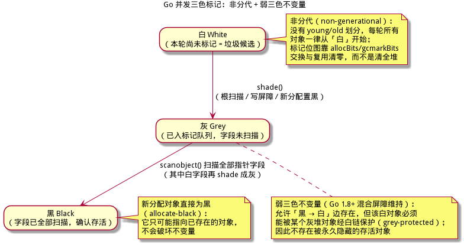
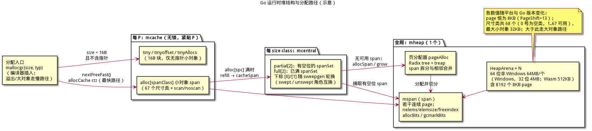
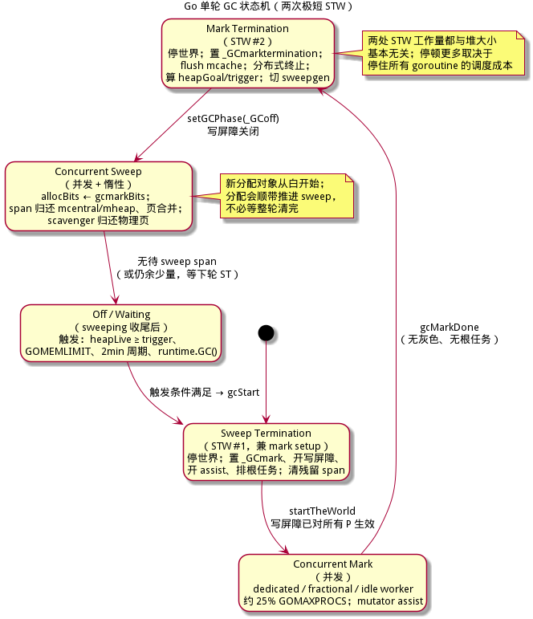
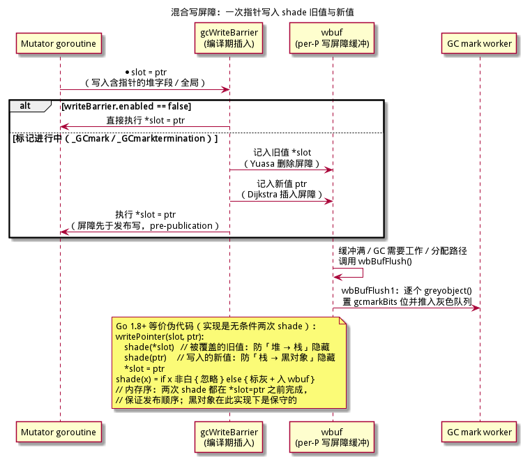
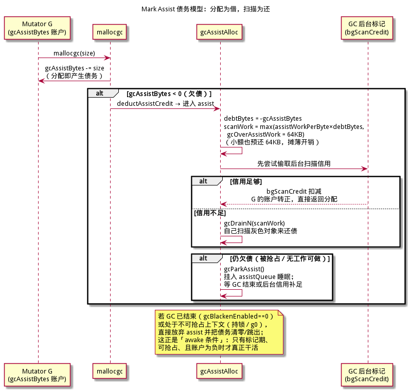
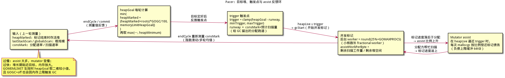
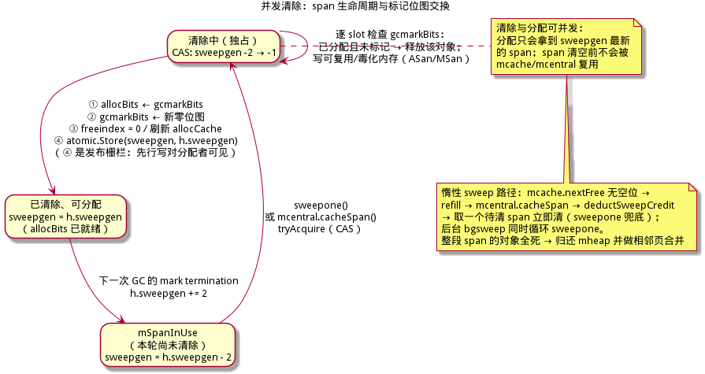
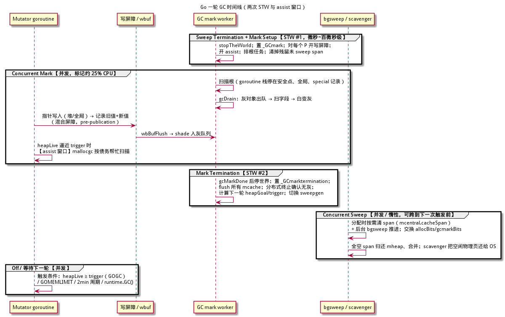

# Go GC 算法详解 —— 非分代并发标记清除

> **面向读者**：完全没有 GC（垃圾回收）背景的开发者。本文从"内存为什么要回收"讲起，一路拆到 Go 运行时（runtime）的垃圾收集器：并发三色标记、混合写屏障（hybrid write barrier）、Mark Assist（标记协助）、Pacer（调速器）、并发惰性清除（lazy sweep）。
> **本系列（建议按序阅读）**：[Serial / Parallel 分代](../serial-parallel-算法详解/serial-parallel-算法详解.md) · [CMS](../cms-算法详解/cms-算法详解.md) · [G1](../g1-算法详解/g1-算法详解.md) · [Shenandoah](../shenandoah-算法详解/shenandoah-算法详解.md) · [Go GC](go-gc-算法详解.md) · [ZGC](../zgc-算法详解/zgc-算法详解.md)
> **目标**：读完并配合伪代码，你能独立实现一个 Go 风格的并发标记清除 GC。文中所有示意图均由 PlantUML 生成，源文件在同目录 `figures/` 下（`.puml`）可复编译。
> **零基础入口**：完全不懂 GC 的读者，请先看本文 [§1 必备基础](#1-必备基础15-分钟速览)，或对照 [ZGC 算法详解](../zgc-算法详解/zgc-算法详解.md) 的 [§1 垃圾回收：为什么需要它](../zgc-算法详解/zgc-算法详解.md#1-垃圾回收为什么需要它)、[§2 经典 GC 算法回顾](../zgc-算法详解/zgc-算法详解.md#2-经典-gc-算法回顾)、[§3 三色抽象](../zgc-算法详解/zgc-算法详解.md#3-三色抽象并发标记正确性的判据) 三章，概念完全通用。
> **并发标记写屏障对照**：Go 的混合屏障解决了 CMS 增量更新/删除屏障各自的漏标窗口，建议对照 [CMS 算法详解](../cms-算法详解/cms-算法详解.md) 阅读。
>
> **版本说明**：本文以 Go 1.26 的 runtime 实现为基准（核对源码 `/usr/local/go/src/runtime` 与 Go 1.26.1 源码），涉及历史行为时明确标注版本；运行时内部结构、常量与函数名可能随版本变化，正文会标注"随版本变化"。

---

## 目录

1. [必备基础（15 分钟速览）](#1-必备基础15-分钟速览)
2. [定位、设计与演进史](#2-定位设计与演进史)
3. [触发与目标：GOGC、GOMEMLIMIT 与 Pacer](#3-触发与目标gogcgomemlimit-与-pacer)
4. [运行时堆结构：Arena / Span / Size Class](#4-运行时堆结构arena--span--size-class)
5. [根集合：栈、全局与 special 记录](#5-根集合栈全局与-special-记录)
6. [并发三色标记与混合写屏障](#6-并发三色标记与混合写屏障)
7. [Mark Assist：分配方的还债机制](#7-mark-assist分配方的还债机制)
8. [Pacer 调速器详解](#8-pacer-调速器详解)
9. [并发清除：Lazy Sweep 与位图交换](#9-并发清除lazy-sweep-与位图交换)
10. [单轮 GC 完整流程：状态机与时间线](#10-单轮-gc-完整流程状态机与时间线)
11. [正确性论证](#11-正确性论证)
12. [从零实现最小路线（0~8 步）](#12-从零实现最小路线08-步)
13. [关键数据结构与伪代码](#13-关键数据结构与伪代码)
14. [参数与调优表](#14-参数与调优表)
15. [与 Java 系收集器对比](#15-与-java-系收集器对比)
16. [术语速查表](#16-术语速查表)
17. [延伸阅读与参考](#17-延伸阅读与参考)

---

## 1. 必备基础（15 分钟速览）

本节自足：完全不懂 GC 的读者只看这里也能继续。想更深入，再看 ZGC 文档 §1–3（链接见文首）。

### 1.1 堆、根与可达性

程序运行时不断创建对象，它们放在**堆（heap）**里。判断对象还能不能用，靠**可达性（reachability）**：从一组确定的入口出发，顺着引用一路走，能走到的对象是**活的（live）**；走不到的是**垃圾（garbage）**。

这组入口叫 **GC 根（GC roots）**。Go 的根包括：

| 根 | 说明 |
|----|------|
| goroutine 栈 | 每个 goroutine 的栈上局部变量、参数、寄存器溢出槽 |
| 全局变量 | 包级变量（data/bss 段） |
| special / 运行时记录 | 终结器（finalizer）、cleanup、弱指针、未处理的缓存等 |
| 正在执行的寄存器 | 每个 P/M 的寄存器上下文在安全点被保存后扫描 |

两个角色：**Mutator（改变者）**指应用程序（不断分配、改引用），**Collector（收集器）**指 GC 线程。GC 要做的就是：在 Mutator 运行的同时，找出并回收不可达对象。

### 1.2 STW 与三大指标

最朴素的做法是 **STW（Stop-The-World，停止世界）**：暂停所有 Mutator，然后安心扫描、回收。简单但停顿长。评价 GC 看三个指标：

| 指标 | 英文 | 含义 |
|------|------|------|
| 吞吐 | Throughput | 有用工作时间占比；GC 吃掉的 CPU 越少越好 |
| 延迟 | Latency / Pause | 单次停顿的长度，尤其最坏停顿 |
| 占用 | Footprint | GC 自身及其策略让堆多占的内存量 |

Go GC 的立场：**优先低延迟与简单性**，用适度的吞吐/内存代价换取与堆大小基本无关的短停顿（§2 详述）。

### 1.3 三色抽象与漏标

把对象分为三色来推理并发遍历：

| 颜色 | 含义 |
|------|------|
| 白 White | 本轮标记还没发现它（可能死、也可能暂时没扫到） |
| 灰 Grey | 已发现，但字段还没扫描（在标记队列里） |
| 黑 Black | 字段已全部扫描完，确认存活 |

遍历就是白 → 灰 → 黑。**并发标记的正确性核心**：Mutator 可能在 GC 遍历的同时改引用，导致"活对象永远没被发现"——这叫**漏标（对象被错误回收，可能崩溃或数据损坏）**。

漏标的经典竞态需要两个条件同时成立：

1. Mutator 把白对象写进了黑对象（新边黑→白，**插入漏标**）；或 Mutator 抹掉了灰/黑对象指向白对象的最后一条路径（**删除漏标**）。
2. GC 此后再也走不到那个白对象。

因此有两条修补路线：**插入屏障（incremental-update / Dijkstra）**——写新值时把新值标灰；**删除屏障（snapshot-at-the-beginning / Yuasa）**——覆盖旧值前把旧值标灰。Go 1.8 起用的是**混合写屏障**，两种都做（§6）。



### 1.4 屏障、卡表、记忆集分别是什么

| 概念 | 英文 | 是什么 | Go 用不用 |
|------|------|--------|-----------|
| 写屏障 | write barrier | 写引用前后自动插入的一小段代码，用于维护 GC 不变量 | 用（混合屏障） |
| 读屏障 | read barrier | 读引用时插入的检查；移动式/染色指针 GC 常用 | 不用（Go 不移动对象，读是普通内存访问） |
| 卡表 | card table | 把堆按固定大小（如 512B）分块，记录"脏卡"，供分代 GC 找老年代→新生代引用 | 不用（Go 非分代） |
| 记忆集 | remembered set | 记录跨区/跨代引用的集合，G1 等分区 GC 依赖 | 不用（Go 无跨代假设） |

Go 的写屏障**不是**卡表机制，也不用记忆集——因为 Go **非分代（non-generational）**且**非移动（non-moving）**。它的写屏障只有一个职责：在并发标记期间维持三色不变量，使标记不漏。

> **常见误区**："所有 GC 都要卡表。" 不对。卡表是分代 GC 为追踪"老→新"引用而引入的优化；Go 每轮扫描全部根和全部存活对象，不需要跨代记录。

**一句话总结**：Go 用三色抽象描述并发标记正确性，用"写屏障"守住不变量，靠"非分代 + 非移动"避开卡表、记忆集与读屏障。

---

## 2. 定位、设计与演进史

### 2.1 一句话定位

> **Go GC 是一款非分代、非移动、并发的三色标记清除（concurrent mark-sweep）收集器**：只有**两次极短的 STW**（mark setup 与 mark termination），标记与清除绝大部分与 Mutator 并发完成；停顿时间与堆大小基本无关（但**不是零**）。

### 2.2 设计哲学：为什么是"非分代 + 非移动 + 并发"

| 决策 | 换来什么 | 代价 |
|------|----------|------|
| **非分代** | 不需要跨代记忆集/卡表，不需要额外的代际写屏障；实现简单 | 每轮都要重新扫描全部存活对象，浮动垃圾（本轮分配但已死的对象）要到下轮才回收 |
| **非移动** | 对象地址稳定：cgo、`unsafe`、外部指针、栈上指针都无需修正；无读屏障 | 堆会碎片化；靠 size class 的尺寸隔离（size-segregated）抑制碎片 |
| **并发标记清除** | 停顿短、与堆大小基本解耦 | 需要写屏障与 assist，吞吐低于纯 STW 收集器 |
| **无（少）旋钮** | 默认行为可用；GOGC 是唯一参数直到 Go 1.19 | 极端场景需要 GOMEMLIMIT 等补充（Go 1.19 加入） |

Go 团队认为分代的潜在收益（少扫一些老对象）不足以抵消其复杂度与写屏障开销：Go 有逃逸分析（escape analysis），大量短命对象根本不上堆；上堆对象里"朝生夕死"的比例没有 Java 那么极端。这是**取舍**，不是"分代不好"。

### 2.3 两次 STW 分别做什么

| STW | 运行时名字 | 干什么 | 为什么短 |
|-----|-----------|--------|----------|
| STW #1 | **Sweep Termination / mark setup** | 停世界；置 `_GCmark`、对每个 P 打开写屏障、打开 assist、把根标记任务入队；顺带清掉上轮残留未 sweep 的 span | 只做与堆大小无关的固定工作 |
| STW #2 | **Mark termination** | 停世界；置 `_GCmarktermination`；flush 所有 mcache、处理终结器/弱引用收尾、确认无灰色工作、计算下一轮 `heapGoal/trigger`、切换 sweep 代 | 标记工作已并发做完，只剩收尾 |

实际停顿更多取决于**停住全部 goroutine 的调度成本**（与 GOMAXPROCS、正在运行的 goroutine 数量相关），而不是堆大小。Go 1.8 起典型停顿"通常在 100 微秒以下，often as low as 10 microseconds"（Go 1.8 Release Notes 原话）。

> **常见误区**："Go GC 停顿为零。" 正解：两次 STW 依然存在，只是**与堆大小基本无关**且通常极短；Go 的卖点是"停顿小且稳定"，不是"无停顿"。

### 2.4 演进史（版本必须准确）

| 版本 | 里程碑 | 备注 |
|------|--------|------|
| Go 1.5 | 首个**并发**标记清除 GC：三色标记 + 写屏障，标记与 Mutator 并发 | STW 大幅缩短，但 mark termination 仍可能较长 |
| Go 1.6 | 继续压缩停顿（扫描与调度优化） | 为后续的并发栈扫描铺路 |
| Go 1.7 | 初始**栈扫描并发化**；仍使用 Dijkstra 插入写屏障 | 剩余的主要 STW 来源是 mark termination 的**栈重扫**，可达数十~数百毫秒 |
| Go 1.8 | **混合写屏障**（Dijkstra 插入 + Yuasa 删除），消除 STW 栈重扫（设计提案 [17503](https://github.com/golang/proposal/blob/master/design/17503-eliminate-rescan.md)） | 停顿通常 <100µs，常低至 ~10µs |
| Go 1.14 | **基于信号的异步抢占**（asynchronous preemption） | 长循环/无函数调用也能到安全点，栈扫描与 GC 调度更及时 |
| Go 1.18 | **Pacer 重设计**（设计提案 [44167](https://github.com/golang/proposal/blob/master/design/44167-gc-pacer-redesign.md)）；GOGC 目标把根集合（栈+全局）计入 | "GOGC includes the root set only as of Go 1.18"（GC Guide） |
| Go 1.19 | **GOMEMLIMIT** 软内存上限（设计提案 [48409](https://github.com/golang/proposal/blob/master/design/48409-soft-memory-limit.md)）与 `debug.SetMemoryLimit` | GOGC 之外第二个旋钮 |
| Go 1.24 | `runtime.AddCleanup` / `weak` 包（可观察对象死亡的新机制） | 终结器仍保留但不推荐新代码使用 |
| Go 1.25 | **实验性 Green Tea GC**：改进小对象标记/扫描的局部性与 CPU 可扩展性，`GOEXPERIMENT=greenteagc` | 实验特性 |
| Go 1.26 | Green Tea 成为**默认** GC（可 `GOEXPERIMENT=nogreenteagc` 关闭） | 本文其余算法概念不变 |

> Green Tea 只改了"怎么高效地扫描小对象"，不改变三色、混合屏障、Pacer 的骨架；本文只此一句提及。

**一句话总结**：Go GC = 非分代 + 非移动 + 并发标记清除；Go 1.8 的混合屏障消灭了栈重扫，Go 1.19 补上 GOMEMLIMIT，两次 STW 极短且与堆大小基本无关。

---

## 3. 触发与目标：GOGC、GOMEMLIMIT 与 Pacer

### 3.1 GOGC：相对存活堆的倍数增长触发

`GOGC` 的语义是**下一次 GC 的目标堆大小**：相对上一轮标记结束时存活堆 + 根集合的百分比增长。

官方 GC Guide 的公式：

```
Target heap = Live heap + (Live heap + GC roots) * GOGC / 100
```

Go 运行时 `gcController.commit` 里的实现（名字与字段一一对应）：

```
gcPercentHeapGoal = heapMarked
                  + (heapMarked + lastStackScan + globalsScan) * gcPercent / 100
若 gcPercentHeapGoal < heapMinimum：取 heapMinimum
其中 heapMinimum = defaultHeapMinimum * gcPercent / 100
     defaultHeapMinimum = 4MiB（GOGC=100 时；随版本/实验可能变化）
```

含义：

- `GOGC=100`（默认）：目标堆 ≈ 上轮存活堆的 2 倍（再把根集合算进去）。存活 8MiB、根 2MiB，则新分配 10MiB 后触发。
- `GOGC=200`：目标约 3 倍，GC 次数减半、CPU 开销约减半，内存峰值约翻倍。
- `GOGC=50`：目标约 1.5 倍，内存省、GC 更频繁。
- `GOGC=0`：`heapMinimum=0`，几乎持续回收，仅用于调试。
- `GOGC=off`（等价 `debug.SetGCPercent(-1)`）：关闭按堆增长触发的 GC。注意：**GOMEMLIMIT 仍然生效**，`runtime.GC()` 仍可强制回收。
- 小堆保护：`heapMinimum`（默认 4MiB，随 `GOGC` 缩放）避免"活着很少、分配很多"时疯狂 GC。
- 定时兜底：即使不分配，若 `GOGC` 未关闭，运行时每 **2 分钟**（`forcegcperiod`）强制一轮 GC。

> **常见误区**："GOGC 是最大内存上限。" 不是。它是"相对存活堆的增长比例"，堆越大目标越大，没有绝对上限；要上限请用 GOMEMLIMIT。

### 3.2 GOMEMLIMIT：Go 1.19 的软内存上限

Go 1.19 加入 `GOMEMLIMIT`（环境变量）与 `runtime/debug.SetMemoryLimit`（API）。它限制的是**运行时管理的总内存**，对应 `runtime.MemStats` 的：

```
Sys - HeapReleased
```

（等价 `runtime/metrics` 的 `/memory/classes/total:bytes - /memory/classes/heap/released:bytes`；不含二进制映射、C 内存、OS 代持内存。）

要点：

- **软（soft）上限**：运行时不保证绝不超限，只承诺"尽力"。
- **与 GOGC 配合**：`heapGoal = min(GOGC 目标, 内存上限目标)`（源码 `gcControllerState.heapGoalInternal`）。两者谁更紧谁说了算。
- **GOGC=off 时也生效**：这正是"最大化利用内存配额"的推荐组合（GC Guide）。
- **防抖动（thrashing）**：当内存上限压得过低，运行时把 GC 的 CPU 占用限制在约 **50%**（窗口约 `2 * GOMAXPROCS` CPU·秒），宁可暂时超限也不让程序停滞；这是"软"的由来。
- 默认值：`off`/未设置等价于 `math.MaxInt64`（实际上不限制）。
- 调优建议（GC Guide）：容器内留 5–10% 余量；不要在共享环境里把 `GOGC=off` 当"预留内存"手段。

### 3.3 相关性 API 一览

| API / 环境变量 | 作用 | 版本 |
|----------------|------|------|
| `GOGC` | 目标增长百分比；`off` 关闭 | `off` 支持自早期版本；与 GOMEMLIMIT 的配合自 Go 1.19 起 |
| `runtime/debug.SetGCPercent(p int) int` | 运行时改 GOGC；`-1` 等于 off；返回旧值 | 一直有 |
| `GOMEMLIMIT` | 软内存上限，接受 `4GiB` 等字节单位或 `off` | Go 1.19 |
| `runtime/debug.SetMemoryLimit(limit int64) int64` | 运行时改内存上限；返回旧值 | Go 1.19 |
| `runtime.GC()` | 强制跑完整的"一轮"（sweep termination → mark → mark termination → sweep），阻塞到本轮结束 | 一直有 |
| `runtime/debug.FreeOSMemory()` | 强制 GC 并把空闲内存归还 OS（scavenge） | 一直有 |
| `GODEBUG=gctrace=1` | 每轮 GC 打印一行统计（目标、停顿、堆大小、CPU 占比） | 一直有 |
| `runtime/metrics` | 读取 `/gc/heap/goal:bytes`、`/gc/heap/live:bytes`、`/gc/cycles/total:gc-cycles` 等 | Go 1.16+ |

`runtime.GC()` 的一个细节：它保证等完整一轮结束，但**不等终结器/cleanup 执行完**，只等它们全部入队（GC Guide 原文：`runtime.GC will not wait until cleanups for unreachable objects are executed, only until they are all queued.`）。

**一句话总结**：GOGC 决定"相对存活堆何时触发"（默认增长 100%），GOMEMLIMIT 决定"总内存软上限"（Go 1.19），运行时取两者更紧的目标，并由 Pacer 落实成具体触发点。

---

## 4. 运行时堆结构：Arena / Span / Size Class

理解后续"分配时触发 GC"和"lazy sweep"，必须先看清 Go 的堆分层。



### 4.1 从大到小的层级

| 层级 | 粒度 | 说明 |
|------|------|------|
| **HeapArena** | 64MiB（64 位非 Windows；Windows/32 位 4MiB，Wasm 512KiB，随版本/平台变化） | 地址对齐的大块虚拟内存；元数据含 page→span 映射。指针/标量位图早期按 arena 内每个 8 字节字存放在此；**Go 1.22 起多数小对象的指针位图改存对象旁/span 头（`heapBitsInSpan`），必要时才回落到独立位图**（随版本变化） |
| **page** | **8KiB**（`PageShift=13`，所有平台恒定） | 分配的最小物理单位；64MiB arena 正好含 8192 个 page |
| **mspan（span）** | 1 个或多个连续 page | 同尺寸对象的数组；记录 `startAddr/npages/elemsize/nelems/freeindex/allocBits/gcmarkBits/sweepgen` 等 |
| **size class** | 68 类 | 0 号是空类（0 字节）；1..67 覆盖 8B..32KiB（`MaxSmallSize=32768`）。前 32 类覆盖 8B..1024B（8B 基本粒度、含 16/32 对齐档），之后按约 12.5% 的比例递增直到 32KiB |
| **object** | size class 决定 | 大型对象（>32KiB，large object）直接由多 page 的 span 承载，不细分 |

`TinySize=16`：小于 16 字节且**不含指针**的小对象走 **tiny allocator**，多个小对象拼进同一个 16B 块，只有整块不可达才回收。

> 这些常量核对自 Go 1.26.1 `internal/runtime/gc/sizeclasses.go`（生成文件）。**它们随版本变化**：例如尺寸类数量历史上有 67→68 的变化，最小堆/分配头策略也有实验项；实现时请以你的版本源码为准，概念不变。

### 4.2 三层分配缓存

| 结构 | 归属 | 并发性 | 作用 |
|------|------|--------|------|
| **mcache** | 每个 P 一份 | 无锁（绑定 P） | 缓存各 size class 的当前 span（`alloc[spanClass]`），分配几乎只碰这里 |
| **mcentral** | 每个 size class 一份 | 有锁 | 管理该尺寸的 span 集合：`partial`（有空位）/`full`（已满），各两个槽位随 `sweepgen` 轮换 swept/unswept |
| **mheap** | 全局一份 | 有锁 | 页分配器（pageAlloc / radix tree + treap）负责从 arena 切 span、释放时合并相邻页 |

### 4.3 mallocgc 的快速路径（缩影）

```
mallocgc(size, typ):
    if size == 0: return &zerobase
    if gcBlackenEnabled != 0: deductAssistCredit(size)   // ← assist 入口（§7）
    if size < 16B 且 typ 无指针:
        x = tiny 分配（mcache.tiny/tinyoffset 指针递增）
    elif size <= 32KiB:
        spc = size_to_class(size)
        x = mcache.nextFree(spc)          // allocCache 位图 + ctz，最快
    else:
        x = 大对象路径
    // 慢路径（span 满）：refill → mcentral.cacheSpan →（可能需要 sweep）→ mheap.alloc
    if checkGCTrigger && gcTriggerHeap.test():  // heapLive ≥ trigger
        gcStart(gcTriggerHeap)                   // ← 分配触发的 GC 入口
```

`nextFreeFast` 用 `allocCache`（`allocBits` 的补码缓存）做 `ctz`（数尾零）找空位，是分配的最热路径；span 满则 `mcache.refill`，从 mcentral 换一个 span——这一步也顺带承担 **lazy sweep**（§9）。

**一句话总结**：Go 堆 = HeapArena（64MiB）→ 8KiB page → mspan（按 68 个 size class 切对象），分配走 P 专属的 mcache 免锁快路径，mcache→mcentral→mheap 逐级回退。

---

## 5. 根集合：栈、全局与 special 记录

### 5.1 根有哪些、怎么扫

| 根 | 扫描方式 |
|----|----------|
| goroutine 栈 | 把 goroutine 停在**安全点（safe point）**，按函数元数据（pc→stack map）逐帧精确扫描，把指针置灰；扫描完 resume |
| 全局变量 | 按 `moduledata` 的指针位图扫描 data/bss 段 |
| special 记录 | 终结器（finalizer）、cleanup、弱指针、profile buffer 等运行时记录；由 `markroot` 的各个 job 处理 |
| 运行时缓存 | 如 `mcache.tiny`（存放在非 GC 内存里的堆指针）在 mark termination 的 `releaseAll` 中清空，避免 GC 回收 tiny 块后缓存悬挂；tiny 对象本身无指针，不需要作为根扫描 |

标记工作被切成若干 **root job**（`work.markrootJobs`），多个 mark worker 用原子取号（`gcNextMarkRoot`）并行领取。

### 5.2 为什么栈写不需要写屏障

写屏障只保护**堆对象字段与全局槽**。对**当前 goroutine 当前栈帧**的写入，编译器**不插入**写屏障，原因有二：

1. 栈在标记开始时是"灰"的：整栈会被扫描一次；且一旦扫描完成就变黑，此后不再需要重扫（混合屏障保证，§6.4）。
2. 栈的写入只会是"把对象引用从寄存器/堆搬到栈"，混合屏障里的 `shade(*slot)` 已经覆盖了从堆抹掉引用的情形（删除屏障），`shade(ptr)` 覆盖了从栈写进堆的情形（插入屏障）。

但有例外：**通过指针写入其它栈帧**（up-pointer，"指针已经沿调用栈传下去"）时，编译器不知道它指向栈还是堆，会保守地插入写屏障；**栈到栈的复制**（channel 发送、`go` 语句启动新 goroutine）有专门处理：

- channel 发送：若源栈或目标栈仍为灰，需要 shade；
- 启动 goroutine：目标栈总是黑，源栈若灰则 shade。

### 5.3 安全点与异步抢占

扫描一个正在跑的 goroutine 的栈不安全（栈会变），必须让它停到**安全点**：运行时在函数序言、函数调用、循环回边等位置埋检查点，goroutine 到此自愿停顿。

Go 1.14 引入**基于信号的异步抢占**：即使卡在无函数调用的紧凑长循环里，运行时也能用信号（`SIGURG`）把 goroutine 拽到安全点，避免"GC 等一个 goroutine 等到天荒地老"。这是"停顿与堆大小无关"的重要支撑。

### 5.4 栈会移动，怎么办

goroutine 栈可增长：旧栈内容整体复制到新栈，所有指向栈的指针都要修正。栈扫描期间 goroutine 是停住的，GC 不会读到半搬家状态；栈复制本身也对"来自堆的栈指针"做相应处理（这是"非移动 GC 里唯一会移动的东西是栈"的一个有趣事实）。

**一句话总结**：Go 的根 = 每个 goroutine 的栈（停在安全点精确扫描、只扫一次）+ 全局变量 + special 记录；栈写不插屏障，栈到栈复制（channel/go）特殊处理。

---

## 6. 并发三色标记与混合写屏障



### 6.1 两次 STW 之间的并发标记

```
STW #1（Sweep Termination + mark setup）：
    setGCPhase(_GCmark)
    对每个 P 打开写屏障（writeBarrier.enabled = true）
    打开 assist（gcBlackenEnabled = 1）
    把所有根标记任务入队（work.markrootJobs）
    新分配对象一律视为"黑"（allocate-black）
startTheWorld()
```

随后进入 **Concurrent Mark**：标记工作由三类 **mark worker（标记工作者）**分担：

| 模式 | 调度 | 用途 |
|------|------|------|
| `gcMarkWorkerDedicatedMode` | 运行时固定占用 P，不可被抢占调度 | 保证后台标记速率：约 `round(GOMAXPROCS * 0.25)` 个（`gcBackgroundUtilization=0.25`） |
| `gcMarkWorkerFractionalMode` | 按时间片（分数配额）运行 | 核数小时补齐"25% 不是整数"的缺口（如 GOMAXPROCS=2/3/6） |
| `gcMarkWorkerIdleMode` | P 空闲时运行 | 白捡空闲 CPU，不影响 Mutator |

worker 循环的核心是 `gcDrain`：从**灰色工作队列**取对象 → `scanobject` 扫描其指针字段 → 白字段调 `shade` 变灰入队。工作队列是按 P 的本地 `gcWork` 缓存 + 全局队列，支持**工作窃取（work stealing）**。分布式终止协议（`gcMarkDone`）在"本地/全局队列都空且根任务发完"时，用 STW 再确认一遍，然后进入 mark termination。

### 6.2 标记位在哪里：对象没有 GC 头

Go 对象**没有**逐对象的 GC 头（header）。"这个对象标了没"存在 span 的 **`gcmarkBits` 位图**里：

```
给定对象地址 p：
    span = spanOf(p)                       // 用 arena/page 索引查 mspan
    if span == nil: 不是堆指针，忽略
    idx  = (p - span.base()) / span.elemsize
    bit  = span.gcmarkBits.bit(idx)        // 1 = 本轮已标记（黑/灰）
```

对象的**指针/标量布局**由 **heap bits** 记录（每个 8 字节字一位）：Go 1.22 起，多数小对象的位图内联在对象旁或 span 头（`heapBitsInSpan`），更大的对象或特殊情形回落到 arena 位图（随版本变化）。扫描对象时，GC 只对"是指针"的字做处理。收益：标记元数据与对象近、缓存友好；代价：每次从地址找元数据要走 span 索引。

> **常见误区**："每个 Go 对象开头有个 GC 标记字。" 不对。标记在 span 的**标记位图** `gcmarkBits` 里，对象内部只有数据。部分带指针的小对象可能带 8 字节分配头（malloc header：Go 1.22 起作为实验引入、后续版本转正为默认，随版本变化），它是"对象指针布局"的记录入口，也不是给 GC 查标记用的。

### 6.3 混合写屏障（Go 1.8+）

`runtime/mbarrier.go` 给出的语义伪代码：

```
writePointer(slot, ptr):
    shade(*slot)   // Yuasa 删除屏障：被覆盖的旧值
    shade(ptr)     // Dijkstra 插入屏障：写入的新值
    *slot = ptr

shade(x):
    if x == nil or x 已标灰/黑: return
    // 实际实现是把 x 记入 per-P 的 wbuf，稍后批量处理：
    wbuf.append(x)  →  wbBufFlush1() 时 greyobject(x) 置 gcmarkBits 并入队
```

注意三点准确性：

1. **实现是无条件的两次 shade**。设计提案 17503 写的是"若当前栈是灰才 shade(ptr)"的**条件**形式，runtime 注释也保留了这个概念版伪代码；但实现选择无条件 shade，原因在 `mbarrier.go` 的"内存序"注释里：若让屏障条件化于 `slot` 所在对象的颜色，需要昂贵的内存屏障，否则可能出现 Mutator 先写 `slot` 再读标记位、GC 线程先写标记位再读 `slot` 的重排，最终"双方都没看见对方"；无条件把新值置灰，省掉内存屏障。
2. **shade 不等于立刻递归标记**：它只把对象推进 `wbuf`（每 P 的写屏障缓冲），缓冲满或 GC 需要工作时 `wbBufFlush` 批量置位入队。屏障是 **pre-publication** 的：先做屏障，再执行 `*slot = ptr`，保证任何其他 goroutine 看到新引用时，那个对象已经被保护。
3. **为什么两次都要**（17503 的三条直觉，逐条对照）：
   - `shade(*slot)`：防止 Mutator 把"唯一指向白对象的指针"从堆移到自己栈上（堆→栈隐藏）；
   - `shade(ptr)`：防止 Mutator 把"栈上唯一指向白对象的指针"装进黑对象（栈→堆隐藏）；
   - 栈一旦扫描变黑，`shade(ptr)` 就不再必要（黑栈上不可能藏着未变黑的指针），但 `shade(*slot)` 仍拦住后续任何堆侧隐藏——这就是"**栈只扫一次**"的关键。



#### 一次指针写入 shade 两个对象的追踪

```
初始（标记进行中）：
  A 是未扫描的灰对象，A.next = B，B 白（唯一路径 A→B）
  Mutator 栈上持有 C，C 白（栈尚未扫描）
  Mutator 执行： A.next = C      // 老值 B 被覆盖，新值 C 被写入

屏障执行：
  shade(B)  → B 置灰入队       // 删除屏障：防止 A 变黑后 B 被隐藏
  shade(C)  → C 置灰入队       // 插入屏障：防止 C 只存在于栈上而栈已黑
  A.next = C

结果：B、C 都不会被漏标；即使此后 A 被扫描成黑，B 已经安全。
```

### 6.4 为什么它消除了 STW 栈重扫

Go 1.7 用的是 Dijkstra 插入屏障，栈必须被当成"永久灰"：栈扫描成黑后，Mutator 一执行栈又会"变回灰"（栈写没有屏障），于是 mark termination 必须**停住全世界重扫所有活跃栈**——goroutine 多时可长达数十~数百毫秒。

混合屏障的删除部分 `shade(*slot)` 补上了"堆→栈隐藏"的洞：栈上的白指针只可能来自堆，而任何把指针从堆抹掉的写都会 shade 它。于是**栈扫描一次即可永久变黑**，`shade(ptr)` 也随之失效，栈重扫、栈屏障（stack barrier）、重扫列表全部可以删除。这是 Go 1.8 停顿从"几十毫秒"掉到"几十微秒"的直接原因。

> 想对照另一种并发标记路线，见 [CMS 算法详解](../cms-算法详解/cms-算法详解.md)：CMS 用增量更新/删除屏障 + 卡表 + 重新标记（remark）处理漏标，Go 用混合屏障把收尾的 STW 压到几乎为零。

### 6.5 白色对象如何判定

一句话：**本轮 `gcmarkBits` 为 0 的对象就是白**。因为：

- 所有对象在 GC 开始时不改位图（不清全堆），而是**换一套新的零位图**——清除阶段把 `gcmarkBits` 变成 `allocBits` 后，给 span 挂一张新的零位图（§9）。所以"上一轮的标记"天然作废，无需清零。
- 新分配对象**直接置黑**（allocate-black）：`mallocgc` 在分配时调用 `gcmarknewobject` 把新对象在 `gcmarkBits` 里标上，避免"新对象白、但已从黑对象可见"的竞态。
- 因此白色 = 本轮开始前就存在、且到现在还没被任何根/灰对象到达 = 垃圾候选。

**一句话总结**：Go 在两次 STW 之间用三色标记 + 混合写屏障并发标记；屏障无条件 shade 旧值与新值，使栈只扫一次，从而消除 Go 1.7 的 STW 栈重扫。

---

## 7. Mark Assist：分配方的还债机制

### 7.1 为什么需要 assist

后台标记只承诺约 25% 的 CPU（还要被调度），如果 Mutator 分配得比标记快，堆会冲破目标，甚至让标记永远追不上。Go 的解法：**谁分配，谁按比例偿还标记工作**——这就是 **Mark Assist（标记协助）**。它把"分配速率 > 标记速率"时的差额强制变成 Mutator 自己的工作，保证标记**可终止**且堆增长受控。

### 7.2 债务模型：分配为借，扫描为还

每个 goroutine 有一个账户 `gcAssistBytes`（正=信用，负=欠债）：

```
mallocgc(size):
    if gcBlackenEnabled == 0: 跳过            // 非标记期不记账
    gcAssistBytes -= size                     // 分配即借债
    if gcAssistBytes < 0:
        gcAssistAlloc()                       // 欠债 → 强制还
```

`gcAssistAlloc` 的还债逻辑（对应源码）：

```
gcAssistAlloc(gp):
    if gp == g0 或 持锁/preemptoff: return     // 不可抢占上下文不还
    if gcCPULimiter.limiting(): return         // CPU 限流期间不还（防抖动）
    retry:
    debtBytes = -gp.gcAssistBytes
    scanWork  = assistWorkPerByte * debtBytes
    if scanWork < 64KiB:                       // gcOverAssistWork
        scanWork = 64KiB                       // 小额时多还一点，摊薄开销
        debtBytes = assistBytesPerWork * scanWork
    // 1) 先偷后台攒下的扫描信用
    stolen = min(bgScanCredit, scanWork); bgScanCredit -= stolen
    gp.gcAssistBytes += assistBytesPerWork * stolen + 1
    scanWork -= stolen
    // 2) 信用不够，自己干活
    if scanWork > 0: gcDrainN(gcw, scanWork)   // 扫描灰色对象，工作量=scanWork
    gp.gcAssistBytes += assistBytesPerWork * workDone + 1
    if gp.gcAssistBytes < 0:
        if gp.preempt: Gosched(); goto retry
        gcParkAssist()                         // 挂入 assistQueue，等信用/GC 结束
```

要点：

- `assistWorkPerByte = 剩余扫描工作量 / 剩余堆空间`（§8），由 Pacer 在整个标记期动态更新；分配越多、标记越落后，比例越高，惩罚越重。
- `gcOverAssistWork = 64KiB`：即使只欠一点，也一次多还 64KiB 的扫描量，把"进入 assist 的开销"摊薄，同时攒下信用供后续分配使用。
- **awake 条件**（何时真正干活）：标记期（`gcBlackenEnabled != 0`）、可抢占（不在 g0、无锁、非 `preemptoff`）、CPU 未限流、账户为负；四者缺一就跳过或挂起。
- `bgScanCredit`：后台 worker 完成的工作会存进信用卡；Mutator 还债时可以先"偷"这部分信用，实现负载再平衡。
- 还不上就 `gcParkAssist` 挂起，等 GC 结束或信用补足被唤醒（`gcWakeAllAssists`）。



### 7.3 一次 assist 偿还的追踪

```
场景：GOGC=100，上轮存活堆 16MiB，本期 heapGoal ≈ 32MiB。
     当前 heapLive = 30MiB，剩余扫描估计 4MiB。
     Pacer：assistWorkPerByte = 4MiB / 2MiB = 2（扫描字节/分配字节）。

时刻 t：goroutine G 的 gcAssistBytes = -8KiB（已欠债）
G 调用 mallocgc(1MiB)：
    gcAssistBytes = -8KiB - 1MiB ≈ -1032KiB
    gcAssistAlloc:
        debtBytes = 1032KiB
        scanWork  = 2 * 1032KiB = 2064KiB   // 需要扫描约 2MiB 的堆
        发现 bgScanCredit = 1MiB
        stolen = 1MiB → 账务抵消 1MiB 分配对应的扫描信用
        剩余 scanWork ≈ 1MiB → gcDrainN 自己扫描约 1MiB
        gcAssistBytes ≥ 0 → 返回，分配成功
```

净效果：G 用约 1MiB 的扫描劳动，换来了额外 1MiB 的分配额度；如果所有 goroutine 都这么干，"分配-标记"就自动配平。

**一句话总结**：assist 是"分配即借债、标记即还债"的反馈机制——分配速率超过后台标记速率时，分配者被迫补课，保证标记收敛、堆不失控。

---

## 8. Pacer 调速器详解

Pacer 是 Go GC 的**反馈控制器**，回答两个问题：

1. **何时触发**下一轮 GC（`trigger`）？
2. 标记期间**assist 比例**多大（`assistWorkPerByte`）？要预留多少"跑道"（`runway`）？



### 8.1 输入：速率比 consMark

运行时在每轮结束时（`endCycle`）测量：

```
consMark ≈ 应用分配速率（字节/CPU 时间） / GC 扫描速率（字节/CPU 时间）
```

直观理解：**Mutator 每分配多少内存的 CPU 时间，才能对应 GC 扫描多少内存的 CPU 时间**。它为下一轮提供"堆长多快、标记能追多快"的预测，并用多轮历史平滑。

### 8.2 输出一：heapGoal 与 trigger

```
heapGoal = min(GOGC 目标, 内存上限目标)
           其中 GOGC 目标在计算时已应用 heapMinimum 下限；
           内存上限目标可以比它更小（此时内存上限说了算），
           超限时该目标还要额外压低

runway   = consMark * (1 - utilization) / utilization * 预计扫描量
           其中 utilization = 0.25（后台标记目标 CPU 占比）
trigger  = clamp(heapGoal - runway, minTrigger, maxTrigger)
           且恒定满足 trigger < heapGoal
```

`runway` 是"GC 一开始，给应用留的分配缓冲"——按"后台只有 25% CPU 在标记"推算：在 GC 追上剩余扫描量的同时，应用大概会分配多少字节。`trigger = heapGoal - runway` 意味着**提前启动**，让标记在堆到达目标时正好收尾。

`minTrigger`/`maxTrigger` 是为了小堆与极端情况保底：不能触发得太早（否则长期"带病运行"浪费 CPU），也不能太晚（没留任何缓冲）。

### 8.3 输出二：assist 比例

`revise` 在整个标记期持续更新：

```
scanWorkRemaining = 预计总扫描量 - 已完成扫描量（下限 1KiB 防除零/负）
heapRemaining     = heapGoal - heapLive（下限 1B）
assistWorkPerByte = scanWorkRemaining / heapRemaining
assistBytesPerWork = 1 / assistWorkPerByte
```

堆增长快/标记落后 → 分子大分母小 → assist 比例上升 → 分配更贵但标记提速。

特殊情况：`heapLive` 已超过 `heapGoal` 时，把目标临时放大 1.1 倍并切换到最坏扫描估计（`maxScanWork`）；目标最多放大到 `hardGoal = (1+GOGC/100)*heapGoal`（防止一轮内无限退让）。

### 8.4 与 GOGC / GOMEMLIMIT 的关系

| 项 | GOGC | GOMEMLIMIT |
|----|------|-----------|
| 决定什么 | 目标堆相对存活堆的倍数 | 总内存软上限换算出的堆目标 |
| 形态 | 无绝对上限（堆越大目标越大） | 绝对上限（超过会紧急压低目标） |
| 谁生效 | 常规情况 | 当内存上限目标更小时 |
| 设为 off | `GOGC=off` 关闭"按堆增长触发" | 关闭内存上限（等价 MaxInt64），回到纯 GOGC 行为 |
| 组合效果 | `GOMEMLIMIT` 生效时，即使 `GOGC=off` 也会因逼近上限而触发 GC | — |

内存上限路径（`memoryLimitHeapGoal`）的思路：从上限里扣掉"非堆的运行时占用与当前已映射未释放内存"，再留一个 3% 的头部余量（至少 1MiB），得到 `goal`；若已超限，还要额外压低以尽快恢复。

### 8.5 过快/过慢的后果

| 偏差 | 后果 |
|------|------|
| GC 触发过晚（触发点太高） | 堆冲过目标 → 内存放大，assist 猛增，mutator 抖动 |
| GC 触发过早 | GC 次数增多、CPU 开销大、吞吐下降；严重时堆还没长起来又开一轮 |
| assist 比例过高 | 分配路径变慢，吞吐、延迟双降（"GC 税"落在分配上） |
| assist 比例过低 | 标记追不上，堆失控，可能 OOM |

> **常见误区**："GOGC 越大越好 / 越小越省。" 两者都对不上：GOGC 大 = 省 CPU 费内存，GOGC 小 = 省内存费 CPU。它是时间/空间权衡的旋钮，Pacer 只是把你选的权衡执行得平滑。

**一句话总结**：Pacer 用上一轮的"分配/扫描速率比"预测本轮，算出触发点（goal − runway）与 assist 比例，让 GC 恰好在堆到目标时完成标记；GOGC 与 GOMEMLIMIT 决定目标，Pacer 决定执行。

---

## 9. 并发清除：Lazy Sweep 与位图交换

标记结束时（STW #2）只是**确认活对象**；真正的"释放"发生在**清除（sweep）**。Go 的清除完全并发，并且大部分是**惰性的（lazy）**：分配碰到哪个 span，就顺手清哪个。

### 9.1 span 的生命周期与 sweepgen

`mspan.sweepgen` 与全局 `mheap_.sweepgen` 的约定（每轮 GC 后全局 +2）：

| `s.sweepgen` | 状态 |
|--------------|------|
| `h.sweepgen - 2` | 需要清除（本轮还没清） |
| `h.sweepgen - 1` | 正在被某个清除者独占 |
| `h.sweepgen` | 已清除、可分配 |
| `h.sweepgen + 1` | 在清除开始前就在 mcache 里，仍需清除 |
| `h.sweepgen + 3` | 已清除但还在 mcache 里 |

获取待清 span 用 **CAS**：`tryAcquire` 把 `sweepgen` 从 `h-2` 抢成 `h-1`，抢到的人独占清除（状态机 + CAS 原子切换，与 xgc 的状态机纪律一致）。

### 9.2 清除一个 span 做什么

```
mspan.sweep(s, preserve=false):   // 示意签名；真实实现见 runtime.mgcsweep.go
    // 用 gcmarkBits 逐 slot 判断
    for each obj in s:
        if allocBits[obj] == 1 and gcmarkBits[obj] == 0:
            回收 obj（必要时毒化内存：ASan/MSan）
            nfreed++
    s.allocCount = nalloc
    s.freeindex = 0
    s.allocBits  = s.gcmarkBits          // ① 交换：活对象位图变成新的分配位图
    s.gcmarkBits = new zeroed bitmap     // ② 新零位图，供下一轮标记
    s.refillAllocCache(0)
    atomic.Store(&s.sweepgen, h.sweepgen) // ③ 发布：此后分配者可见
    if nalloc == 0: mheap_.freeSpan(s)   // 整个 span 空了 → 还页并合并
    else if nalloc == nelems: mcentral.fullSwept.push(s)
    else: mcentral.partialSwept.push(s)
```



### 9.3 为什么"交换位图"是正确的

设想清除与分配并发：

- 交换与 `sweepgen` 发布之间有严格顺序：**先换好 `allocBits`/`gcmarkBits`、重置 `freeindex`，最后才写 `sweepgen`**。分配者只使用 `sweepgen` 最新的 span，因此它看到 span 时可分配状态一定已就绪。`atomic.Store` 充当发布栅栏。
- 正在被清除的 span 不会被分配者拿到（CAS 式独占 + sweepgen 状态）。
- 标记期分配的对象是**黑**的；它们的标记位在 `gcmarkBits` 里，交换后自动变成"已分配"，下一轮从新位图重新开始——不会把活对象清掉，也不会残留旧标记。
- span 内"未分配"的槽位本来 `allocBits=0`，无论标记位如何都当空闲处理；`freeIndexForScan` 机制保证 GC 不会把"刚分配、还没初始化完"的对象误判为可用。

### 9.4 Lazy sweep 的触发路径：从 mcache 分配开始

```
mcache.nextFree(spc):
    if allocCache 还有空位: 直接分配              // 完全不碰 sweep
    refill(spc) → mcentral.cacheSpan():
        deductSweepCredit(spanBytes)               // 记账：为 sweep 预留工作
        优先从 partial/full 的 swept 集合取
        若只有 unswept span：tryAcquire CAS sweepgen
                              → 立即 sweep 这个 span 再用
    if 仍无可用 span: mheap_.allocSpan(...)        // 切新 span / 扩展 arena
```

后台还有 `bgsweep` goroutine 不停调用 `sweepone()` 推进清除，避免"不分配的 span 永远不清"。`sweepone` 从 `mheap_.nextSpanForSweep()` 取任务，清完把页归还页分配器；空闲页由 **scavenger（清道夫）** 后台归还操作系统。

### 9.5 一次 lazy sweep 的追踪

```
1. G 想分配 48B 对象：spc=48B 尺寸类
2. mcache.alloc[spc] 的 allocCache 已无空位（span 满）
3. mcache.refill → mcentral.cacheSpan：
   - 该 size class 的 swept partial 列表为空
   - 找到一个 sweepgen = h-2 的 unswept span（上轮标记后还没清）
4. tryAcquire CAS 成功：sweepgen h-2 → h-1，独占
5. mspan.sweep：假设 170 个槽位里 12 个活、158 个死
   - 逐位对比 allocBits/gcmarkBits，释放 158 个死对象
   - allocBits ← gcmarkBits（只留 12 个 1）
   - gcmarkBits ← 新零位图；freeindex=0；allocCache 刷新
   - atomic.Store(sweepgen, h)；12 个活对象 → partialSwept
6. 控制权回到 mcentral，span 可分配；mcache 取到它
7. G 的 48B 分配从第 0 号空位完成 —— 全程 mutator 自己完成 sweep，
   没有专门停顿，也没有额外 GC 线程介入
```

### 9.6 终结器与 weak/cleanup 的执行时序

- 标记发现"只被终结器可达"的对象时，把它**复活**并入终结器队列（`queuefinalizer`）；`runtime.GC()` 返回时只保证**入队**，不保证执行完。
- `runfinq` goroutine 异步执行终结器；终结器会再产生一轮回收（对象下一轮才真正释放）。
- Go 1.24 起推荐 `runtime.AddCleanup` / `weak.Pointer` 替代终结器：不复活对象、开销更小、可在对象"被发现死"后尽快触发（cleanup 之间可以并发）。

**一句话总结**：清除与分配并发且惰性——分配需要新 span 时顺手清一个，后台 `bgsweep` 兜底；`allocBits ← gcmarkBits` 的交换与 `sweepgen` 的原子发布保证"清完之前绝不复用"。

---

## 10. 单轮 GC 完整流程：状态机与时间线

### 10.1 状态机


| 阶段 | 停不停 | 干什么 | 关键点 |
|------|--------|--------|--------|
| Sweep Termination（STW #1） | STW | 停世界；`setGCPhase(_GCmark)`；对每个 P 开写屏障；开 assist；排根任务；清残留未 sweep span | 固定开销，与堆大小无关；写屏障必须先对所有 P 生效才允许扫描 |
| Concurrent Mark | 并发 | mark worker（dedicated/fractional/idle）与 assist 并行扫根、drain 灰队列；写屏障 shade 新旧值 | 约占 25% CPU；工作窃取 + 分布式终止检测 |
| Mark Termination（STW #2） | STW | 停世界；`_GCmarktermination`；flush 所有 mcache；终结器/弱引用收尾；确认无灰（`gcMarkDone`）；计算下轮 heapGoal/trigger；`h.sweepgen += 2`；`setGCPhase(_GCoff)`；关写屏障 | 停顿主要取决于停 goroutine 的成本 |
| Concurrent Sweep | 并发/惰性 | 分配路径 + `bgsweep` 逐 span 清除；交换位图；空 span 还堆合并 | 与 mutator 分配同时进行，无需等全部清完 |
| Off / Waiting | 并发 | 等下一轮触发：`heapLive ≥ trigger`、GOMEMLIMIT、2 分钟定时、`runtime.GC()` | `GOGC=off` 时 `heapLive ≥ trigger` 这条不再触发（内存上限与显式强制仍有效） |

### 10.2 时间线



读图要点：

- 两次 STW **都很短**，且不随堆增大而线性变长；
- Concurrent Mark 期间有 **assist 窗口**：一旦 `heapLive` 逼近 `trigger`，分配者开始还债，这是"延迟尖峰"的常见来源之一；
- Concurrent Sweep 可以**跨过整个 Off/Waiting 阶段**，直到下一次 STW #1 前才保证清完（`gcStart` 会循环 `sweepone` 兜底）；
- 触发点由 Pacer 提前算出，不是"堆满了才慌"。

**一句话总结**：一轮 GC = 极短 STW 开屏障 → 并发三色标记（worker+assist）→ 极短 STW 收尾 → 并发惰性清除；不移动、不分代、两次停顿与堆大小基本解耦。

---

## 11. 正确性论证

### 11.1 混合屏障为何同时防两类漏标

定义**弱三色不变量（weak tricolor invariant）**：

> 任何"黑对象 → 白对象"的边，其白对象必须能从某个**灰堆对象**出发、经一条**白链**到达（grey-protected）。

- `shade(*slot)`（删除屏障）保证：Mutator 想抹掉"堆→某个白对象"的引用时，该对象先被置灰；白对象不会因为"唯一堆路径被剪断"而失联。
- `shade(ptr)`（插入屏障）保证：Mutator 把白对象装进任何槽位时，该对象先被置灰；黑对象不会凭空多出一条通向"孤白"的边。
- 两者结合 + 新对象 allocate-black，用归纳法可以证明：每次堆写、栈写、扫描、分配、建栈操作后弱三色不变量都保持；因此 GC 不会回收可达对象（soundness），且对象只会白→灰→黑单向推进，标记必然终止（设计提案 17503 附录有完整证明）。

### 11.2 栈扫描一次为何足够

- 栈是根；标记开始后第一次扫描把它由白变黑，其中的指针全部被 shade。
- 此后 goroutine 继续执行，可能向栈写新指针。新指针从哪来？只能来自寄存器或堆。
  - 若来自堆：这个对象在此前是可达的（否则 Mutator 也拿不到它），而"把唯一引用从堆槽位搬到栈"的那次写会把堆槽位覆盖，删除屏障 `shade(*slot)` 已经保护了被覆盖的旧值。
  - 栈内部指针搬家（复用当前帧、传参）不产生新的白对象引用。
- channel/go 的栈到栈复制单独处理（§5.2）。
- 因此**黑栈永远是"对标记安全"的**，不需要 mark termination 重扫——这正是 17503 的结论（第 3 条直觉）。

### 11.3 清除与分配并发为何不冲突

| 风险 | 防护 |
|------|------|
| 分配者拿到"正在被清除"的 span | `tryAcquire` CAS `sweepgen`，一个 span 同一时刻只有一个清除者 |
| 分配者看到"半清完"的位图 | 位图交换与 `freeindex` 重置都发生在 `atomic.Store(sweepgen)` **之前**；分配者只认最新 sweepgen，形成发布/获取顺序 |
| 把刚分配未初始化的对象当成可清内存 | `freeIndexForScan` 只在对象初始化完毕后前移；GC 扫描看到的分配集合不含半成品（issue 54596 的修复思路） |
| 标记期的标记位污染下一轮 | 清除把 `gcmarkBits` 换成全新的零位图，而不是逐位清全 heap |
| 大对象/用户 arena span 被误清 | `preserve`/`isUserArenaChunk` 等分支单独处理，生命周期由引用计数与隔离区接管 |

### 11.4 常见误区合集

> **误区 1**："Go GC 停顿是零。" → 两次 STW 真实存在，只是短且与堆大小基本无关。
> **误区 2**："Go 有卡表和记忆集。" → 非分代非移动，不需要。
> **误区 3**："白对象一定死。" → 并发标记中"白"只表示"尚未发现"，可能马上被 shade。
> **误区 4**："写屏障会立即递归标记。" → 实现是写入 per-P `wbuf` 后批量 flush，屏障本身极轻。
> **误区 5**："GOGC=off 内存就不会被回收。" → GOMEMLIMIT 与 `runtime.GC()` 仍然有效。
> **误区 6**："GOMEMLIMIT 是硬上限。" → 是软上限，为防 thrashing 允许有限超限（GC CPU 限 ~50%）。

**一句话总结**：混合屏障维持弱三色不变量，使栈只扫一次；位图交换 + sweepgen 原子发布保证清除与分配并发安全；所有推理都可以收敛到"不变量在每个操作后仍成立"。

---

## 12. 从零实现最小路线（0~8 步）

> 目标：不要一上来就挑战并发。每一步的产物都能跑、可测、可交付，再逐步替换。每步都给出验收与失败处理。语言不限，伪代码用 Go 风格；**Go 生态里 race detector（`go test -race`）等价于 C/C++ 的 TSan，内存错误用 ASan 思路（Go 可用 checkptr/ASan 交叉验证）**。

### 第 0 步：精确根 + 精确对象布局（硬前提）

- 做什么：能枚举线程/协程栈上的引用（含寄存器溢出）、全局引用；对象元数据能说明"哪些字段是指针"。
- 验收：写一个"影子标记器"，对随机对象图能准确列出全部指针字段；误报/漏报为 0。
- 失败怎么办：若暂时做不到精确栈，可先保守扫描（像 Boehm GC），但**并发移动/位图方案必须精确**；先补齐编译器/运行时协作。

### 第 1 步：STW 的 mark-sweep

- 做什么：从根遍历、位图标记、线性扫堆清除；对象头或外部 span 元数据记录尺寸与标记位。
- 验收：最小用例（创建→断引用→回收→地址复用）；`go test -race` / ASan 无错误；差分测试对比"影子存活集"。
- 失败怎么办：先修根枚举与位图索引；**不要跳过这一步**，后面所有并发都建立在它之上。

### 第 2 步：并发标记 + 插入屏障（Dijkstra）

- 做什么：STW 开写屏障；后台 worker 从灰队列取对象扫描；Mutator 写引用时 `shade(ptr)`；用 epoch/计数器检测终止。
- 验收：高并发读写 + 反复触发，强校验"无活对象被回收"；race detector 零告警。
- 失败怎么办：漏标多半是"根扫描与写屏障开启的时序"或"终止检测过早"；把开启顺序固定为"STW 内先开屏障→再扫根→再放行"。

### 第 3 步：升级为混合屏障（删除 + 插入）

- 做什么：写引用时 `shade(*slot); shade(ptr); *slot = ptr`，并把 shade 记为"写入每线程缓冲、批量置灰"。
- 验收：专门构造"堆→栈隐藏"与"栈→堆隐藏"两个用例，确认都不漏标；栈扫描一次后不再重扫也正确。
- 失败怎么办：注意 channel/新协程的栈到栈复制要补屏障；注意 `memclr`/批量搬移也要走屏障。

### 第 4 步：栈扫描与安全点

- 做什么：把协程停在安全点后精确扫栈（pc→栈图）；实现异步抢占（信号或编译器在回边插检查）；被抢占时把寄存器引用入根。
- 验收：大栈深递归、紧凑长循环、海量空闲协程三种负载下 GC 都能推进；停顿与栈总量无关（或仅弱相关）。
- 失败怎么办：栈图不准 → 保守扫该帧兜底；长循环卡住 → 上异步抢占。

### 第 5 步：Mark Assist

- 做什么：分配时扣减信用/累积债务；按 `assistWorkPerByte` 还债；先偷后台信用，再自己 `gcDrainN`，还不上就挂起。
- 验收：构造"分配狂魔"线程，观测堆不超过目标太多、标记一定收敛；assist 时长有上限（可抢占）。
- 失败怎么办：债务符号搞反、忘记非抢占上下文跳过、忘记 GC 结束后清零是三个常见 bug。

### 第 6 步：Pacer

- 做什么：测量分配/扫描速率比；计算 `heapGoal/trigger/runway`；动态更新 assist 比例；实现 min/max trigger 与 hard goal 保护。
- 验收：在稳定分配负载下，GC 触发点围绕目标收敛而非振荡；GOGC 调大调小能看到频率变化；内存上限生效时以更紧目标为准。
- 失败怎么办：先固定 25% 背景 CPU；若触发抖动，检查速率估计的平滑与"跑过头 1.1 倍"分支。

### 第 7 步：并发 + 惰性清除（位图交换）

- 做什么：span sweepgen 状态机 + CAS；`allocBits ← gcmarkBits`、新位图、`freeindex` 重置、原子发布；分配路径按需 sweep + 后台 sweeper 兜底；span 还堆与页合并。
- 验收：分配驱动 + 后台清两种模式都用 race detector 压测；确认"未清完的 span 绝不复用"；确认空 span 会被合并。
- 失败怎么办：位图交换与 sweepgen 发布的顺序、`freeIndexForScan` 的可见性是重点排查对象。

### 第 8 步：生产级调优与观测

- 做什么：GOGC/GOMEMLIMIT 参数面、GC trace/metrics、scavenger 归还内存、终结器/cleanup 队列、Green Tea 这类扫描优化。
- 验收：一组基准（高分配率、低存活、超小堆、容器受限内存）下，延迟 P99 与内存峰值都在预期内；可用 `GODEBUG=gctrace=1` 与 `runtime/metrics` 复盘每一轮。
- 失败怎么办：先区分"Pacer 参数问题"与"分配行为问题"；用 trace 看 assist/mark worker 时间占比，再决定调 GOGC 还是改代码减少分配。

**一句话总结**：先正确（STW mark-sweep）→ 再并发（屏障+栈扫描）→ 再配平（assist+pacer）→ 最后细活（lazy sweep+调优）；每步用 race/ASan 与差分测试验收，绝不跳步。

---

## 13. 关键数据结构与伪代码

> 以下为 Go 风格伪代码（字段名与真实 runtime 对齐，但省略大量细节，**不可直接编译**）。注释标注了原子操作与内存序要求。个别示意辅助函数（如 `tinyOrSizeClassAlloc`、`freeObject`、`newZeroedBits`、`pushSwept`）**不是 runtime 真实函数名**，真实实现散落在多处；带 `mspan.`/`mcache.`/`gcController.` 前缀的方法与字段可在源码中检索到。

### 13.1 堆结构

```go
// span：连续 page 组成的同尺寸对象数组
type mspan struct {
    startAddr   uintptr   // 起始地址
    npages      uintptr   // 占用 page 数（page = 8<<10）
    elemsize    uintptr   // 单对象大小（size class 决定）
    nelems      uint16    // 槽位总数
    freeindex   uint16    // 分配扫描起点
    freeIndexForScan uint16 // GC 视角的"已初始化"边界
    allocCache  uint64    // allocBits 的补码缓存（ctz 找空位）
    allocBits   *gcBits   // 分配位图
    gcmarkBits  *gcBits   // 本轮标记位图（清除时交换）
    sweepgen    uint32    // 状态机 + 代（CAS 用）
    state       mSpanStateBox // InUse / Manual / Free / Dead（原子访问）
}

// 每 P 的分配缓存：分配快路径只碰这里
type mcache struct {
    tiny       uintptr    // 16B tiny 块
    tinyoffset uintptr
    alloc      [numSpanClasses]*mspan
}

// 每 size class 的中心：partial/full × (swept/unswept)
type mcentral struct {
    spanclass spanClass
    partial   [2]spanSet  // 有空位的 span；下标随 sweepgen 轮换
    full      [2]spanSet  // 已满 span
}

// 全局堆：页分配器 + 各 mcentral
type mheap struct {
    central   [numSpanClasses]struct{ mcentral mcentral }
    pages     pageAlloc   // radix tree + treap：切分/合并 page
    sweepgen  uint32      // 每轮 GC +2
}
```

### 13.2 标记：从地址到位、再置灰

```go
// 找对象所在 span（三段索引：arena -> page -> span）
func spanOf(p uintptr) *mspan {
    // 未映射/非堆区返回 nil
}

// 把一个地址标灰：先找到对象起点与索引
//go:nowritebarrier
func shade(p uintptr) {
    if p == 0 { return }
    span := spanOf(p)
    if span == nil { return }
    obj   := alignDown(p, span.elemsize)
    idx   := (obj - span.base()) / span.elemsize
    greyobject(obj, span, idx)
}

func greyobject(obj uintptr, span *mspan, idx uintptr) {
    mbits := span.markBitsForIndex(idx)
    // 注意：这里是"检查-置位"而非 CAS 独占。
    // 标记是幂等的：两个线程可能同时看到未标记并都入队，
    // 同一对象被扫描两次是允许的（revise 注释明确提到
    // double-scanning），只会多花一点 CPU，不影响正确性。
    if mbits.isMarked() { return }
    mbits.setMarked()                       // 原子置位（atomic.Or8）
    // 无指针对象：直接视为黑，不必入队
    if span.spanclass.noscan() {
        gcw.bytesMarked += span.elemsize
        return
    }
    getg().m.p.ptr().gcw.putObj(obj)        // 入本地灰队列
}
```

### 13.3 混合写屏障与批量 flush

```go
// 语义（runtime/mbarrier.go）：无条件 shade 旧值与新值
func writePointer(slot *unsafe.Pointer, ptr unsafe.Pointer) {
    shade(uintptr(*slot))   // 删除屏障
    shade(uintptr(ptr))     // 插入屏障
    // 内存序：两个 shade 必须在下面的发布写之前完成
    *slot = ptr
}

// 真实实现：屏障先写 per-P wbuf，避免在写路径做重活
// （示意签名；真实路径由汇编桩 gcWriteBarrier1..8 进入）
func gcWriteBarrier(slot, old, new uintptr) {
    if !writeBarrier.enabled {
        *(*uintptr)(unsafe.Pointer(slot)) = new
        return
    }
    pp := getg().m.p.ptr()
    pp.wbBuf.put(old)       // 旧值
    pp.wbBuf.put(new)       // 新值
    if pp.wbBuf.full() {
        wbBufFlush()        // 切换到系统栈后批量处理
    }
    *(*uintptr)(unsafe.Pointer(slot)) = new
}

// flush 时逐项置灰并入队；只有在此刻才真正动标记位图
func wbBufFlush1(pp *p) {
    for _, ptr := range pp.wbBuf.buf {
        if ptr != 0 { shade(ptr) }
    }
    pp.wbBuf.reset()
}
```

### 13.4 新分配置黑

```go
func mallocgc(size uintptr, typ *_type, needzero bool) unsafe.Pointer {
    if gcBlackenEnabled != 0 { deductAssistCredit(size) } // assist
    x := tinyOrSizeClassAlloc(size, typ)
    if gcphase == _GCmark || gcphase == _GCmarktermination {
        span := spanOf(uintptr(x))
        // allocate-black：防止"白对象已从黑对象可见"
        gcmarknewobject(span, uintptr(x)) // 置 gcmarkBits 位
    }
    return x
}
```

### 13.5 Assist 债务

```go
// 分配即借债：负值 = 欠标记工作量
func deductAssistCredit(size uintptr) {
    g := getg()
    if g.m.curg != nil { g = g.m.curg }
    g.gcAssistBytes -= int64(size)
    if g.gcAssistBytes < 0 { gcAssistAlloc(g) }
}

func gcAssistAlloc(gp *g) {
    if gp == getg().m.g0 || getg().m.locks > 0 || getg().m.preemptoff != "" {
        return // 不可抢占：不还债
    }
retry:
    debtBytes   := -gp.gcAssistBytes
    scanWork    := int64(gcController.assistWorkPerByte.Load() * float64(debtBytes))
    if scanWork < gcOverAssistWork {          // 64KiB：预还，摊薄开销
        scanWork = gcOverAssistWork
        debtBytes = int64(gcController.assistBytesPerWork.Load() * float64(scanWork))
    }
    // 偷后台信用（原子扣减）
    if bg := gcController.bgScanCredit.Load(); bg > 0 { /* stolen = min(bg, scanWork) ... */ }
    // 自己扫描（可被抢占）
    workDone := gcDrainN(&getg().m.p.ptr().gcw, scanWork)
    gp.gcAssistBytes += 1 + int64(gcController.assistBytesPerWork.Load()*float64(workDone))
    if gp.gcAssistBytes < 0 {
        if gp.preempt { Gosched(); goto retry }
        gcParkAssist() // 无活可干/还不上：挂起等唤醒
    }
}
```

### 13.6 Pacer 核心更新

```go
// 目标堆：GOGC 目标与内存上限目标取小
func heapGoal() uint64 {
    goal := gcPercentHeapGoal      // heapMarked + (heapMarked+roots)*GOGC/100
                                   // （该值在 commit 时已应用 heapMinimum 下限）
    if lim := memoryLimitHeapGoal(); lim < goal {
        goal = lim                 // 超限时 memoryLimitHeapGoal 会额外压低
    }
    return goal
}

// 触发点：留出按 consMark 推算的 runway
func trigger() (trigger, goal uint64) {
    goal = heapGoal()
    runway := uint64(consMark * (1-gcGoalUtilization) / gcGoalUtilization * scanWorkExpected)
    trigger = clamp(goal-runway, minTrigger, maxTrigger)
    if trigger > goal { throw("trigger > goal") } // 恒有 trigger < goal
    return
}

// 标记期间动态更新 assist 比例
func revise() {
    scanWorkRemaining := scanWorkExpected - work              // 剩余扫描
    heapRemaining     := heapGoal() - heapLive                // 剩余堆空间
    if scanWorkRemaining < 1000 { scanWorkRemaining = 1000 }  // 防零/负
    if heapRemaining <= 0 { heapRemaining = 1 }
    c.assistWorkPerByte.Store(scanWorkRemaining / heapRemaining)
    c.assistBytesPerWork.Store(heapRemaining / scanWorkRemaining)
}
```

### 13.7 清除

```go
// 取一个待清 span 并清掉（可被任意分配者调用）
func sweepone() uintptr {
    s := mheap_.nextSpanForSweep()
    if s == nil { return ^uintptr(0) }        // 没活了
    // CAS 抢独占：sweepgen h-2 -> h-1
    if !atomic.Cas(&s.sweepgen, h.sweepgen-2, h.sweepgen-1) {
        return 0                              // 别人在清
    }
    if s.sweep(preserve=false) {
        return s.npages                       // 整个 span 空出，归还页数
    }
    return 0                                  // 仍在使用：留在 mcentral
}

func (s *mspan) sweep(preserve bool) uintptr {
    for each obj in s {
        if allocBits[obj] == 1 && gcmarkBits[obj] == 0 {
            freeObject(obj)                   // 清内容/毒化/Sanitizer 通知
            nfreed++
        }
    }
    s.allocCount = s.nelems - nfreed
    s.freeindex  = 0
    s.allocBits  = s.gcmarkBits               // ① 交换
    s.gcmarkBits = newZeroedBits(s.nelems)    // ② 新零位图
    s.refillAllocCache(0)
    atomic.Store(&s.sweepgen, mheap_.sweepgen) // ③ 发布（release）
    if s.allocCount == 0 {
        mheap_.freeSpan(s)                    // 全空：还页 + 相邻合并
        return s.npages
    }
    mcentral[s.spanclass].pushSwept(s)        // partial 或 full
    return 0
}
```

**一句话总结**：把 `mspan` 当状态机、把位图当真相、把 `sweepgen` 当发布栅栏，再配一个"分配即借债"的账户和"目标−跑道"的触发器，Go GC 的工程骨架就齐了。

---

## 14. 参数与调优表

### 14.1 参数速查

| 参数 | 默认 | 作用 | 调整建议 |
|------|------|------|----------|
| `GOGC` | `100` | 目标堆 = 存活 + (存活+根)×GOGC/100 | 内存换 CPU：调大省 CPU 费内存，调小反之 |
| `GOGC=off` | — | 关闭按堆增长的触发（内存上限仍生效） | 仅在明确的容器配额 + GOMEMLIMIT 场景使用 |
| `GOMEMLIMIT` | `off`（MaxInt64） | 运行时总内存软上限（`Sys-HeapReleased`） | 容器内设为配额 90–95%，留 5–10% 余量 |
| `debug.SetGCPercent(p)` | 返回旧值 | 运行时改 GOGC，`-1`=off | 动态适配负载时调用 |
| `debug.SetMemoryLimit(n)` | 返回旧值 | 运行时改内存上限 | 临时租用内存/cgo 场景动态调整 |
| `runtime.GC()` | — | 强制完整一轮并阻塞 | 测试、基准、释放前快照；不要放进热路径 |
| `debug.FreeOSMemory()` | — | GC + 把空闲内存归还 OS | 内存敏感型长驻进程的低峰期调用 |
| `GODEBUG=gctrace=1` | 关 | 打印每轮 GC 摘要 | 排查 GC 频率/停顿/CPU 占比的第一手段 |
| `runtime/metrics` | — | `/gc/heap/goal:bytes`、`/gc/heap/live:bytes`、`/gc/cycles/total:gc-cycles` 等 | 做监控与告警的正式接口 |

`gctrace` 一行可读出的关键信息：触发时的堆大小、目标、两次 STW 时长、标记 CPU 占比、堆/栈/全局规模。调优顺序建议：

1. 先减少分配（对象复用、`sync.Pool`、切片预分配、避免不必要的指针字段）；
2. 再调 `GOGC` 做 CPU/内存权衡；
3. 容器场景补 `GOMEMLIMIT`；
4. 最后才考虑 `runtime.GC()`/`FreeOSMemory()` 这类"手动挡"。

### 14.2 典型问题 → 参数对策

| 症状 | 可能原因 | 对策 |
|------|----------|------|
| GC 太频繁、CPU 高 | 存活堆小但分配多 → 目标小 | 调大 GOGC；减少分配；检查 `heapMinimum` 是否兜底 |
| 内存峰值过高 | GOGC 目标随存活堆膨胀 | 调小 GOGC；设置 GOMEMLIMIT；排查泄漏（存活堆持续增长） |
| 延迟尖峰 | assist 窗口、STW、抢占停顿 | 减少分配速率峰值；调大 GOGC 减轮次；看 gctrace 定位 |
| 容器 OOM | 只看堆、忽略运行时/栈开销 | GOMEMLIMIT 留余量；关注 `Sys-HeapReleased` 与 RSS |
| GC 抖动（thrashing） | GOMEMLIMIT 设得过低 | 抬高上限或调小 GOGC；观察 50% CPU 限流是否长期生效 |

**一句话总结**：默认 GOGC=100 适用大多数程序；内存受限上 GOMEMLIMIT（留 5–10% 余量）；先优化分配，再动参数，最后才手动 GC。

---

## 15. 与 Java 系收集器对比

| 维度 | Serial/Parallel | CMS | G1 | Shenandoah | ZGC | **Go GC** |
|------|-----------------|-----|----|------------|-----|-----------|
| 分代 | 是 | 是 | 是 | 是（可选） | 是（JDK21+） | **否** |
| 移动对象/压缩 | 是 | 否 | 复制/整理 | 并发移动 | 并发移动 | **否** |
| 并发标记 | 否 | 是 | 是 | 是 | 是 | **是** |
| 并发清除 | 否 | 是 | 是 | 是 | 是 | **是（惰性）** |
| 写屏障 | 无 | 卡表+增量更新 | 卡表+SATB | 卡表/Brooks | **无**（并发移动靠读屏障） | **混合写屏障** |
| 读屏障 | 无 | 无 | 无 | 有（LRB） | 有（染色指针） | **无** |
| 记忆集/卡表 | 无 | 有 | 有 | 有 | 有 | **无** |
| 最大停顿 | 随堆线性 | 中等 | 可设目标 | 亚毫秒级 | 亚毫秒级 | 两次极短 STW，与堆大小基本无关 |
| 主要取舍 | 吞吐高、停顿长 | 低延迟但碎片+浮动垃圾 | 平衡、调优复杂 | 低延迟、Brooks 开销 | 低延迟、依赖高位地址 | **简单、无移动、非分代；吞吐与内存效率不是最优** |

Go GC 的特殊定位：

- 它更像"**CMS 的极简化 + 混合屏障 + 无卡表**"：同样并发标记清除、同样不压缩，但 Go 用"非分代"直接取消了卡表/记忆集，用"非移动"直接取消了读屏障和引用修正。
- 代价：每轮扫全部存活（没有分代过滤），浮动垃圾同样存在；碎片问题靠尺寸类隔离而非压缩。
- 优势：实现简单、对象地址稳定（cgo/unsafe 友好）、停顿小且稳定、默认零配置可用。

**一句话总结**：Go GC 用"非分代 + 非移动"换取简单与稳定，用"混合写屏障 + assist + pacer"补齐并发正确性与收敛性；它是低延迟路线里工程最克制的一员，不是吞吐/内存效率的冠军。

---

## 16. 术语速查表

| 术语 | 英文 | 含义 |
|------|------|------|
| 改变者 | Mutator | 应用程序线程，负责分配与改引用 |
| 收集器 | Collector | GC 线程/工作者 |
| 停止世界 | STW（Stop-The-World） | 暂停所有 Mutator 的停顿 |
| 根 | GC roots | 栈、全局、寄存器、special 记录等可达性入口 |
| 三色抽象 | Tri-color | 白/灰/黑描述标记进度 |
| 漏标 | Lost object | 活对象未被标记而被误收 |
| 插入屏障 | Dijkstra / insertion barrier | 写新值时 shade 新值 |
| 删除屏障 | Yuasa / deletion barrier | 覆盖旧值前 shade 旧值 |
| 混合写屏障 | Hybrid write barrier | Go 1.8+ 同时做两种 shade |
| 标记协助 | Mark assist | 分配者按债务帮 GC 扫描 |
| 调速器 | Pacer | 决定触发点、assist 比例与跑道 |
| 目标堆 | heapGoal | 本轮 GC 期望结束时的堆大小 |
| 触发点 | trigger | `heapLive` 达到即启动 GC 的阈值 |
| 跑道 | runway | 触发到目标之间留给应用的分配缓冲 |
| 清除 | Sweep | 回收未标记对象、复用 span |
| 惰性清除 | Lazy sweep | 分配路径按需清除 span |
| 清道夫 | Scavenger | 把空闲页归还 OS 的后台组件 |
| 位图 | Bitmap | 对象指针布局的 heap bits + span 的 allocBits/gcmarkBits |
| 尺寸类 | Size class | 68 类固定尺寸，隔离碎片 |
| 中央缓存 | mcentral | 每 size class 的 span 集散地 |
| 线程缓存 | mcache | 每 P 的免锁分配缓存 |
| 安全点 | Safe point | goroutine 可被安全停顿/扫描的位置 |
| 异步抢占 | Async preemption | Go 1.14 信号式抢占，长循环也能到安全点 |
| 浮动垃圾 | Floating garbage | 本轮已死但下轮才回收的对象 |
| 抖动 | Thrashing | 内存上限过低导致 GC 几乎不停 |

---

## 17. 延伸阅读与参考

### 17.1 官方文档与设计提案（已核对）

- **A Guide to the Go Garbage Collector**（Go 官方 GC Guide）：GOGC 公式、GOMEMLIMIT、软上限与 50% CPU 限流、终结器语义。https://go.dev/doc/gc-guide
- **Proposal: Eliminate STW stack re-scanning**（设计提案 17503，Austin Clements / Rick Hudson，2016）：混合写屏障、弱三色不变量、完整正确性证明。https://github.com/golang/proposal/blob/master/design/17503-eliminate-rescan.md
- **GC pacer redesign**（设计提案 44167，Go 1.18）：consMark、runway、trigger、assist 比例。https://github.com/golang/proposal/blob/master/design/44167-gc-pacer-redesign.md
- **Soft memory limit**（设计提案 48409，Go 1.19）：GOMEMLIMIT 与 thrashing 防护。https://github.com/golang/proposal/blob/master/design/48409-soft-memory-limit.md
- **Go 1.5 concurrent GC pacing**（go15gcpacing）：早期 pacer 设计。https://golang.org/s/go15gcpacing
- **Go 1.5 GC 公告**：https://go.dev/blog/go15gc ；**Getting to Go**（ISMM keynote，GC 演进史）：https://go.dev/blog/ismmkeynote
- **The Green Tea Garbage Collector**（Go 1.25 实验、1.26 默认）：https://go.dev/blog/greenteagc
- **Release Notes**：Go 1.7（并发栈扫描）、Go 1.8（混合屏障与 <100µs 停顿）、Go 1.19（GOMEMLIMIT）、Go 1.25（Green Tea 实验）、Go 1.26（Green Tea 默认）。https://go.dev/doc/devel/release

### 17.2 源码（Go 1.26.1，函数名可直接检索）

- `runtime/mgc.go`：GC 周期总览、`gcStart`、`gcMarkTermination`、`gcSweep`。
- `runtime/mgcpacer.go`：`gcControllerState`、`heapGoal`、`trigger`、`revise`、`commit`、`readGOGC/readGOMEMLIMIT`。
- `runtime/mbarrier.go`：混合写屏障注释与 `bulkBarrierPreWrite`。
- `runtime/mwbbuf.go`：`wbBuf`、`wbBufFlush`。
- `runtime/mgcmark.go`：`gcDrain`、`gcAssistAlloc`、`shade`、`greyobject`、`markroot`。
- `runtime/mgcsweep.go`：`sweepone`、`mspan.sweep`、sweepgen 状态机。
- `runtime/mheap.go`：`mspan`、`mheap`、`spanOf`、`freeSpan`。
- `runtime/mcentral.go` / `mcache.go` / `malloc.go`：分配路径、`nextFreeFast`、`deductAssistCredit`。
- `internal/runtime/gc/sizeclasses.go`（生成）：68 个 size class、`PageShift=13`（page=8KiB）、`TinySize=16`；`internal/runtime/gc/malloc.go`：`MallocHeaderSize` 等。
- `runtime/malloc.go`：`heapArenaBytes`/`logHeapArenaBytes`（arena 大小）等平台常量。

### 17.3 仓库内（xgc）

- [implementation-guide/05-算法实现详解.md](../implementation-guide/05-算法实现详解.md)：算法伪代码与陷阱；
- [implementation-guide/10-内存分配器与堆布局.md](../implementation-guide/10-内存分配器与堆布局.md)：分配器与堆布局（与本文 §4 互相印证）；
- [implementation-guide/16-并发正确性与内存模型.md](../implementation-guide/16-并发正确性与内存模型.md)：并发正确性、内存序与屏障；
- [implementation-guide/17-正确性验证与压力测试.md](../implementation-guide/17-正确性验证与压力测试.md)：差分/压力/Sanitizer 验证方法；
- [implementation-guide/22-术语表与FAQ.md](../implementation-guide/22-术语表与FAQ.md)：术语与常见问题；
- [ZGC 算法详解](../zgc-算法详解/zgc-算法详解.md)：并发标记、三色抽象与读屏障的另一条路线（本文的对照系）。

> 附图源文件均在 `figures/` 下，修改 `.puml` 后可用 `plantuml -charset UTF-8 -tpng x.puml` 重新生成；中文渲染依赖 WenQuanYi Micro Hei 字体（与 ZGC 文档一致）。
