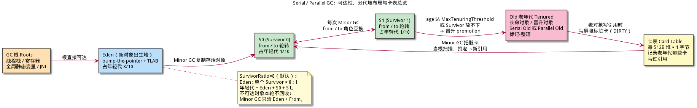
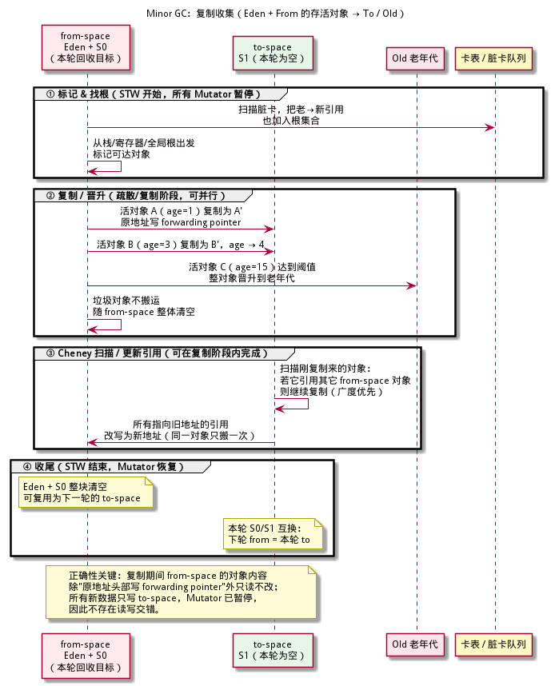
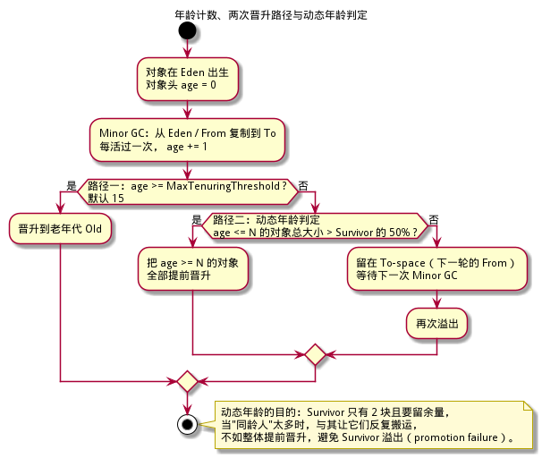
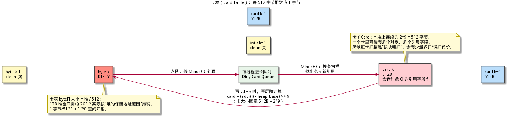
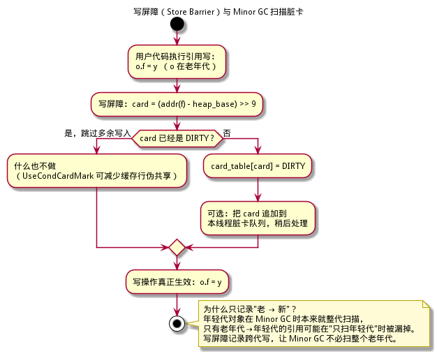
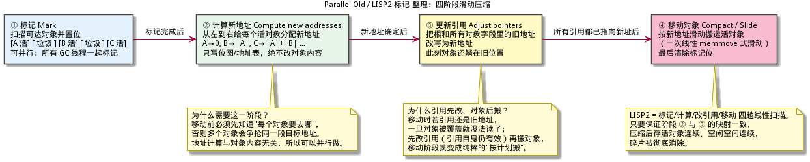
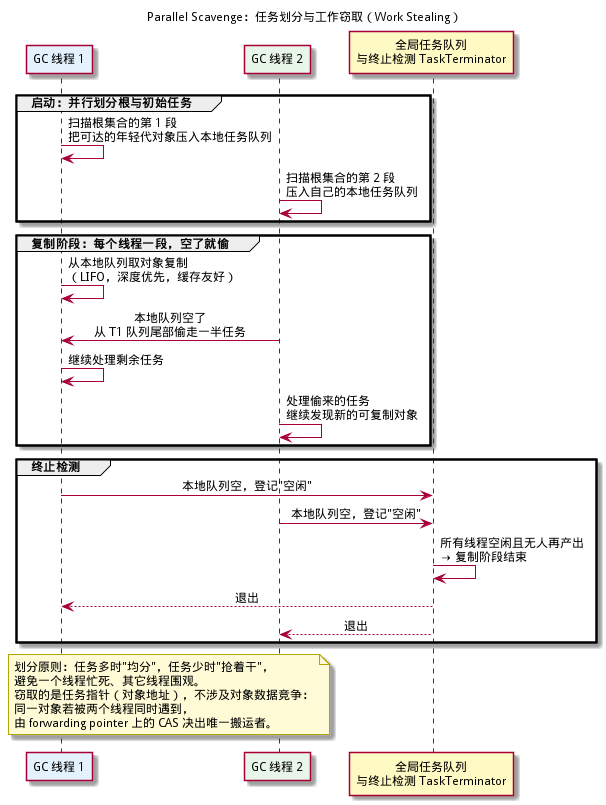
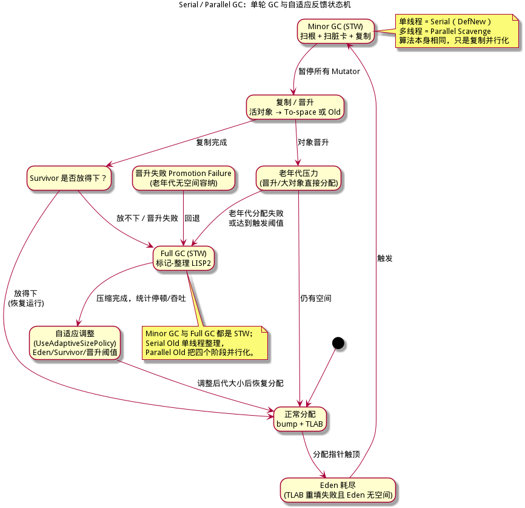
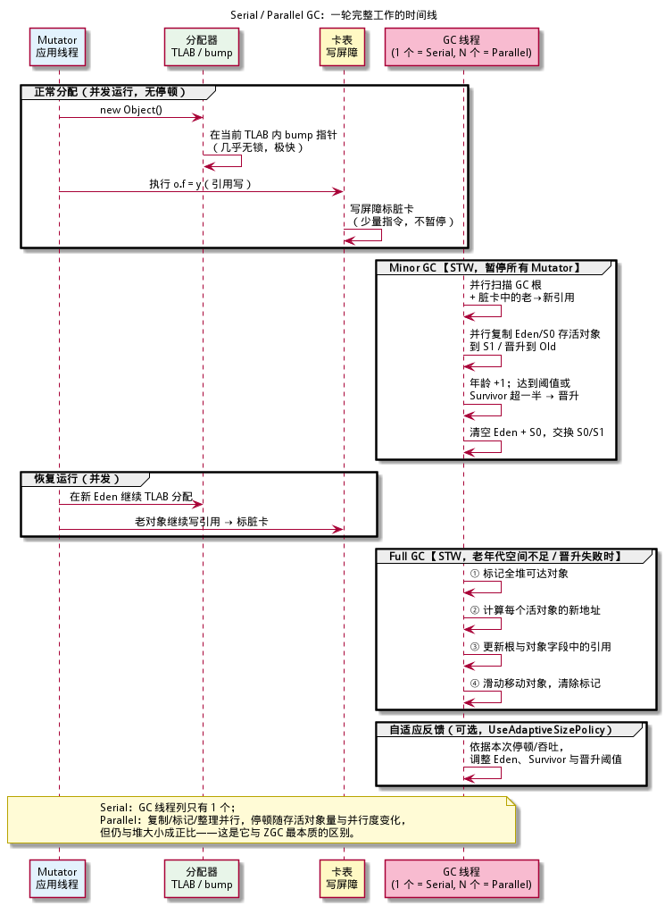

# Serial / Parallel GC 算法详解 —— 分代收集与吞吐优先

> **面向读者**：完全没有 GC（垃圾回收）背景的开发者。本文从"对象、堆、根、可达性"讲起，一路拆到 HotSpot 里 Serial / Parallel（分代收集、吞吐优先）的完整机制：分代假说、TLAB 分配、Minor GC 复制、卡表与写屏障、Full GC 标记-整理（LISP2）、并行化与自适应调参。
> **目标**：读完并配合伪代码，你能独立实现一个"分代 + 复制 + 标记-整理 + 卡表 + 并行"的垃圾回收器；第 12 章给出从 0 到 7 的最小实现路线。
> **与 xgc 仓库的关系**：本文是"算法原理 / 教学"文档；xgc 自身的工程实现细则见 [implementation-guide/05-算法实现详解.md](../implementation-guide/05-算法实现详解.md)、[implementation-guide/10-内存分配器与堆布局.md](../implementation-guide/10-内存分配器与堆布局.md) 等系列文档。
>
> **GC 基础**：第一次接触 GC 的读者，建议同时查阅更系统的 [ZGC 算法详解 §1–3](../zgc-算法详解/zgc-算法详解.md)，那里把对象 / 可达性 / STW / 三色抽象讲得更细；本篇 §1 也提供一份自足速览，只看本篇同样能继续。
>
> **本系列（建议按序阅读）**：**Serial / Parallel 分代** · [CMS](../cms-算法详解/cms-算法详解.md) · [G1](../g1-算法详解/g1-算法详解.md) · [Shenandoah](../shenandoah-算法详解/shenandoah-算法详解.md) · [Go GC](../go-gc-算法详解/go-gc-算法详解.md) · [ZGC](../zgc-算法详解/zgc-算法详解.md)

---

## 目录

1. [必备基础（15 分钟速览）](#1-必备基础15-分钟速览)
2. [定位与历史：HotSpot 的四组搭配](#2-定位与历史hotspot-的四组搭配)
3. [弱分代假说与分代堆布局](#3-弱分代假说与分代堆布局)
4. [对象分配：bump、TLAB 与大对象](#4-对象分配bumptlab-与大对象)
5. [Minor GC：复制收集全流程](#5-minor-gc复制收集全流程)
6. [卡表与写屏障：跨代引用怎么找](#6-卡表与写屏障跨代引用怎么找)
7. [Full GC：标记-整理与 LISP2 四阶段](#7-full-gc标记-整理与-lisp2-四阶段)
8. [并行化：任务划分与工作窃取](#8-并行化任务划分与工作窃取)
9. [自适应调节：吞吐目标的自动旋钮](#9-自适应调节吞吐目标的自动旋钮)
10. [单轮流程：状态机与时间线](#10-单轮流程状态机与时间线)
11. [正确性论证：为什么这样搬不会错](#11-正确性论证为什么这样搬不会错)
12. [从零实现：最小可行路线](#12-从零实现最小可行路线)
13. [关键数据结构与伪代码](#13-关键数据结构与伪代码)
14. [性能特征与调参表](#14-性能特征与调参表)
15. [与 CMS/G1/ZGC 的对比](#15-与-cmsg1zgc-的对比)
16. [术语速查表](#16-术语速查表)
17. [延伸阅读与参考](#17-延伸阅读与参考)

---

## 1. 必备基础（15 分钟速览）

这一节把后面要用的名词一次讲清。已经懂 GC 的读者可以跳读。

### 1.1 对象、堆、根、可达性

程序运行时会不断创建对象，对象放在一片叫**堆（Heap）**的内存里。一个对象什么时候能销毁？答案是：**当它再也不可能被程序访问到时**。

怎么判断"不可能被访问"？从一组确定的入口出发，顺着对象里的引用一路走：

- 走得到的对象叫**可达（reachable）**，是活的；
- 走不到的叫**不可达（unreachable）**，是垃圾。

这组入口叫 **GC 根（GC Roots）**，典型包括：

| 根的类型 | 举例 |
|----------|------|
| 线程栈 / 寄存器 | 局部变量、方法参数、返回地址附近的引用 |
| 全局 / 静态变量 | 类静态字段、全局单例 |
| 运行时内部句柄 | JNI 局部/全局引用、线程对象、类加载器 |
| GC 自身维护的根 | 卡表 / 记忆集找出的跨代引用（见 §6） |

**精确式 GC（precise GC）** 要求运行时确切知道"哪里是引用、哪里不是"：能枚举栈上每个引用槽，能从对象元数据（map）知道哪些字段是指针。Serial / Parallel 以及本文的所有伪代码都以此为前提。

### 1.2 两个角色：Mutator 与 Collector

| 角色 | 英文 | 干什么 |
|------|------|--------|
| 应用程序线程 | **Mutator**（改变者） | 跑用户代码，不断创建、读取、改写对象 |
| 垃圾回收线程 | **Collector** | 找出不可达对象、回收空间、必要时搬移对象 |

GC 的本质就是：**在 Mutator 运行期间，识别并回收不可达对象，同时保证活对象的引用关系不被破坏。**

### 1.3 STW：最简单的正确性来源

最直接的做法是 GC 先**停下所有 Mutator**，这段停顿叫 **STW（Stop-The-World，停止世界）**。程序暂停期间没人会改对象，扫描、搬运、改引用都可以放心做。

- 好处：简单，正确性容易保证。
- 坏处：停顿。对交互系统是卡顿，对服务器是延迟尖峰。
- 三大指标：
  - **吞吐（Throughput）**：有用工作时间 / 总时间；
  - **延迟 / 停顿（Latency / Pause）**：单次 STW 有多长、最大多长；
  - **Footprint（占用）**：GC 自身额外用了多少内存。

三者不可能同时最优，GC 设计就是在三角形里取舍。**Serial / Parallel 明确选择吞吐优先，接受与堆大小成正比的 STW**；ZGC 等新一代收集器才反过来追求低延迟。理解这一点，本篇所有设计取舍就都顺了。

### 1.4 三色抽象与漏标

把对象按标记进度分三色：

| 颜色 | 含义 |
|------|------|
| **白（White）** | 本次标记还没发现它，生死未定 |
| **灰（Grey）** | 已发现，但字段还没扫描完 |
| **黑（Black）** | 字段已全部扫描完，确定存活 |

遍历过程是 白 → 灰 → 黑；没有灰对象时，剩下的白对象就是垃圾。一个关键判据：

> **并发标记不允许出现"黑对象直接引用白对象"**——黑对象已经"扫完了"，它指向的白对象若还活着，就永远不会被发现，会被误回收，即**漏标（对象被错误回收）**。

Serial / Parallel 用最省事的办法规避这个问题：**标记全程 STW**，Mutator 根本不会在标记期间改引用，所以不存在"边标边改"的竞态。这是"用停顿换正确性"的典型。

### 1.5 屏障、卡表、记忆集

分代收集只回收年轻代时，必须知道"老年代里有没有指针指向年轻代"。总不能每次 Minor GC 都扫整个老年代，所以需要一个**记录跨代引用的旁路结构**：

| 名词 | 一句话定义 |
|------|------------|
| **写屏障（Write / Store Barrier）** | 编译器在"写引用"前后插入的一小段代码，用来通知 GC"这里发生了引用写" |
| **卡表（Card Table）** | 把堆按固定大小（HotSpot 为 512B）切成**卡**，每卡用 1 字节记录"脏 / 净"的粗粒度位图 |
| **记忆集（Remembered Set，RSet）** | 更一般的"跨区引用索引"，卡表是它的最简实现；G1 的 RSet 更精细 |
| **脏卡（Dirty Card）** | 被写屏障标脏的卡：里面可能出现了新引用，GC 需要扫描 |

写屏障只付出几条指令的代价，就让 Minor GC 可以把"老年代→年轻代"的引用当成根的一部分来扫，而不必扫描整个老年代。

### 1.6 总览图



> **一句话总结**：GC = 从根找可达对象并回收其余；分代 = 按对象年龄分区、各代独立回收；Serial / Parallel = 用 STW 换实现简单，用并行换吞吐。

---

## 2. 定位与历史：HotSpot 的四组搭配

### 2.1 两个维度：年轻代收集器 × 老年代收集器

HotSpot 的分代收集器不是"一个算法"，而是"年轻代 + 老年代"两两配对：

| 年轻代收集器 | 老年代收集器 | 启用方式 | 备注 |
|--------------|--------------|----------|------|
| **Serial**（DefNew，复制） | **Serial Old**（标记-整理） | `-XX:+UseSerialGC` | 单线程；客户端 / 单核 / 小堆 |
| ParNew（复制，并行版 Serial） | Serial Old 或 CMS | `-XX:+UseConcMarkSweepGC` | CMS 专属搭配；CMS 已在 JDK 14 移除（JEP 363） |
| **Parallel Scavenge**（复制，并行） | **Serial Old** | `-XX:+UseParallelGC -XX:-UseParallelOldGC` | 冷门组合；JDK 15 起被 JEP 366 废弃 |
| **Parallel Scavenge**（复制，并行） | **Parallel Old**（并行标记-整理） | `-XX:+UseParallelGC` | 本文主角，吞吐优先 |

要点：

- **`-XX:+UseSerialGC`**：年轻代 Serial、老年代 Serial Old，全程单线程。
- **`-XX:+UseParallelGC`**：年轻代 Parallel Scavenge、老年代 Parallel Old。JDK 8 起默认就是"两个都并行"；只有显式 `-XX:-UseParallelOldGC` 才会退回老年代单线程。
- **`-XX:+UseParallelOldGC`**：历史标志，"让 Full GC 并行"。它会隐含打开 `UseParallelGC`；JDK 15 被 JEP 366 标记废弃，较新 JDK 已移除（本机 JDK 25 实测报 `Unrecognized VM option`）。
- **默认选择**：JDK 8 在"服务器级"机器（≥2 CPU、≥2GB 内存）上默认 Parallel；JDK 9 起默认 GC 变成 G1。Parallel 至今仍是**批处理 / 大数据 / 离线计算**的常见手工选择。

### 2.2 为什么叫"吞吐优先"

Parallel 的设计目标不是把停顿压短，而是**把 GC 占用的 CPU 时间降到最低**，让单位时间内干更多活：

- 年轻代用复制：存活对象少、复制成本低、分配快；
- 老年代用标记-整理：不用预留半空间，空间利用率高；
- 停顿可以很长（与堆中活对象数量成正比），只要总吞吐高就行。

### 2.3 适用与不适用

| 场景 | 是否适合 Parallel | 原因 |
|------|-------------------|------|
| 批处理 / ETL / 离线报表 | 适合 | 没有交互延迟要求，吞吐最大化 |
| 大数据计算（Spark/MapReduce 类型的 worker） | 适合 | 大量朝生夕死对象，分代复制收益大 |
| Web 交互服务 | 通常不适合 | 长 STW 造成请求毛刺；多用 G1 / ZGC |
| 超大堆（数十 GB 以上） | 谨慎 | Full GC 停顿随堆增长，可能到秒级 |

> **一句话总结**：Serial 是"单线程的分代收集"，Parallel 是"把复制/标记/整理并行化的分代收集"；两者共享同一套分代与复制/整理机制，差别只在并行度与自适应调节。

---

## 3. 弱分代假说与分代堆布局

### 3.1 弱分代假说：为什么可以按年龄分区

分代收集建立在两个经验规律上，合称**弱分代假说（Weak Generational Hypothesis）**：

1. **对象朝生夕死（infant mortality）**：绝大多数对象创建后很快就不再使用；
2. **越老越难死**：熬过若干次 GC 的对象，往往还会继续存活很久。

推论：

- 把新对象集中在一小块区域（年轻代），**频繁、低成本**地回收它，就能回收掉大部分垃圾；
- 老对象集中在另一块（老年代），**很少回收**；
- 跨代引用通常很少，所以记录它们的旁路结构（卡表）开销可控。

### 3.2 布局：Eden + S0 + S1 + Old


| 区域 | 作用 | 默认比例 |
|------|------|----------|
| **Eden（伊甸园）** | 新对象出生地，bump 指针顺序分配 | 年轻代的 8/10 |
| **S0 / S1（Survivor，幸存者）** | 两块等大空间，轮换当 from / to | 各占年轻代的 1/10 |
| **Old（老年代 / Tenured）** | 长期存活、晋升来的对象 | 整堆的 2/3（`NewRatio=2`） |

两个关键参数（默认值均已核验，见 §14 来源表）：

- **`-XX:SurvivorRatio=8`**：Eden : 单个 Survivor = 8 : 1。年轻代共 10 份，Eden 8 份、S0 与 S1 各 1 份。
- **`-XX:NewRatio=2`**：老年代 : 年轻代 = 2 : 1，即年轻代占整堆 1/3。

举例：`-Xms600m -Xmx600m -XX:NewRatio=2 -XX:SurvivorRatio=8` 时，年轻代约 200MB，其中 Eden 约 160MB、S0/S1 各约 20MB，老年代约 400MB。**下面贯穿全文的例子就用这组数值。**

### 3.3 对象头里的年龄

对象头（HotSpot 的 mark word）里有 **4 个 bit 的年龄计数**，所以年龄最大是 15——这正是 `MaxTenuringThreshold` 默认值 15 的来源（范围 0…15）。每熬过一次 Minor GC，年龄 +1；达到阈值就晋升。

### 3.4 为什么 Survivor 要轮转

复制式收集必须有一个"干净的目的地"。于是 S0 / S1 轮流扮演两个角色：

- 本轮 **from**：Minor GC 开始时装着上一轮幸存对象；
- 本轮 **to**：空的，接收本轮从 Eden + from 复制来的存活对象；
- 一轮结束后交换角色：上轮的 to 变成下轮的 from，上轮的 from 与被清空的 Eden 一起回收。

这样永远只有"一份幸存对象 + 一份空闲目的地"，空间利用率是 50%（仅限年轻代），换来的是**无碎片、分配只需 bump 指针**。

### 3.5 一个贯穿全文的追踪例子

> 一台会话服务：`-Xms600m -Xmx600m -XX:NewRatio=2 -XX:SurvivorRatio=8`，Eden 160MB、S0/S1 各 20MB、Old 400MB。启动后老年代已有 300MB 常驻缓存。
> 运行中：
> - 每个请求产生约 2MB 短命对象（`tmp`，活不过一次 Minor GC）；
> - 一个会话缓存对象 `cache` 被反复访问，已经活了很久；
> - 一个 6MB 的报表对象 `report`，一出生就比 Survivor 大。
>
> 下面各章会跟踪它从"Eden 溢出 → 复制 → 晋升 → promotion failure → Full GC"的完整轨迹。

> **一句话总结**：分代 = 用"对象年龄"把回收成本摊给最可能有垃圾的区域；Survivor 轮转 = 复制收集的"空目的地"机制。

---

## 4. 对象分配：bump、TLAB 与大对象

### 4.1 bump-the-pointer：最简单的分配器

Eden 被当作一个连续区间，维护一个 `top` 指针：

```c
void* bump_alloc(bump_alloc_t* a, size_t size, size_t align) {
  uintptr_t p = align_up((uintptr_t)a->top, align);   // 对齐（通常 8 字节）
  if (p + size > (uintptr_t)a->end) return NULL;      // 空间不足 → 触发 GC / 换区域
  a->top = (char*)(p + size);
  return (void*)p;
}
```

分配 = 一次加法 + 一次比较，**O(1) 且无碎片**。但所有线程共用一个 `top`，多线程必须加锁或 CAS，会成为热点。

### 4.2 TLAB：每线程先领一大块

**TLAB（Thread Local Allocation Buffer，线程本地分配缓冲）** 的思路：每个线程从 Eden 一次性"批发"一块空间，之后分配只在自己的 TLAB 里 bump，**快路径完全无锁**。

| 参数 | 默认值 | 说明 |
|------|--------|------|
| `-XX:+UseTLAB` | `true` | 是否启用 TLAB |
| `-XX:TLABSize=N` | `0`（自动） | 0 表示由 JVM 按线程数与分配速率估算 |
| `-XX:+ResizeTLAB` | `true` | 根据线程实际分配量动态调整 TLAB 大小 |
| `-XX:TLABRefillWasteFraction=64` | `64` | TLAB 内剩余空间不足单个对象时，浪费比例阈值（1/64） |
| `-XX:MinTLABSize` | `2048` 字节 | TLAB 最小尺寸（随版本可能变化） |

伪代码（完整版见 §13.2）：

```c
void* tlab_alloc(thread_t* t, size_t size, size_t align) {
  tlab_t* tl = &t->tlab;
  uintptr_t p = align_up((uintptr_t)tl->top, align);
  if (p + size <= (uintptr_t)tl->end) {      // 快路径：无锁
    tl->top = (char*)(p + size);
    return (void*)p;
  }
  return tlab_refill_slow(t, size, align);   // 慢路径：换新 TLAB 或触发 GC
}
```

### 4.3 大对象：直接进老年代

在年轻代里搬一个 6MB 对象是很亏的：复制成本高，还可能撑爆 Survivor。HotSpot 提供：

- **`-XX:PretenureSizeThreshold=N`**（默认 `0`，即不启用）：对象大于 N 字节时直接在老年代分配。
  **注意**：该参数官方说明只对 **Serial / ParNew** 生效；Parallel Scavenge 有自己的内建大对象路径，当对象大到新生代放不下时会直接进老年代。跨版本行为有差异，建议 `-XX:+PrintFlagsFinal` 实测（见 §14 存疑表）。
- TLAB 里的对象不受该阈值约束——大对象会在慢路径绕过 TLAB。
- **动态年龄判定**（§5.4）也会让"注定留不住"的一批对象提前晋升，减少无效搬运。

### 4.4 分配失败时会发生什么

1. TLAB 快路径失败 → 慢路径尝试换新 TLAB；
2. Eden 有空间 → 重新领 TLAB，继续分配；
3. Eden 不足 → 触发 **Minor GC**（见 §5）；GC 后重试分配；
4. 仍不足或对象太大 → 尝试老年代分配；
5. 老年代也失败 → **Full GC**（见 §7），再不行就 `OutOfMemoryError`。

> **一句话总结**：分配快在"bump + TLAB"，代价是空间不共享；大对象走老年代的旁路，避免拖累年轻代复制。

---

## 5. Minor GC：复制收集全流程

Minor GC（也叫 Young GC、Scavenge）是 Serial / Parallel 的日常主力。

### 5.1 触发条件

- 分配时 Eden（或 TLAB 慢路径）空间不足；
- 或者显式 `System.gc()`（在默认 `-XX:+ScavengeBeforeFullGC` 下，Full GC 前也会先做一次 Minor GC）。

### 5.2 根集合：不只是栈和全局

Minor GC 的根 = 常规根 + **跨代引用**：

| 根来源 | 说明 |
|--------|------|
| 线程栈 / 寄存器 | 活跃局部变量中的引用 |
| 全局 / 静态 / JNI | 全局可达入口 |
| **卡表脏卡** | 老年代→年轻代的引用；不用扫整个老年代（见 §6） |
| GC 内部根 | 类加载器、系统字典等 |

### 5.3 完整流程（五步）



1. **STW**：暂停所有 Mutator，进入安全点。
2. **找根并标记**：从根出发，凡是指向 from-space（Eden + 当前 Survivor）的引用，都视为"待复制"。
3. **复制 / 晋升**：
   - 目标对象未处理 → 复制到 to-space（或晋升到老年代），并在**原地址头部写 forwarding pointer（转发指针）**：旧地址 → 新地址；
   - 同一对象被多个引用/多个 GC 线程遇到 → 读转发指针，直接复用，保证**只搬一次**；
   - from-space 里的引用槽此时被改写为新地址。
4. **Cheney 扫描**：to-space 里刚复制来的对象也可能引用其它 from-space 对象，于是像 BFS 一样扫描 to-space（`scan_ptr < top`），边发现边复制，直到没有新的可复制对象。
5. **收尾**：清空 Eden + 旧 from，S0/S1 交换角色，STW 结束。

用 §3.5 的例子走一遍（示意数值，单位 MB）：

| 时刻 | Eden | 当前 from | to | Old | 事件 |
|------|------|-----------|----|-----|------|
| t0 | 0 | 0 | 0 | 300 | 启动完成，Eden 全空 |
| t1 | 160（满） | 0 | 0 | 300 | 压测请求持续分配，Eden 溢出 |
| t1+ | 0 | 0 | 9 | 300 | Minor #1：`tmp` 全死，`cache` 等 9MB 复制到 to（age=1），from 清空 |
| t2 | 160（满） | 9 | 0 | 300 | 运行一段时间后再次溢出；期间老对象 `registry.cur = cache` 触发写屏障，卡表第 k 字节变脏 |
| t2+ | 0 | 0 | 11 | 300 | Minor #2：扫根 + 扫脏卡找到 `cache`；9MB 复制回来（age=2），新增少量对象 |
| … | … | … | … | … | 每轮 +1 岁；Survivor 占用逐渐逼近 50% |
| t6+ | 0 | 0 | 10 | 310 | 年龄表显示"age ≤ 5 的对象总大小已超 Survivor 一半（10MB）"→ 动态年龄判定：age≥5 的约 9MB 提前晋升，Old 增至 310 |
| t7 | 160（满） | 0 | 0 | 316 | `report`（6MB）分配，大对象路径直接进老年代；随后缓存膨胀，多次 Minor GC 持续晋升，Old 增至 396 |
| t8 | 160（满） | 0 | 0 | 396 | 一次 Minor GC 中发现 to-space / 老年代都放不下晋升对象 → **promotion failure**，回退 **Full GC** |
| t8+ | 0 | 0 | 0 | 260 | Full GC（标记-整理）压缩老年代，回收 136MB，STW 明显变长（示意约 500ms） |

### 5.4 年龄与晋升策略



对象的去向有三个判断，按顺序：

1. **年龄达到阈值**：`age >= MaxTenuringThreshold`（默认 15）→ 晋升。
2. **动态年龄判定（Survivor 一半规则）**：GC 内部维护一张"年龄 → 该年龄对象总大小"的表（age table）。若 `age ≤ N` 的对象总大小超过 **Survivor 目标占用**（`TargetSurvivorRatio` 默认 50% × Survivor 大小），则把所有 `age >= N` 的对象直接晋升。
   目的：Survivor 只有 2 块，必须留一半余量；否则很快溢出，反而更频繁地复制。
3. **to-space 放不下**：直接晋升——若老年代也放不下，就是 **promotion failure**，回退 Full GC。

注意：**年龄不是"想留多久就留多久"**。动态年龄判定可能让你精心设计的对象比预期更早晋升；调试时用 `-XX:+PrintTenuringDistribution`（旧版）或 `-Xlog:gc+age=trace`（JDK 9+）观察真实年龄分布。

### 5.5 forwarding pointer：为什么"复制后再改引用"是安全的

复制一个对象 `A` 的顺序是：

1. 在 to-space 分配 `A'` 并 `memcpy` 内容；
2. 在 `A` 的原地址头部写入转发地址：`A.header = A' | 1`（最低位置 1 表示"这是转发指针"）；
3. 之后才把引用槽（根槽、from-space 对象字段）里的 `A` 改写成 `A'`。

安全的原因有三层：

- **STW**：Mutator 全部暂停，没有任何并发读者；
- **from-space 只读**：除了头部的转发指针，`A` 的字段不再被修改；GC 线程读到的永远是完整对象；
- **幂等转发**：任何线程第二次遇到 `A`，读头部就得到 `A'`，不会重复分配、重复复制。

> **一句话总结**：Minor GC = "STW 下把 Eden + from 的活对象复到 to 或老年代，用转发指针保证只搬一次，再交换 Survivor"。

---

## 6. 卡表与写屏障：跨代引用怎么找

### 6.1 问题：老年代里藏着指向年轻代的指针

Minor GC 只扫年轻代。若一个老对象 `registry.cur` 指向一个 Eden 里的新对象 `cache`，而这个引用既不在栈上也不在全局，Minor GC 就完全"看不见"它，会把 `cache` 当垃圾回收——**漏标、悬空引用、程序崩溃**。

因此必须记录**老→新**的引用。为什么不用记录"新→老"或"新→新"？因为：

- 年轻代本来就整代扫描，"新→新"引用自然会被看到；
- "新→老"引用指向的对象这轮不回收，改不改都不影响年轻代收集；
- 只有"老→新"引用在"只扫年轻代"时会被遗漏。

### 6.2 卡表：粗粒度、极便宜的记忆集



HotSpot 的做法：

- 把堆地址空间按 **512 字节（2^9）** 切成**卡（Card）**；
- 开一个 `byte[]` 卡表，大小 = 堆大小 / 512，**每卡 1 字节**；
- 写屏障在"写引用"时把该字段所在卡标为 `DIRTY`。

```c
#define CARD_SHIFT 9
#define CARD_SIZE  (1u << CARD_SHIFT)     // 512 字节
#define DIRTY 0x01
#define CLEAN 0x00

extern char* g_heap_base;                 // 堆起始地址
extern byte* g_card_table;                // 大小 = 堆保留范围 / 512

static inline void write_barrier(void** field, void* new_val) {
  uintptr_t off = (uintptr_t)field - (uintptr_t)g_heap_base;
  byte* card = &g_card_table[off >> CARD_SHIFT];
  if (*card != DIRTY) *card = DIRTY;      // 条件写：减少缓存行伪共享
  *field = new_val;                       // 真正写入
}
```



要点：

- 卡表是**近似**结构：一个卡里可能有多个对象、多个字段，扫一张脏卡可能扫到一些不相关的引用（**误扫 / false positive**），但绝不会漏（只要写屏障不漏卡）。
- 空间开销仅约 0.2%（1/512）；写屏障是几条移位 + 比较 + 存储指令。
- `-XX:+UseCondCardMark` 让屏障先检查再写，避免多线程反复写同一缓存行（false sharing）。
- 卡大小由 `GCCardSizeInBytes` 控制，**默认 512**（JDK 较新版本 LP64 允许上限 1024；见 §14）。

### 6.3 Minor GC 如何用脏卡

1. GC 遍历卡表，找到所有 `DIRTY` 卡；
2. 对每张脏卡，扫描其中对象的所有引用字段；
3. 发现指向年轻代的引用 → 加入根集合（`update_slot`，见 §5.3），确保对象被复制；
4. 处理完后按情况清理卡：如果卡里已不存在"老→新"引用，可以清成 `CLEAN`；如果仍存在（引用的年轻代对象还留在 Survivor），必须保持脏，留给下一轮。

> **常见误区**：写屏障和卡表不是"标记对象"，而是"标记内存位置"。卡表本身不存引用，只回答"这 512 字节里可能有人刚写过引用"。

> **一句话总结**：卡表用 0.2% 的空间把"扫老年代"降级为"扫几张脏卡"，写屏障是它的触发开关。

---

## 7. Full GC：标记-整理与 LISP2 四阶段

Minor GC 解决年轻代；当老年代空间不足、或晋升失败（promotion failure）时，就要做 **Full GC**，回收整个堆。老年代使用**标记-整理（Mark-Compact）**：标记存活对象，把它们压缩到堆的一端，消除碎片。

### 7.1 为什么不复制、为什么不清除

| 方案 | 问题 |
|------|------|
| 复制 | 老年代对象多、存活率高，复制成本极高；还要预留半个堆 |
| 标记-清除 | 不移动对象，但产生碎片；大对象可能分配失败 |
| **标记-整理** | 移动对象、消除碎片、不浪费半空间；代价是移动 + 改引用 |

### 7.2 LISP2 四阶段



经典滑动压缩算法 LISP2（名字来自早期 Lisp 实现）分四趟：

1. **标记（Mark）**：从根出发标记所有可达对象（位图或对象头标记位）。
2. **计算新地址（Compute new addresses）**：从左到右扫描堆，为每个活对象计算压缩后的新地址：`new = 当前空闲起点`，然后 `起点 += 对齐后的对象大小`。这一阶段**只看对象大小、不改任何对象内容**。
3. **更新引用（Adjust pointers）**：把根和所有活对象字段中的引用，从旧地址改成对应的新地址。**此时对象还躺在旧位置**。
4. **移动对象（Compact / Slide）**：按计划的 `old → new` 把每个活对象搬到新地址（可整段滑动），最后清除所有标记位。

回到 §3.5 的例子：t8 的 **promotion failure** 回退的 Full GC，执行的就是上面这四趟——先把老年代 396MB 里的活对象标记出来，再压缩到 260MB。

### 7.3 为什么必须"两遍不改对象、再移动"

这是 LISP2 的精髓，也是面试常问点：

- **阶段 2 必须先于 3**：引用要改成"最终地址"，就必须先知道每个对象的最终地址；地址规划是一次线性前缀和（prefix sum），与对象内容无关。
- **阶段 3 必须先于 4**：如果先把对象搬走，旧位置就被覆盖/腾空了，而引用里还全是旧地址，再去读就什么都读不到。先改引用（引用槽本身在移动前依然有效），移动阶段才能变成"按计划表执行"。
- **阶段 4 可以用滑动（slide）**：由于新地址是按旧地址顺序递增分配的，压缩保持对象相对顺序，可以一段一段 `memmove`，缓存友好。

### 7.4 并行化

Parallel Old 把四趟都并行化（细节见 §8）：

- 标记：GC 线程分工扫描不同区域，用位图 + 原子置位（或每线程本地标记后合并）；
- 计算新地址：每个线程先统计本段活对象字节数，再做并行前缀和；
- 更新引用：并行扫描各段对象字段；
- 移动：各段并行 `memmove`（目标区间与本段错开，需保证顺序正确）。

> **一句话总结**：Full GC 用 LISP2 四阶段"先规划地址、再改引用、最后滑动搬移"完成压缩；先规划后搬移是它正确性的核心。

---

## 8. 并行化：任务划分与工作窃取

### 8.1 GC 线程数从哪来

- **`-XX:ParallelGCThreads=N`**：STW 阶段（Minor GC、Full GC）的并行度。
- **默认值**（官方文档口径）：设机器可用硬件线程数为 N：
  - N ≤ 8：`ParallelGCThreads = N`；
  - N > 8：取约 **5/8 × N**；JDK 8 源码等价公式为 `8 + (N - 8) * 5 / 8`；
  - 部分平台（官方文档称 selected platforms）比例降到 **5/16**；
  - JDK 9+ 加入容器感知（`UseContainerSupport`），线程数按容器 CPU 配额计算；本机 JDK 25 `UseDynamicNumberOfGCThreads=true`，运行时还会按负载动态增减。
  - 因此：**不要硬编码公式，用 `java -XX:+PrintFlagsFinal -version | grep ParallelGCThreads` 实测**。
- 小堆上线程过多反而更慢：线程启动、同步、任务分裂都有开销。经验上堆小于几百 MB 时，线程数与 CPU 核数相当即可。

### 8.2 任务划分



以 Minor GC 为例，Parallel Scavenge 把工作拆成：

1. **根扫描任务**：按根来源 / 内存区间切分（例如每个线程扫描一段栈或一段根表）；
2. **对象复制任务**：每个被复制到 to-space 的对象都是一个新的"待扫描"任务；
3. **终止检测任务**：所有线程都空且无人再产出新任务时结束。

### 8.3 工作窃取（Work Stealing）

每个 GC 线程有一个**本地双端队列（deque）**：

- 自己从队列的一端（LIFO）取任务，局部性好、缓存友好；
- 队列空的线程从别人的另一端（FIFO）**偷**走一半任务，减少与主人的竞争；
- 所有线程都空时，用全局终止器（HotSpot 的 `TaskTerminator` / `ParallelTaskTerminator`）确认"真的没有任务了"。

```c
bool try_steal(task_deque_t* q, object_t** out) {
  lock(&q->lock);
  if (q->bot - q->top <= 1) {           // 至少给主人留一个，避免抢夺
    unlock(&q->lock);
    return false;
  }
  *out = q->buf[q->top++];              // 从窃取端拿
  unlock(&q->lock);
  return true;
}
```

### 8.4 并行的同步点

| 环节 | 同步手段 |
|------|----------|
| 认领任务 | 本地队列加锁；或用原子游标均分区间 |
| 复制同一对象 | forwarding pointer 上的 **CAS**，赢家搬运，输家读转发地址 |
| to-space 分配 | 每线程私有区域（类似 TLAB），或原子 bump |
| 标记置位 | 原子 OR / 每线程本地标记 + 合并 |
| 终止判定 | 全局终止器 + 超时/轮询 |

> **一句话总结**：并行的关键是"任务能均分、空线程能偷、同对象只搬一次（CAS 转发）、结束能确认（终止器）"。

---

## 9. 自适应调节：吞吐目标的自动旋钮

Parallel 提供 **UseAdaptiveSizePolicy（自适应尺寸策略）**，让 JVM 根据运行时统计自动调整各代大小与晋升阈值，而不是每次都手工算参数。

### 9.1 三个目标与优先级

可以给 JVM 三个行为目标：

| 目标 | 参数 | 默认 |
|------|------|------|
| 最大暂停 | `-XX:MaxGCPauseMillis=ms` | **无默认目标**（默认不设 pause goal） |
| 吞吐 | `-XX:GCTimeRatio=ratio` | **99**，即 GC 时间占比 ≤ 1/(1+99) = 1% |
| 占用 | 无专门参数 | 前两者满足时尽量缩小堆 |

处理顺序（Oracle JDK 8 调优指南）：

1. 若 GC 停顿超过 pause goal → **缩小各代**，把停顿拉回来；
2. 若 pause goal 已满足但吞吐不达标 → **增大各代**，减少 GC 频率；
3. 若两者都满足 → 缩小堆，降低 footprint。

### 9.2 自适应会调什么

- **Eden / Survivor 大小**：按分配速率、存活量、GC 频率动态伸缩；
- **晋升阈值**：根据年龄表和 Survivor 占用，动态调整（与 §5.4 的动态年龄判定配合）；
- **年轻代占比**：必要时改变 Young/Old 边界。

### 9.3 取舍：MaxGCPauseMillis 是把双刃剑

设置 `-XX:MaxGCPauseMillis=50` 后，策略为满足 50ms 会缩小年轻代：

- 好处：单次 Minor GC 更快；
- 坏处：Minor GC 更频繁、晋升更早、Full GC 更容易发生 → **吞吐下降**。

所以 Parallel 的调优顺序通常是：

1. 给足堆（`-Xms = -Xmx`，避免动态扩缩的抖动）；
2. 只设吞吐目标（默认 GCTimeRatio=99 或按需调大调小）；
3. 非必要不设 MaxGCPauseMillis；确需设时观察真实停顿分布；
4. 用 `-XX:+PrintAdaptiveSizePolicy`（旧版）或 `-Xlog:gc+ergo=trace`（JDK 9+）看策略的决策日志；
5. 老年代持续增长 / Full GC 频繁 → 适当增大堆或老年代比例，而不是压年轻代。

另外 HotSpot 有 **GC 开销保护**：`-XX:GCTimeLimit=98`（GC 时间占比上限）与 `-XX:GCHeapFreeLimit=2`（回收后最小空闲比例），超过则抛 `OutOfMemoryError`，避免"GC 忙死却回收不动"的活锁。

> **一句话总结**：自适应策略按"暂停 > 吞吐 > 占用"的优先级自动调 Eden/Survivor/晋升阈值；给 Parallel 调参时，优先喂饱堆和吞吐目标，谨慎设置停顿目标。

---

## 10. 单轮流程：状态机与时间线

### 10.1 状态机



| 状态 | 触发 / 动作 | 停顿 |
|------|-------------|------|
| 正常分配 | TLAB + bump | 无（并发） |
| Eden 耗尽 | TLAB 重填失败且 Eden 无空间 | — |
| Minor GC | 扫根 + 扫脏卡 + 复制 | STW |
| 复制 / 晋升 | 活对象 → to-space 或 Old | STW 内 |
| 放得下 | 交换 Survivor，恢复分配 | STW 结束 |
| 晋升失败 / 老年代压力 | 老年代无空间容纳 | — |
| Full GC | LISP2 标记-整理 | STW（最长） |
| 自适应调整 | 调整 Eden/Survivor/阈值 | 少量 |

### 10.2 时间线



> **一句话总结**：日常是"无停顿分配 + 短 STW 的 Minor GC"；老年代告急才进入"长 STW 的 Full GC"；两者之间由自适应策略反馈调节。

---

## 11. 正确性论证：为什么这样搬不会错

### 11.1 复制期间 from-space 内容不变

- GC 线程对 from-space 对象**只读字段**，唯一的写是"在头部安装 forwarding pointer"；
- 所有新数据只写入 to-space，且每个 GC 线程在 to-space 的分配区域互不重叠；
- Mutator 全部暂停，没有并发读者/写者；
- 因此不存在"读到半搬状态"的可能。

### 11.2 forwarding pointer 保证同一对象只搬一次

多个引用、多个 GC 线程可能同时到达同一对象：

- 第一个线程用 CAS 把 `A.header` 从"普通头"改成 `A' | 1`，成功者负责复制；
- 后到者读到最低位为 1，直接解析出 `A'`，把引用改成 `A'` 即可；
- 这样每个对象**恰好产生一个副本**，所有引用最终指向同一个新地址。

### 11.3 写屏障漏卡会怎样

假设某次 `old_obj.f = young_obj` 没有标脏卡：

1. Minor GC 只扫根 + 脏卡，看不到这条老→新引用；
2. `young_obj` 不可达于 GC 的根集合 → 被当垃圾，内存回收；
3. `old_obj.f` 仍指向已回收地址 → **悬空引用（UAF）**，后续访问读到垃圾数据或崩溃。

因此写屏障的正确性是分代收集的生命线。工程上要专门做"漏卡检测"：

- 用"全堆精确扫描"作为影子答案，与"卡表扫描"结果做差分；
- 压力测试随机写老对象引用，检查 GC 后引用完整性；
- 任何不一致都按严重 bug 处理（参见 [implementation-guide/17-正确性验证与压力测试.md](../implementation-guide/17-正确性验证与压力测试.md)）。

### 11.4 为什么暂停是必需的

经典 Serial / Parallel 是**移动式收集 + 原地改写引用**：

- 若 Mutator 并发读，可能读到"旧地址 + 对象已被搬走"；
- 若 Mutator 并发写，可能与 GC 的引用改写互相覆盖；
- 要并发做这些，需要读屏障 / 自愈 / 染色指针等额外机制（那是 ZGC 的路线）。

Serial / Parallel 选择 **STW**：用一段完全静止的时间，换取"无需任何并发屏障"的实现简单性。这就是吞吐优先路线的核心契约。

> **一句话总结**：from-space 只读、to-space 独占、转发 CAS 幂等、STW 排除并发，四者合起来保证不用任何复杂屏障也能正确搬移。

---

## 12. 从零实现：最小可行路线

> 目标：不要一上来就挑战并行 + 自适应。按下面 8 步走，每一步的产物都能跑、可测，再逐步替换。验收默认包含 **ASan**；涉及多线程的步骤还要 **TSan**。

### 第 0 步：确定前提与测试脚手架

- **做什么**：
  - 对象布局固定（头 + 字段 map，能枚举指针字段）；
  - 能枚举栈 / 寄存器 / 全局根（或先用手工注册的根集合模拟）；
  - 准备一个可注入的"随机分配 + 随机断引用"压力测试框架。
- **验收**：一个最小 VM 壳能创建对象、跑测试；根枚举在 GC 前后一致。
- **失败怎么办**：根枚举不精确就先退化为"保守扫描"（把疑似指针都当根），先保证不误回收，再逐步精确化。

### 第 1 步：bump 分配器 + TLAB

- **做什么**：实现 §4 的 Eden bump 分配与每线程 TLAB 慢路径。
- **验收**：多线程并发分配互不重叠（地址集合无交集）；ASan 无越界；TLAB 耗尽自动重填。
- **失败怎么办**：TLAB 尺寸估算不准先固定成 64KB，保证正确后再谈性能。

### 第 2 步：semispace 复制 + STW

- **做什么**：全堆两半（from/to），从根复制活对象到 to，安装 forwarding pointer，Cheney 扫描，交换。
- **验收**：随机对象图测试，GC 后存活集合与"影子标记 GC"结果完全一致；ASan 干净。
- **失败怎么办**：出现漏复制多半是根没扫全或 forwarding 未安装；用差分测试定位。

### 第 3 步：根集合枚举（精确化）

- **做什么**：栈映射 / 寄存器保存 / 全局表；GC 在安全点暂停 Mutator。
- **验收**：随机 GC 注入（分配点、循环回边）10 万次无错误；对象一致性校验通过。
- **失败怎么办**：漏根会表现为悬空引用；给每个根类型单独写单测，逐一排除。

### 第 4 步：老年代 mark-sweep（先不压缩）

- **做什么**：把堆扩为"年轻代（复制）+ 老年代（标记-清除）"；晋升就是把对象加进老年代链表。
- **验收**：跨代引用先靠"Full GC 全堆扫描"保证正确；ASan 干净。
- **失败怎么办**：先不做碎片整理，验证控制流正确后再替换为 LISP2。

### 第 5 步：卡表写屏障替换全堆扫描

- **做什么**：实现 512B 卡表、写屏障、脏卡扫描；Minor GC 只扫根 + 脏卡。
- **验收（关键）**：**漏卡差分测试**——随机压力下，"卡表扫描得到的根集合"必须精确包含"全堆扫描得到的全部老→新引用"；TSan 无数据竞争。
- **失败怎么办**：先关闭 `UseCondCardMark` 式优化全量标脏，确认逻辑正确后再加优化。

### 第 6 步：晋升策略（年龄 / Survivor / 动态年龄）

- **做什么**：对象头年龄计数、Survivor 轮转、`MaxTenuringThreshold`、动态年龄判定、promotion failure 回退 Full GC。
- **验收**：日志输出年龄分布；用影子算法核对每轮晋升集合；promotion failure 路径被测试覆盖。
- **失败怎么办**：阈值算错先从简单策略（只看年龄上限）开始，再补动态年龄。

### 第 7 步：LISP2 标记-整理

- **做什么**：实现 §7 四阶段（单线程），再并行化（§8 的工作窃取 + 前缀和）。
- **验收**：压缩后堆连续（空闲区单一）；引用完整性全量校验；ASan + TSan；长时间随机压测无 UAF、无泄漏。
- **失败怎么办**：移动阶段最危险，先在"对象不移动"模式下验证阶段 1–3，再打开阶段 4。

### 测试与验证策略（必须做）

- **差分测试**：与简单可靠的"影子 GC"比对存活集，任何不一致即 bug；
- **随机图压力**：随机创建 / 断引用 / 触发 GC，配合多线程分配；
- **Sanitizer**：ASan（内存越界 / UAF）、TSan（数据竞争）、UBSan；参见
  [implementation-guide/16-并发正确性与内存模型.md](../implementation-guide/16-并发正确性与内存模型.md)；
- **不变量断言**：GC 前后对象图哈希、年龄单调性、卡表与全堆扫描一致性。

> **一句话总结**：先把"分配 → 复制 → 根 → 老年代 → 卡表 → 晋升 → 压缩 → 并行"每一步做成可验证的独立模块，再叠加性能优化。

---

## 13. 关键数据结构与伪代码

本节代码可直接作为实现起点，注释给出关键不变量。内存序按"教学用简化"处理，生产代码请按平台内存模型补全 acquire/release。

### 13.1 堆与对象

```c
typedef struct {
  uintptr_t header;     // 低 4bit 年龄；bit0=1 表示 header 存的是 forwarding 地址
  void*     klass;      // 类型元数据（含字段 map：哪些偏移是指针）
  // ... 字段
} object_t;

#define AGE_MASK  0xFUL
#define FORWARD_BIT 1UL

static inline bool     oop_is_forwarded(object_t* o) { return (o->header & FORWARD_BIT) != 0; }
static inline object_t* oop_forwardee(object_t* o)   { return (object_t*)(o->header & ~FORWARD_BIT); }
static inline uint32_t oop_age(object_t* o)          { return (uint32_t)(o->header & AGE_MASK); }

typedef struct {
  char*  start;         // 区域起始
  char*  top;           // 下一个空闲地址
  char*  end;           // 区域结束
} bump_alloc_t;
```

### 13.2 分配与 TLAB

```c
typedef struct {
  char*  top;           // 当前分配指针
  char*  end;           // TLAB 结束
  size_t alloc_bytes;   // 本 TLAB 内累计分配（供 Resize 参考）
} tlab_t;

void* bump_alloc(bump_alloc_t* a, size_t size, size_t align) {
  uintptr_t p = align_up((uintptr_t)a->top, align);
  if (p + size > (uintptr_t)a->end) return NULL;     // 区域耗尽
  a->top = (char*)(p + size);
  return (void*)p;
}

void* tlab_alloc(thread_t* t, size_t size, size_t align) {
  tlab_t* tl = &t->tlab;
  uintptr_t p = align_up((uintptr_t)tl->top, align);
  if (p + size <= (uintptr_t)tl->end) {              // 快路径：无锁
    tl->top = (char*)(p + size);
    tl->alloc_bytes += size;
    return (void*)p;
  }
  return tlab_refill_slow(t, size, align);
}

void* tlab_refill_slow(thread_t* t, size_t size, size_t align) {
  size_t want = tlab_target_size(t);                 // ResizeTLAB 时按速率自适应
  if (want < MIN_TLAB_SIZE) want = MIN_TLAB_SIZE;
  if (eden_allocate_tlab(t, want) == OK) {           // 从 Eden 领新 TLAB（原子/锁）
    return tlab_alloc(t, size, align);
  }
  if (size >= eden_max_normal_object()) {            // 大对象：走老年代路径
    void* p = old_alloc(size, align);
    if (p) return p;
  }
  gc_request_minor();                                // Eden 不足：请求 Minor GC
  return NULL;                                       // 调用方在 GC 后重试
}
```

### 13.3 复制收集（Serial / Parallel Scavenge 核心）

```c
// from-space：Eden + 当前 from Survivor；to-space：当前 to Survivor
static char *from_start, *from_end, *to_start, *to_top, *to_end;
static char *scan_ptr;                               // Cheney 扫描游标

bool in_from_space(object_t* p) { return (char*)p >= from_start && (char*)p < from_end; }

// 复制或晋升一个对象；多 GC 线程可能并发调用，CAS 保证只搬一次
object_t* copy_or_promote(object_t* from) {
  for (;;) {
    uintptr_t h = atomic_load_explicit(&from->header, memory_order_acquire);
    if (h & FORWARD_BIT) return (object_t*)(h & ~FORWARD_BIT);   // 已转发
    size_t sz = oop_size(from);
    object_t* dst = should_promote(from) ? old_alloc(sz, OBJECT_ALIGN)
                                         : to_space_alloc(sz, OBJECT_ALIGN);
    if (!dst) return NULL;                            // 晋升/复制失败 → promotion failure
    memcpy(dst, from, sz);                            // 复制全部字段（含头）
    dst->header = (dst->header & ~AGE_MASK) | age_after(from);   // 年龄 +1（晋升时保留）
    uintptr_t fwd = (uintptr_t)dst | FORWARD_BIT;
    if (atomic_compare_exchange_strong_explicit(&from->header, &h, fwd,
                                                memory_order_acq_rel, memory_order_acquire)) {
      return dst;                                     // 我赢得搬运权
    }
    to_space_rollback(dst, sz);                       // 输家回滚本地分配（工程实现可避免回滚）
  }
}

static inline void update_slot(object_t** slot) {
  object_t* p = *slot;
  if (p && in_from_space(p)) *slot = copy_or_promote(p);   // 复制后再改引用
}

void scavenge_minor(void) {
  stw_begin();
  to_top = to_start; scan_ptr = to_start;             // 初始化 to-space
  for_each_root_slot(update_slot);                    // 栈 / 寄存器 / 全局 / JNI
  scan_dirty_cards(update_slot);                      // 老→新引用（§13.4）
  while (scan_ptr < to_top) {                         // Cheney 广度优先
    object_t* o = (object_t*)scan_ptr;
    scan_ptr += align_up(oop_size(o), OBJECT_ALIGN);
    for_each_reference_slot(o, update_slot);          // 继续复制/改写
  }
  compute_dynamic_tenuring_threshold();               // 动态年龄判定（§5.4）
  swap_survivor_spaces();                             // S0 <-> S1
  clear_eden_and_old_from();                          // 整体清空
  stw_end();
}
```

### 13.4 卡表与写屏障

```c
#define CARD_SHIFT 9
#define CARD_SIZE  (1u << CARD_SHIFT)                 // 512 字节
#define CLEAN 0x00
#define DIRTY 0x01

extern byte*    card_table;
extern uintptr_t heap_base;

// 写引用时调用（真实实现由编译器内联；此处为语义）
static inline void post_write_barrier(void** field, void* new_val) {
  uintptr_t off = (uintptr_t)field - heap_base;
  byte* card = &card_table[off >> CARD_SHIFT];
  if (*card != DIRTY) *card = DIRTY;                  // 条件标脏
  *field = new_val;
}

// Minor GC：把脏卡中的引用当根扫描
void scan_dirty_cards(void (*visit)(object_t**)) {
  size_t n = card_table_size();
  for (size_t i = 0; i < n; i++) {
    if (card_table[i] != DIRTY) continue;
    char* lo = (char*)(heap_base + (i << CARD_SHIFT));
    char* hi = lo + CARD_SIZE;
    scan_reference_slots_in_range(lo, hi, visit);     // 粗扫整张卡
    card_table[i] = CLEAN;                            // 若仍有老→新引用需重新标脏
  }
}
```

### 13.5 LISP2 四阶段

```c
typedef struct { uintptr_t old_addr, new_addr; size_t size; } plan_t;
static plan_t* plan;
static size_t  plan_count;

static uintptr_t plan_lookup_new_addr(object_t* old) {
  // 教学：线性/二分查 plan（按 old_addr 升序）
  for (size_t i = 0; i < plan_count; i++)
    if (plan[i].old_addr == (uintptr_t)old) return plan[i].new_addr;
  return 0;                                           // 未找到 = 死对象（不应被引用）
}

static inline void update_slot_lisp2(object_t** slot) {
  object_t* p = *slot;
  if (!p || !in_old_space(p)) return;
  uintptr_t np = plan_lookup_new_addr(p);
  if (np) *slot = (object_t*)np;
}

void full_gc_lisp2_serial(void) {
  stw_begin();

  // ① 标记
  bitmap_clear();
  mark_roots_recursive();                             // 并行版见 §8

  // ② 计算新地址（不改对象内容）
  uintptr_t free_ptr = old_start;
  plan_count = 0;
  for (object_t* o = first_object(); o < old_end; o = next_object(o)) {
    if (bitmap_test(o)) {
      plan[plan_count++] = (plan_t){ (uintptr_t)o, free_ptr, oop_size(o) };
      free_ptr += align_up(oop_size(o), OBJECT_ALIGN);
    }
  }

  // ③ 更新引用（对象仍在旧位置）
  for_each_root_slot(update_slot_lisp2);
  for (size_t i = 0; i < plan_count; i++)
    for_each_reference_slot((object_t*)plan[i].old_addr, update_slot_lisp2);

  // ④ 滑动移动对象
  for (size_t i = 0; i < plan_count; i++) {
    if (plan[i].old_addr != plan[i].new_addr)
      memmove((void*)plan[i].new_addr, (void*)plan[i].old_addr, plan[i].size);
  }
  clear_all_marks();
  stw_end();
}
```

### 13.6 并行工作窃取与自适应

```c
bool try_steal(task_deque_t* q, object_t** out) {
  lock(&q->lock);
  if (q->bot - q->top <= 1) { unlock(&q->lock); return false; }
  *out = q->buf[q->top++];                            // 从窃取端拿
  unlock(&q->lock);
  return true;
}

void adaptive_update(stats_t* s) {
  if (g_max_pause_ms != 0 && s->last_pause_ms > g_max_pause_ms) {
    shrink_young_gen();                               // 优先级 1：满足暂停目标
  } else if (s->gc_time_ratio > 1.0 / (1.0 + g_gc_time_ratio)) {
    grow_young_gen();                                 // 优先级 2：满足吞吐目标
    grow_old_gen();
  } else {
    shrink_young_gen();                               // 优先级 3：降低占用
  }
  recompute_tenuring_threshold(s->age_table);         // 动态年龄：Survivor 一半规则
}
```

> **一句话总结**：六个结构（对象头 / bump / TLAB / 复制器 / 卡表 / LISP2 计划表）撑起整个收集器；所有并发点收敛到"转发 CAS + 任务终止器"两个同步原语。

---

## 14. 性能特征与调参表

### 14.1 默认值核验表

以下默认值已通过 Oracle 官方文档、OpenJDK 源码 / JBS 与本地 JDK 25 `-XX:+PrintFlagsFinal` 交叉核验。**默认值随版本与平台变化**，生产使用前务必实测。

| 参数 | 默认值 | 含义 | 来源 / 备注 |
|------|--------|------|-------------|
| `-XX:SurvivorRatio` | **8** | Eden : 单个 Survivor | Oracle JDK 17 调优指南；`gc_globals.hpp`；JDK 25 实测 |
| `-XX:NewRatio` | **2** | Old : Young | 同上 |
| `-XX:MaxTenuringThreshold` | **15** | 晋升年龄上限（对象头 4bit，最大 15） | `gc_globals.hpp`；JDK 8 文档 |
| `-XX:InitialTenuringThreshold` | **7** | 自适应策略的初始阈值 | `gc_globals.hpp`；JDK 7/8 选项文档 |
| `-XX:TargetSurvivorRatio` | **50** | Survivor 目标占用百分比 | `gc_globals.hpp`；JDK 25 实测 |
| `-XX:PretenureSizeThreshold` | **0**（不启用） | 大对象直接进老年代阈值 | `gc_globals.hpp`；JDK 25 实测 |
| `-XX:+UseTLAB` | **true** | 启用线程本地分配缓冲 | JDK 25 实测 |
| `-XX:TLABSize` | **0** | 0 = 自动 | JDK 25 实测 |
| `-XX:+ResizeTLAB` | **true** | 动态调整 TLAB 大小 | JDK 25 实测 |
| `-XX:TLABRefillWasteFraction` | **64** | 浪费比例阈值（1/64） | JDK 25 实测；随版本可能变化 |
| `-XX:MinTLABSize` | **2048** 字节 | TLAB 最小值 | JDK 25 实测；随版本可能变化 |
| `-XX:GCTimeRatio` | **99** | 吞吐目标：GC 时间占比 ≤ 1% | Oracle 官方；JDK 25 实测 |
| `-XX:MaxGCPauseMillis` | **未设置**（无目标） | 暂停目标 | Oracle JDK 8/17 文档明确 "by default, there is no maximum pause time goal" |
| `-XX:+UseAdaptiveSizePolicy` | Parallel 下生效（JDK 25 标志默认 true） | 自适应尺寸策略 | Oracle 文档；Serial 下其行为随版本变化，需实测 |
| `-XX:ParallelGCThreads` | N≤8 → N；N>8 → 约 5/8×N | STW 并行 GC 线程数 | Oracle JDK 8/17 文档；部分平台 5/16；容器/动态线程随版本变化 |
| `-XX:+UseDynamicNumberOfGCThreads` | **true**（JDK 25） | 运行时动态增减 GC 线程 | JDK 25 实测；JDK 9+ 行为 |
| `-XX:+ScavengeBeforeFullGC` | **true**（JDK 25） | Full GC 前先做 Minor GC | JDK 25 实测 |
| `-XX:GCCardSizeInBytes` | **512** | 卡大小（字节） | OpenJDK 源码；JBS 7029167；新版 LP64 上限 1024 |
| `-XX:GCTimeLimit` | 98（%） | GC 时间占比保护阈值 | Oracle JDK 8 Ergonomics 文档 |
| `-XX:GCHeapFreeLimit` | 2（%） | 回收后最小空闲比例保护 | Oracle JDK 8 Ergonomics 文档 |
| 初始堆 | 物理内存的 **1/64** | `-Xms` 未指定时 | Oracle JDK 17/21 Parallel 文档 |
| 最大堆 | 物理内存的 **1/4** | `-Xmx` 未指定时 | Oracle JDK 17/21 Parallel 文档 |

### 14.2 常见调优目标与手段

| 现象 | 原因 | 手段 |
|------|------|------|
| Minor GC 频繁、每次很快 | 年轻代太小 | 增大 `-Xmn` / 调大 `NewRatio` 的年轻代占比；或增大总堆 |
| 对象过早晋升、Survivor 溢出 | Survivor 太小 / 年龄阈值太低 | 调小 `SurvivorRatio` 数值或增大年轻代总大小（让 Survivor 绝对容量变大） |
| 晋升太快、老年代压力大 | 动态年龄判定提前晋升 | 增大 Survivor、观测 `PrintTenuringDistribution` / `-Xlog:gc+age` |
| Full GC 频繁、停顿长 | 老年代不足 / 内存泄漏 | 增大堆 / 增大老年代；排查泄漏；必要时换 G1/ZGC |
| 并行 GC 反而更慢 | 线程过多 / 堆太小 | 降低 `ParallelGCThreads`；串行 Serial 可能更合适 |
| 吞吐不达标 | 堆过小、GC 占比高 | 增大堆，设 `-Xms=-Xmx`；保持默认 `GCTimeRatio=99` 或调大 ratio |
| 单次停顿刺眼 | 未设/误设 pause goal | 谨慎设 `MaxGCPauseMillis`；更要关注 Full GC 的整理停顿 |

> **常见误区**：把 `-XX:SurvivorRatio` 调大，Eden 相对更大、Survivor 更小——不是"Survivor 更大"。它的定义是 `Eden / 单个 Survivor`。

### 14.3 存疑 / 随版本变化的点

| 事项 | 说明 |
|------|------|
| `ParallelGCThreads` 精确公式 | JDK 8 源码公式 `8 + (N-8)*5/8`（N>8）；官方文档只说"约 5/8"，部分平台 5/16；JDK 9+ 有容器感知与动态线程，**以 `PrintFlagsFinal` 为准** |
| `PretenureSizeThreshold` 是否对 Parallel Scavenge 生效 | 官方文档称仅 Serial / ParNew；Parallel Scavenge 有内建大对象路径，跨版本有差异 |
| `UseAdaptiveSizePolicy` 在 Serial 下的默认 | 旧版本与 Parallel 绑定；JDK 25 标志默认 true，但 Serial 是否实际使用需实测 |
| `UseParallelOldGC` 生命期 | JDK 8 默认随 `UseParallelGC` 启用；JDK 15 被 JEP 366 废弃；较新 JDK 已移除（JDK 25 报 Unrecognized） |
| TLAB 相关小参数 | `TLABRefillWasteFraction` / `MinTLABSize` 等默认值随版本调整 |
| 初始/最大堆比例 | 1/64 与 1/4 是文档口径，实际受 `MaxRAMPercentage`、容器限制影响 |

> **一句话总结**：Parallel 调优三板斧——堆给足、目标定吞吐、少碰停顿；所有默认值都可能在别的版本/平台上不同，实测优先。

---

## 15. 与 CMS/G1/ZGC 的对比

| 维度 | Serial | **Parallel** | CMS | G1 | ZGC |
|------|--------|--------------|-----|----|-----|
| 分代 | 是（物理连续） | **是（物理连续）** | 是（物理连续） | 逻辑分代（Region） | 分代/统一（视版本） |
| 年轻代算法 | 复制（单线程） | **复制（并行）** | 复制（ParNew） | 复制（并行/部分并发） | 复制 + 并发重定位 |
| 老年代算法 | 标记-整理（单线程） | **标记-整理（并行）** | 标记-清除（并发为主） | 标记-整理（并行，Region 级） | 标记-整理（并发） |
| 停顿特征 | 长，随堆增长 | **长，随堆增长（并行缩短）** | 中，有并发标记/清除 | 中，可设 pause goal | 亚毫秒，与堆无关 |
| 移动对象 | 是（STW） | **是（STW）** | 不移动（默认） | 是（STW 疏散） | 是（并发） |
| 跨代/跨区记录 | 卡表 | **卡表 + 脏卡队列** | 卡表 | RSet + 卡表 | 染色指针/读屏障 |
| 并发标记 | 否 | **否** | 是 | 是 | 是 |
| 碎片 | 无（整理） | **无（整理）** | 有（需 `-XX:+UseCMSCompactAtFullCollection` 等） | 基本无 | 无 |
| 主要目标 | 小堆/客户端简单 | **吞吐** | 低延迟（已移除） | 平衡、可预测停顿 | 极低延迟 |
| 典型场景 | 单核、小内存 | **批处理、大数据** | 历史 Web 应用 | 通用服务器（JDK 9+ 默认） | 大堆低延迟服务 |

**取舍解读**：

- Parallel 赢在**单位 CPU 的吞吐**：没有并发线程与 Mutator 抢 CPU，没有屏障开销，回收时还你多核并行；
- 代价是**停顿不可控**，Full GC 在大堆上可能是秒级；
- CMS 用并发换延迟，但代价是浮动垃圾、碎片与更高的 CPU 占用；G1 用 Region + 可预测停顿模型做平衡；ZGC 用染色指针 + 读屏障把停顿与堆解耦。
- 没有"谁更好"，只有"目标不同"。

> **一句话总结**：Parallel 是"吞吐优先"谱系的代表：单代成本最低，但停顿与堆大小强相关；能接受长停顿的吞吐型负载选它，否则往 G1 / ZGC 走。

---

## 16. 术语速查表

| 术语 | 含义 |
|------|------|
| Mutator | 应用线程（改变堆的人） |
| Collector | 垃圾回收线程 |
| STW（Stop-The-World） | 停止世界，暂停所有 Mutator 的停顿 |
| 根（Roots） | 栈 / 寄存器 / 全局 / JNI 等可达性入口 |
| 可达 / 不可达 | 从根走得到 / 走不到的对象 |
| 分代（Generation） | 按对象年龄划分的堆区域 |
| Eden | 新对象出生地 |
| Survivor / S0 / S1 | 两块轮换的幸存者空间（from / to） |
| Old / Tenured | 老年代，存长命与晋升对象 |
| Minor GC / Scavenge / Young GC | 只回收年轻代的 GC |
| Full GC / Major GC | 回收整个堆（含老年代）的 GC |
| forwarding pointer | 复制收集时写在旧对象头部的"旧地址→新地址"转发指针 |
| 晋升（Promotion） | 对象从年轻代进入老年代 |
| promotion failure | 晋升时老年代/ to-space 放不下，回退 Full GC |
| 年龄（Age） | 对象熬过 Minor GC 的次数，存于对象头（4bit，最大 15） |
| 动态年龄判定 | 同龄对象总大小超 Survivor 目标占用时提前晋升 |
| 写屏障（Write Barrier） | 写引用时插入的簿记代码 |
| 卡表（Card Table） | 每 512B 堆 1 字节的脏位图 |
| 脏卡（Dirty Card） | 被写屏障标脏、需要扫描的卡 |
| 记忆集（RSet） | 跨区引用索引，卡表是其一种实现 |
| 标记-整理（Mark-Compact） | 标记后把活对象压缩到一端的算法 |
| LISP2 | 经典四阶段滑动压缩：标记 / 计算新地址 / 更新引用 / 移动 |
| bump-the-pointer | 指针递增式线性分配 |
| TLAB | 线程本地分配缓冲，避免分配锁竞争 |
| 工作窃取（Work Stealing） | 空线程从别的线程任务队列偷任务 |
| 自适应尺寸策略 | 按暂停/吞吐/占用目标自动调整各代大小与晋升阈值 |
| 吞吐（Throughput） | 有用工作时间占比 |
| 延迟 / 停顿（Pause） | 单次 STW 时长 |

---

## 17. 延伸阅读与参考

- **仓库内（xgc）**：
  - [ZGC 算法详解 §1–3](../zgc-算法详解/zgc-算法详解.md)：对象/堆/根、经典三算法、三色抽象，更系统的 GC 基础；
  - [implementation-guide/05-算法实现详解.md](../implementation-guide/05-算法实现详解.md)：算法伪代码与陷阱；
  - [implementation-guide/10-内存分配器与堆布局.md](../implementation-guide/10-内存分配器与堆布局.md)：分配器与堆布局工程细节；
  - [implementation-guide/12-统计度量与调优.md](../implementation-guide/12-统计度量与调优.md)：度量与调优；
  - [implementation-guide/16-并发正确性与内存模型.md](../implementation-guide/16-并发正确性与内存模型.md)：并发正确性与内存模型；
  - [implementation-guide/17-正确性验证与压力测试.md](../implementation-guide/17-正确性验证与压力测试.md)：差分测试、Sanitizer、压力测试；
  - [implementation-guide/22-术语表与FAQ.md](../implementation-guide/22-术语表与FAQ.md)：术语与 FAQ。
- **OpenJDK / Oracle 官方**：
  - HotSpot Virtual Machine Garbage Collection Tuning Guide（JDK 8 第 6 章 "The Parallel Collector"；JDK 17/21 对应章节）：Parallel 默认值、暂停/吞吐目标、默认堆比例；
  - Java SE 8 GC Ergonomics：`UseAdaptiveSizePolicy`、`GCTimeLimit` / `GCHeapFreeLimit`；
  - `src/hotspot/share/gc/shared/gc_globals.hpp`：`SurvivorRatio`、`MaxTenuringThreshold`、`TargetSurvivorRatio`、`GCCardSizeInBytes` 等默认值权威来源；
  - JEP 366：Deprecate the ParallelScavenge + SerialOld GC Combination（JDK 15）；
  - JEP 363：Remove the Concurrent Mark Sweep (CMS) Garbage Collector（JDK 14）；
  - JBS 7029167（conditional card marks）：确认卡页 512B、卡表 1 字节/卡。
- **经典论文**：
  - Ungar, "Generation Scavenging: A Non-disruptive High Performance Storage Reclamation Algorithm", 1984（分代与复制）；
  - Appel, "Simple Generational Garbage Collection and Fast Allocation", 1988（bump + 复制）；
  - Wilson, "Uniprocessor Garbage Collection Techniques", 1992（LISP2/滑动压缩综述）。
- **本地核验命令**：
  - `java -XX:+UseParallelGC -XX:+PrintFlagsFinal -version | grep -E "SurvivorRatio|MaxTenuringThreshold|TargetSurvivorRatio|TLAB|GCTimeRatio|MaxGCPauseMillis|ParallelGCThreads|GCCardSizeInBytes"`

> 附图源文件均在 `figures/` 下，修改 `.puml` 后可用 `plantuml -charset UTF-8 -tpng figures/xxx.puml` 重新生成；中文渲染字体为 WenQuanYi Micro Hei。
