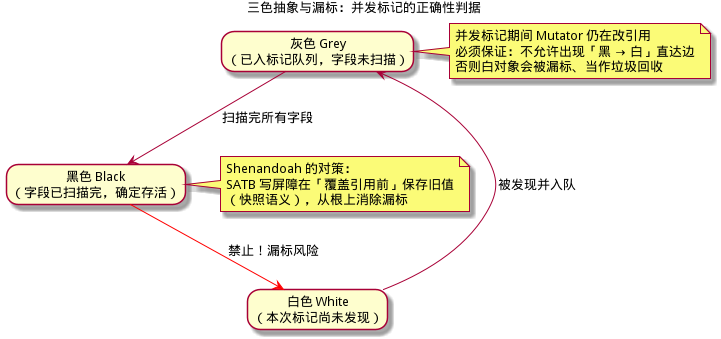
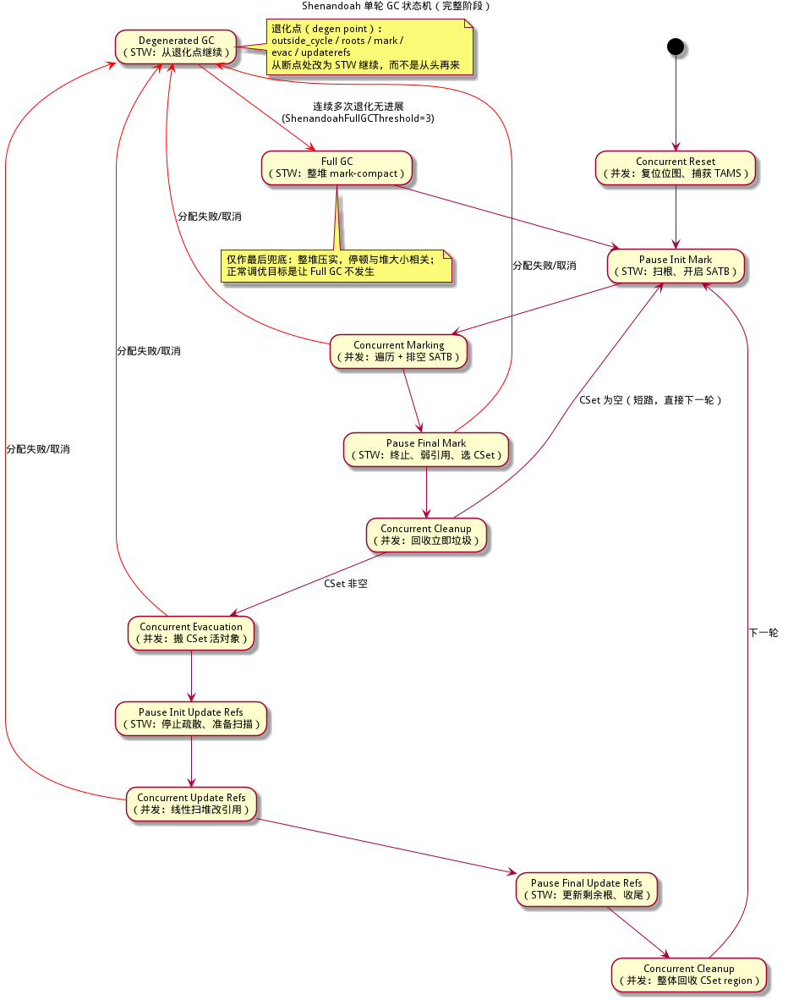
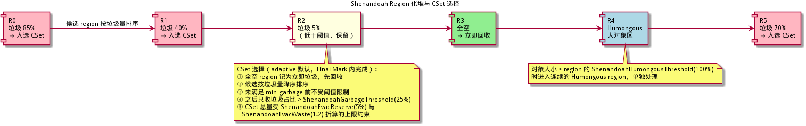
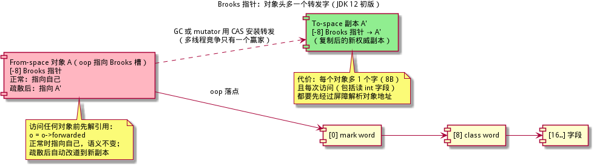
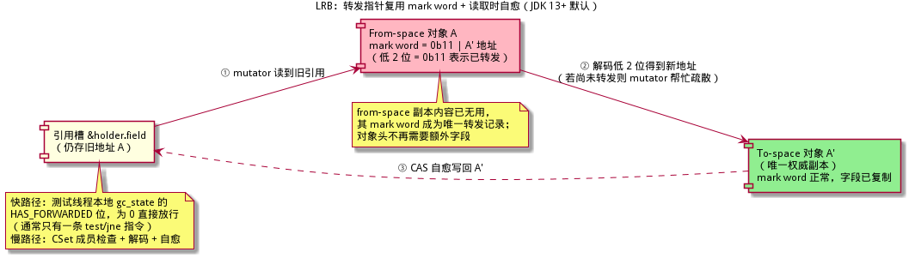
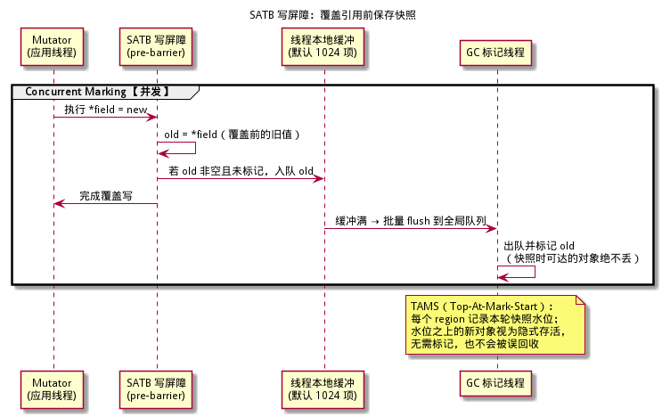
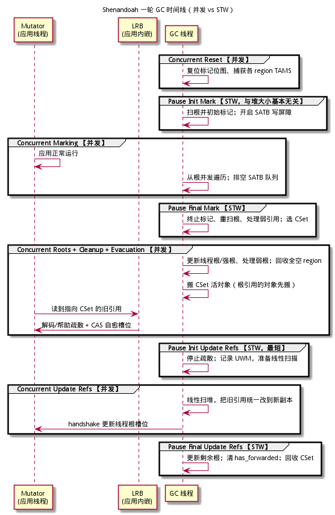
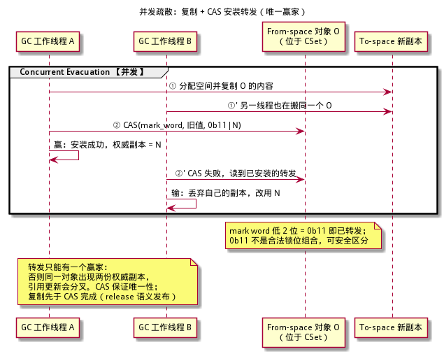
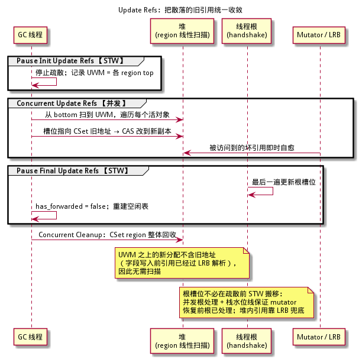

# Shenandoah 算法详解 —— 低延迟并发疏散

> **面向读者**：完全没有 GC（垃圾回收）背景的开发者。本文从"内存为什么要回收"讲起，一路拆到 OpenJDK Shenandoah 的核心机制：region 化堆、Brooks 指针与 LRB 两代对象访问间接层、SATB 并发标记、并发疏散 + CAS 转发、update refs 收敛。
> **本系列（建议按序阅读）**：[Serial / Parallel 分代](../serial-parallel-算法详解/serial-parallel-算法详解.md) · [CMS](../cms-算法详解/cms-算法详解.md) · [G1](../g1-算法详解/g1-算法详解.md) · [Shenandoah](shenandoah-算法详解.md) · [Go GC](../go-gc-算法详解/go-gc-算法详解.md) · [ZGC](../zgc-算法详解/zgc-算法详解.md)
> **基础与对照**：GC 基础（根、可达性、三色、屏障）见 [ZGC 算法详解 §1–3](../zgc-算法详解/zgc-算法详解.md#1-垃圾回收为什么需要它)；region / SATB / 记忆集的横向对照见 G1 篇；最终路线对照见 ZGC 篇（染色指针 + 多映射 vs 本文的 LRB）。
> **目标**：读完并配合伪代码，你能独立实现一个 Shenandoah 风格的"并发标记 + 并发疏散"GC。文中所有示意图由 PlantUML 生成，源文件在同目录 `figures/` 下（`.puml`）可复编译。
> **与 xgc 仓库的关系**：本文是"算法原理/教学"文档；工程实现细则见 [implementation-guide/05-算法实现详解.md](../implementation-guide/05-算法实现详解.md)、[16-并发正确性与内存模型.md](../implementation-guide/16-并发正确性与内存模型.md)、[17-正确性验证与压力测试.md](../implementation-guide/17-正确性验证与压力测试.md)。

---

## 目录

1. [必备基础（15 分钟速览）](#1-必备基础15-分钟速览)
2. [定位与历史：Red Hat 与 OpenJDK](#2-定位与历史red-hat-与-openjdk)
3. [总体设计：核心思想与基石](#3-总体设计核心思想与基石)
4. [Region 化堆与 CSet](#4-region-化堆与-cset)
5. [两种对象访问间接层：Brooks 与 LRB](#5-两种对象访问间接层brooks-与-lrb)
6. [并发标记：SATB 与写屏障](#6-并发标记satb-与写屏障)
7. [单轮 GC 完整流程：状态机与时间线](#7-单轮-gc-完整流程状态机与时间线)
8. [并发疏散与 CAS 转发](#8-并发疏散与-cas-转发)
9. [Update Refs 与引用收敛](#9-update-refs-与引用收敛)
10. [LRB 快慢路径与典型场景](#10-lrb-快慢路径与典型场景)
11. [退化 Degenerated GC 与 Full GC 回退](#11-退化-degenerated-gc-与-full-gc-回退)
12. [正确性论证](#12-正确性论证)
13. [从零实现最小路线](#13-从零实现最小路线)
14. [关键数据结构与伪代码](#14-关键数据结构与伪代码)
15. [参数调优与三方对比](#15-参数调优与三方对比)
16. [术语速查表](#16-术语速查表)
17. [延伸阅读与参考](#17-延伸阅读与参考)

---

## 1. 必备基础（15 分钟速览）

> 本节自足：即使你从未接触过 GC，也能凭本节读懂后文。想更系统地打基础，可读
> [ZGC 算法详解 §1–3](../zgc-算法详解/zgc-算法详解.md#1-垃圾回收为什么需要它)。

### 1.1 对象、堆、根与可达性

程序运行时不断创建对象（`new` 一个结构体、一个类实例），它们放在一片叫**堆（Heap）**的内存里。一个对象什么时候可以销毁？答案是：**当它再也无法被程序访问到时**。

怎么判断"无法被访问"？从一组确定的入口出发，顺着对象里的引用一路走：

- 走得到的对象，叫**可达（reachable）**，是活对象；
- 走不到的，叫**不可达（unreachable）**，是垃圾。

这组入口叫 **GC 根（GC Roots）**，典型来源：

| 根类型 | 例子 |
|--------|------|
| 线程栈 | 局部变量、方法参数、返回地址处的引用 |
| 全局/静态 | 类静态字段、全局变量表 |
| 寄存器 | 当前 CPU 寄存器里暂存的引用 |
| 运行时/JNI | 宿主 VM、JNI 句柄持有的引用 |

### 1.2 两个角色：Mutator 与 Collector

| 角色 | 英文 | 干什么 |
|------|------|--------|
| 应用程序 | **Mutator**（改变者） | 运行用户代码，不断创建、读取、改写对象 |
| 垃圾回收器 | **Collector**（收集器） | 找出并回收不可达对象，整理可用内存 |

GC 的本质：**在 Mutator 运行期间，识别并回收不可达对象，同时保证活对象的引用关系不被破坏**。Shenandoah 的特别之处在于，连"搬运活对象"都要和 Mutator 同时进行。

### 1.3 STW 与三大指标

最朴素的做法是 **STW（Stop-The-World，停止世界）**：GC 先暂停所有 Mutator，放心地扫描、搬运、回收，完事再恢复。

- 好处：简单、正确性容易保证；
- 坏处：**停顿（Pause）**。程序被冻结的那段时间，对服务器是延迟尖峰，对交互系统是卡顿。

衡量 GC 的三大指标：

| 指标 | 英文 | 含义 |
|------|------|------|
| 吞吐 | Throughput | 花在有用工作上的时间占比 |
| 延迟/停顿 | Latency / Pause | 单次 STW 多长、最大停顿多长 |
| 占用 | Footprint | GC 自身额外耗了多少内存 |

传统 GC 的停顿往往与堆大小成正比（要扫的越多越久）。**Shenandoah 的目标是：停顿时间与堆大小基本无关**——200 MB 和 200 GB 的堆，停顿都在同一量级。

### 1.4 三色抽象与漏标

并发标记需要一个正确性判据。把对象分成三类：

| 颜色 | 含义 |
|------|------|
| **白 White** | 本次标记还没发现它（死活未定） |
| **灰 Grey** | 已发现、进了标记队列，但字段还没扫描 |
| **黑 Black** | 字段已扫描完，确定存活 |

遍历就是 白 → 灰 → 黑。当没有灰色对象时，剩下的白色对象就是垃圾。

**并发标记的正确性判据（三色不变量）**：任何时刻都不允许出现「**黑对象直接引用白对象**」——黑色对象"已经扫完了"，如果它指向的白对象是活的，就再也不会被发现，会被误回收，造成**漏标**，程序随后崩溃或数据损坏。



Shenandoah 用 **SATB（Snapshot-At-The-Beginning，起始快照）写屏障**消除漏标：Mutator 覆盖一个引用之前，先把**旧值**记下来，等价于"GC 开始时活着的对象，之后永远当活的处理"。

### 1.5 屏障、卡表、记忆集

- **屏障（Barrier）**：编译器在读写引用处自动插入的一小段检查代码。按位置分**读屏障（Load Barrier）**与**写屏障（Store/Write Barrier）**。
- **卡表（Card Table）**：把堆按固定大小（如 512B）划成"卡"，用一位标记"这张卡里的引用被改过"，用于分代/region 间跨区引用追踪。
- **记忆集（Remembered Set, RS）**：记录"哪些 region 指向我这个 region"，避免回收一个 region 时扫全堆。

G1 用写屏障维护卡表/记忆集；Shenandoah 的并发标记用 SATB 写屏障；并发疏散则用 **LRB（Load Reference Barrier，读引用屏障）**，这是它与 ZGC 读屏障最值得对照的地方。

### 1.6 从"复制"到"并发复制"

复制式收集（Copying）把活对象从 From 空间复制到 To 空间，天然无碎片、分配极快，但**移动对象后所有指向它的引用都要更新**。STW 下这很容易；并发下就难了：

- Mutator 手里可能还攥着旧地址；
- 谁先发现旧地址，谁就要能把它"改道"到新副本；
- 多个 GC 线程可能同时搬同一个对象，不能出现两份权威副本。

Shenandoah 的全部设计，就是围绕"**并发复制**"这四个字展开的。

**一句话总结**：GC = 从根找可达对象、回收不可达对象；并发 GC 的难点是"搬对象时 Mutator 还在读写"，Shenandoah 用 SATB 解决漏标、用对象访问间接层解决改道。

---

## 2. 定位与历史：Red Hat 与 OpenJDK

### 2.1 一句话定位

> **Shenandoah** 是 Red Hat 主导、进入 OpenJDK 的**低停顿、region 化、并发疏散**垃圾收集器：标记与搬移都并发执行，停顿与堆大小基本无关；它**不需要染色指针、不需要多映射**，支持压缩指针（compressed oops），甚至能跑 32 位平台——这是它与 ZGC 最大的路线差异。

### 2.2 版本与历史（已查证）

| 版本 | 事件 | 说明 |
|------|------|------|
| 2014 | JEP 189 创建 | 作者 Christine H. Flood、Roman Kennke 等，Red Hat 主导 |
| JDK 8u / 11u | Red Hat 下游先行发布 | Shenandoah 先随 RHEL 的 8u/11u 发布，已是"非实验"特性 |
| JDK 12 | **JEP 189** 集成，实验特性 | 需要 `-XX:+UnlockExperimentalVMOptions -XX:+UseShenandoahGC`；初版用 **Brooks 指针** |
| JDK 13 | **JDK-8221766** 引入 LRB；**JDK-8224584** 移除对象头转发字 | 屏障方案改为 Load Reference Barrier，对象头不再多一个字；现行形态 |
| JDK 15 | **JEP 379** 转为产品特性 | 不再需要 `UnlockExperimentalVMOptions` |
| JDK 24 | **JEP 404** 分代 Shenandoah（实验） | `-XX:ShenandoahGCMode=generational` |
| JDK 25 | **JEP 521** 分代转正 | 非分代 `satb` 模式仍是默认 |
| JDK 28（计划） | **JEP 535** 分代成为默认 | 同时弃用 `satb` 模式（写作时 JEP 状态为 Targeted） |

> **版本说明**：本文以 JDK 17–21 时代的**经典非分代（satb）模式**为主线，因为它是理解分代模式的基础。分代模式只是在同一套机制上加了一层 young/old 划分（young 回收频繁、old 标记可被打断）。

### 2.3 回移到 JDK 8/11 的背景

OpenJDK 主线之外，Red Hat 长期维护 Shenandoah 的 8u/11u 回移仓库（`shenandoah/jdk8u`、`shenandoah/jdk11u`），把 LRB、转发字消除等改动同步回去。JEP 379 原文明确提到：JDK 12 集成时，Shenandoah 已经随 Red Hat 8u/11u 下游发布并服务 RHEL 用户，因此那些版本本来就是"非实验"状态。

### 2.4 目标与路线差异

Shenandoah 的设计目标（JEP 189）：

1. **停顿与堆大小无关**：STW 只做扫根、选 CSet、收尾等"工作量不随堆增长"的事；
2. **搬移与标记并发**：真正随堆增长的工作全部放到并发阶段；
3. **以 CPU 周期和空间换停顿**：并发线程会和应用抢 CPU，疏散需要预留空间（`ShenandoahEvacReserve` 等）。

与 ZGC 的路线对比：

| 维度 | Shenandoah | ZGC |
|------|-----------|-----|
| 对象访问间接层 | 对象自己的 mark word 存转发指针 + LRB | 指针高位染色 + 多映射 + 读屏障 |
| 额外指针宽度 | 不需要，可用压缩指针 | 需要 64 位地址高位 |
| 32 位支持 | 支持（LRB 不依赖指针高位） | 不支持 |
| 根搬移 | 根可并发处理，LRB 兜底 | Relocate Start 在 STW 中先搬根 |
| 旧引用修正 | 本轮显式 update refs 收敛 | 推迟到下一轮 Mark Start 惰性 remap |

**一句话总结**：Shenandoah 是 Red Hat 的 OpenJDK 低延迟收集器，JDK 12 实验、JDK 15 转正；JDK 13 从 Brooks 指针切换到 LRB，此后不需要额外对象头字段，路线比 ZGC 更"平易近人"。

---

## 3. 总体设计：核心思想与基石

### 3.1 核心思想一句话

> **Shenandoah = 复制收集 + SATB 并发标记 + 并发疏散（CAS 唯一转发）+ 一轮 update refs 收敛。**
> 代价：每次**载入引用**多一层访问间接（LRB）；收益：搬移与标记全并发，停顿与堆大小无关。

完整状态机如下（红色箭头是分配失败时的退化路径，§11 详解）：



### 3.2 四大基石

| 基石 | 解决什么 | 章节 |
|------|----------|------|
| **Region 化堆 + CSet** | 以 region 为单位选"垃圾最多"的目标，搬空后整块回收、无碎片 | §4 |
| **对象访问间接层（Brooks / LRB）** | 并发搬移时，任何线程拿到的引用都被"改道"到权威副本 | §5 |
| **SATB 写屏障** | 并发标记不漏标：覆盖引用前保存旧值，维持起始快照 | §6 |
| **并发疏散 + CAS 转发** | 多线程竞争搬同一对象时只有一个赢家，转发指针唯一 | §8 |
| **Update Refs** | 本轮内把散落的旧引用统一改到新副本，回收 CSet、解除屏障负担 | §9 |
| **Pacing + 退化/Full GC** | 用分配限速避免 OOM；来不及就退化到 STW 或 Full GC 兜底 | §11 |

### 3.3 与 G1 的血缘关系

Shenandoah 的 region、CSet、SATB 标记、记忆集思想都与 G1 同源（参见 G1 篇）。区别在关键一步：

- G1 的**疏散（Evacuation）是 STW 的**，虽然标记并发；
- Shenandoah 把疏散也并发化，代价是引入 LRB 和 update refs。

所以读懂 G1 的 region/SATB/RS 概念，再读本文的"并发化改造"，是最顺的学习路径。

**一句话总结**：Shenandoah 把 G1 的 region 化设计与"并发复制"结合起来，用 LRB 换取停顿与堆大小解耦。

---

## 4. Region 化堆与 CSet

### 4.1 Region：比 G1 更细的集装箱

Shenandoah 把堆切成许多固定大小的 **region（区）**，分配就是把 region 当作空闲块做"指针递增（bump-the-pointer）"，快如复制收集。回收时只挑**垃圾占比最高**的若干 region 组成 **CSet（Collection Set，收集集合）**，把里面活对象搬到别处，然后整块 region 归还空闲表——天然无碎片。

| 维度 | G1 | Shenandoah |
|------|----|-----------|
| region 大小 | 1 MB – 32 MB（自动） | 256 KB – 32 MB（自动），可小得多 |
| 自动定尺寸 | 目标约 2048 个 region | `ShenandoahTargetNumRegions=2048`，`max_heap/2048` 再夹到上下限，向下取 2 的幂 |
| 指定大小参数 | `-XX:G1HeapRegionSize` | `-XX:ShenandoahRegionSize`（更早版本叫 `ShenandoahHeapRegionSize`，JDK 15 起改名） |
| 大对象 | Humongous region | `ShenandoahHumongousThreshold=100`（占 region 的百分比），对象 ≥ 一个 region 即进连续 Humongous region |
| 回收单位 | region（疏散 STW） | region（疏散并发） |

region 的常见状态：

| 状态 | 含义 |
|------|------|
| FREE | 空闲，可分配 |
| REGULAR | 正在使用，有活对象 |
| CSET | 本轮被选中，等待/正在疏散 |
| HUMONGOUS_START / HUMONGOUS_CONT | 大对象的起始段 / 延续段 |
| PINNED（CSET 内） | 被 JNI critical 等钉住，本轮搬不动，推迟处理 |



### 4.2 CSet 选择：怎么挑"最值得搬"的 region

CSet 选择在 **Final Mark（STW）** 内完成。思路分四步：

1. **立即垃圾（Immediate Garbage）**：标记后一个活对象都没有的 region，直接记为可回收，由 Concurrent Cleanup 立即释放（不进入疏散）。
2. **候选排序**：其余 region 按垃圾量降序排序。
3. **双重目标**：既要搬得值（垃圾多），又要保证搬完能腾出足够空闲。adaptive 启发式用一个公式表达：
   - `max_cset = capacity × ShenandoahEvacReserve% ÷ ShenandoahEvacWaste`（本轮最多搬这么多活对象，给疏散留空间）；
   - `free_target = capacity × ShenandoahMinFreeThreshold% + max_cset`；
   - `min_garbage = max(0, free_target - 当前空闲)`。
4. **选择规则**：先无条件加入候选直到垃圾总量满足 `min_garbage`；之后只收垃圾占比超过 `ShenandoahGarbageThreshold`（默认 25%）的 region；CSet 活对象总量一旦超过 `max_cset` 立即停止（否则疏散必 OOM）。

一个细节：`ShenandoahImmediateThreshold=90` 表示当立即垃圾已占总垃圾的 90% 以上时，本轮可以"短路"——不疏散，直接回收，显著降低开销。

### 4.3 启发式（Heuristics）：什么时候开始 GC

`-XX:ShenandoahGCHeuristics` 决定"何时启动、搬多少、自动开哪些特性"：

| 模式 | 触发策略 | 适用 |
|------|----------|------|
| **adaptive**（默认） | 学习分配速率与历史周期时长，预测"堆耗尽前能否跑完一轮"，提前启动；`ShenandoahLearningSteps=5` 轮学习期用 `ShenandoahInitFreeThreshold=70` 触发 | 通用 |
| **static** | 空闲低于 `ShenandoahMinFreeThreshold`（10%）就启动；任何有垃圾的 region 都可能入选 | 行为可预测 |
| **compact** | 更频繁、更深入地回收（更低的垃圾阈值、更积极的 uncommit），以内存换频率 | 内存紧张 |
| **aggressive** | 诊断用：背靠背连续 GC，搬所有非空 region | 测试收集器本身 |

还有兜底触发：空闲低于 `ShenandoahMinFreeThreshold`（10%）时，无论哪个启发式都必须启动；空闲很久（`ShenandoahGuaranteedGCInterval`，默认 5 分钟）也会强制来一轮，趁应用空闲做掉。

**一句话总结**：Shenandoah 用比 G1 更细的 region 做单位，在 Final Mark 里按垃圾占比和疏散预留空间选出 CSet，整块搬空、整块回收；adaptive 默认通过预测分配速率决定何时开跑。

---

## 5. 两种对象访问间接层：Brooks 与 LRB

这是 Shenandoah 最核心、也最容易被讲错的部分。并发复制要求"对象移动后，任何线程还能找到新副本"，Shenandoah 历史上用过两代方案。

### 5.1 为什么需要"间接层"

并发疏散时，Mutator 可能：

- 手里已经有旧地址（引用槽、寄存器、栈）；
- 正在读旧对象的字段；
- 正在往旧对象写字段。

如果对象被搬走而 Mutator 继续读写旧副本，就会出现"两个副本各改各的"——数据分叉。间接层的职责就是：**任何一次对象访问，都先解析到当前唯一权威副本**。

### 5.2 Brooks 指针版（JDK 12 初版）

**布局**：每个对象头前面多一个转发字（Brooks pointer），oop 指向这个字；正常时它指向对象自己。

```
[-8] Brooks 指针   ← oop 指向这里
[ 0] mark word
[ 8] class word
[16] 字段 1 ...
```

**协议**：

- 正常：`obj->forwarded == obj`，解引用等于没变；
- 疏散：复制出新副本后，用 CAS 把 `obj->forwarded` 指向新副本；多个线程同时搬，只有一个 CAS 成功；
- 此后任何线程访问对象，先 `o = o->forwarded` 就自动改道。



**Mutator 帮助疏散的完整追踪**（旧屏障方案）：

1. Mutator 执行 `o.x`。读屏障先做 `o = o->forwarded`：
   - 若 Brooks 指向自己：对象未搬，`o` 不变；
   - 若指向新副本 A'：`o` 就地改为 A'，后续访问落在 A'。
2. Mutator 执行 `o.x = v`。写屏障检查 `o` 是否在 CSet：
   - 不在：直接写；
   - 在且尚未转发：**Mutator 自己复制 `o` 到新副本并 CAS 安装转发**（帮助疏散），然后把 `o` 改道到新副本再写。
3. 于是旧副本在转发后只保留一个 Brooks 字，内容不再被读写。

**代价**：

- 每个对象多 8 字节，堆越大越可观；
- 对象访问（**包括读一个 int 字段**）都要先经屏障解析地址，因为对象引用必须先解析才能解引用；
- 读屏障是"常开"的，快路径也要多读一次内存。

### 5.3 LRB 版（JDK 13+ 现行默认）

JDK 13 的两个关键改动（JDK-8221766、JDK-8224584）：

1. 屏障从"读/写使用点"改为 **LRB（Load Reference Barrier，载入引用屏障）**：只在**引用被载入**的那一刻解析，之后该引用就是 to-space 地址；
2. 转发指针**复用 from-space 副本的 mark word**：低 2 位为 `0b11` 表示"已转发"（`0b11` 不是合法锁位组合），其余位存新副本地址。

```
对象头（不再有额外字段）：
[ 0] mark word  ← 正常是 mark；已疏散时 = 0b11 | A' 地址
[ 8] class word
[16] 字段 ...
```



**为什么可以复用 mark word**：LRB 建立了**强 to-space 不变量**——任何线程只读/写 to-space 副本，from-space 副本的内容彻底作废，只剩 mark word 当转发记录，因此可以随便覆盖。这消除了 Brooks 方案的额外内存和"解析后还要再解析"的常开开销。

**LRB 快路径**：先测试线程本地的 `gc_state` 是否含 `HAS_FORWARDED` 位。绝大多数时候没有并发疏散，一条 `test/jne` 就放行；概念上的完整条件是：

```
if (in_evac_phase && in_collection_set(loaded_ref) && !is_forwarded(loaded_ref))
    走慢路径;
```

**Mutator 读到已被疏散对象的完整追踪**（LRB 版）：

1. Mutator 执行 `Foo f = holder.field;`。编译器在此插入 LRB（定义点）。
2. 快路径：`gc_state` 无 `HAS_FORWARDED` → 直接用，结束。
3. 假设疏散进行中，且 `holder.field` 里还是旧地址 A（A 在 CSet）：
   - LRB 慢路径读 A 的 mark word：低 2 位是 `0b11` → 已转发，解出 A'；
   - 若尚未转发：Mutator 调用 `evacuate_object(A)` **帮助疏散**（复制 + CAS 安装转发），拿到 A'；
   - 用 CAS 把 `holder.field` 自愈写回 A'（防止覆盖其他线程刚写入的新值）；
   - 返回 A' 给 Mutator。
4. 之后 `f.other` 的 LRB 快路径直接通过：`f` 已经是 to-space 地址，不在 CSet。

**引用比较**：因为每个引用在载入时都已解析到权威副本，`a == b` 不需要额外的"对象相等屏障"（这正是 LRB 方案相比旧方案简化的接口之一）。

### 5.4 两版对比

| 维度 | Brooks 指针（JDK 12） | LRB（JDK 13+ 默认） |
|------|----------------------|---------------------|
| 转发记录位置 | 对象头额外 1 字 | from-space 的 mark word（低 2 位 `0b11` 标记） |
| 每对象额外内存 | +8 B | 0 |
| 屏障位置 | 每次访问对象（含基本类型读）都要先解析 | 仅在"载入引用"处（定义点） |
| 快路径成本 | 一次额外内存读 | 一次线程本地标志位测试 |
| 未转发时 mutator 帮忙搬 | 写屏障触发 | LRB 慢路径触发 |
| 压缩指针 / 32 位 | 可用但开销大 | 支持（不依赖指针高位） |
| 实现复杂度 | 协议直观、内存开销大 | 解码稍复杂，但屏障接口更简单 |
| 状态 | JDK 13 起移除 | 现行默认；分代模式沿用同一 LRB |

> **常见误区**：LRB 不是"每次读内存都拦截的读屏障"。它只在**引用被载入**时插入，不拦基本类型字段读；而且快路径只是一次标志位测试，慢路径才做 CSet 检查和转发解码。

**一句话总结**：Brooks 指针用"每个对象多一个字"换简单；LRB 把转发藏进 mark word、只在载入引用时检查，零额外内存、快路径一条指令，是 JDK 13 之后的唯一形态。

---

## 6. 并发标记：SATB 与写屏障

### 6.1 SATB 语义

**SATB（Snapshot-At-The-Beginning，起始快照）**：标记的正确性只要求"GC 开始时活着的对象都不能被回收"。实现方式：

- Init Mark（STW）时刻，所有根可达对象构成快照；
- 之后 Mutator 若**覆盖**某个引用（`*field = new`），旧值可能因此失去最后一个引用而"凭空消失"——必须在覆盖前把旧值记下来；
- 新写入的引用不需要记录：它指向的对象要么快照时已活（会被标记），要么是快照之后新分配的（天然存活）。

### 6.2 写屏障怎么做

```
store *field = new:
    old = *field                     // 覆盖前的旧值
    if (SATB 激活 && old != null && !is_marked(old))
        enqueue(old)                 // 写入线程本地 SATB 缓冲
    *field = new
```

细节（对应 OpenJDK 实现）：

- **线程本地缓冲**：默认 1024 项（`ShenandoahSATBBufferSize=1K`），满了批量 flush 到全局队列，减少竞争；
- **过滤已标记**：入队前先看 old 是否已标记，避免无效工作；
- **原子写路径**：`cmpxchg` / `xchg` 也要把"被替换的旧值"入队（因为那也是被覆盖的引用）；
- **TAMS**：每个 region 记录 **Top-At-Mark-Start** 水位。水位之上的对象是快照后分配的，`is_marked()` 直接返回 true（隐式存活），无需标记、不会被误回收。



### 6.3 并发遍历与负载均衡

- Init Mark（STW）扫根，把根引用的对象标记并入标记队列；
- 多个 GC 工作线程从各自的**任务队列**取对象、扫描字段、把未标记的子对象标记入队；
- **工作窃取（Work Stealing）**：自己的队列空了就去别的线程队列尾部偷，保证负载均衡；
- 每处理 `ShenandoahMarkLoopStride=1000` 个对象检查一次取消/让步，兼顾吞吐与响应；`ShenandoahMarkScanPrefetch=32` 用于预取位图。

### 6.4 终止判定

并发标记"什么时候算完"需要小心：GC 线程队列空了，但 Mutator 可能刚往 SATB 缓冲里塞了东西。终止协议：

1. 所有标记任务队列为空；
2. flush 并排空所有 SATB 缓冲，重试最多 `ShenandoahMaxSATBBufferFlushes=5` 次；
3. 仍有新工作 → 回到第 1 步；
4. 全部为空 → 进入 Final Mark（STW）做最终收尾：重扫根、排空残余队列，确认无灰色对象。

> **版本说明**：现代 JDK 把弱引用处理、类卸载放到 Final Mark 之后的**并发阶段**（Concurrent Weak References / Concurrent Class Unloading）；早期版本在 Final Mark 的 STW 内完成。日志阶段名与顺序随版本变化。

**一句话总结**：SATB 用写屏障在覆盖引用前保存旧值，配合 TAMS 把"快照后新分配"视为隐式存活；并发遍历靠任务队列 + 工作窃取，终止条件是"队列空 + SATB 缓冲全部排空"。

---

## 7. 单轮 GC 完整流程：状态机与时间线

### 7.1 逐阶段拆解

以下阶段名取自 JDK 17–21 的日志与源码；括号内标注停顿性质。

| # | 阶段（日志名） | 停顿 | 目的与关键动作 | 依赖/产出 |
|---|----------------|------|----------------|-----------|
| 0 | Concurrent Reset | 并发 | 复位标记位图、捕获各 region 的 TAMS，准备新一轮 | 为 Init Mark 准备干净的标记状态 |
| 1 | **Pause Init Mark** | STW | 开启并发标记状态；扫描 GC 根并初始标记；开启 SATB 写屏障；arm nmethod、切换栈水位线 epoch | 产出初始标记队列；此后 Mutator 的覆盖写都被 SATB 记录 |
| 2 | Concurrent Marking | 并发 | 工作线程从队列并发遍历、排空 SATB；处理根（并发根标记） | 产出可达位图与各 region 存活量 |
| 3 | **Pause Final Mark** | STW | 终止标记（排空队列/SATB、重扫根）；统计垃圾、**选 CSet**；准备并发根；置 `evacuation_in_progress`、`has_forwarded_objects=true`（早期版本还会在此处理弱引用） | 产出 CSet；开启 LRB 慢路径 |
| 4 | Concurrent Thread Roots | 并发 | 更新 Java 线程栈根，并把根引用的 CSet 对象疏散到新副本 | 根槽位先于主疏散被处理 |
| 5 | Concurrent Weak References / Weak Roots | 并发 | 处理弱引用、弱根，报告死亡对象 | 防止死对象被弱根"复活" |
| 6 | Concurrent Cleanup（early） | 并发 | 回收"立即垃圾"region（一个活对象都没有的） | 立刻腾出空间 |
| 7 | Concurrent Class Unloading | 并发 | 卸载不可达类（若开启） | 配合弱根处理 |
| 8 | Concurrent Strong Roots | 并发 | 更新 VM 根、CLD、代码缓存等强根 | 强根引用改到新副本 |
| 9 | Concurrent Evacuation | 并发 | 并发搬空 CSet 剩余活对象；LRB 为 Mutator 兜底并自愈 | 产出转发指针与 to-space 副本 |
| 10 | **Pause Init Update Refs** | STW | 停止疏散；记录各 region 的 UWM（Update Watermark）；准备 update refs | 冻结"待扫描范围" |
| 11 | Concurrent Update Refs | 并发 | 线性扫堆（bottom → UWM），把所有指向 CSet 旧地址的引用 CAS 改到新副本 | 引用收敛的主体 |
| 12 | Concurrent Update Thread Roots | 并发（handshake） | 逐个线程更新栈上根槽位 | 根引用收敛 |
| 13 | **Pause Final Update Refs** | STW | 更新剩余根；`has_forwarded=false`；更新 region 状态、重建空闲表 | 解除 LRB 负担；CSet region 变为可回收 |
| 14 | Concurrent Cleanup（complete） | 并发 | 整体回收 CSet region，归还空闲表 | 本轮结束 |

### 7.2 时间线



### 7.3 阶段命名差异（重要）

Shenandoah 的阶段名在版本间改过，不要背错：

| 时期 | 说明 |
|------|------|
| JDK 12 初版 | Init Mark / Concurrent Mark / Final Mark / Concurrent Cleanup / Concurrent Evacuation / Init Update Refs / Concurrent Update Refs / Final Update Refs / Final Cleanup |
| 现代 JDK（17–21） | 增加了 Concurrent Reset、Concurrent Marking roots、Concurrent Thread/Strong Roots、Concurrent Weak Refs/Class Unloading、Concurrent Update Thread Roots 等细分；收尾日志常表现为两条 "Concurrent cleanup" |
| JDK 8u/11u 回移版 | 曾支持 `ShenandoahUpdateRefsEarly`（on/off/adaptive）把 update refs 合并进标记阶段；约 JDK 15 起移除该开关，现代版本 update refs 固定独立执行（随版本变化） |

> **常见误区**："Shenandoah 只有三个停顿，所以停顿时长固定。"三个 STW 点是 Init Mark、Final Mark、Init/Final Update Refs（收尾），它们的工作量主要是扫根和收尾，确实不随堆增长，但**根集合大小、线程数、弱引用数量**仍会影响它们，只是量级很小。

**一句话总结**：一轮 = 并发准备 → STW 初始标记 → 并发标记 → STW 终止并选 CSet → 并发回收/疏散 → STW 切换 update refs → 并发修引用 → STW 收尾 → 并发回收 CSet；真正的重活（标记、疏散、修引用）全在并发阶段。

---

## 8. 并发疏散与 CAS 转发

### 8.1 疏散预留：不能把空闲空间全搬满

疏散需要目标空间，如果 CSet 里的活对象总量超过可用空闲，必然 OOM。Shenandoah 用三个参数控制：

| 参数 | 默认 | 作用 |
|------|------|------|
| `ShenandoahEvacReserve` | 5（%） | 预留多少堆空间给疏散 |
| `ShenandoahEvacWaste` | 1.2 | 疏散过程的"浪费系数"（并发冲突会产生弃用副本） |
| `ShenandoahEvacReserveOverflow` | true | 允许紧急时超出预留（更抗 OOM，但更早耗尽） |

CSet 大小上限就是按这些参数折算的（§4.2 的 `max_cset` 公式）。

### 8.2 复制与 CAS：一个对象只能有一个赢家

每个 CSet region 由工作线程逐个认领，region 内每个活对象：

1. 在 to-space 分配空间，复制对象内容；
2. 用 **CAS 在对象 mark word 安装转发指针**（`0b11 | 新地址`）；
3. CAS 成功者是新副本的"赢家"；失败者读到已安装的转发，**丢弃自己刚复制的副本**，改用赢家的副本。



为什么必须唯一赢家：如果两个线程各自复制了一份且都保留，就会出现两份"权威副本"，后续引用更新会一半指向这份、一半指向那份，对象状态分叉。CAS 把"安装转发"变成原子仲裁点，**复制可以重复，转发只能一次**。

失败者的副本浪费由 `ShenandoahEvacWaste` 计入预留估算。

### 8.3 复制期间的 Mutator 读写怎么办

LRB 的强 to-space 不变量给出答案：

- **Mutator 读**：任何引用载入都过 LRB；若指向 CSet，先解析到新副本（必要时帮助疏散）再使用。Mutator 永远不会解引用 from-space 对象。
- **Mutator 写**：它持有的引用早已被 LRB 解析成 to-space 地址，写入自然落在新副本；GC 也只在 to-space 上写。
- **进入疏散前的窗口**：Final Mark 是 STW 点，此时所有线程的根（含寄存器/栈）都被扫描处理；之后新载入的引用全部过 LRB。因此不存在"寄存器里藏着未处理旧引用"的窗口。

from-space 副本在转发后内容作废，只有 mark word 作为转发记录保留——这也是 LRB 方案能省掉额外字段的原因。

> **钉住（Pinned）**：被 JNI critical 区或宿主原生代码钉住的 region 不能搬空，Shenandoah 会把它标记为 pinned 并推迟处理；若退化时 CSet 中存在 pinned region，会直接升级 Full GC（§11）。

### 8.4 为什么不需要"先搬根"（与 ZGC 的差异）

ZGC 在 Relocate Start（STW）里会先把**根直接引用的对象**搬掉并更新根，确保 Mutator 从根出发不会撞进旧地址。

Shenandoah 不需要这一步：

- **根槽位的更新可以并发**：Final Mark 后，线程根/VM 根/弱根由并发根处理阶段更新；Mutator 恢复执行前，栈水位线（StackWatermark）机制保证栈上的引用已被处理；线程根还通过 handshake 逐个更新。
- **堆内引用有 LRB 兜底**：即便某个根槽位短暂还是旧地址，Mutator 载入它的那一刻，LRB 会解析并自愈。

也就是说，Shenandoah 把"根必须先搬"这个约束，换成了"LRB 无条件解析任何旧引用"这个更强的保证。代价是每次引用载入的间接检查，收益是省掉一个 STW 搬根步骤。

### 8.5 update refs 阶段存在的意义

既然 LRB 能自愈，为什么还要专门一轮 update refs？

1. **有界收敛**：LRB 只修"被读到的槽位"，一个冷引用可能整个周期都没人读；update refs 主动线性扫堆，保证所有引用在有限时间内收敛。
2. **回收前提**：from-space region 只有在"没有任何引用再指向它"之后才能安全复用；没有 update refs，就无法确定这一点。
3. **解除屏障负担**：收敛后 `has_forwarded=false`，LRB 快路径恢复"一位测试即放行"，否则慢路径检查会长期存在。
4. **路线差异**：ZGC 把 remap 推迟到下一轮 Mark Start 惰性完成；Shenandoah 在本轮用一次并发扫描换"下一轮轻装"。

**一句话总结**：并发疏散 = 复制 + CAS 安装转发（唯一赢家）；Mutator 经 LRB 永远只碰 to-space；根不需要 STW 先搬，因为 LRB 兜底；update refs 负责把引用收敛这件事做得有界、可回收。

---

## 9. Update Refs 与引用收敛

### 9.1 三个子阶段

| 子阶段 | 停顿 | 做什么 |
|--------|------|--------|
| Pause Init Update Refs | STW | 关闭疏散状态；为每个 region 记录 **UWM（Update Watermark）** = 当前 top；准备线性扫描 |
| Concurrent Update Refs | 并发 | 从每个 region 的 bottom 扫到 UWM，遍历活对象字段，把指向 CSet 旧地址的引用 CAS 改到新副本 |
| Pause Final Update Refs | STW | 更新剩余根槽位；`has_forwarded=false`；region 状态更新、重建空闲表；随后 Concurrent Cleanup 回收 CSet |

### 9.2 为什么扫描范围是 [bottom, UWM)

UWM 之上的对象是 update refs 开始后新分配的。新对象的字段写入前，引用已经过 LRB 解析（写进去的就是 to-space 地址），不可能包含旧地址，所以不需要扫——这就是 UWM 的作用：**把"确定干净"的新分配排除在扫描之外**。

### 9.3 CAS 更新，不丢并发写

更新引用也必须用 CAS，因为 Mutator 可能同时改同一个槽位：

```
expected = 旧地址 old
loop:
    if CAS(slot, expected, new_copy) 成功 → 完成
    if 失败:
        if *slot == new_copy          → 别人已修好，退出
        if forwardee(*slot) != new_copy → 槽位已被改成别的对象，退出（不能覆盖）
        否则继续重试
```

注意最后一条：如果 Mutator 把槽位改成了另一个对象，GC **绝不能**把新值覆盖回 old 的转发目标——这正是"loser 不覆写 winner"的并发纪律。

### 9.4 根的最后一遍

Concurrent Update Thread Roots 用 handshake 逐个线程更新栈根；但 handshake 期间 Mutator 仍在运行，可能有新根出现。Final Update Refs（STW）再做最后一遍根更新，然后才能断言"堆内不存在旧地址"，安全地把 CSet region 整体回收。



**一句话总结**：update refs 用"线性扫堆 + CAS"把 LRB 的懒自愈升级为有界收敛，UWM 排除新分配，Final Update Refs 在 STW 中补最后一遍根，之后 CSet 整块回收、LRB 回到最轻快路径。

---

## 10. LRB 快慢路径与典型场景

### 10.1 完整伪代码

```c
// 读引用屏障：在“载入引用”处调用（JIT 会把快路径内联成 1~2 条指令）
static inline obj_t *load_reference(obj_t **slot) {
    obj_t *o = atomic_load_explicit(slot, memory_order_relaxed);
    if (o == NULL) return NULL;

    // 快路径：线程本地 gc_state 没有 HAS_FORWARDED 位
    // （通常一条 test/jne；绝大多数访问走这里）
    if (!thread_gc_state_has(HAS_FORWARDED))
        return o;

    // 慢路径：只有疏散进行中、且载入的引用指向 CSet 才需要解析
    if (!in_collection_set(o))
        return o;

    obj_t *fwd = get_forwardee(o);          // 解码 mark word 低 2 位
    if (fwd == o) {
        // 尚未转发：mutator 帮助疏散（复制 + CAS 安装转发）
        fwd = evacuate_object(o);           // 返回唯一赢家的副本
    }
    // 自愈：CAS 把槽位从旧地址改成新副本，防止覆盖并发写
    self_heal(slot, o, fwd);
    return fwd;
}
```

```c
// 自愈写回：只有“槽位仍然是旧地址”时才改
static void self_heal(obj_t **slot, obj_t *old, obj_t *fwd) {
    obj_t *expected = old;
    while (!atomic_compare_exchange_weak_explicit(
               (obj_t **)slot, &expected, fwd,
               memory_order_release, memory_order_relaxed)) {
        if (expected == fwd) return;            // 已被别人修好
        if (get_forwardee(expected) != fwd)     // 槽位已是别的对象
            return;                             // 绝不能覆盖
    }
}
```

### 10.2 各场景怎么过屏障

| 场景 | 处理 |
|------|------|
| 字段读 `f = a.b` | 在载入 `a.b` 后插 LRB，解析到权威副本 |
| 数组元素 `f = arr[i]` | 同上；批量拷贝（arraycopy）对源/目标逐元素处理 |
| 引用比较 `a == b` | 两个引用载入时都已解析，**无需对象相等屏障**（LRB 方案的重要简化） |
| 原子操作 `CAS(addr, cmp, new)` | 比较值与返回值都要解析；被替换的旧值要入 SATB 队列 |
| 弱引用 `WeakReference.get()` | LRB 带弱语义：若对象未被强标记（本轮已死）直接返回 NULL，防止"复活" |
| JNI / native 载入 | 走 native LRB，规则相同，只是调用点来自运行时 |

### 10.3 伪代码里的内存序

- `evacuate_object` 先复制、后 CAS 安装转发：CAS 用 **release（或保守序）**，保证"副本内容"先于"转发指针"对其他线程可见；
- `get_forwardee` 读 mark word 用 **acquire**，看到转发就能安全读副本；
- `self_heal` 用 CAS（compare-exchange）而不是直接写：避免把 Mutator 刚写入的新引用覆盖掉；
- SATB 入队/全局 flush 用 release/acquire 配对，保证入队对象对 GC 线程可见。

> **常见误区**："LRB 快路径要查 CSet。" 实现上快路径只测线程本地 `gc_state` 的一位；CSet 成员检查在慢路径里。把条件写成 `in_evac && in_cset && !forwarded` 是**概念模型**，不是快路径的真实指令序列。

**一句话总结**：LRB 快路径一条位测试，慢路径解码转发、必要时帮助疏散、CAS 自愈；所有引用载入场景（字段、数组、原子操作、弱引用）共用同一套语义。

---

## 11. 退化 Degenerated GC 与 Full GC 回退

### 11.1 为什么会退化

并发 GC 与 Mutator 赛跑：如果分配速度超过回收速度，可能出现：

- Mutator 分配失败（free set 拿不到空间）；
- GC 内部需要分配（如疏散副本、标记队列扩展）失败。

这时 Shenandoah 不能"等下一轮"，必须立刻停下 Mutator，把当前这轮 GC **从断点继续做完**——这就是**退化（Degenerated GC）**：一种"并发周期被迫转 STW"的降级模式。

### 11.2 退化点（degen point）

退化不是从头再来，而是记录"在哪个阶段被打断"，从该点用 STW 方式继续。源码中的枚举（随版本变化）：

| 退化点 | 含义 | 继续方式 |
|--------|------|----------|
| `outside_cycle` | 没有进行中的并发周期就分配失败 | 从零做一次 STW 标记/疏散/更新 |
| `roots` | 并发根标记阶段失败 | STW 标记 + 继续 |
| `mark` | 并发标记中途失败 | STW 排空标记队列 + 继续 |
| `evac` | 并发疏散中途失败 | STW 把剩余 CSet 对象搬完（含 pinned 检查） |
| `updaterefs` | 并发 update refs 中途失败 | STW 完成 update refs + 根更新 |

### 11.3 从退化到 Full GC

退化后判断"有没有进展"：回收到的空闲是否达到 `ShenandoahCriticalFreeThreshold`（默认 1%）。若连续多轮退化都没进展，升级为 **Full GC**：

- **Full GC 是 STW 的 mark-compact（标记-整理）**，把整堆压实，允许移动 humongous 对象（`ShenandoahHumongousMoves`，默认 true，仅影响 STW 周期）；
- 触发阈值：`ShenandoahFullGCThreshold=3`（连续退化次数）；`ShenandoahDegeneratedGC=true` 时才走退化，否则直接 Full GC；
- Full GC 的停顿与堆大小相关，是**延迟尖峰的主要来源**，正常调优目标就是让它不发生。

### 11.4 Pacing：让分配"慢一点"，别撞上 OOM

与其频繁退化，不如提前给 Mutator 限速。**Pacing（节流）** 在分配路径上对应用线程收"税"：

| 参数 | 默认 | 作用 |
|------|------|------|
| `ShenandoahPacing` | true | 总开关 |
| `ShenandoahPacingMaxDelay` | 10（ms） | 单次分配最多延迟多久；超过就放行，宁可退化 |
| `ShenandoahPacingIdleSlack` | 2（%） | 空闲阶段免税额 |
| `ShenandoahPacingCycleSlack` | 10（%） | 周期开始阶段的免税额 |
| `ShenandoahPacingSurcharge` | 1.1 | 附加税率，让回收跑在分配前面 |

思路：估算"按当前分配速率，GC 能否在堆耗尽前完成"；不能就按比例延迟分配线程，把分配速率压到安全线以下。adaptive 启发式则从源头提前启动周期（学习分配速率与周期时长，见 §4.3）。

**一句话总结**：退化是"并发周期被迫转 STW 从断点续做"，连续无进展（阈值 3）升级为 STW mark-compact 的 Full GC；pacing 用限速把退化概率降到最低，三者构成"预防 → 降级 → 兜底"的三级体系。

---

## 12. 正确性论证

### 12.1 SATB 不漏标

**命题**：GC 开始时（Init Mark 快照）可达的对象，最终都会被标记。

论证草图：

1. 取任意快照时可达的对象 X，存在路径 `root = v0 → v1 → ... → vk = X`。
2. 并发期间 Mutator 只能通过**覆盖**引用破坏这条路径的某条边 `vi → vi+1`；插入新边不会破坏旧路径。
3. SATB 写屏障保证：覆盖前 `vi+1` 一定被记录（若尚未标记），因此 `vi+1` 及其后继仍会被标记到。
4. 快照后新分配对象由 TAMS 视为隐式存活，不会漏。
5. 归纳可得 X 必被标记。因此白色对象中不存在"快照时可达"的对象，回收是安全的。

### 12.2 转发唯一性

**命题**：任一对象最多存在一个权威 to-space 副本。

论证：转发安装是对 mark word 的单次 CAS（`0b11 | new_addr`）。CAS 是原子仲裁：所有竞争者中只有一个成功，其余读到已安装的转发指针。失败者丢弃自己的副本，所有线程最终通过 `get_forwardee` 得到同一个新地址。复制可以发生多次（浪费），但转发值唯一。

### 12.3 update refs 收敛

**命题**：Final Update Refs 之后，堆内与根中不存在指向 CSet 旧地址的引用。

论证：

1. 每个引用槽位要么在 `[bottom, UWM)` 内被线性扫描到，要么在 UWM 之上（新分配，写前已解析，天然干净）；
2. 扫描到的旧引用用 CAS 改为转发目标；
3. Mutator 并发修改的槽位：若改成新对象，GC 的 CAS 会失败并放弃（不覆盖）；若改成旧地址，说明它来自一次尚未自愈的载入——Final Update Refs 的 STW 根扫描与 handshake 覆盖栈根，堆内槽位则由扫描保证；
4. 全部收敛后 `has_forwarded=false`，CSet region 可安全回收。

### 12.4 内存序要点

| 位置 | 要求 | 理由 |
|------|------|------|
| 安装转发 CAS | release / 保守序 | 副本内容先于转发可见，读者不会看到"半成品" |
| 读取转发（解码 mark word） | acquire | 看到转发后安全读副本字段 |
| LRB 自愈写回 | CAS（非普通写） | 不覆盖 Mutator 并发写入的新引用 |
| SATB 入队 / flush | release / acquire | 入队对象对 GC 线程可见，避免读到半初始化数据 |
| 栈根可见性 | StackWatermark / safepoint handshake | Mutator 恢复前根已处理，根扫描无遗漏 |

### 12.5 三个常见误区

> **误区一**："Shenandoah 停顿为零。"
> 正解：它有 Init Mark、Final Mark、Init/Final Update Refs 等 STW 点，只是工作量不随堆大小增长，量级在亚毫秒到毫秒。

> **误区二**："Shenandoah 必须有 Brooks 指针（每对象多一个字）。"
> 正解：那是 JDK 12 初版。JDK 13 起 LRB 把转发放进 from-space 的 mark word，对象头没有额外字段。

> **误区三**："有 LRB 自愈，update refs 是多余的。"
> 正解：自愈只修被读到的槽位，无法保证有界收敛，也无法证明 CSet 可以回收；update refs 是"回收许可"与"解除屏障负担"的必要步骤。

**一句话总结**：SATB 保证快照可达对象不漏；CAS 保证转发唯一；线性扫描 + STW 根收尾保证引用有界收敛；release/acquire 与 CAS 纪律保证并发下不丢写、不见半成品。

---

## 13. 从零实现最小路线

> 目标：不要一上来就写并发疏散。每一步的产物都能跑、可测、可交付，再逐步替换。
> 约定：每步验收都必须过 **ASan**（内存错误）与 **TSan**（数据竞争）；仓库里可直接跑
> [17-正确性验证与压力测试.md](../implementation-guide/17-正确性验证与压力测试.md) 的 `verify-asan`。

### 第 0 步：精确根 + 精确引用（硬前提）

- 运行时必须确切知道"哪里是引用、哪里不是"：可枚举线程栈/全局/寄存器根，可从元数据得知对象哪些字段是指针。
- 验收：随机栈布局下根扫描无遗漏、无把整数误当指针。
- 失败怎么办：先补元数据与根枚举，不要往下走；后面所有机制都建立在精确性上。

### 第 1 步：STW 的 mark-sweep

- 从根做可达性遍历、bitmap 标记、扫堆清除。
- 验收：创建→切断引用→回收→地址复用最小用例；ASan 无内存错误。
- 目的：把根、位图、遍历打扎实。

### 第 2 步：region 化 + STW mark-copy

- 堆切 region；回收时把 CSet 活对象复制到其他 region，用**转发表**把旧引用改到新址（STW 下直接全堆改）。
- 验收：无碎片、能整块归还 region；ASan 通过。
- 目的：掌握"搬移 + 转发 + 引用更新"，但还不用并发。

### 第 3 步：Brooks 指针 + 访问间接

- 给对象头加转发字，正常指向自己；访问对象前 `o = o->forwarded`；疏散时 CAS 安装转发。
- 验收：单线程下"访问转发后的对象必得新副本"；构造"两线程同时搬同一对象"的测试，断言只有一个赢家（可用多线程测试但先不接 GC 并发）。ASan 通过。
- 失败怎么办：CAS 语义/内存序写错是最常见原因；先确保"复制完成后再 CAS"。

### 第 4 步：SATB 写屏障 + 并发标记

- 实现线程本地 SATB 缓冲（容量可设 1024）与写屏障（覆盖前记录旧值、过滤已标记）；实现 TAMS；GC 线程并发遍历 + 工作窃取；终止判定 = 队列空 + SATB 排空。
- 验收：大量并发读写 + 反复触发 GC 的压力测试下，与"STW 影子标记"结果一致；TSan 无数据竞争。
- 失败怎么办：先查 SATB 是否漏记原子操作替换的旧值、TAMS 是否在正确时点捕获。

### 第 5 步：LRB + 自愈（先单线程）

- 用 mark word 低 2 位 `0b11` 编码转发；实现 `get_forwardee` / `try_update_forwardee`；实现 LRB 快慢路径与 CAS 自愈。
- 验收：强制"读一个已转发引用"，断言拿到新副本且槽位被写回；ASan 通过。
- 失败怎么办：解码与正常 mark word 冲突时，检查锁位组合是否与转发标记互斥（`0b11` 必须是非法锁位组合）。

### 第 6 步：并发疏散 + CAS 转发

- 工作线程并发搬 CSet；`evacuate_object` 用 CAS 仲裁；输家丢弃副本；Mutator 慢路径可帮助疏散。
- 验收：多线程压测下"每个对象恰好一个权威副本"；转发指针无丢失；TSan 通过。
- 失败怎么办：检查复制与 CAS 的内存序（release 发布）、以及输家是否真的丢弃副本。

### 第 7 步：update refs + 根处理 + CSet 回收

- Init Update Refs（STW）记录 UWM；并发线性扫堆 CAS 更新；handshake 更新线程根；Final Update Refs（STW）补根、清 `has_forwarded`、回收 CSet。
- 验收：一轮结束后断言"堆内无任何指向已回收 region 的引用"；长时间压测零 UAF；ASan + TSan 通过。
- 失败怎么办：优先怀疑 UWM 记录时点与根 handshake 的竞态（这正是仓库 [16-并发正确性与内存模型.md](../implementation-guide/16-并发正确性与内存模型.md) 讨论的典型窗口）。

### 第 8 步：pacing + 退化 + Full GC 兜底

- 分配失败检测；退化点记录与 STW 续做；无进展计数 → Full GC（简单 STW mark-compact 即可）；分配限速。
- 验收：在"分配速率略高于回收速率"的极端压测下，系统不崩溃、能收敛（可能发生退化甚至 Full GC）；ASan + TSan 通过。
- 失败怎么办：先保证退化/Full GC 正确性优先于性能；宁可多一次 Full GC，不可丢一次引用。

**一句话总结**：先 STW 打地基（标记、复制、转发），再把标记并发化（SATB），再把疏散并发化（LRB + CAS），再补 update refs 收敛，最后加 pacing/退化/Full GC；每一步都用 ASan + TSan 验收，且必须与"影子 GC"差分比对。

---

## 14. 关键数据结构与伪代码

> 以下伪代码是"可直接照抄"的骨架，省略了错误处理与平台细节；内存序用 C11 atomics 表达。

### 14.1 Region、CSet 与堆

```c
typedef enum {
    REGION_FREE,            // 空闲，可分配
    REGION_REGULAR,         // 使用中
    REGION_CSET,            // 本轮收集集合
    REGION_HUMONGOUS_START, // 大对象起始段
    REGION_HUMONGOUS_CONT,  // 大对象延续段
    REGION_PINNED_CSET      // 被钉住、本轮搬不动
} region_state_t;

typedef struct region {
    uintptr_t       bottom;       // region 起始地址
    uintptr_t       top;          // bump 分配水位
    uintptr_t       tams;         // Top-At-Mark-Start（快照水位）
    uintptr_t       uwm;          // Update Watermark（update refs 扫描上界）
    region_state_t  state;
    size_t          garbage_bytes;// 标记后统计的垃圾量（选 CSet 依据）
    uint8_t        *mark_bitmap;  // 每对象 1 bit（也可全局位图）
} region_t;

typedef struct cset {
    uint8_t   *in_cset;      // region 索引 -> 是否在 CSet
    region_t **regions;
    size_t     n;
} cset_t;

// TAMS 语义：水位之上的对象视为快照后新分配，隐式存活
static inline bool is_marked(obj_t *o) {
    region_t *r = region_of(o);
    if ((uintptr_t)o >= r->tams) return true;
    return bitmap_test(r->mark_bitmap, o);
}
```

### 14.2 转发指针（LRB 版）

```c
// mark word 低 2 位 == 0b11 表示“已转发”；0b11 不是合法锁位组合
#define FWD_TAG 0x3ULL

static inline bool is_forwarded(obj_t *o) {
    return (atomic_load_explicit(&o->mark, memory_order_acquire) & FWD_TAG) == FWD_TAG;
}

static inline obj_t *get_forwardee(obj_t *o) {
    uintptr_t m = atomic_load_explicit(&o->mark, memory_order_acquire);
    if ((m & FWD_TAG) == FWD_TAG) return (obj_t *)(m & ~FWD_TAG);
    return o;
}

// 安装转发：返回唯一赢家的副本
static inline obj_t *try_update_forwardee(obj_t *o, obj_t *copy) {
    uintptr_t old = atomic_load_explicit(&o->mark, memory_order_relaxed);
    for (;;) {
        if ((old & FWD_TAG) == FWD_TAG)
            return (obj_t *)(old & ~FWD_TAG);       // 别人赢了
        uintptr_t neu = ((uintptr_t)copy) | FWD_TAG;
        if (atomic_compare_exchange_weak_explicit(
                &o->mark, &old, neu,
                memory_order_acq_rel, memory_order_acquire))
            return copy;                            // 我是赢家
        // CAS 失败：old 被更新为当前值，循环重试/让位
    }
}
```

### 14.3 转发指针（Brooks 版，对照）

```c
// oop 指向 forwarded 字；对象真实头部在其后
typedef struct obj_hdr {
    obj_t    *forwarded;   // 正常：指向自己；疏散后：指向新副本
    uintptr_t mark;
    void     *klass;
    /* fields... */
} obj_hdr_t;

static inline obj_t *brooks_resolve(obj_t *o) {
    obj_t *f = atomic_load_explicit(&o->forwarded, memory_order_acquire);
    return f ? f : o;
}

static inline obj_t *brooks_try_forward(obj_t *o, obj_t *copy) {
    obj_t *expected = o;
    if (atomic_compare_exchange_strong_explicit(
            &o->forwarded, &expected, copy,
            memory_order_acq_rel, memory_order_acquire))
        return copy;                    // 赢家
    return expected;                    // 输家：拿到已安装的转发
}
```

### 14.4 SATB 队列与写屏障

```c
#define SATB_BUF_SIZE 1024

typedef struct satb_queue {
    obj_t *buf[SATB_BUF_SIZE];  // 线程本地缓冲
    size_t len;
    struct satb_queue *next;    // flush 后挂到全局链表
} satb_queue_t;

static inline void satb_enqueue(obj_t *old) {
    if (old == NULL || is_marked(old)) return;      // 过滤已标记
    satb_queue_t *q = &thread_local_data()->satb;
    q->buf[q->len++] = old;
    if (q->len == SATB_BUF_SIZE) satb_flush(q);     // 批量转移，减少竞争
}

static inline void satb_write_barrier(obj_t **field, obj_t *neu) {
    if (satb_active)
        satb_enqueue(atomic_load_explicit(field, memory_order_relaxed));
    atomic_store_explicit(field, neu, memory_order_release);
}
```

### 14.5 LRB

```c
static inline obj_t *load_reference(obj_t **slot) {
    obj_t *o = atomic_load_explicit(slot, memory_order_relaxed);
    if (o == NULL) return NULL;

    if (!thread_gc_state_has(HAS_FORWARDED))        // 快路径：一位测试
        return o;
    if (!in_collection_set(o))                      // 慢路径：CSet 检查
        return o;

    obj_t *fwd = get_forwardee(o);
    if (fwd == o)
        fwd = evacuate_object(o);                   // 未搬：mutator 帮助疏散
    self_heal(slot, o, fwd);                        // CAS 写回，防止覆盖并发写
    return fwd;
}
```

### 14.6 疏散与 update refs

```c
obj_t *evacuate_object(obj_t *o) {
    obj_t *fwd = get_forwardee(o);
    if (fwd != o) return fwd;                       // 已转发
    obj_t *copy = allocate_in_to_space(obj_size(o));
    memcpy(copy, o, obj_size(o));                   // ① 复制
    obj_t *winner = try_update_forwardee(o, copy);  // ② CAS 安装
    if (winner != copy)
        free_to_space(copy);                        // ③ 输了：丢弃自己的副本
    return winner;
}

// 线性扫描更新引用；UWM 之上的新分配不含旧地址
void update_heap_references_concurrent(void) {
    for (size_t i = 0; i < heap.n_regions; i++) {
        region_t *r = &heap.regions[i];
        if (r->state == REGION_CSET) continue;
        for (obj_t *p = (obj_t *)r->bottom; (uintptr_t)p < r->uwm;
             p = next_object(p)) {
            if (!is_marked(p)) continue;
            for (obj_t **s = ref_slots_begin(p); s != ref_slots_end(p); s++) {
                obj_t *o = atomic_load_explicit(s, memory_order_relaxed);
                if (o != NULL && in_collection_set(o))
                    atomic_update_oop(get_forwardee(o), s, o);
            }
        }
    }
}

// CAS 更新单个槽位：不覆盖并发写入的新对象
void atomic_update_oop(obj_t *fwd, obj_t **slot, obj_t *old) {
    obj_t *expected = old;
    while (!atomic_compare_exchange_weak_explicit(
               slot, &expected, fwd,
               memory_order_release, memory_order_relaxed)) {
        if (expected == fwd) break;                 // 已修好
        if (get_forwardee(expected) != fwd) break;  // 槽位已是别的对象
    }
}
```

### 14.7 终止判定

```c
bool mark_terminated(void) {
    if (!task_queues_all_empty()) return false;
    // 冲刷并排空所有 SATB 缓冲（重试上限 ShenandoahMaxSATBBufferFlushes）
    for (int i = 0; i < MAX_SATB_FLUSHES; i++) {
        if (!flush_all_satb_queues()) break;        // 没有新东西了
        if (!task_queues_all_empty()) return false; // flush 后又长出工作
    }
    return task_queues_all_empty() && satb_all_empty();
}
```

**一句话总结**：region 有 TAMS/UWM 两个水位；转发编码在 mark word 低 2 位；SATB 用线程本地缓冲；LRB 快路径一位测试、慢路径帮助疏散 + CAS 自愈；update refs 用 CAS 保证不覆盖并发写。

---

## 15. 参数调优与三方对比

### 15.1 真实参数与默认值（JDK 17–21，已查证）

> 以下取自 OpenJDK `shenandoah_globals.hpp`（JDK 21 分支）。带 EXPERIMENTAL 标记的参数需要
> `-XX:+UnlockExperimentalVMOptions`。**默认值随版本变化**，以你所用 JDK 的 `-XX:+PrintFlagsFinal` 为准。

| 参数 | 默认值 | 含义 |
|------|--------|------|
| `-XX:+UseShenandoahGC` | 关闭 | 启用 Shenandoah（JDK 15+ 无需解锁实验选项） |
| `ShenandoahGCHeuristics` | adaptive | 启发式：adaptive / static / compact / aggressive |
| `ShenandoahGCMode` | satb | 模式：satb（默认）/ iu / passive；分代另见 `generational` |
| `ShenandoahRegionSize` | 0 | 0=自动（`max_heap/2048`，夹到 256K–32M，取 2 的幂） |
| `ShenandoahTargetNumRegions` | 2048 | 自动定尺寸的目标 region 数 |
| `ShenandoahMinRegionSize` / `ShenandoahMaxRegionSize` | 256K / 32M | region 大小上下限 |
| `ShenandoahHumongousThreshold` | 100 | 占 region 百分比，达到即按大对象处理 |
| `ShenandoahGarbageThreshold` | 25 | region 垃圾占比超过它才默认入选 CSet |
| `ShenandoahMinFreeThreshold` | 10 | 空闲低于此百分比无条件触发 GC |
| `ShenandoahInitFreeThreshold` | 70 | 学习期触发阈值 |
| `ShenandoahAllocSpikeFactor` | 5 | 为分配尖峰预留的堆百分比 |
| `ShenandoahAllocationThreshold` | 0 | 自上次 GC 以来分配超过此百分比触发（0=禁用） |
| `ShenandoahLearningSteps` | 5 | 学习期周期数 |
| `ShenandoahImmediateThreshold` | 90 | 立即垃圾占比达到它可短路本轮 |
| `ShenandoahEvacReserve` | 5 | 疏散预留堆百分比 |
| `ShenandoahEvacWaste` | 1.2 | 疏散浪费系数 |
| `ShenandoahEvacReserveOverflow` | true | 允许疏散超出预留 |
| `ShenandoahPacing` | true | 分配限速总开关 |
| `ShenandoahPacingMaxDelay` | 10 ms | 单次分配最大延迟 |
| `ShenandoahPacingIdleSlack` / `ShenandoahPacingCycleSlack` | 2 / 10 | 空闲/周期免税额（%） |
| `ShenandoahPacingSurcharge` | 1.1 | 附加税率 |
| `ShenandoahDegeneratedGC` | true | 允许退化 GC 作为降级步骤 |
| `ShenandoahFullGCThreshold` | 3 | 连续多少次退化无进展后升级 Full GC |
| `ShenandoahCriticalFreeThreshold` | 1 | 恢复周期后至少回收多少百分比才算成功 |
| `ShenandoahSATBBufferSize` | 1K | SATB 线程本地缓冲项数 |
| `ShenandoahMaxSATBBufferFlushes` | 5 | 终止阶段最多冲刷次数 |
| `ShenandoahUncommit` / `ShenandoahUncommitDelay` | true / 5 min | 空闲 region 归还 OS |
| `ShenandoahGuaranteedGCInterval` | 5 min | 空闲时也保证的 GC 间隔 |
| `ConcGCThreads` | 自动 | 并发 GC 线程数（通用参数） |

### 15.2 调优建议（按场景）

| 场景 | 建议 |
|------|------|
| 通用低延迟 | 默认 adaptive；堆给足，避免高频退化；观察日志里的 "Pause Final Mark" 与退化次数 |
| 内存紧张 | `ShenandoahGCHeuristics=compact`；适当降 `ShenandoahEvacReserve`（但别太小） |
| 分配尖峰 | 增大 `ShenandoahAllocSpikeFactor`；保留 pacing 开启 |
| 行为可预测 | `ShenandoahGCHeuristics=static` 配合固定的空闲阈值 |
| 排查 GC 正确性 | `-XX:+UnlockDiagnosticVMOptions -XX:+ShenandoahVerify`（会拖慢，仅测试） |
| 排查退化/Full GC | `-Xlog:gc,gc+ergo` 观察触发原因；Full GC 出现说明堆/参数需要调整 |

### 15.3 G1 / Shenandoah / ZGC 三方对比

| 维度 | G1 | **Shenandoah** | ZGC |
|------|----|----------------|-----|
| 停顿目标 | 可设 `MaxGCPauseMillis`，毫秒级 | 与堆大小基本无关 | 亚毫秒、与堆大小无关 |
| 并发标记 | 是（SATB） | 是（SATB） | 是（染色指针） |
| 并发搬移 | 否（疏散在 STW） | **是** | 是 |
| 对象访问间接层 | 无（写屏障 + 卡表/记忆集） | **LRB（mark word 转发 + 自愈）** | 染色指针 + 多映射 + 读屏障 |
| 额外对象内存 | 无 | 无（JDK 13+） | 无 |
| 压缩指针 | 支持 | 支持 | 不支持 |
| 需要 64 位指针高位 | 否 | 否 | 是 |
| 根搬移 | STW 根扫描 | 并发根处理 + LRB 兜底 | Relocate Start STW 搬根 |
| 旧引用修正 | STW 内完成 | 本轮并发 update refs | 下一轮 Mark Start 惰性 remap |
| 分代 | 是 | JDK 24 实验 / JDK 25 转正 / JDK 28 计划默认 | JDK 21 起分代 |
| 最大堆 | 大 | 大 | 多 TB |
| 主要取舍 | 吞吐与可预测停顿平衡 | 以 CPU 与预留空间换低停顿，跨平台（含 32 位） | 以地址空间与屏障换极低停顿 |

**一句话总结**：Shenandoah 用 LRB 与 update refs 换取"无染色指针、支持压缩指针"的低延迟路线；G1 是它的 STW 疏散祖先，ZGC 是它的"染色指针"对照系。

---

## 16. 术语速查表

| 术语 | 含义 |
|------|------|
| Mutator | 应用程序线程（改变堆的人） |
| Collector | 垃圾回收线程 |
| STW（Stop-The-World） | 停止世界，暂停所有 Mutator 的停顿 |
| 根（Roots） | 栈/全局/寄存器等可达性入口 |
| Region | 堆的固定大小分区 |
| CSet（Collection Set） | 本轮选定要搬空的 region 集合 |
| 立即垃圾（Immediate Garbage） | 标记后无活对象的 region，直接回收 |
| TAMS（Top-At-Mark-Start） | region 的标记快照水位，之上的对象隐式存活 |
| UWM（Update Watermark） | update refs 扫描上界，之上的新分配无需扫描 |
| 三色（Tri-color） | 白/灰/黑，描述遍历进度与不变量 |
| SATB（Snapshot-At-The-Beginning） | 起始快照语义；写屏障在覆盖前保存旧值 |
| 写屏障（Write Barrier） | 写引用时插入的检查；Shenandoah 用它维护 SATB |
| Brooks 指针 | JDK 12 的对象头转发字；JDK 13 起被 LRB 取代 |
| LRB（Load Reference Barrier） | 载入引用时解析转发、自愈槽位的屏障 |
| 自愈（Self-Healing） | LRB 把解析后的新地址 CAS 写回原槽位 |
| 转发指针（Forwarding Pointer） | 旧地址 → 新副本的映射；LRB 版存在 mark word |
| 并发疏散（Concurrent Evacuation） | 与 Mutator 并行搬移 CSet 活对象 |
| Update Refs | 线性扫堆把旧引用统一改到新副本的阶段 |
| 退化（Degenerated GC） | 并发周期被迫转 STW 从断点续做 |
| Full GC | STW mark-compact 整堆压实，最后兜底 |
| Pacing | 分配限速，避免分配跑赢回收 |
| 启发式（Heuristics） | adaptive/static/compact/aggressive，决定何时 GC、搬多少 |
| 钉住（Pinned） | JNI critical 等导致 region 本轮无法搬空 |
| 工作窃取（Work Stealing） | 标记线程从别人队列偷任务做负载均衡 |

---

## 17. 延伸阅读与参考

**仓库内（xgc）**：

- [ZGC 算法详解](../zgc-算法详解/zgc-算法详解.md)：基础篇（§1–3）与最终对照系（染色指针 + 多映射 + 读屏障）；
- [implementation-guide/05-算法实现详解.md](../implementation-guide/05-算法实现详解.md)：算法伪代码与陷阱；
- [implementation-guide/16-并发正确性与内存模型.md](../implementation-guide/16-并发正确性与内存模型.md)：并发正确性与内存模型；
- [implementation-guide/17-正确性验证与压力测试.md](../implementation-guide/17-正确性验证与压力测试.md)：差分测试、压力测试与 sanitizer 验证。

**OpenJDK / 官方**：

- JEP 189：Shenandoah: A Low-Pause-Time Garbage Collector (Experimental)，JDK 12；
- JEP 379：Shenandoah: A Low-Pause-Time Garbage Collector (Production)，JDK 15；
- JEP 404：Generational Shenandoah (Experimental)，JDK 24；
- JEP 521：Generational Shenandoah，JDK 25；JEP 535：Shenandoah GC: Generational Mode by Default（Targeted JDK 28）；
- JBS JDK-8221766（Load-reference barriers，JDK 13）、JDK-8224584（Eliminate forwarding pointer word，JDK 13）；
- 源码位置：`hotspot/src/share/gc/shenandoah/`（`shenandoahBarrierSet.inline.hpp`、`shenandoahForwarding.inline.hpp`、`shenandoahConcurrentGC.cpp`、`shenandoah_globals.hpp`）；
- OpenJDK Shenandoah Wiki（阶段说明与参数清单）。

**背景文章**：

- Red Hat Developer 系列 "Shenandoah GC in JDK 13" Part 1（Load reference barriers）/ Part 2（Eliminating the forward pointer word）；
- Roman Kennke 关于 LRB 与转发字消除的邮件列表提案（shenandoah-dev）。

> 附图源文件均在 `figures/` 下，修改 `.puml` 后可用 `plantuml -charset UTF-8 -tpng x.puml` 重新生成；中文字体使用 WenQuanYi Micro Hei。
