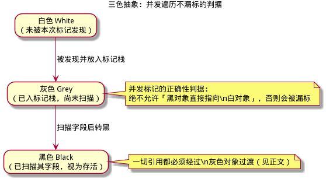
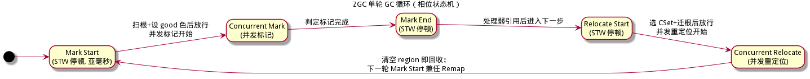
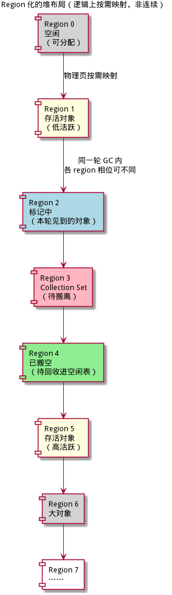
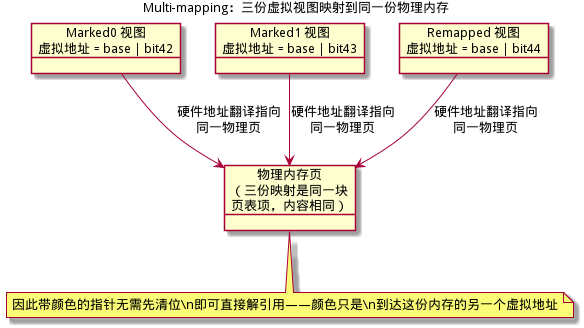
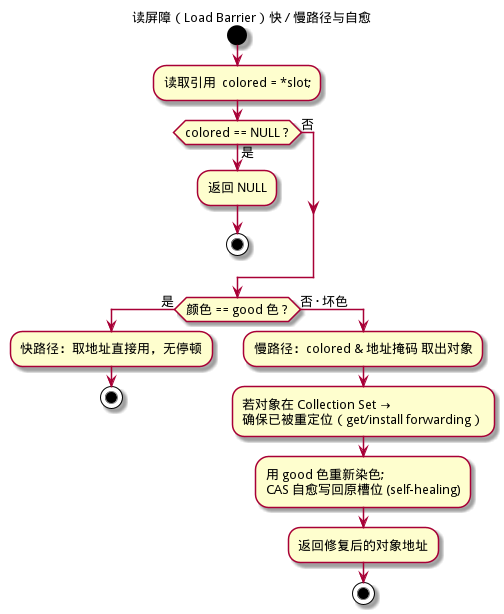
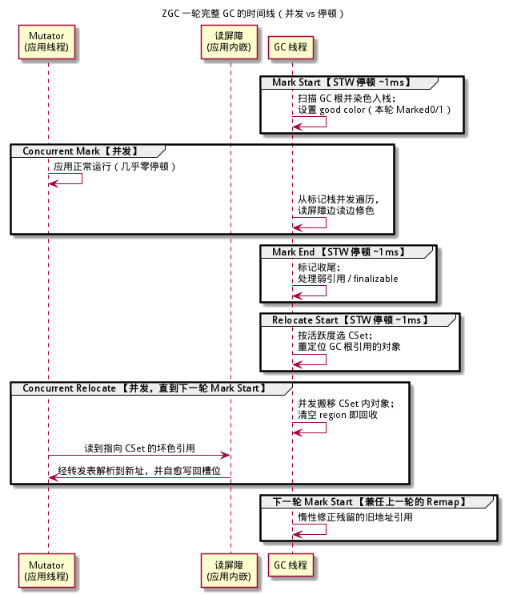
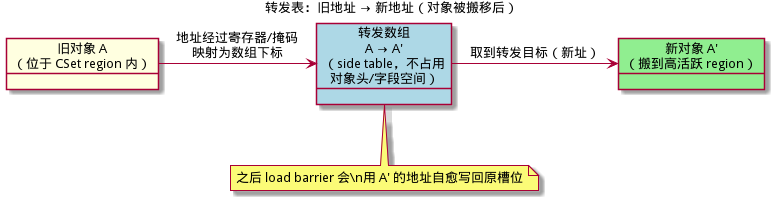

# ZGC 算法详解 —— 从零基础到能照着实现

> **面向读者**：完全没有 GC（垃圾回收）背景的开发者。本文从"内存为什么要回收"讲起，一路拆到 OpenJDK Z Garbage Collector（ZGC）的核心机制：染色指针、多映射、读屏障、并发标记与并发重定位。
> **目标**：读完并配合伪代码，你能独立实现一个 ZGC。文中所有示意图均由 PlantUML 生成，源文件在同目录 `figures/` 下（`.puml`）可复编译。
>
> **与 xgc 仓库的关系**：本文是"算法原理/教学"文档；xgc 自身的工程实现细则见
> [implementation-guide/20-并发重定位读屏障与指针染色.md](../implementation-guide/20-并发重定位读屏障与指针染色.md) 等系列文档。
> 本文的染色指针、读屏障设计与该文档完全同构，可互为佐证。

---

## 目录

1. [垃圾回收：为什么需要它](#1-垃圾回收为什么需要它)
2. [经典 GC 算法回顾（标记-清除 / 复制 / 整理）](#2-经典-gc-算法回顾)
3. [三色抽象：并发标记正确性的判据](#3-三色抽象并发标记正确性的判据)
4. [ZGC 是什么：定位、历史与目标](#4-zgc-是什么定位历史与目标)
5. [核心设计总览：把难题藏进指针](#5-核心设计总览把难题藏进指针)
6. [Region 化的堆布局](#6-region-化的堆布局)
7. [染色指针（Colored Pointers，三色指针）](#7-染色指针colored-pointers三色指针)
8. [多映射（Multi-mapping）：让彩色地址可直接解引用](#8-多映射multi-mapping让彩色地址可直接解引用)
9. [读屏障（Load Barrier）与自愈](#9-读屏障load-barrier与自愈)
10. [单轮 GC 完整流程（时间线）](#10-单轮-gc-完整流程时间线)
11. [并发标记详解](#11-并发标记详解)
12. [并发重定位与回收详解](#12-并发重定位与回收详解)
13. [为什么它是正确的：并发安全论证](#13-为什么它是正确的并发安全论证)
14. [从零实现一个 ZGC：最小可行路线](#14-从零实现一个-zgc最小可行路线)
15. [术语速查表](#15-术语速查表)
16. [延伸阅读与参考](#16-延伸阅读与参考)

---

## 1. 垃圾回收：为什么需要它

### 1.1 问题：堆内存谁负责清空

程序运行时要不断地创建对象（`new` 一个结构体、一个类实例）。这些对象被放在一片被叫做**堆（Heap）**的内存里。一个对象何时能销毁？答案是：**当它再也无法被程序访问到时**。

怎么判断"无法被访问"？从一组确定的入口，顺着对象里的引用一路走，凡是走得到的对象都是"活着的"；走不到的，就是垃圾。这一组入口叫做 **GC 根（GC Roots）**，例如：

- 线程栈上的局部变量、参数、返回地址处引用的对象；
- 全局/静态变量引用的对象；
- 当前正在执行的 CPU 寄存器里引用的对象；
- JNI / 宿主 VM 持有的对象引用。

所谓**可达（reachable）**，就是从某个根出发，通过一系列引用能到达的对象。**不可达（unreachable）**的即垃圾。

### 1.2 两个角色

| 角色 | 英文 | 干什么 |
|------|------|--------|
| 应用程序（用户代码） | **Mutator**（改变者） | 运行你的代码，不断创建、改写、读取对象 |
| 垃圾回收器 | **Collector**（收集器） | 找出并回收不可达对象，整理可用内存 |

GC 的本质就是：**在 Mutator 运行期间，识别并回收不可达对象，同时保证活对象的引用关系不被破坏。**

### 1.3 一个关键观察：停不停世界（STW）

最直接的做法是：GC 先**停下所有 Mutator**（让程序暂停，即 **STW = Stop-The-World 停止世界**），然后放心大胆地扫描、搬运、回收，因为程序暂停期间没人会改动对象。GC 结束后再恢复运行。

- 好处：简单、正确性容易保证。
- 坏处：**停顿**。程序被"冻结"的那段时间——对服务器是延迟尖峰，对交互系统是卡顿。
- 衡量指标：
  - **吞吐（Throughput）**：花在有用工作上的时间占比。
  - **延迟/停顿（Latency / Pause）**：单次 STW 停顿有多长，最大停顿是多少。
  - **Footprint（占用）**：GC 自身额外耗了多少内存。

GC 设计的核心矛盾，就是在这个三角形里做取舍。传统的 Serial/Parallel GC 追求吞吐，可以容忍很长的 STW（与堆大小成正比）；而 ZGC 追求的是**把停顿压到亚毫秒、且与堆大小无关**——这就是它最特别的地方。

---

## 2. 经典 GC 算法回顾

要理解 ZGC，必须先理解三种最基础的 GC 原型。它们解决"找出垃圾 + 回收内存 + 消除碎片"的问题，但策略不同。

### 2.1 标记-清除（Mark-Sweep）

两个阶段：
1. **标记（Mark）**：从根出发遍历，把所有可达对象"标记"出来（通常用一个 bitmap/位图）。
2. **清除（Sweep）**：线性扫描整个堆，把没标记的对象的内存回收进空闲列表。

优点：实现简单，不需要搬运对象。缺点：产生**碎片（fragmentation）**——空闲内存是一块块小洞，可能导致"明明总量够、却分配不出连续大块"。

### 2.2 复制收集 / 幸存者复制（Copying）

把堆分成两半（From / To）。回收时把 From 里活的对象**复制**到 To，然后整块 From 直接作为空闲空间。
优点：无碎片、分配极快（bump-the-pointer 指针递增分配）。缺点：**要移动对象**——移动后所有指向它的引用都得更新，这是后面一切复杂性的来源；且固定浪费一半空间（或分区式）。

### 2.3 标记-整理（Mark-Compact）

标记后，把活对象往堆的一段**压缩**，消除碎片。同样要移动对象、更新引用。优点是空间利用率高，缺点是移动成本高、往往停顿长。

### 2.4 关键结论

> 三种原型里，**复制**和**整理**都需要"移动对象 + 更新所有引用"。在 STW 下这很容易：程序停了，改引用没人看见。
> ZGC 的终极挑战是：**能不能在 Mutator 运行时（并发）移动对象，又不改错引用、又不丢更新？** 这正是染色指针 + 读屏障要解决的。

这段推理请反复读三遍，因为 ZGC 的一切都围绕它展开。

---

## 3. 三色抽象：并发标记正确性的判据

在进行任何"并发"标记前，我们必须先有一个判断"标记是否做对了"的标准。计算机科学家用**三色抽象（Tri-color Abstraction）**来描述遍历过程：

把对象分成三类集合：

| 颜色 | 含义 |
|------|------|
| **白（White）** | 本次标记**还没发现**它（可能存活也可能垃圾，尚未判定） |
| **灰（Grey）** | **已发现、但其字段还没扫描**（还在标记"待办"里） |
| **黑（Black）** | **已扫描完所有字段**，确定存活 |

遍历过程就是：白 → 灰（被发现，放进标记栈/工作队列）→ 黑（扫描完字段）。当没有灰色对象时，剩下的白色对象就是不可达的垃圾。



**并发标记的正确性判据（三色不变量）**：
> 在并发的任何时刻，不允许出现「**一个黑色对象直接引用一个白色对象**」——因为黑色对象"已经扫完了"，如果它指向的白色对象是活的，就永远不会再被发现，会被误当作垃圾回收掉，造成**漏标（对象被错误回收）→ 程序崩溃/数据损坏**。

因此并发标记要么保证"黑色→白色的边不会出现"，要么在它出现时（通过读屏障等）立即把白色变成灰色。ZGC 用**读屏障**在访问的那一刻完成这个补救。后面 §11、§13 会展开。

---

## 4. ZGC 是什么：定位、历史与目标

### 4.1 一句话

> **ZGC（Z Garbage Collector）** 是 OpenJDK 的一款**低延迟、region 化、并发**垃圾收集器：它把单次 GC 停顿压到**亚毫秒**（约 1ms 上下），并且**停顿时间与堆大小基本无关**——哪怕是几十 GB、甚至数 TB 的堆。

### 4.2 历史与版本

| 版本 | 说明 |
|------|------|
| JDK 11 | ZGC 作为实验特性引入（`-XX:+UnlockExperimentalVMOptions -XX:+UseZGC`） |
| JDK 15 | 转正，可用 `-XX:+UseZGC` 使用 |
| JDK 16 | 成为标准特性 |
| JDK 21 | 引入**分代 ZGC（Generational ZGC）**，生产可用 |

（JDK 21+ 还包含多分代内部优化，但本文讲的是 ZGC 最经典、最核心的**单代（统一）设计**——概念对分代依然成立，只是多了一层 young/old 的划分。）

### 4.3 目标：与堆大小解耦的停顿

传统 GC 的停顿往往跟存活对象数量/堆大小成正比（要扫的越多越久）。ZGC 的核心设计目标：

1. **停顿时间与堆大小无关**：STW 阶段只做"扫根、选集合、设色"这类**工作量固定**的事，而真正随堆大小增长的"标记、搬移"全部放到并发阶段。
2. **分配与 GC 并发完成**：不用停下来等待。
3. **超大堆（多 TB）也适用**。

### 4.4 与主流 GC 的对比

| 特性 | Parallel | G1 | Shenandoah | **ZGC** |
|------|----------|----|----|---------|
| 停顿 | 长（与堆成正比）| 中（region，目标化）| 亚毫秒级 | **亚毫秒级** |
| 并发标记 | ✗ | ✓ | ✓ | ✓ |
| 并发移动对象 | ✗ | 部分/STW | ✓ | ✓ |
| 移动后如何改引用 | — | 写屏障/卡表 | **Brooks 指针**(对象头间接层) | **染色指针 + 多映射 + 读屏障** |
| 无额外对象头开销 | — | 有 | 有(forwarding 槽) | **无（用指针高位）** |

**Shenandoah vs ZGC** 是理解 ZGC 最好的参照系：
- Shenandoah 在**对象头里放一个 forwarding 指针**，读对象前先解引用拿"当前真实地址"（Brooks 指针）。代价：每个对象多一个指针字段的内存，且每次读多一次间接。
- ZGC 则**不额外占用对象内存**，把状态直接编码进指针的未用高位（染色指针），再用"多映射"让带颜色的地址仍能直接访问同一物理内存。代价：依赖 64 位地址有足够富余的高位，且需要一个**读屏障**。

---

## 5. 核心设计总览：把难题藏进指针

ZGC 解决两大难题的思路，一句话概括：

> **把 GC 的状态（是否标记、是否已重映射）直接"染"进引用指针的高位（染色指针），再用读屏障在访问对象的那一刻、按颜色惰性地把引用修正为正确状态（自愈）。**

对应地，ZGC 有四大基石，缺一不可：

| 基石 | 解决什么 | 对应章节 |
|------|----------|----------|
| **Region 化堆** | 细粒度回收、按活跃度选搬哪些 | §6 |
| **染色指针（Colored Pointers）** | 让"标记/重映射状态"随引用走了，不用扫全堆 | §7 |
| **多映射（Multi-mapping）** | 带颜色的地址仍能直接解引用（否则每次访问都要清位） | §8 |
| **自愈读屏障（Self-Healing Load Barrier）** | 并发下访问对象时保证拿到"正确地址"，并顺手修好引用 | §9 |

四个基石合起来，支撑起"并发标记 + 并发重定位"这两个真功夫（§11、§12）。整体循环见下：



下一节开始逐个击破。

---

## 6. Region 化的堆布局

ZGC 把整个堆分成很多固定大小的**区（Region）**，例如 2 MB（可调整）。对象分配在某个 region 里，GC 以 region 为单位判断存活率、决定回收哪几块。



几个要点：
- **分配快**：region 被当作空闲块，分配就是"往当前 region 的指针递增（bump-the-pointer）"，快如复制收集。
- **按活跃度回收**：回收时不是整堆处理，而是挑出"垃圾最多（活跃度最低）"的 region 作为 **Collection Set（CSet，本轮要搬空的 region 集合）**，把里面还活着的对象搬到别处，然后整块 region 归还空闲表。
- **物理页按需映射**：region 并不是一次性占满物理内存，而是逻辑地址上预留，用到才映射物理页（这也便于后面的多映射）。

> 你可以把 region 想象成"集装箱"：GC 只处理装满垃圾的集装箱，把里面仅剩的几个好箱子搬到新集装箱，再把空箱回收。

---

## 7. 染色指针（Colored Pointers，三色指针）

### 7.1 为什么叫"染色指针"

64 位机器上，一个程序能用到的用户态地址通常只占低 48 位（甚至更少），高 16 位常年空闲、不会被用作地址。ZGC 的想法：**把这几个高位拿来做 GC 元数据**——对象被"染上"颜色，颜色就藏在指向它的引用指针里。

这样一来，**"对象是否被标记过"不再需要单独的标记表**，标记信息跟着引用走；判断一个对象是死是活，看一眼引用指针的颜色就知道了。

### 7.2 位布局

给出一种示意布局（低位 0 是对象地址，高位是 4 个元数据/颜色位）：


对应概念：

| 位 | 名称 | 含义 |
|----|------|------|
| 41 … 0 | 对象地址 | 堆内偏移；在此例中堆上限约 4TB |
| 42 | **Marked0** | 本对象在"**偶数轮**"GC 中被标记过 |
| 43 | **Marked1** | 本对象在"**奇数轮**"GC 中被标记过 |
| 44 | **Remapped** | 本对象**已被重定位/搬移**，地址是最终地址 |
| 45 | **Finalizable** | 本对象只被"终结器（finalization）"可达，特殊处理 |

> **注意**：具体用哪几个位、堆用多少位，随平台和 JDK 版本而变，但概念完全一致。你实现时可以自定，只要保证地址位够用、元数据位被 CPU 忽略即可。**请勿照抄具体位号**——抄概念、定自己的位。

### 7.3 为什么 Marked0 和 Marked1 要两套：省掉"每轮清标记"

假设只有一个标记位：本轮标记后，下一轮想重新标记，必须先**把全堆所有对象的标记位清掉**——这是 O(堆大小) 的工作，昂贵且要碰所有对象。

ZGC 用**两个标记位交替**化解：第 N 轮用 Marked0 当本次的"好标记色"，第 N+1 轮用 Marked1，如此往复。

- 第 N 轮标记时，引用染上 Marked0；第 N+1 轮开始时，"本次的好标记色"变成 Marked1。
- 于是**不需要清任何东西**：上一轮不是 Marked1 的对象，天然算"本轮还没标记"；本轮标记过、应存活的，自然带 Marked1。
- 换色成本是 O(1)（改一个全局变量），而不是 O(堆)。

### 7.4 好色 / 坏色（Good / Bad Color）

GC 在每次阶段切换时更新一个全局"好色（good color）"变量，它编码了**当前阶段下"合法/顺手"的指针颜色组合**。读屏障拿引用颜色跟它一比：

- **好色（good）** → 快路径，直接用，什么也不做。
- **坏色（bad）** → 慢路径，进入读屏障做修正（标记/转发/换色），修正完再把好色写回引用（自愈）。

"好色"具体是什么，取决于当前相位——这正是后面并发标记、并发重定位正确的关键。举个最典型的例子：
> 一轮 GC 的 Mark Start，好色设为 `Marked0 | Remapped`。意思是：一个引用，只要是"本轮已标记(Marked0)"或"已是最终地址(Remapped)"，就是好的；否则（还是旧的 Marked1 或未处理）就是坏的，读屏障会帮它转正。

---

## 8. 多映射（Multi-mapping）：让彩色地址可直接解引用

### 8.1 不解决的麻烦

如果指针是"地址 + 高位染了色"，那 CPU 去取内存时，高位并不参与真正的地址计算——正常情况下直接 `addr & 掩码` 就能取。但这样**每次访问都要先清位**，快路径就不快了。

ZGC 的妙招是 **Multi-mapping（多映射）**：**把同一块物理内存，映射到 3 个不同的虚拟地址**，每个虚拟地址恰好对应染上不同颜色位。于是：

- `物理页 X` 同时映射为：
  - 虚拟地址 `base`（无色/Remapped 视图）
  - 虚拟地址 `base | bit42`（Marked0 视图）
  - 虚拟地址 `base | bit43`（Marked1 视图）

如图所示：



### 8.2 为什么这就够神奇

因为三份映射是**同一块物理页**，所以：
- 你用一个"染了 Marked0 色"的地址去解引用，CPU 的虚拟地址翻译会把你带到**同一份物理内存**。
- 因此**带颜色的指针无需清位就能直接访问对象**——颜色只是到达同一内存的另一个虚拟地址而已。
- 而"颜色/被标记/被重映射"这个信息，又完整保留在高位里，读屏障可以**零额外成本**地检查。

> 一句话：**多映射让"染色"与"可访问"不冲突**——指针既能读又能检查状态，快路径几乎零开销（只需一次位比较 + 条件分支）。

### 8.3 硬件助力（可选读）

在支持 **AArch64 Top-Byte-Ignore（TBI）** 的平台上，CPU 会自动忽略地址的高 8 位，染色指针可以直接解引用而无需手工处理，读屏障成本进一步降低。x86-64 上则通常用未使用的高位 + 单条指令完成颜色判断。理解这些能帮助你调优，但不是理解算法的前提。

---

## 9. 读屏障（Load Barrier）与自愈

### 9.1 为什么要有读屏障

读屏障就是"每次读引用（读一个对象的某个字段、或从根取引用）时自动插入的一段检查代码"。它的职责：**保证你取到的对象地址一定是"当前正确副本"，并在必要时修好槽位引用。**

- 标记阶段读屏障用于"把访问到的引用染成本轮好色（顺便标记）"——支撑并发标记，避免 §3 的漏标。
- 重定位阶段读屏障用于"遇到指向 CSet 里的旧地址时，转发到新地址"——支撑并发搬移。
- 自愈（Self-Healing）：读完顺手把**修正后的好色写回原槽位**，这样下次再读就变成快路径，一条引用只亏一次。

### 9.2 快路径 / 慢路径



**快路径**（绝大部分访问命中，会被 JIT 编译内联成几条指令）：

```
v = *slot;                 // 读引用
if (v == NULL) return NULL;
if (颜色(v) == good) return 地址(v);   // 位比较 + 条件分支
else 走慢路径;
```

**慢路径**（稀有，外部函数调用）：

```
obj = v & 地址掩码;                  // 取出真实对象
if (obj 在本轮 CSet 内) obj = forward(obj);   // 还没搬就现在搬/取转发
healed = obj | good;                 // 重新染上好色
CAS(slot, v, healed);                // 自愈写回，避免覆盖别人的新值
return obj;
```

### 9.3 自愈的成本分摊思想

自愈的美妙之处在于**把"扫全堆改引用"的 O(堆) 工作，换成一笔笔懒洋洋、被首次访问触发、并发的 O(1) 修正**：

- 谁先读到坏引用，谁负责修好；修好之后，这条引用永远走快路径。
- 于是重定位后**不需要一次性 STW 扫描全堆更新引用**——引用是在 Mutator 自然而然访问它们的过程中被逐个修正的。

这彻底改写了"移动对象后必须全局改引用"的传统约束。

---

## 10. 单轮 GC 完整流程（时间线）

把上面的机制拼起来，一轮完整的 ZGC GC 包含 5 个相位、其中 3 个是极短的 STW 停顿（每个都在亚毫秒量级），剩下的并发跑。



| 相位 | 停不停 | 干什么 | 为什么停顿很短 |
|------|--------|--------|----------------|
| **Mark Start** | STW | 设置本轮好色（Marked0/1 交替）；扫描 GC 根，把根引用的对象染上好色并入标记栈 | 只扫根，工作量不随堆大小 |
| **Concurrent Mark** | 并发 | 从标记栈出发，配合读屏障并发遍历、标记所有可达对象 | 全在后台，Mutator 不停 |
| **Mark End** | STW | 标记收尾；判定无灰色对象；处理弱引用 / finalizable | 少量收尾工作 |
| **Relocate Start** | STW | 按活跃度选 CSet；**重定位 GC 根直接引用的对象**（确保 Mutator 从根出发即指向新址） | 只处理根和选集合，固定开销 |
| **Concurrent Relocate** | 并发 | 并发搬移 CSet 内活对象；清空的 region 归还空闲表；Mutator 经读屏障按需转发+自愈 | 全在后台 |
| **（下一轮 Mark Start）** | STW | **兼任上一轮的 Remap**：残留的旧地址引用在下次标记时被读屏障惰性修正 | 复用而非新增停顿 |

关于"Remap（重映射）"要特别说明：
> ZGC 搬完对象后，**没有**一个专门的"全堆扫描更新引用"的 Remap 阶段。它把 Remap **推迟**到了下一轮 GC 的标记阶段，以让读屏障在访问时惰性完成。这是"少一次全堆 STW"的关键设计。

---

## 11. 并发标记详解

### 11.1 它怎么工作

1. **Mark Start（STW）**：全局好色切到本轮的标记位（偶数轮 Marked0 / 奇数轮 Marked1）。用该色染根引用的对象并入**标记栈（mark stack）**。
2. **Concurrent Mark（并发）**：多个 GC 线程从标记栈取"灰对象"，逐个扫描其字段：
   - 每个字段引用读出来时，都会过读屏障；
   - 若是"坏色"（本轮还没标记），读屏障把它**染成本轮好色（Marked0/1）**——这一步的染色即是"标记"，同时压回标记栈继续扫；
   - 所有字段扫完，该对象变"黑"。
3. **终止检测**：当标记栈空、且并发 Mutator 不再往栈里"长出新灰对象"时，标记终止（Mark End）。弱引用、终结器在此收尾。

### 11.2 为什么用读屏障而不是写屏障

- 写屏障（store barrier）在"写引用"时触发，标记类 GC 常用它维护卡表（记录跨区引用）。
- ZGC 的并发标记用**读屏障**：因为**任何对活对象的访问，最终都会经过一次读引用**；读屏障在"读到"的那一刻就能保证"这一轮被看见的对象一定染成好色、不会漏"。这天然满足 §3 的"黑→白"不可出现不变量（白在被读时变成灰）。

### 11.3 标记信息为什么不需要"清场"

因为标记是**编码在引用指针的颜色里**的（§7.3）：本轮只认本轮的好标记色。上一轮用另一个色标记过的对象，本轮天然不算"已标记"，无需任何清零操作。而**不可达对象本来就没有引用指向它**，颜色无所谓——也就无从谈起"清它"。

---

## 12. 并发重定位与回收详解

### 12.1 Collection Set 的选取

在 Mark End 得到各 region 的存活率后，Relocate Start 选出**活跃度最低**的若干 region 组成 CSet。目标：**用最少的搬移，释放最多的空 region**。（ZGC 用一张按对象记录的存活 bitmap 辅助判断哪些对象活着、该搬到哪。）

### 12.2 先搬根，再惰性搬

- **Relocate Start（STW）**：先把**根直接引用的、位于 CSet 内的对象**搬掉，并把根引用更新为新址。这样 Mutator 从根出发不会再一头撞进旧地址。
- **Concurrent Relocate（并发）**：GC 线程继续搬 CSet 里其余对象。用一张 **转发表（forwarding table）** 记录"旧地址 → 新地址"：



### 12.3 Mutator 碰到旧地址怎么办（读屏障接管）

Mutator 访问某个还在 CSet、尚未搬的对象时：

1. 读到引用，发现颜色是"坏色"（指向 CSet 的旧地址），触发读屏障慢路径；
2. 读屏障查转发表：如果对象已被搬走，直接拿到新地址；如果还没搬，立刻由当前线程补搬一次，并安装转发记录（用 CAS 保证多线程并发搬同一对象时只有一个赢）;
3. 读屏障把新地址 + 好色**自愈写回**原槽位，以后都走快路径；
4. 返回新地址给 Mutator。

### 12.4 Region 回收

一个 CSet region 内所有活对象都搬完、且没有任何引用还指向它后，整块 region 归还**空闲 region 列表**，供后续分配复用。Region 是被"整块"归还的，因此**无碎片**，分配地址连续。

### 12.5 总结：Congruent 的收益

- 搬移工作被摊到整个并发周期，而不是瞬时的全堆停顿；
- 引用修正靠读屏障自愈，懒得出奇、分摊成本低；
- 回收单位是整块 region，天然紧凑、无碎片。

---

## 13. 为什么它是正确的：并发安全论证

### 13.1 并发标记为何不漏（三色不变量）

ZGC 用读屏障保证：**Mutator 任何时刻读到一个"本轮未标记"（白色→其实是未染本轮色）的对象，读屏障都会立刻给它染上本轮好色（变灰）并压栈**。于是永远不会出现"一个黑对象指向仍为白的对象而且永远不被发现"——因为能指向它的黑对象去读它的那一瞬，它就已经变灰了。

### 13.2 并发搬移为何不丢写

搬移期间，任何对旧地址的读，都会经读屏障转到新地址（转发/自愈），Mutator 始终操作"唯一权威副本"。多线程并发搬同一对象时用 CAS 安装转发表，保证只有一份成功、其余都拿到同一新址，不会出现"两个线程各搬一份、各写各的"的错乱。

### 13.3 一个常见误区

> 误区："ZGC 停顿为零。"
> 正解：ZGC 的停顿是**亚毫秒、且与堆大小无关**，但并**不是零**——它仍有三处极短 STW（Mark Start / Mark End / Relocate Start）。它的卖点是"停顿小且恒定"，不是"没有停顿"。

---

## 14. 从零实现一个 ZGC：最小可行路线

> 目标：不要一上来就挑战并发。按下面顺序，每一步的产物都能跑、可测、可交付，再逐步替换。

### 第 0 步：保证"精确根 + 精确引用"前提

ZGC 的一切都要求**精确式 GC**：运行时必须确切知道"哪里是引用（GC 根、对象字段），哪里不是"，才能安全地染色、搬移。这是硬前提：
- 能枚举线程栈/全局/寄存器里的根；
- 能从对象元数据知道它的哪些字段是指针；
- 最好有 JIT 能内联读屏障（初级实现可以先不内联，用函数调用顶着，慢但正确）。

### 第 1 步：先实现一个 STW 的 mark-sweep

- 从根做可达性遍历、bitmap 标记、扫堆清除。
- 验收：能跑通"创建对象→切断引用→回收→地址复用"的最小用例；配合 ASan 无内存错误。
- 这一步的目的：把根、bitmap、遍历这些基础打扎实。**不要跳过。**

### 第 2 步：实现 region 化的 mark-copy（STW 搬移）

- 把堆改成 region；回收时把 CSet 里的活对象复制到别的 region，用转发表把旧引用改到新址（STW 下直接全堆改，简单）。
- 验收：无碎片、能整块还 region。
- 这一步让你掌握"搬移 + 转发表 + 引用更新"，但还不用并发。

### 第 3 步：染色指针 + 多映射

- 在 64 位平台上预留高位，实现 `address(ptr)` 与 `color(ptr)` 两个原语；
- 把同一物理页映射到 3 个不同虚拟地址（`mmap` + 分别 `MAP_FIXED` 到不同高位）;
- 用一个小测试证明"染了色的地址解引用 == 无色的地址"。
- 验收：`read` 无色的地址与染 Marked0 色的地址，得到相同内存内容。

### 第 4 步：并发标记（读屏障染色）

- 用两个标记位交替当"本轮好色"；
- Mark Start（STW）扫根入栈并设好色；GC 线程并发出栈扫描；读屏障在 Mutator 读取时把坏色染成好色；
- 终止判定用计数器/时代（epoch），处理并发 Mutator 仍往栈加灰对象的"重标记"。
- 验收：压测下（大量并发读写、反复触发 GC），用 address sanitizer + 强校验（对象一致性、引用完整性）确保零误回收。

### 第 5 步：并发重定位（转发 + 自愈读屏障）

- Relocate Start（STW）选 CSet、搬根；
- 并发搬 CSet 对象，安装转发表（CAS）；
- 读屏障慢路径：遇坏色→查/补转发→自愈写回；
- 清空 region 归还空闲表；下一轮 Mark Start 兼任 Remap。
- 验收：持续高并发下长时间运行，最终堆内所有引用自洽、无旧地址残留、无数据竞争（用 TSan 把关，参见仓库
  [implementation-guide/17-正确性验证与压力测试.md](../implementation-guide/17-正确性验证与压力测试.md)）。

### 关键数据结构（伪代码速览）

```c
// 指针原语
#define ADDR_MASK  ((1ULL<<42)-1)
uintptr_t address(uintptr_t coloured){ return coloured & ADDR_MASK; }
uintptr_t colour  (uintptr_t coloured){ return coloured & ~ADDR_MASK; }
uintptr_t good;                    // 全局好色，相位切换时更新

// 读屏障（快路径由 JIT 内联）
void* load_ref(void** slot){
  uintptr_t v = (uintptr_t)*slot;
  if (v == 0) return NULL;
  if ((v & ~ADDR_MASK) == good) return (void*)address(v);
  return slow_slot(slot, v);
}

// 转发表：旧址 -> 新址（side table）
forwarding_t* forward_table[ /*region数*/ ];
```

### 测试与验证策略（必须做）

- **差分测试**：与一个简单可靠的"影子 GC/标记"比对存活集，任何不一致即 bug。
- **压力/随机图**：随机建/断引用、随机触发 GC，配合并发线程。
- **Sanitizer**：ASan（内存）/ TSan（数据竞争）/ UBSan。参见
  [implementation-guide/16-并发正确性与内存模型.md](../implementation-guide/16-并发正确性与内存模型.md)。

---

## 15. 术语速查表

| 术语 | 含义 |
|------|------|
| Mutator | 应用程序线程（改变堆的人） |
| Collector | 垃圾回收线程 |
| STW（Stop-The-World） | 停止世界，暂停所有 Mutator 的停顿 |
| 根（Roots） | 栈/全局/寄存器等可达性入口 |
| Region / CSet | 堆的分区 / 本轮选定要搬空的 region 集合 |
| 染色指针（Colored Pointer） | 把 GC 元数据编码进指针高位的引用 |
| 三色（Tri-color） | 白/灰/黑，描述遍历进度与不变量 |
| 多映射（Multi-mapping） | 同一物理内存映射到多个虚拟地址 |
| 好色 / 坏色 | 当前相位合法 / 需修正的指针颜色 |
| 读屏障（Load Barrier） | 读引用时插入的检查，ZGC 用它标记与转发 |
| 自愈（Self-Healing） | 读屏障把修正后的好色写回原槽位 |
| Marked0/1 | 交替使用的两个标记位，避免每轮清标记 |
| Remapped | 已重定位的标记位 |
| 转发表（Forwarding） | 旧地址 → 新地址的映射 |
| Remap | 重定位后更新引用；ZGC 惰性并入下一轮标记 |

---

## 16. 延伸阅读与参考

- **仓库内（xgc）**：
  - `implementation-guide/20-并发重定位读屏障与指针染色.md`：与本文同构的工程实现细则；
  - `implementation-guide/16-并发正确性与内存模型.md`：并发正确性与内存模型；
  - `implementation-guide/05-算法实现详解.md`：算法伪代码与陷阱；
  - `implementation-guide/22-术语表与FAQ.md`：FAQ。
- **OpenJDK**：`-XX:+UseZGC`，ZGC 源码在 `hotspot/src/hotspot/share/gc/z/`；
- **JEP**：JEP 333（引入）、JEP 377（转正）、JEP 439（分代 ZGC）；
- **经典讲解**：可检索 "ZGC 彩色指针 / multi-mapping / self-healing load barrier" 相关论文与博客，概念一致。

> 附图源文件均在 `figures/` 下，修改 `.puml` 后可用 `plantuml -tpng x.puml` 重新生成。唯一需要留意的是中文渲染字体（本仓库使用 WenQuanYi Micro Hei）。
